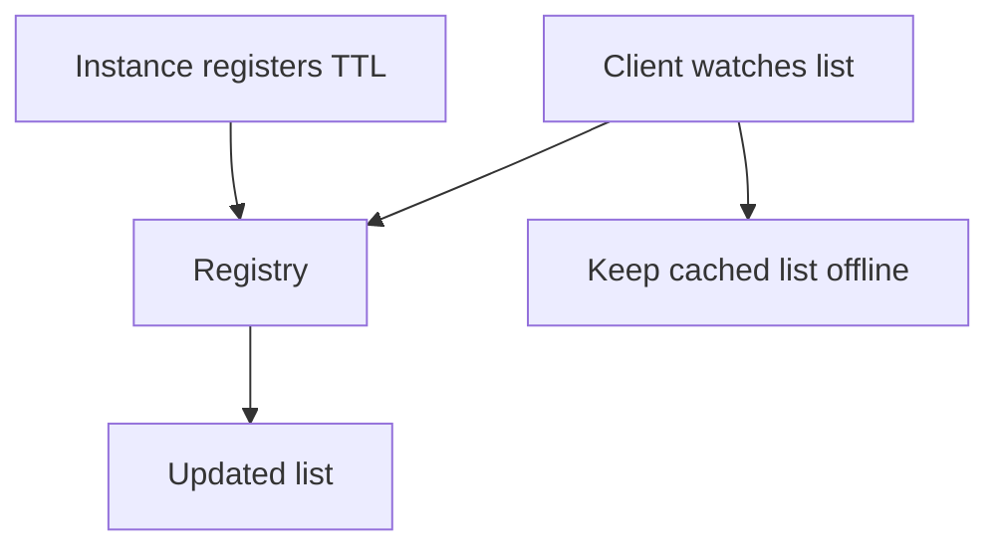

Load balancing assumes a list of backends. Producing that list, keeping it
current, and handling the window in which it is wrong is service discovery. The
window is unavoidable — the question is only which direction you would rather be
wrong in.

> [!WHY] Zone-local routing sends customers in zone A to its two backends while zone B’s ten backends sit idle; A overloads and users pay for the uneven routing.

> [!GOALS]
>
> - Compare the user cost of a stale dead backend with the capacity cost of a missing live backend.
> - Choose capacity-aware zone routing when local backend counts differ.
> - Explain why clients need cached state, retries and fast removal.


## The two directions of staleness

```text
  STALE: contains a DEAD backend        STALE: missing a LIVE backend

  requests fail until it is removed     capacity sits idle
  → user-visible errors                 → no user impact

  mitigate: retry on another backend    mitigate: nothing needed
            + passive outlier ejection
```

The asymmetry is the design principle. **Be fast to remove and slow to add.**
Aggressive removal costs a little capacity; slow removal costs errors. And
because removal will still never be instant, the client must be able to survive
sending to a dead address — which means retries and outlier ejection are part of
discovery's correctness, not an optional extra.

## Registration models

```text
  SELF-REGISTRATION            THIRD-PARTY REGISTRATION

  the instance registers        the platform observes the instance
  itself on startup and         and registers on its behalf
  heartbeats

  - application code            + no application code
  - a wedged-but-alive          + the platform's view of health is
    process keeps                 authoritative
    heartbeating                + deregistration on crash is reliable
  + no platform dependency      - tied to the platform
```

**Third-party registration is better where available** — Kubernetes endpoints, a
service mesh, a cloud provider's target groups — for the reason in the second
row. A process that is wedged but still running its heartbeat thread is exactly
the failure that self-registration cannot detect, and it is a common one: a
thread pool exhausted, an event loop blocked, a deadlock in the request path
while the health thread runs happily.

## Propagation

```text
  POLL                              WATCH / PUSH

  clients refresh every N seconds   the registry pushes changes
  staleness up to N                 staleness in milliseconds
  load ∝ clients × frequency        load only on change
  trivially robust                  needs reconnection handling
```

Watch where available, and on reconnect **re-read the full list** rather than
assuming continuity — a client that missed a deregistration while disconnected
will keep sending to a dead instance indefinitely otherwise.

Whichever you use, **cache the last known good list and keep using it when the
registry is unreachable.** A discovery outage should not take down the services
that already know where each other are. This is the same principle as
configuration: coordination is needed to *change* the view, not to keep operating
on it.



## What a registration should carry

More than an address, if the balancer is to make good decisions:

```json
{
  "service": "orders",
  "address": "10.4.2.17:8080",
  "healthy": true,
  "zone": "us-east-1a",
  "version": "3.14.1",
  "weight": 100,
  "protocol": "grpc",
  "started_at": "2026-09-02T10:14:33Z"
}
```

- **`zone`** enables zone-aware routing — keep traffic within an availability
  zone to avoid cross-zone latency and, on most clouds, cross-zone data charges.
  This is frequently a large and unnoticed cost line.
- **`version`** enables canary routing and lets you shift traffic by version
  rather than by instance.
- **`weight`** enables slow start and heterogeneous capacity.
- **`started_at`** lets the client apply slow start without the registry needing
  to model it.

## Zone-aware routing, and its trap

```text
  PREFER LOCAL ZONE
    client in us-east-1a → backends in us-east-1a
    fall back to other zones only if local capacity is insufficient

  + lower latency, no cross-zone data transfer cost
  - if zone A has 2 backends and zone B has 10, A's clients
    overload A's backends while B idles
```

Zone-aware routing needs **capacity awareness**, not just preference: send the
local zone its proportional share and spill the remainder. Envoy's zone-aware
routing does this arithmetic; a naive "prefer local" implementation does not, and
produces exactly the imbalance above after an autoscaler makes zones uneven.

## Failure modes worth naming

**The registry is a single point of failure.** Everything depends on it. Cache
aggressively, degrade to the cache, and make sure the registry itself is
replicated.

**A wedged instance keeps heartbeating.** Self-registration's characteristic
failure. Prefer platform registration, or make the heartbeat depend on the same
resources real requests use (touch the connection pool, not just the clock).

**A thundering herd on registry recovery.** Every client rediscovers at once when
the registry returns. Stagger with jitter.

**Removed instances that keep running.** A pod removed from the registry but not
killed may still be reachable by clients with stale lists, or by anything that
addresses it directly. Deregistration must be paired with actually stopping the
process.

**DNS caching, again.** If discovery is via DNS, verify the runtime's caching
behaviour explicitly. This one is worth a test, not an assumption.

## The minimum viable design

If you are building rather than adopting:

```text
  □  platform-driven registration where possible
  □  watch-based propagation, with a full re-read on reconnect
  □  a locally cached list that survives registry unavailability
  □  metadata: zone, version, weight
  □  fast removal, slow addition (slow start)
  □  retries to a different backend, plus outlier ejection
  □  a minimum-healthy threshold so an empty pool never happens
```

The last three lines are what make the unavoidable staleness survivable, and they
matter more than the discovery mechanism itself.

> [!CHECK] Which direction of stale discovery is user-visible, and what is the recommended response?
>
> A stale list containing a dead backend causes request errors. Retry on a different backend and use passive outlier ejection; a stale list missing a live backend mainly wastes capacity.

> [!CHECK] Why should a client re-read the full list when a watch reconnects?
>
> It may have missed a deregistration while disconnected. Re-reading prevents it from continuing to send requests to an instance that was removed.

## What to take away

1. Staleness is unavoidable in both directions; a stale-dead entry causes errors
   and a stale-missing one costs only capacity, so be fast to remove and slow to
   add.
2. Third-party (platform) registration beats self-registration, because a wedged
   process keeps heartbeating.
3. Watch rather than poll, re-read fully on reconnect, and keep serving from a
   cached list when the registry is unreachable.
4. Carry zone, version, weight and start time in the registration — they enable
   zone-aware routing, canaries and slow start.
5. Zone-aware routing needs capacity arithmetic, not just preference, or uneven
   zones overload the small one.
6. Retries to a different backend plus outlier ejection are what make discovery
   staleness survivable, and matter more than the mechanism.

Next: traffic management — using all of this deliberately, to release safely.


## Exercises

> [!EXERCISE recall] What should a client do when the registry becomes unreachable after it has learned a backend list?
>
> **Solution:** Cache the last known good list and keep using it. A registry outage should not take down services that already know where each other are.

> [!EXERCISE apply] Zone A has two backends and zone B has ten. The router currently always prefers the local zone. What routing policy should replace that rule when local capacity is insufficient?
>
> **Solution:** Use capacity-aware zone routing: give each zone its proportional share and spill the remainder when local capacity is insufficient. A naive local preference overloads A while B idles.

> [!EXERCISE stretch] A team proposes always preferring the local zone to avoid cross-zone latency and data charges. Recommend a safer policy and name what the local-only answer misses.
>
> **Solution:** Keep local-zone preference but make it capacity-aware: send the local zone its proportional share and spill the remainder. The local-only answer misses uneven zone capacity; with two backends in A and ten in B, A can overload while B is idle.
