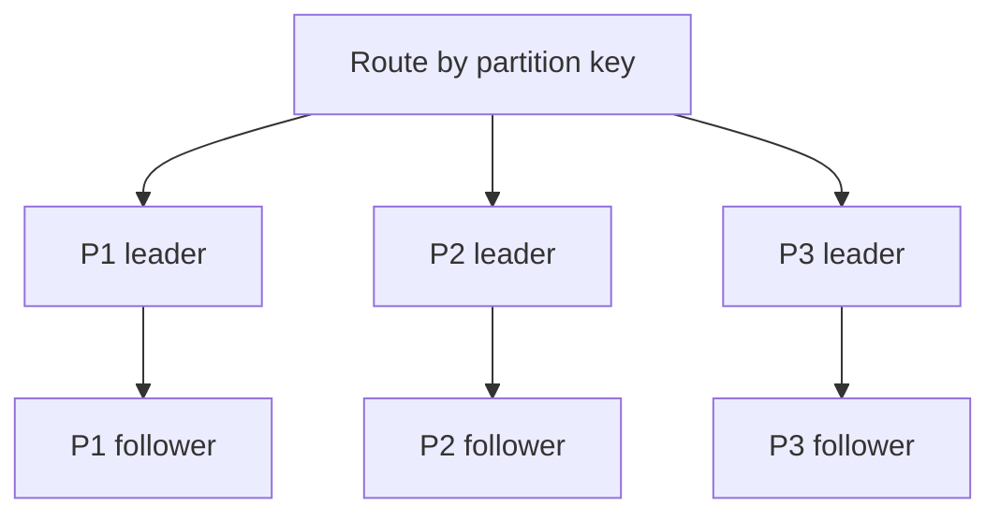

Replication makes copies. Partitioning makes pieces. They solve different
problems, they compose, and confusing them leads to a system that scales reads
beautifully and then falls over on writes.

```text
  REPLICATION                        PARTITIONING (sharding)
  ───────────                        ───────────────────────

  ┌─────┐  ┌─────┐  ┌─────┐          ┌─────┐  ┌─────┐  ┌─────┐
  │ ALL │  │ ALL │  │ ALL │          │ A–H │  │ I–P │  │ Q–Z │
  └─────┘  └─────┘  └─────┘          └─────┘  └─────┘  └─────┘

  every node has everything          each node has a slice
  scales READS                       scales WRITES and STORAGE
  survives node loss                 node loss = that slice is GONE
```

The critical asymmetry: replication scales reads because any replica can answer;
it does **not** scale writes, because every replica must apply every write. Ten
replicas do ten times the write work to serve the same write throughput.
Partitioning is the only thing that scales writes, because each partition handles
a disjoint subset of them.

And partitioning alone is fragile: lose a node and that shard's data is gone. So
real systems do both.

```text
  6 nodes, 3 partitions, 2 replicas each

  ┌──────────┬──────────┬──────────┐
  │  P1 (L)  │  P2 (L)  │  P3 (L)  │   ← leaders spread across nodes
  ├──────────┼──────────┼──────────┤
  │  P1 (F)  │  P2 (F)  │  P3 (F)  │   ← followers on different nodes
  └──────────┴──────────┴──────────┘
     node 1     node 2     node 3
     node 4     node 5     node 6

  each node leads one partition and follows another —
  so read and write load is spread, and no node is idle
```



Note that leadership is spread deliberately. A naive layout that puts all leaders
on one node gives you the write bottleneck back.

> [!WHY] A read replica brought the dashboard under its latency target, but the write leader is still saturated and the data no longer fits on one disk. The team is considering sharding; choosing the wrong partition key would turn ordinary queries and transactions into cluster-wide work.

> [!GOALS]
>
> - Distinguish the capacity problems replication and partitioning solve
> - Choose a partitioning trigger and key from workload and access patterns
> - Explain the query, transaction and operational costs partitioning adds

## When to partition

Partitioning is a large, mostly irreversible complexity increase. The honest
triggers:

**1. Data exceeds one machine's storage.** The clearest signal.

**2. Write throughput exceeds one leader.** Note _write_ — read pressure is
solved by replicas, and often by a cache before that.

**3. Working set exceeds memory.** Once the hot data does not fit in RAM, every
read becomes a disk read and latency degrades sharply. Splitting the data means
each node's slice fits again.

**4. Blast radius.** Partitioning by tenant means one tenant's problem is
confined to one shard. This is a legitimate reason on its own, independent of
scale.

And the things to do first, because they are cheaper and often sufficient:
indexes, caching, read replicas, archiving cold data, and a bigger machine. All
of these are reversible; sharding is not, in practice.

## What you give up

The costs are specific and worth knowing before committing.

> [!KEY] **Cross-partition queries become fan-out.** A query that cannot be answered by
> one partition must ask all of them and merge:

```text
  SELECT * FROM orders WHERE user_id = 7        ← partitioned by user_id
    → 1 partition. fast.

  SELECT * FROM orders WHERE status = 'pending' ← not the partition key
    → ALL partitions. slowest one determines the latency.
      and the tail-latency amplification from the fundamentals topic
      applies in full.
```

**Transactions across partitions need two-phase commit or a saga.** A single-node
transaction is cheap; a distributed one is an order of magnitude more expensive
and introduces a coordinator that can fail mid-decision.

**Joins get hard.** Joining two tables partitioned by different keys means moving
data between nodes. The usual answers are denormalisation, or co-partitioning —
partitioning both tables by the same key so related rows live together.

**Global constraints get hard.** Uniqueness on a non-partition-key column cannot
be enforced locally, for the same reason it could not in multi-leader
replication.

**Rebalancing is an operational project.** Adding capacity means moving data
while serving traffic.

## Choosing the partition key

This is the single most consequential decision, it is very expensive to change,
and it should be made from the _access patterns_, not from the data model.

The criteria, in order:

**1. High cardinality.** The key must have enough distinct values to spread
across partitions. Partitioning by `country` when 60% of users are in one country
guarantees skew.

**2. Even distribution.** Both of data volume and of request rate — and these can
differ. A key that distributes rows evenly may still concentrate _traffic_ on one
value.

**3. Present in the common queries.** If the hot query does not include the
partition key, every hot query is a fan-out and you have gained nothing.

**4. Aligned with transaction boundaries.** Operations that must be atomic should
land in one partition. Partitioning by `user_id` means a user's own data is
transactional; partitioning the same data by `created_date` means it is not.

```text
  Good keys                     Poor keys
  ─────────                     ─────────
  user_id                       country       (low cardinality, skewed)
  tenant_id                     status        (very low cardinality)
  order_id                      created_date  (all writes hit today's
  device_id                                    partition — a moving hotspot)
  hash(email)                   boolean flags
```

The `created_date` case is worth calling out because it looks reasonable and is a
classic mistake. Time-based partitioning puts **all current writes on one
partition** — the one for today — while every historical partition sits idle. It
is right for time-series data you write once and query by range, and wrong for
an operational table.

## The composite key trick

When one key does not satisfy every criterion, combine two:

```text
  partition key: tenant_id           ← determines the partition
  sort key:      created_at          ← ordering WITHIN the partition

  → "all events for tenant X between two dates" hits one partition
    and reads a contiguous range within it
```

This is DynamoDB's model made explicit, and Cassandra's partition key plus
clustering columns are the same idea. It is worth reaching for because it gives
you locality _and_ range queries, which single-column partitioning cannot.

## An honest look at the alternative

Before committing, price the boring option:

```text
  Sharding a Postgres database
    - application changes for routing
    - cross-shard query layer
    - distributed transaction strategy
    - rebalancing tooling and runbooks
    - per-shard monitoring, backup, failover
    - permanent tax on every future feature
  → quarters of engineering time, and it never goes away

  Moving to a machine with 2 TB of RAM and 128 cores
    - a maintenance window
  → a credit card transaction
```

Vertical scaling ends eventually, and when it does the sharding project is
unavoidable. But it ends much later than most teams assume, and the year you buy
by scaling up is a year you spend on the product instead. The engineering
judgement is knowing where you actually are on that curve — which requires
measuring, not estimating.

> [!CHECK] Why do ten replicas not provide ten times the write throughput?
>
> Every replica applies every write, so ten replicas perform ten copies of
> the same write work. Partitioning instead assigns disjoint writes to
> different owners; replicating each partition then adds fault tolerance.

> [!CHECK] Which query is local when orders are partitioned by user_id, and why is
> a status query different?
>
> The user_id = 7 predicate identifies one partition directly. A status =
> pending predicate does not identify the partition key, so it must query
> all partitions and merge; its latency includes the slowest response.

## What to take away

1. Replication copies and scales reads; partitioning splits and scales writes and
   storage. Only partitioning scales writes.
2. Real systems do both, and spread partition leadership across nodes so no node
   becomes the write bottleneck.
3. Partition when data or write throughput exceeds one machine, when the working
   set no longer fits memory, or to bound blast radius — after exhausting
   indexes, caches, replicas and a bigger machine.
4. You give up cheap cross-partition queries, single-node transactions, joins
   across differing keys, and global constraints.
5. Choose the key for cardinality, even distribution of _both_ data and traffic,
   presence in hot queries, and alignment with transaction boundaries.
6. A composite partition-plus-sort key gives locality and range queries together;
   date-based partition keys create a moving hotspot on today.

Next: the two ways to map keys to partitions, and what each one is good at.

## Exercises

> [!EXERCISE recall] Name the four signals that can justify partitioning, and two cheaper steps to try first.
>
> **Solution:** Partition when data exceeds one machine's storage, write throughput exceeds one leader, the working set no longer fits memory, or tenant isolation is needed for blast radius. First consider indexes, caching, read replicas, archiving cold data or a larger machine; these are easier to reverse than sharding.

> [!EXERCISE apply] A SaaS product's common query reads one tenant's events over a date range, and edits to one tenant's settings must be atomic. Choose a partition and sort key, and state the cost of an all-tenant query.
>
> **Solution:** Partition by `tenant_id` so tenant-local settings and queries stay together, then sort by `created_at` for the common range scan. A query across all tenants still requires fan-out or a separate read model.

> [!EXERCISE stretch] A team wants to shard a table by `created_date` because its dashboard filters by date. Recommend a review question and explain what a weaker answer misses.
>
> **Solution:** Check where current writes land: a time-based key sends today's operational writes to one moving-hot partition while older partitions sit idle. Consider whether a tenant or entity key with a time sort key can keep common reads local. A weaker answer optimizes only the date-range dashboard; it misses write distribution and transaction boundaries.
