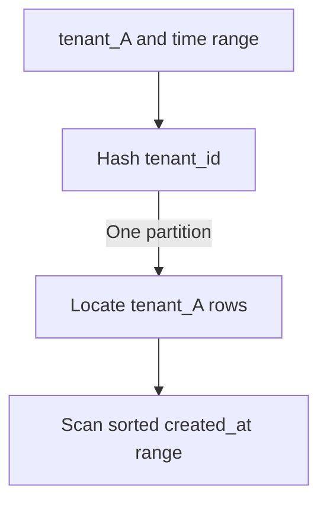

Once you have chosen a partition key, you must decide how key values map to
partitions. There are two fundamental schemes, they support different queries,
and each creates a characteristic failure that the other avoids.

> [!WHY] A time-series service needs fast date-range reads, but current writes all land on the newest range. Hashing spreads those writes, yet a report across all tenants now touches every partition.

> [!GOALS]
>
> - Compare range-query and distribution trade-offs of range and hash mapping
> - Choose a mapping from the service's common query shapes
> - Design a composite or salted key and state its bounded read cost

## Range partitioning

Assign contiguous key ranges to partitions.

```text
  ┌────────────┬────────────┬────────────┬────────────┐
  │  A  –  F   │  G  –  M   │  N  –  S   │  T  –  Z   │
  └────────────┴────────────┴────────────┴────────────┘
      part 1       part 2       part 3       part 4

  key "hendrix" → part 2       key "smith" → part 3
```

**What it buys: range queries.**

```text
  SELECT * FROM events
  WHERE timestamp BETWEEN '2026-03-01' AND '2026-03-07'

  range-partitioned by timestamp → ONE partition, sequential scan.
  the ideal case.
```

Keys that are adjacent in value are adjacent in storage, so a range scan reads
contiguous data on one node. For time-series, log data, and anything queried by
"everything between X and Y", this is a large win.

**What it costs: hotspots on sequential keys.**

```text
  partitioned by timestamp, writes arriving now:

  ┌────────────┬────────────┬────────────┬────────────┐
  │ Jan        │ Feb        │ Mar        │ APR ██████ │
  │ (idle)     │ (idle)     │ (idle)     │ ALL WRITES │
  └────────────┴────────────┴────────────┴────────────┘

  one partition takes 100% of the write load.
  the others are cold storage.
```

Any monotonically increasing key — timestamp, auto-increment ID, sequential
order number — produces this. The write hotspot moves over time, which is
sometimes acceptable (you are effectively writing to one node and archiving the
rest) and often not.

Range partitioning also needs the boundaries to be **chosen**, and choosing them
requires knowing the distribution. Splitting the alphabet into four equal letter
ranges gives wildly unequal partitions, because surnames are not uniformly
distributed. Systems that do this well (HBase, Bigtable, CockroachDB) choose
boundaries dynamically by splitting partitions that grow too large.

## Hash partitioning

Hash the key and take the result modulo the partition count.

```text
  partition = hash(key) mod N

  "alice"   → hash 0x8f3a... → mod 4 → part 2
  "alicia"  → hash 0x1c04... → mod 4 → part 0
  "amanda"  → hash 0xa730... → mod 4 → part 3

  adjacent keys land in unrelated partitions — deliberately
```

> [!KEY] **What it buys: even distribution.** A good hash function spreads any input
> distribution uniformly, so sequential keys, skewed keys and clustered keys all
> scatter evenly. The monotonic-write hotspot disappears entirely.

**What it costs: range queries become fan-out.**

```text
  SELECT * FROM events
  WHERE timestamp BETWEEN '2026-03-01' AND '2026-03-07'

  hash-partitioned → the keys in that range are scattered across
                     EVERY partition → query all of them and merge
```

You have traded the range scan for the even distribution. That is the whole
trade, and it is why the choice must come from the access pattern.

**The hash function matters.** Use a hash designed for distribution — MurmurHash,
xxHash, or the language's non-cryptographic hash — not `hashCode()` on a Java
String (poorly distributed for some inputs), and not a cryptographic hash unless
you need the security properties, because those are much slower.

**Critically: the hash must be stable across processes and versions.** Python's
`hash()` on strings is randomised per process by default (`PYTHONHASHSEED`), so
using it for partitioning gives a different answer on every restart. This is a
real and confusing bug.

## The combination: hash the prefix, range the suffix

The best of both, and what most modern systems actually offer.

```text
  partition key: hash(tenant_id)     ← even distribution across partitions
  sort key:      created_at          ← range queries WITHIN a partition

  ┌───────────────────────────────────────────────────────┐
  │ partition 2 (tenants hashing here)                    │
  │   tenant_A: [t1][t2][t3][t4]...  ← sorted, scannable  │
  │   tenant_B: [t1][t2][t3]...                           │
  └───────────────────────────────────────────────────────┘

  "tenant_A's events last week" → one partition, one range scan ✓
  "all events last week"        → fan-out ✗ (and that is fine, if rare)
```



Cassandra's partition key plus clustering columns, DynamoDB's partition key plus
sort key, and MongoDB's compound shard keys are all this design. If your access
pattern is "range within an entity", which is extremely common, this is the
answer.

## Comparison

|                          | Range                        | Hash                      | Hash + sort key       |
| ------------------------ | ---------------------------- | ------------------------- | --------------------- |
| Range queries            | ✅ optimal                   | ❌ fan-out                | ✅ within a partition |
| Even distribution        | ❌ needs care                | ✅                        | ✅                    |
| Sequential-write hotspot | ❌ severe                    | ✅ avoided                | ✅ avoided            |
| Point lookup             | ✅                           | ✅                        | ✅                    |
| Boundary management      | needed                       | not needed                | not needed            |
| Adding partitions        | split a range                | rehash (see next chapter) | rehash                |
| Used by                  | HBase, Bigtable, CockroachDB | Cassandra, DynamoDB, Riak | Cassandra, DynamoDB   |

## Directory-based partitioning

A third option worth knowing: keep an explicit lookup table from key to
partition.

```text
  ┌──────────────────────────────┐
  │  tenant_7c3f  →  partition 2 │
  │  tenant_9a1b  →  partition 5 │
  │  tenant_4e2d  →  partition 2 │
  └──────────────────────────────┘
```

Maximum flexibility: you can move any single key to any partition, which means a
whale tenant can be given a partition to itself. The costs are a lookup on every
request (usually cached) and a directory that is itself a critical, highly
available component.

This is used more often than its low profile suggests — many multi-tenant SaaS
systems map tenants to shards explicitly, precisely so that the largest customers
can be isolated. If your distribution has a few enormous entities and a long
tail, this is frequently the right design.

## Fixing the sequential-write hotspot without giving up ranges

Two techniques worth knowing when you need range queries _and_ even writes.

**Salting.** Prefix the key with a small random or hashed bucket:

```text
  original key:  2026-04-12T10:33:00
  salted key:    3#2026-04-12T10:33:00     ← bucket 3 of 8

  writes spread across 8 buckets → 8× the write throughput
  a range query must read all 8 buckets and merge
```

You have converted a write hotspot into a read fan-out of fixed, small width.
That is usually a good trade, and it is bounded — 8 partitions to query, not N.

**Key reversal.** Reverse the digits of a sequential ID:

```text
  1001 → 1001         1002 → 2001
  1003 → 3001         1004 → 4001

  adjacent IDs now land far apart
```

Cheap and effective for spreading writes; destroys range queries entirely, so it
is really a hash scheme in disguise. Twitter's Snowflake IDs and similar schemes
sometimes apply it deliberately.

> [!CHECK] What does salting a timestamp across eight buckets buy and cost?
>
> Writes spread across eight buckets rather than one moving hotspot,
> giving the stated 8× write throughput. A time-range read must scan all
> eight buckets and merge, replacing the hotspot with a bounded eight-way
> read fan-out.

> [!CHECK] Why does hashing tenant_id not make an all-tenant time-range query
> local?
>
> Hashing selects a partition for one tenant, while created_at orders only
> the rows inside that partition. Without a tenant_id, the query cannot
> choose one hash partition, so it must read all partitions despite the
> local sort key.

## What to take away

1. Range partitioning gives optimal range scans and creates a severe hotspot for
   any monotonically increasing key.
2. Hash partitioning gives even distribution regardless of input and turns range
   queries into fan-out.
3. Hash the partition key and sort within the partition — this gives even writes
   and range queries within an entity, and is what Cassandra and DynamoDB offer.
4. Use a hash designed for distribution and stable across processes; Python's
   `hash()` on strings is randomised per process.
5. Directory-based partitioning costs a lookup and buys the ability to isolate a
   single large tenant — often the right answer for multi-tenant systems with a
   few whales.
6. Salting converts a write hotspot into a bounded read fan-out when you need
   both even writes and range queries.

Next: consistent hashing — how to add and remove partitions without moving
everything.

## Exercises

> [!EXERCISE recall] What does range partitioning preserve that hash partitioning scatters, and what characteristic hotspot does each scheme risk?
>
> **Solution:** Range partitioning keeps adjacent keys together for efficient range scans, but monotonic keys concentrate current writes on one range. Hash partitioning spreads keys evenly, but a range query becomes fan-out because its keys land on unrelated partitions.

> [!EXERCISE apply] An order table uses monotonically increasing IDs, gets frequent lookups by exact ID, and rarely scans ID ranges. Choose a mapping that avoids concentrating current writes and state what happens to a range scan.
>
> **Solution:** Hash the ID with a stable hash so sequential values spread across partitions and point lookups can compute their owner. A range scan over IDs loses locality and must fan out to the partitions and merge results. A range mapping would keep the scan local but concentrate the newest writes.

> [!EXERCISE stretch] A multi-tenant service has a few tenants hundreds of times larger than the median. Recommend a key mapping and explain what a weaker uniform-hash answer misses.
>
> **Solution:** Use a tenant-to-partition directory so ordinary tenants can share partitions while a whale can be isolated on its own resources; retain a sort key such as time for that tenant's range queries. A weaker answer hashes every tenant uniformly and stops there; it misses that a large tenant can dominate its assigned partition even when the hash distributes tenant IDs evenly.
