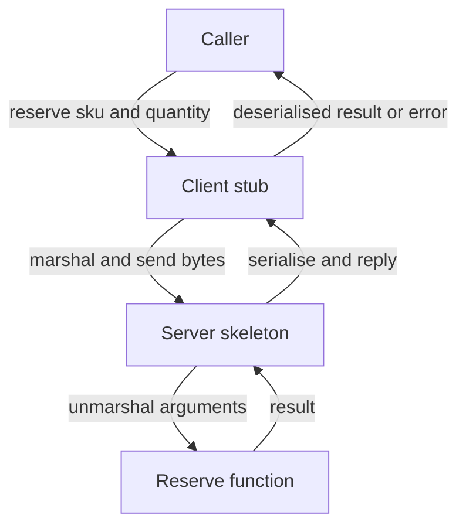

Remote procedure call is a forty-year-old idea with one seductive promise: that
calling a function on another machine could look exactly like calling one in
your own process. The promise is false, and the industry took two decades and
several expensive failures to fully accept it. Understanding *why* it is false
— precisely, not vaguely — is what makes you good at designing service
boundaries.

> [!WHY] A page calls a remote service once for each of its twelve product cards, even though the caller needs the same product fields together. The network turns a tidy local loop into repeated round trips that a use-case-shaped endpoint could avoid.

> [!GOALS]
>
> - Explain how latency, copying, partial failure and concurrency change remote calls
> - Shape a remote endpoint around the caller's use case
> - Calculate the round-trip cost of chatty and batched calls
> - Choose RPC or messaging based on whether the caller needs an answer

## The promise

```python
# local
result = inventory.reserve(sku, qty)

# remote — identical at the call site
result = inventory_client.reserve(sku, qty)
```

The machinery that makes the second line work is a **stub**: generated code that
serialises the arguments, sends them, waits, deserialises the reply, and either
returns it or raises. From the caller's perspective, a function call.

```text
  CALLER PROCESS                          CALLEE PROCESS

  reserve(sku, 3)
      │
      ▼
  ┌─────────┐   marshal args    ┌──────────────┐
  │  stub   │──────────────────▶│  network     │
  └─────────┘                   └──────┬───────┘
      ▲                                │
      │  unmarshal result              ▼
      │                          ┌──────────┐   ┌──────────────────┐
      └──────────────────────────│ skeleton │──▶│ reserve(sku, 3)  │
                                 └──────────┘   │ the real function│
                                                └──────────────────┘
```

This is genuinely useful. Hand-writing the marshalling for every call would be
tedious and error-prone, and generated stubs from a shared schema eliminate a
whole class of mismatch bugs. The machinery is not the problem.



```chart
type: bar
scale: linear
unit: round trips
title: The order detail API boundary
caption: Both paths serve the same order-detail use case.
---
Chatty API: 43
Chunky API: 1
```

## Why transparency failed

In 1994, Waldo, Wyant, Wollrath and Kendall published *A Note on Distributed
Computing* — still the clearest statement of the problem. Their argument was
that local and remote calls differ in four ways that cannot be papered over:

**1. Latency.** Five orders of magnitude, as the previous topic established. Code
written assuming a call is free will be written differently — in loops, without
batching — and no amount of stub cleverness fixes a caller that made 200 calls
because it thought they were cheap.

**2. Memory access.** A local call can pass a pointer. A remote call cannot: the
callee has no access to your address space, so everything must be *copied*.
This changes semantics, not just performance:

```python
def add_tag(order):          # local: mutates the caller's object
    order.tags.append("x")

add_tag(o)                   # o.tags now contains "x"
remote.add_tag(o)            # a COPY was tagged. o is unchanged.
```

Object graphs with cycles, shared sub-objects, and identity all break under
copying. Two references to the same object arrive as two separate objects.

**3. Partial failure.** The local call has two outcomes; the remote call has
three. There is no local equivalent of "I do not know whether that happened",
so there is no exception type that means it, and callers written for local
semantics do not handle it.

**4. Concurrency.** Local calls into a single-threaded component are serialised
by the call stack. A remote service receives calls from many clients at once,
so any invariant that relied on one-caller-at-a-time is now false.

The failed systems — CORBA, DCOM, Java RMI, and to a degree SOAP — did not fail
because their engineering was bad. They failed because they encouraged
developers to *ignore* those four differences, and systems built on that
assumption fell over in production in ways the abstraction had no vocabulary
for.

## What modern RPC keeps and what it dropped

gRPC, Thrift, and well-designed HTTP APIs kept the code generation and dropped
the transparency:

| Kept | Dropped |
| --- | --- |
| Schema-driven stub generation | Pretending remote is local |
| Type-safe request/response | Passing object references |
| Efficient binary encoding | Distributed garbage collection |
| Streaming as a first-class shape | Transparent object migration |
| Deadlines, cancellation, metadata in the API | Implicit retries and hidden state |

The tell is in the API surface. A gRPC call **requires** a context carrying a
deadline; you cannot express a call without acknowledging that it might not
finish. A local function call has no such parameter. That is the abstraction
deliberately leaking, in the one place where hiding the truth was fatal.

## The design consequence: chunky, not chatty

Because a remote call costs 500,000× a local one, the *granularity* of a remote
interface must be different from a local one. A local interface can be
fine-grained; a remote one must not be.

```text
  CHATTY (a local interface exposed remotely)

    getOrder(id)                  ──▶ 1 call
    getOrderItems(id)             ──▶ 1 call
    for each item: getProduct(sku)──▶ 40 calls
    getCustomer(order.customerId) ──▶ 1 call
                                      ─────────
                                      43 round trips


  CHUNKY (an interface designed for the network)

    getOrderDetail(id, include=[items, products, customer])
                                  ──▶ 1 call
```

This is the single most important design rule for service APIs, and it has a
corollary that people resist: **a remote interface is not a class**. Exposing
your domain objects' methods over the network produces a chatty interface by
construction. Remote interfaces should be shaped around *use cases* — "what does
the caller actually need in one go" — which is why they often look coarser and
less elegant than the internal model behind them.

The tension this creates is real. Coarse endpoints return more than some callers
need (fallacy 3), so you get field selection, sparse fieldsets, or GraphQL. That
is the actual argument GraphQL is making: let the caller specify the shape, so
one round trip returns exactly what this screen needs.

## Sync, async, and what you are choosing between

RPC is *request/response*: the caller waits for an answer. That is the right
shape when the caller needs the result to continue, and the wrong shape when it
does not.

```text
  REQUEST/RESPONSE (RPC)              MESSAGING (async)

  A ──── call ────▶ B                 A ──▶ [queue] ──▶ B
    ◀─── result ───                   A continues immediately

  + simple to reason about            + A survives B being down
  + immediate errors                  + natural buffering under load
  + no extra infrastructure           + one event, many consumers
  - A is coupled to B's availability  - eventual, not immediate
  - A is coupled to B's latency       - needs a broker
  - failure is A's problem            - harder to trace and debug
```

The decision rule that holds up: **does the caller need the answer to produce
its own response?** If yes, RPC. If no — sending an email, updating a search
index, recording analytics, notifying another team's system — messaging, because
making the user's request depend on those things couples their success to
systems that have nothing to do with what they asked for.

A common and correct hybrid: RPC for the read path where a caller genuinely
needs data now, messaging for the write path's side effects. The order is
written synchronously; the confirmation email, the index update and the
analytics event are published.

## Where the time goes in one call

Worth knowing before optimising anything:

```text
  client stub: serialise            ~50 µs   (JSON, 10 KB)
  connection acquire (pooled)        ~1 µs
  kernel + NIC + wire (same AZ)     ~300 µs
  server: deserialise                ~60 µs
  server: authn/authz                ~50 µs   (cached)
  server: actual work              ~2000 µs
  server: serialise                  ~50 µs
  wire back                         ~300 µs
  client: deserialise                ~60 µs
                                   ─────────
                                    ~2.9 ms
```

Serialisation is ~7% here and grows fast with payload size — at 1 MB payloads it
dominates everything else, which is the argument for binary formats. Connection
setup is absent only because the pool was warm; a cold connection with TLS adds
two round trips and would double the total.

> [!CHECK] Why does remote.add_tag(o) leave the caller's object unchanged?
>
> A local call can mutate an object through its reference. A remote call
> serialises and copies the object into the callee's address space.
> Mutating that copy does not mutate the caller's original.

> [!CHECK] How does getOrderDetail reduce the chapter's chatty order API?
>
> The chatty path has one order call, one items call, 40 product calls
> and one customer call: 43 round trips. A use-case-shaped
> getOrderDetail returns the needed aggregate in one call.

## What to take away

1. RPC's machinery — schema-driven stubs, type-safe encoding — is genuinely
   valuable. Its original promise of *transparency* is what failed.
2. Local and remote calls differ in latency, memory access, partial failure and
   concurrency. None of the four can be hidden, and systems that hid them broke.
3. Modern RPC leaks the truth deliberately: a required deadline in the call
   signature is the abstraction admitting the call might not finish.
4. Remote interfaces must be chunky and use-case shaped, not fine-grained
   mirrors of domain objects. A remote interface is not a class.
5. Use RPC when the caller needs the answer to continue; use messaging when it
   does not, so a user's request is not coupled to a system they never asked
   about.

Next: what actually goes on the wire — framing, protocols, and why HTTP/2 changed
what an RPC system can do.

## Exercises

> [!EXERCISE recall] Name the four differences between local and remote calls that transparency cannot hide, and state when messaging is preferable to RPC.
>
> **Solution:** Remote calls add latency, copy rather than share memory, can fail ambiguously, and receive concurrent calls from many clients. Use messaging when the caller does not need the result to produce its own response, so unrelated side effects do not become dependencies of the user's request.

> [!EXERCISE apply] A request needs an immediate reservation result, a welcome email, and an analytics record. Choose RPC or messaging for each action and explain which results the caller must wait for.
>
> **Solution:** Use RPC for the reservation because the request needs its result before it can respond. Publish the welcome email and analytics record through messaging because the caller can continue without either result. Waiting for all three would make unrelated side effects part of the user-facing request path.

> [!EXERCISE stretch] A team exposes every domain-object method as a remote endpoint, then adds automatic retries so calls appear local to callers. Recommend a boundary and explain what a weaker answer misses.
>
> **Solution:** Shape remote methods around complete use cases, require deadlines and expose failure and cancellation behavior. Use RPC for data the caller needs now, and publish side effects asynchronously when the caller can continue without their result. A weaker answer improves the stub; it misses that generated code cannot erase network latency, partial failure, copying or concurrent callers.
