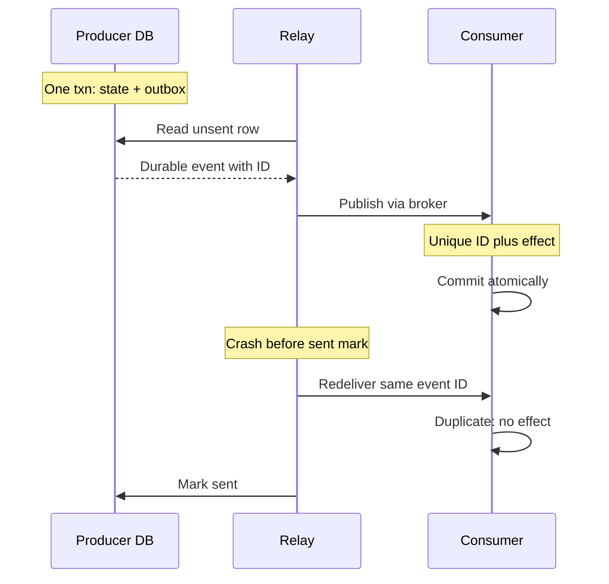

The two-writes problem — save a row and publish an event, with a crash possible
between them — has one clean answer, and it is simple enough to be worth
implementing correctly everywhere rather than reaching for anything heavier. It
turns two writes to two systems into **one write to one system, plus a retryable
delivery step**.

> [!WHY] A service saves an order and publishes its event as two separate writes. A crash between them leaves either an order nobody hears about or a message describing an order that never committed.

> [!GOALS]
>
> - Explain how an outbox makes state change and delivery intent atomic
> - Choose polling or CDC and state the delivery guarantees each requires
> - Design ordering, cleanup and age-based monitoring for the relay

## The mechanism

```sql
BEGIN;
  INSERT INTO orders (id, customer_id, total, status)
       VALUES ('ord-7c3f', 'cus-991', 4200, 'placed');

  INSERT INTO outbox (id, topic, payload, created_at)
       VALUES (gen_random_uuid(), 'order.placed',
               '{"order_id":"ord-7c3f","total":4200}', now());
COMMIT;
```

Both rows are in **one transaction against one database**, so they are atomic by
the database's own guarantee. There is no distributed anything.

A separate **relay** then delivers the outbox rows:

```text
  ┌──────────────────────────────────────────┐
  │  application database                    │
  │    orders   ────┐                        │
  │    outbox   ────┴── ONE transaction      │
  └───────────────┬──────────────────────────┘
                  │
              relay reads unsent rows
                  │
                  ▼
            ┌──────────┐
            │  broker  │──▶ consumers
            └──────────┘
```

The relay can crash, retry, and duplicate — none of which loses data, because the
outbox row is durable until delivery is confirmed. What it _cannot_ do is fail to
notice a message, because the message is in the same database as the state change
that produced it.

## Two ways to build the relay

> [!KEY] **Polling.** Query for unsent rows on an interval.

```sql
UPDATE outbox
   SET locked_by = 'relay-1', locked_at = now()
 WHERE id IN (
   SELECT id FROM outbox
    WHERE sent_at IS NULL
      AND (locked_at IS NULL
           OR locked_at < now() - interval '30 seconds')
    ORDER BY created_at
    LIMIT 100
    FOR UPDATE SKIP LOCKED          -- ← the important part
 )
RETURNING *;
```

`FOR UPDATE SKIP LOCKED` is what lets several relay instances run concurrently
without fighting: each grabs a disjoint batch instead of blocking on the same
rows. Without it, multiple relays serialise and you have accidentally built a
single-threaded system.

Simple, works everywhere, and costs a query per interval. The latency floor is
the polling interval, so it is typically tuned to 100–500 ms.

**Log tailing (CDC).** Read the database's own replication log — Debezium reading
Postgres's logical decoding stream, or MySQL's binlog — and publish whatever
appears in the outbox table.

```text
  Postgres WAL ──▶ Debezium ──▶ Kafka
```

Lower latency (milliseconds), no polling load on the database, and it scales
better. The costs are an extra piece of infrastructure to run, replication-slot
management (a stalled consumer means the database retains WAL forever and
eventually fills its disk — a real and common outage), and schema coupling to
the log format.

**Choose polling first.** It is a hundred lines of code with no new
infrastructure, and it is sufficient for the large majority of systems. Move to
CDC when polling latency or load actually becomes the constraint.

## The guarantees you get, and the obligation

```text
  ✅ ATOMIC     the state change and the intent to publish commit together
  ✅ ORDERED    rows can be published in creation order, per key
  ✅ DURABLE    an unsent row survives any crash
  ⚠️  AT LEAST ONCE   the relay may publish and then crash before
                      marking the row sent
```

That last line is not a defect to be fixed; it is inherent, and it is the same
conclusion as the delivery-semantics chapter. **Every consumer must be
idempotent.** The outbox makes delivery reliable; it does not make it
exactly-once, and a system built on it that assumes single delivery is broken.

## Housekeeping that decides whether it works

The parts that are boring and that fail in production when omitted.

**Delete sent rows.** An outbox that grows forever eventually dominates the
database and slows every query against it.

```sql
DELETE FROM outbox WHERE sent_at < now() - interval '7 days';
```

Keep a retention window rather than deleting immediately, so you can inspect what
was published during an incident.

**Index for the relay's query.** A partial index on unsent rows keeps the
relay's scan proportional to the backlog rather than the table:

```sql
CREATE INDEX outbox_unsent_idx ON outbox (created_at)
  WHERE sent_at IS NULL;
```

Without this, the relay's query gets slower as the retained history grows — the
classic version of this bug is a relay that was fast for six months and then
degraded, because it was scanning a million sent rows to find ten unsent ones.

**Alert on outbox depth and age.** The two signals that matter:

```text
  depth  — count of unsent rows       → the relay is behind
  age    — now() - oldest created_at  → the relay is STOPPED
```

Age is the better alert. Depth can be high legitimately during a burst; a growing
oldest-message age means delivery has stopped, and every second it grows is
another second of events not reaching downstream systems.

**Handle poison messages.** A row that fails to publish repeatedly — an oversized
payload, a schema the broker rejects — blocks everything behind it if the relay
preserves order. Track an attempt count, and after N failures move the row to a
dead-letter table and continue.

## Ordering, and how much you actually have

The outbox gives you ordering _if you preserve it_, and preserving it costs
parallelism:

```text
  STRICT GLOBAL ORDER     one relay, one message at a time
                          → simple, and a throughput ceiling

  PER-KEY ORDER           partition rows by an ordering key
                          (aggregate id), one relay worker per
                          partition
                          → the usual right answer

  NO ORDER                any worker takes any row
                          → maximum throughput; consumers must be
                            order-insensitive
```

Per-key is almost always what is wanted, for the reason established in the
delivery-semantics chapter: you need events for _one order_ in order, and no
constraint between different orders. Adding an `ordering_key` column and hashing
it to a worker gives that.

## The inbox: the consumer's half

The mirror pattern, and it is what makes the consumer's idempotence concrete:

```sql
BEGIN;
  -- the unique constraint does the concurrency control
  INSERT INTO inbox (message_id) VALUES ('msg-88213');

  UPDATE inventory SET reserved = reserved + 3 WHERE sku = 'SKU-88';
COMMIT;
-- a duplicate delivery violates the unique constraint, the transaction
-- aborts, and the effect is applied exactly once
```

Together, outbox and inbox give **effectively-once processing** across two
services with no distributed transaction anywhere:

```text
  service A                          service B
  ┌────────────────────┐             ┌────────────────────┐
  │ state + outbox     │             │ inbox + state      │
  │ in ONE transaction │──broker──▶  │ in ONE transaction │
  └────────────────────┘             └────────────────────┘

  at-least-once in the middle, exactly-once at each end
```



That picture is the practical answer to "how do we get exactly-once between two
services", and it is worth being able to draw from memory. Note the inbox needs
the same housekeeping — old message IDs must be pruned, and the retention window
must exceed the longest possible redelivery, which is the same sizing argument as
the idempotency window from the ordering chapter.

## When you do not need an outbox

Not every publish needs this. If losing the message is genuinely acceptable —
analytics, a cache warm, a best-effort notification — publish directly and accept
the gap. The outbox costs a table, a relay, and housekeeping; spend it where a
lost message is a defect.

The test: **would anyone notice, or would data be wrong, if this message were
silently dropped?** If yes, outbox. If no, publish directly.

> [!CHECK] Why can the relay publish an outbox event twice without losing the
> intent to deliver?
>
> It can publish successfully and crash before marking the row sent. The
> durable unsent row is read again after restart, causing a duplicate; the
> producer state and delivery intent still committed together, but
> consumers must deduplicate.

> [!CHECK] How does the inbox keep reserved inventory from increasing by three
> again on redelivery?
>
> The first delivery inserts the unique message ID and applies reserved +=
> 3 in one transaction. A duplicate violates that unique constraint, so
> its transaction aborts before another increment can commit. Prune IDs
> only after the longest possible redelivery window.

Next: reconciliation — the backstop that catches the cases where all of this was
implemented slightly wrong.

## What to take away

1. The outbox turns two writes into one transaction plus a retryable delivery
   step, which is the only clean answer to the two-writes problem.
2. Polling with `FOR UPDATE SKIP LOCKED` is sufficient for most systems; move to
   CDC when latency or load demands it, and watch replication-slot growth.
3. Delivery is at-least-once by construction — consumers must be idempotent, and
   the inbox pattern with a unique constraint is how.
4. The housekeeping decides whether it works: prune sent rows, index unsent rows
   partially, dead-letter poison messages.
5. Alert on the _age_ of the oldest unsent row, not just the count — age means
   delivery has stopped.
6. Outbox plus inbox gives effectively-once processing between two services with
   no distributed transaction anywhere.

## Exercises

> [!EXERCISE recall] What ordering guarantees can an outbox relay provide, and what cost does each stronger ordering choice impose?
>
> **Solution:** A single relay sending one message at a time gives strict global order but limits throughput. Partitioning by an aggregate key gives per-key order with parallelism across keys; no order permits maximum throughput but requires order-insensitive consumers.

> [!EXERCISE apply] An order service emits `paid` then `shipped` for each order, while separate orders may progress in parallel. Choose an ordering key and relay strategy that preserves the needed order without imposing a global sequence.
>
> **Solution:** Use the order ID as the `ordering_key` and ensure a single relay worker handles each key's rows in order. Different order IDs can be processed by different workers, preserving the paid-before-shipped sequence for each order without serializing all orders globally.

> [!EXERCISE stretch] Polling latency or database load has become the delivery constraint for an outbox relay. Recommend a migration path, name its operational costs, and explain what a weaker answer misses.
>
> **Solution:** Move to CDC when polling latency or load is the constraint. It adds infrastructure, couples the relay to the database log schema, and requires replication-slot monitoring: a stalled consumer makes the database retain WAL until the disk fills. A weaker answer keeps shortening the polling interval; each step below the chapter's typical 100–500 ms adds another query per interval to the database, while the interval remains the latency floor.
