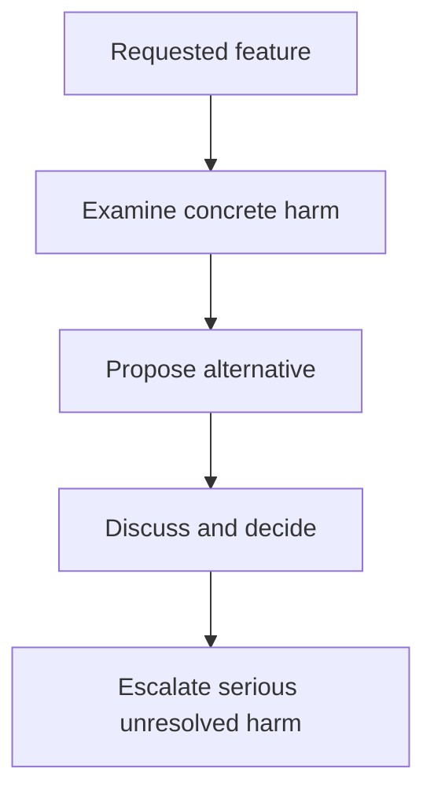

The Product Sense for Engineers chapter asked "should this exist, and does
it solve a real problem." This chapter is what happens when the honest
answer to a related question is uncomfortable — not "is this worth
building" but "does building this cause real harm" — and an engineer's own
judgment is frequently the actual last checkpoint before something ships.

> [!WHY] A retention experiment makes cancellation harder and reports
> fewer cancellations as success. Users who cannot find the exit pay the
> cost hidden by the dashboard’s chosen objective.

> [!GOALS]
>
> - Explain intent versus impact
> - Redesign a manipulative interface choice
> - Evaluate dual-use deployment context

## Harm isn't always the obvious, intended kind

```text
  a feature can cause genuine harm WITHOUT anyone involved
  intending it to, or even fully realizing it will, at the time
  it's being built:

    a recommendation algorithm optimizing PURELY for
      engagement, with no other consideration, can end up
      systematically promoting increasingly extreme content —
      not because anyone deliberately designed it TO do that,
      but because extreme content genuinely, measurably drives
      MORE engagement, and the algorithm is doing exactly what
      it was actually told to optimize for
```

```text
  → this is a genuinely important, non-obvious distinction:
    INTENT and IMPACT are different things, and "we didn't
    MEAN for it to cause that" doesn't undo the actual,
    real-world harm once it's already happening at scale — an
    engineer building the OPTIMIZATION function bears real
    responsibility for genuinely thinking through what it
    ACTUALLY optimizes for, in practice, not merely for what it
    was originally, abstractly INTENDED to optimize for on
    paper.
```

## Dark patterns: when a UI choice manipulates rather than genuinely informs

```text
  "Cancel Subscription" buried three menus deep, while
  "Keep My Subscription" is one prominent click away — this is
  a DELIBERATE, specific design choice, not an accident of
  layout — the exact same underlying UX skill (the Frontend
  Engineering track's whole toolkit) used to make something
  genuinely EASY to find, redirected instead toward making
  something specifically HARD to find, on purpose.

  → the SAME skill set (making an interface clear, or making it
    confusing; making a flow smooth, or making it deliberately
    frustrating) can be aimed at genuinely helping a user, or
    at exploiting a well-documented, predictable cognitive bias
    against their own actual interest — this is precisely why
    "I'm just implementing the design as specified" doesn't
    fully absolve the ENGINEER of the DESIGN's actual,
    real-world effect on real users, even when the specific
    pixels and interaction flow were handed down by someone
    else.
```

## Dual use: the same technology, genuinely different applications

```text
  facial recognition:  unlocking YOUR OWN phone with your own
                          face vs. mass, unconsented public
                          surveillance

  the SAME underlying technical CAPABILITY (accurately matching
  a face against a stored reference) applies, essentially
  unchanged, to both genuinely beneficial and genuinely harmful
  uses — the technology ITSELF doesn't determine which
  application it ends up serving; the specific CONTEXT and
  actual DEPLOYMENT do.
```

```text
  → this is why "the technology itself is neutral" is TRUE and
    simultaneously not, by itself, a sufficient, complete
    answer to every question about it — an engineer building a
    genuinely dual-use capability has a real, legitimate reason
    to think carefully about the SPECIFIC deployment context
    it's actually going into, not merely about whether the
    underlying capability is impressive or technically
    interesting to build.
```

## Saying no: a genuine, sometimes uncomfortable engineering skill

```text
  → this is the Product Sense chapter's "saying no is a real
    skill" point, made SHARPER and more personally uncomfortable
    here: sometimes what's being asked for isn't merely
    sub-optimal from a product standpoint — it's something the
    engineer being asked to build it genuinely believes causes
    real harm.

  → the practical, examinable version of this skill isn't a
    flat, unexplained refusal — it's "here's SPECIFICALLY why I
    think this causes real harm, and here's what I think we
    should do INSTEAD" — engaging directly and substantively
    with the actual underlying concern (harm, this time,
    specifically — not merely product-market fit or technical
    feasibility), the same reasoned-disagreement discipline
    from the Working in a Team chapter, applied to a
    genuinely higher-stakes question.
```



## Whistleblowing and escalation: when internal disagreement genuinely isn't enough

```text
  → most ethical disagreements are genuinely resolvable through
    the Working in a Team chapter's normal disagree-and-commit
    process — someone raises a real concern, it's discussed
    substantively, a decision gets made, and everyone moves
    forward together from there, even those who initially
    disagreed.

  → a small minority of situations genuinely exceed what that
    normal process is actually built to handle — genuine
    illegality, or harm serious enough that "disagree and
    commit" itself stops being an ethically defensible response
    at all. recognizing the DIFFERENCE (an ordinary product
    disagreement that disagree-and-commit correctly resolves,
    versus a genuine, serious ethical line) is itself a real,
    difficult, and important judgment call — not a decision with
    an obvious, universal, one-size-fits-all bright line that
    applies identically to every situation.
```

> [!PITFALL] A technically successful optimization can increase harm even
> when nobody intended that outcome.

> [!INTERVIEW] Name who may be harmed, how, and what alternative addresses
> the underlying need.

> [!CHECK] Why can engagement-only optimization be harmful?
>
> It can promote content that drives the target while harming users,
> because the objective does not encode their welfare.

> [!CHECK] Why does implementing handed-down pixels still require
> judgment?
>
> The engineer’s implementation has real effects on users even if someone
> else specified the design.

> [!CHECK] When may ordinary disagree-and-commit be inadequate?
>
> Serious harm or genuine illegality can exceed what that normal
> disagreement process is designed to resolve; context matters.

## What to take away

1. Intent and impact are different things — an algorithm optimizing purely
   for engagement can cause real, systematic harm nobody deliberately
   designed, and "we didn't mean for it to" doesn't undo that harm once
   it's happening at scale.
2. The same UX skill that makes an interface genuinely clear can be aimed
   at making one deliberately confusing — "I'm just implementing the
   design as specified" doesn't fully absolve the engineer of its real
   effect on real users.
3. A dual-use technology's harm or benefit comes from its specific
   deployment context, not from the underlying capability itself — "the
   technology is neutral" is true and still not a complete answer on its own.
4. Saying no to something believed to cause real harm is a sharper,
   higher-stakes version of product sense's "saying no is a real skill" —
   engaging with the specific concern and proposing an alternative, not a
   flat unexplained refusal.
5. Most ethical disagreements resolve through ordinary disagree-and-commit
   — recognizing the rare situation that genuinely exceeds what that
   process can handle (genuine illegality, sufficiently serious harm) is
   itself a difficult, important judgment call with no universal bright line.

## Exercises

> [!EXERCISE recall] Why does “we did not intend harm” fail to settle
> whether a feature is acceptable?
>
> **Solution:** Intent does not undo impact. Engineers must examine what
> the deployed system actually optimizes and does to people, including
> unintended consequences.

> [!EXERCISE apply] An account-setup screen says an optional tracking
> preference is required to continue, although the service works with
> either choice. The team celebrates more enabled tracking as user
> enthusiasm. Recommend an alternative and explain why the metric could be
> misleading.
>
> **Solution:** Describe the preference truthfully as optional, explain
> its effect clearly and let either choice continue setup. More enabled
> tracking under the misleading screen may measure coerced navigation
> rather than genuine preference. The alternative uses the same interface
> skill to inform users rather than manipulate them, and lets the team
> examine the choice people actually want.

> [!EXERCISE stretch] A face-matching capability works for both a user
> unlocking their own device and unconsented public surveillance.
> Recommend what a deployment review must examine.
>
> **Solution:** Evaluate the specific use, affected people and plausible
> harms, and propose a narrower beneficial deployment or raise a reasoned
> objection where appropriate. A weaker answer approves solely because the
> underlying technology is neutral: unchanged technical capability can
> have sharply different effects depending on context.
