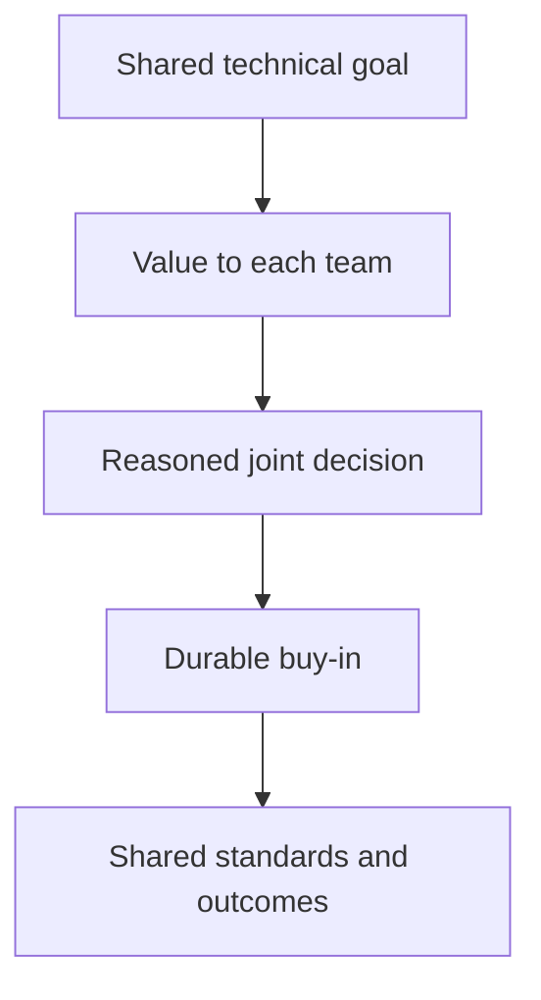

This is the last chapter in the curriculum, and it doesn't introduce a new
technique so much as name what happens when every discipline this track has
covered — clear writing, productive disagreement, mentoring, scoping,
honest measurement — gets aimed at a scope that spans multiple teams, with
no direct reporting line giving anyone the authority to simply mandate the
outcome.

> [!WHY] A cross-team technical direction is announced, but another team
> drops it as soon as its own deadline tightens. Formal compliance did not
> make the shared goal valuable enough to survive competing priorities.

> [!GOALS]
>
> - Explain influence without reporting authority
> - Choose a strategy under finite capacity
> - Build alignment around legitimate team priorities

## Influence without authority: the actual mechanism

```text
  → a STAFF+ engineer, in the org-chart sense, typically has NO
    direct authority to simply COMMAND another team to adopt a
    technical direction — the actual mechanism of influence is
    almost entirely PERSUASION: a genuinely well-reasoned
    argument, a track record of DECISIONS that turned out well
    over time, and relationships built on trust EARNED through
    consistently good judgment, demonstrated repeatedly, rather
    than through any formal, mandated authority to simply
    dictate an outcome.
```

```text
  → this makes EVERY writing and disagreement discipline from
    EARLIER in this track directly, literally load-bearing here
    — a design doc that actually gets a genuinely difficult
    decision made (the Design Docs chapter), disagreement
    conducted well enough that people who lost an argument still
    genuinely trust the PROCESS that led to the outcome (the
    Working in a Team chapter) — these aren't separate skills
    from leadership; at THIS scope, they largely ARE what
    leadership actually consists of, in practice.
```

## Technical strategy: choosing what NOT to do, at organizational scale

```text
  → the Product Sense chapter's "not every feature is worth
    building" question, resurfacing again here — but now aimed
    at TECHNICAL DIRECTION across an entire ORGANIZATION, rather
    than at one single feature: which of several plausible
    architectures should the COMPANY genuinely invest in, for
    the next several years, knowing full well that resources
    spent thoroughly pursuing ONE direction are resources that
    are, by definition, NOT available for pursuing a different,
    also-plausible one.
```

```text
  → this is the Capacity Planning chapter's headroom-as-trade-off idea, one
    final time, at the largest scale this entire curriculum ever reaches: an
    organization has a genuinely FINITE amount of engineering capacity, and
    a real technical strategy is an explicit, examinable STATEMENT about
    where that finite, scarce capacity should actually go — not merely a
    list of things that would each, individually, be nice to eventually
    have someday.
```

## Alignment across teams: the coordination problem, at its largest scale

```text
  → the Working in a Team chapter covered coordination WITHIN
    one team; this is the SAME underlying coordination problem,
    genuinely harder, because different TEAMS frequently have
    real, legitimate, and entirely defensible DIFFERENT
    incentives and different immediate priorities — getting
    multiple teams, each with their own genuinely reasonable
    priorities, to actually pull in ONE coherent direction
    requires making the SHARED goal's value legible and
    concretely credible to EACH team individually, in terms
    that actually connect to what THAT specific team already,
    genuinely cares about.
```

```text
  → this is why "just tell people what to do" doesn't
    genuinely work here, structurally, even in the relatively
    rare cases where there technically IS enough formal
    authority present to attempt it — a mandate secures
    surface-level, minimum COMPLIANCE at best; it does not, by
    itself, secure genuine, durable BUY-IN — and buy-in is what
    actually determines whether a cross-team technical direction
    survives the FIRST time it becomes genuinely inconvenient for
    one of the teams involved, which it eventually, predictably
    will.
```



## Multiplying impact: mentoring's idea, extended past direct reports

```text
  → the Mentoring chapter's "multiply others' output" idea
    resurfaces here at a larger scale still — a staff engineer's
    genuine impact increasingly comes from the DECISIONS and
    STANDARDS they help establish across MANY teams (a shared
    architectural pattern, a genuinely adopted testing
    discipline, a technical standard that becomes the org's
    accepted default) rather than from code they personally,
    individually write themselves.
```

```text
  → this is the SAME "impact scales past individual output" idea from the
    Scope, Levels, and Growth chapter, carried all the way through to its
    logical, final endpoint: the highest-leverage engineering work in this
    entire curriculum often involves writing very LITTLE code personally,
    while shaping, through influence and demonstrated judgment, how a great
    deal of OTHER code across an entire organization eventually
    gets written.
```

## What this track, and this curriculum, has actually been building toward

```text
  → every discipline this whole curriculum has covered —
    complexity analysis, distributed consensus, careful API
    design, honest metrics, clear writing, productive
    disagreement — exists, ultimately, in service of building
    something that genuinely WORKS, that other people can
    actually maintain, and that solves a real problem someone
    genuinely has. TECHNICAL skill (everything from Programming
    Fundamentals through Serving Analytics) makes that possible
    to BUILD at all; the judgment this final track adds makes it
    possible to build the RIGHT thing, with the RIGHT people,
    sustainably, in a way that lasts.
```

> [!PITFALL] A list of individually desirable initiatives is not a
> strategy until it makes capacity trade-offs explicit.

> [!INTERVIEW] Explain the goal in terms that connect to each team’s
> actual incentives.

> [!CHECK] Why does writing become central at cross-team scope?
>
> Reasoned documents and trustworthy disagreement help decisions happen
> without a direct mandate.

> [!CHECK] How can leadership multiply impact beyond personal code?
>
> Adopted decisions, testing discipline and standards shape how many teams
> work.

> [!CHECK] What limits a wishlist of directions?
>
> Engineering capacity is finite; pursuing one direction consumes capacity
> unavailable to alternatives.

## What to take away

1. Influence without formal authority runs almost entirely on persuasion —
   a well-reasoned argument and a track record of good judgment, earned
   over time, not a mandated ability to simply dictate an outcome.
2. Every writing and disagreement discipline from earlier in this track
   becomes literally load-bearing at this scope — at the staff+ level,
   those skills largely ARE what leadership consists of in practice.
3. Technical strategy is product sense's "not everything is worth
   building" question aimed at organizational scale — an explicit,
   examinable statement about where finite engineering capacity should go,
   not a wishlist of nice-to-haves.
4. Cross-team alignment is the same coordination problem as within-team
   collaboration, harder because different teams have genuinely legitimate
   different priorities — a mandate secures compliance, not the durable
   buy-in that survives the first genuine inconvenience.
5. The highest-leverage engineering work often involves writing very
   little code personally, while shaping — through influence and
   demonstrated judgment — how a great deal of other code across an
   organization eventually gets written; this is mentoring's
   multiply-others'-output idea carried to its logical endpoint, and where
   this curriculum's technical foundation and this track's judgment finally
   meet.

## Exercises

> [!EXERCISE recall] What gives a technical leader influence without
> formal authority?
>
> **Solution:** Persuasive reasoning, a demonstrated record of good
> decisions and relationships built on earned trust, rather than an
> ability to order another team to comply.

> [!EXERCISE apply] Assume a quarter has 12 engineer-weeks available.
> Shared deployment work needs 8, a storage rewrite needs 7, and
> evaluating an uncertain interface needs 2. A proposed strategy promises
> all three. Evaluate feasibility and propose an explicit capacity choice,
> naming what is deferred.
>
> **Solution:** All three require 8 + 7 + 2 = 17 engineer-weeks, exceeding
> 12 by 5. One coherent choice is deployment work plus the interface
> evaluation, using 10 and leaving 2 for other needs; defer the 7-week
> rewrite rather than pretending it also fits. The choice must be
> justified by organizational goals, not by arithmetic alone; another
> priority can lead to a different explicit plan.

> [!EXERCISE stretch] A platform direction improves shared reliability but
> conflicts with a product team’s immediate delivery goal. Recommend an
> alignment approach.
>
> **Solution:** Make the reliability goal’s concrete value and costs
> legible to that team, examine its legitimate priority and reach a
> reasoned commitment it can sustain. A weaker answer only issues a
> mandate: minimum compliance can disappear at the first inconvenience
> without durable buy-in.
