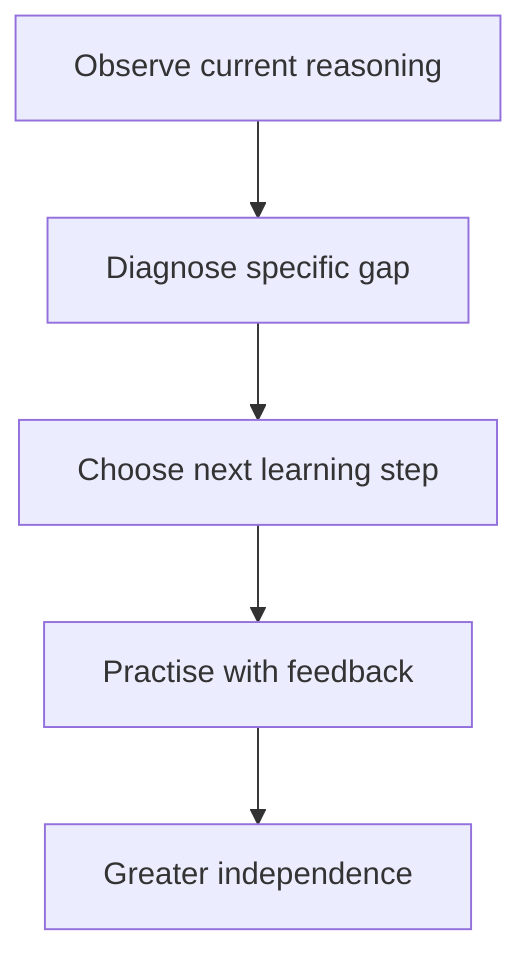

Every engineering skill this curriculum has covered so far multiplies ONE
person's own output — yours. Mentoring is a genuinely different kind of
leverage: multiplying SOMEONE ELSE's output, which means the actual skill
being exercised is different in kind, not merely "the same skills, applied
to teaching" — and it's frequently harder precisely because it isn't the
thing you're already good at.

> [!WHY] An expert repeatedly fixes a colleague’s bugs for them, keeping
> today’s tasks fast but tomorrow’s dependency unchanged. The team gains a
> repaired feature without growing anyone else’s ability to solve that
> class of problem.

> [!GOALS]
>
> - Explain mentoring as diagnosis
> - Give specific actionable feedback
> - Balance delegated learning with short-term speed

## The shift: from doing the work well to making someone else good at it

```text
  → an engineer who is EXCELLENT at solving a problem THEMSELVES
    is not automatically, or even usually, good at helping
    SOMEONE ELSE learn to solve that SAME kind of problem — these
    are genuinely, substantially different skills, and
    conflating them ("I'm a strong engineer, so I'll naturally
    be a strong mentor too") is a real, common, and
    understandable mistake.

  → the actual mentoring skill is closer to DIAGNOSIS than to
    demonstration: understanding specifically WHERE someone's
    current understanding is, and what SPECIFIC next step would
    genuinely move them forward from exactly there — not simply
    showing them how YOU would personally do it, which teaches
    them to copy a specific solution rather than to develop
    their own actual problem-solving capability.
```



## Feedback: specific and actionable beats general and vague, every time

```text
  "you should communicate better"           ✗ TRUE, maybe, but
                                                genuinely
                                                unactionable —
                                                WHAT, specifically,
                                                should actually
                                                change, and HOW
                                                would either
                                                person even know
                                                if it had?

  "in yesterday's design review, you           ✓ SPECIFIC — ties
  presented the solution before                  directly to an
  explaining the actual problem it                 ACTUAL, real
  solves — try leading with the problem            EVENT, with a
  next time, so people can properly                 concrete,
  evaluate whether the solution actually             specific,
  fits it"                                            actionable
                                                        alternative
                                                        attached
```

```text
  → this is directly the Code Review chapter's "phrase a
    concern as a grounded, specific scenario" discipline,
    applied to feedback about a PERSON'S own growth rather than
    about a diff — vague feedback ("communicate better") is
    genuinely, practically impossible to act on with any
    confidence; SPECIFIC feedback (tied to one real, concrete
    event, with a real, concrete alternative attached) is
    something the person receiving it can actually, practically
    DO differently, starting the very next time.
```

## Delegation: giving up control of HOW, in service of someone else's growth

```text
  → the genuinely hard part of delegating, specifically for
    someone who's personally strong at the work themselves:
    letting someone ELSE solve the problem in THEIR OWN way,
    even when you're already quite confident you personally know
    a faster or objectively cleaner path to the same solution.

  → the actual payoff: someone who works through a real,
    genuine struggle THEMSELVES retains and internalizes it far
    more durably than someone who was simply handed the answer
    outright — this is a real, direct trade-off, deliberately
    made: SLOWER in the SHORT term (this one specific task takes
    genuinely longer, this time, than if you'd simply done it
    yourself) for FASTER in the LONG term (they can competently
    handle this entire CLASS of problem independently, on their
    own, from now on, without needing to be handed the answer
    again).
```

## Pairing: transferring tacit knowledge that's genuinely hard to write down

```text
  → some knowledge is genuinely, structurally hard to transfer
    through DOCUMENTATION alone — not everything that matters
    for doing the work well can be captured cleanly in writing.
    the specific, half-conscious HEURISTICS an experienced
    engineer uses ("this error message USUALLY means the
    connection pool's exhausted, check THAT first before
    anything else") are frequently TACIT — genuinely hard for
    even the expert themselves to articulate directly and fully
    in writing, ahead of time, without a specific real situation
    actually prompting it.

  → PAIRING (working through a real, live problem together, in
    real time) transfers this SPECIFIC kind of knowledge far
    more effectively than a written document ever reliably can
    — watching someone's actual live REASONING process, as it
    happens, unfold in real time ("I'm checking X first because
    of Y") is precisely what a well-written runbook or doc,
    however carefully written, genuinely cannot fully capture on
    its own.
```

## Multiplying output: the actual leverage mentoring provides

```text
  → the concrete, structural reason mentoring becomes
    genuinely, increasingly valuable as someone's own career
    progresses: an engineer personally writing code has a HARD,
    real ceiling on their own total possible output — there are
    only so many hours in any given day, for any one single
    person. an engineer who has genuinely, successfully grown
    THREE OTHER engineers to be significantly more capable and
    independent has MULTIPLIED total team output, in a way
    their own individual work, however excellent, structurally
    never could on its own.
```

```text
  → this is precisely the Scope, Levels, and Growth chapter's
    "impact across multiple people/teams" axis, made completely
    concrete: mentoring is one of the most direct, tangible ways
    an individual engineer's impact genuinely SCALES beyond
    what their own two hands could ever build alone, however
    skilled those two hands happen to be.
```

> [!PITFALL] Expertise in doing the work does not automatically confer
> expertise in teaching it.

> [!INTERVIEW] Describe the learner’s current gap and an observable next
> step, not only your preferred solution.

> [!CHECK] Why can pairing transfer knowledge that documents miss?
>
> Live reasoning exposes tacit heuristics prompted by a real situation
> that an expert may not articulate in advance.

> [!CHECK] What limits an individual’s direct output?
>
> One person has a finite number of working hours; growing others can
> scale impact beyond that ceiling.

> [!CHECK] Why is “communicate better” hard to act on?
>
> It names no specific event, changed behaviour or concrete alternative
> the person can try.

## What to take away

1. Being excellent at solving a problem yourself doesn't automatically make
   you good at helping someone else learn to — these are genuinely
   different skills, and mentoring is closer to diagnosis than to
   demonstration.
2. Specific feedback tied to a real event, with a concrete alternative
   attached, is what someone can actually act on — vague feedback like
   "communicate better" is true, maybe, but practically impossible to do
   anything with.
3. Delegating means letting someone solve a problem their own way even when
   you know a faster path — a deliberate short-term-slower,
   long-term-faster trade, since someone who struggles through it
   themselves retains it more durably than someone handed the answer.
4. Tacit knowledge — the half-conscious heuristics an expert uses — is
   genuinely hard to write down, which is why pairing on a live problem
   transfers it more effectively than documentation ever reliably can.
5. Mentoring is one of the most direct ways an engineer's impact scales
   past their own individual output ceiling — growing three other
   engineers multiplies total team output in a way one person's own work,
   however excellent, structurally cannot.

## Exercises

> [!EXERCISE recall] How does diagnosis differ from merely demonstrating
> your own solution?
>
> **Solution:** Diagnosis identifies where the learner’s present
> understanding is and the next step that helps from there. Demonstration
> alone can teach copying one solution without developing independent
> problem-solving.

> [!EXERCISE apply] After an incident handoff, feedback says only
> “communicate better.” The engineer omitted which diagnostics had already
> been tried, so the next responder repeated them. Rewrite the feedback so
> the recipient can act on it and describe what you would look for next
> time.
>
> **Solution:** For example: “In today’s handoff you omitted the
> diagnostics already tried, so the next responder repeated them. Next
> time include those steps and their observed results.” In the next
> handoff, look for that concrete information rather than judging a vague
> impression of communication skill. Tie the feedback to the real event
> and an observable alternative.

> [!EXERCISE stretch] A learner is making slower progress than the mentor
> would on a suitable delegated task. Recommend an approach that grows
> independence.
>
> **Solution:** Let the learner work through a real struggle in their own
> way, diagnosing blockers and providing specific next steps rather than
> automatically taking over. A weaker answer completes every difficult
> part for them to optimize today’s speed: it preserves reliance on the
> expert instead of building capability for future tasks.
