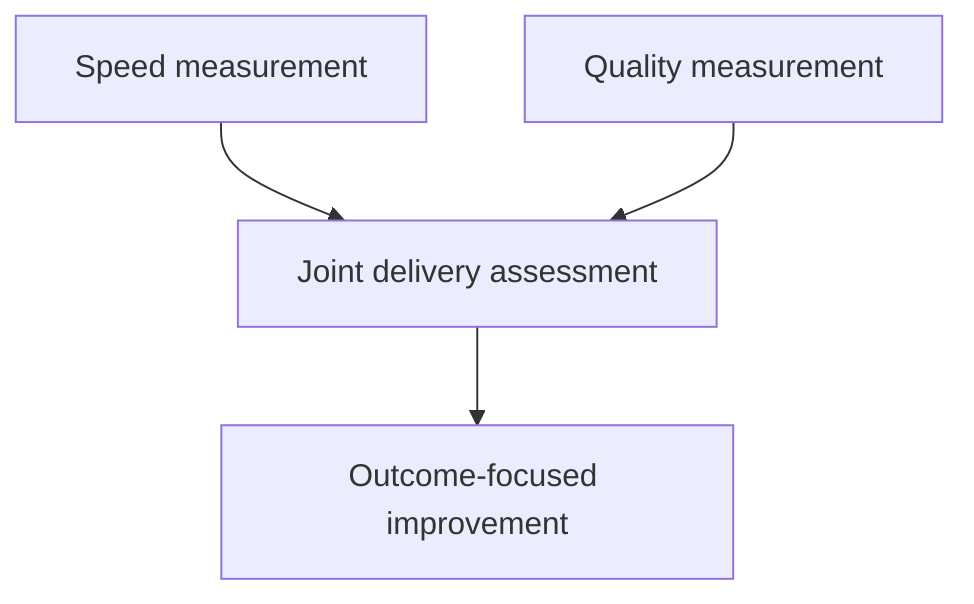

Engineering work resists measurement in a way that's easy to underestimate
— and the specific failure mode this chapter is built around, a metric
that stops measuring what it was meant to the moment it becomes a target,
is one of the most reliable, predictable traps in all of management,
appearing again and again across genuinely different domains.

> [!WHY] A team doubles deployment frequency and celebrates while more
> releases break users. The speed number has improved, but measuring it
> alone conceals the stability cost the process was supposed to avoid.

> [!GOALS]
>
> - Explain Goodhart’s law
> - Evaluate delivery speed alongside failure rate
> - Choose evidence for individual impact

## Goodhart's law: the single idea underneath this entire chapter

```text
  "when a measure becomes a target, it ceases to be a good
  measure" — Goodhart's Law, stated plainly.

  measuring LINES OF CODE written    → engineers write more,
                                          needlessly VERBOSE
                                          code, to inflate the
                                          number — the metric
                                          goes UP while actual
                                          genuine PRODUCTIVITY,
                                          if anything, goes DOWN

  measuring BUGS FIXED                  → engineers start
                                          filing trivial,
                                          near-meaningless
                                          "bugs" specifically to
                                          then fix them and
                                          inflate the count —
                                          same underlying
                                          pattern, different
                                          specific metric being
                                          gamed
```

```text
  → this ISN'T a hypothetical failure mode, or a rare edge
    case — it's a PREDICTABLE, near-universal consequence the
    moment ANY metric is used as a direct TARGET (especially
    when it's tied to something that genuinely, personally
    matters to the person being measured by it, like
    compensation or promotion) — people optimize, rationally
    and predictably, for what's actually being MEASURED, not
    necessarily for the underlying, genuine OUTCOME the metric
    was originally designed to be a useful PROXY for.
```

## DORA metrics: measuring the OUTCOME of engineering process, not individual output

```text
  DEPLOYMENT FREQUENCY      how often does code actually reach
                          production

  LEAD TIME FOR CHANGES       how long from a commit being
                          written to it running live, in
                          production

  CHANGE FAILURE RATE           what fraction of deployments
                          actually cause a real, user-facing
                          problem

  TIME TO RESTORE SERVICE         how long does an incident
                          actually take to genuinely resolve,
                          once it starts
```

```text
  → these FOUR metrics were specifically chosen, deliberately,
    because they measure the health of the entire DELIVERY
    PROCESS — not any one individual engineer's personal
    output — this sidesteps a large part of Goodhart's law's
    usual trap: it's genuinely much harder to game "how often
    does the WHOLE TEAM's code reach production, safely" than
    it is to game a metric that's aimed at one individual's own
    personal, isolated output specifically.
```

```text
  → they also, deliberately, measure BOTH speed (deployment
    frequency, lead time) AND stability (change failure rate,
    time to restore) TOGETHER, as a genuinely paired set —
    optimizing for speed ALONE, in isolation, while completely
    ignoring stability, is precisely the kind of one-dimensional
    optimization Goodhart's law predicts will happen the moment
    only ONE side of a real trade-off gets measured and
    rewarded.
```

## Individual metrics: a genuinely harder, much riskier problem

```text
  "commits per week," "lines of code," "story points
  completed" — EVERY one of these is genuinely, trivially easy
  to GAME, and NONE of them actually captures the things that
  matter most about real engineering VALUE: is the code
  actually correct, is it genuinely maintainable by someone
  else later, does it actually solve the real underlying
  problem it was meant to solve at all.

  → this is precisely why the Scope, Levels, and Growth
    chapter's evaluation of "impact" is deliberately QUALITATIVE
    (a real narrative, actual concrete examples, genuine peer
    input) rather than a single, clean, reducible NUMBER —
    engineering impact genuinely resists exactly the kind of
    clean quantification that would make it trivially,
    conveniently comparable across people, and pretending
    otherwise, by forcing it into a single number anyway, tends
    to produce exactly the gaming Goodhart's law predicts.
```

## Product metrics: the same trap, in a different, equally real disguise

```text
  "increase daily active users"      → can be "achieved" via a
                                         genuinely manipulative
                                         notification strategy
                                         that annoys real users
                                         into technically
                                         opening the app more
                                         often, without making
                                         the actual PRODUCT
                                         itself genuinely any
                                         better for them at all

  → the SAME underlying Goodhart's law pattern, playing out in
    product work rather than in engineering process
    specifically — this is directly the Ethics and
    Responsibility chapter's dark-patterns point, resurfacing
    here from a slightly different, metrics-focused angle: a
    metric optimized in genuine isolation, disconnected from
    what it was actually originally meant to be a useful,
    honest PROXY for, can very easily drift into actively
    harming the real thing it was supposed to be measuring in
    the first place.
```

## Measurements that resist gaming: pairing metrics deliberately

```text
  → the practical, general defense against Goodhart's law: pair
    a SPEED metric with a QUALITY one, DELIBERATELY, together
    — "deployment frequency" alone rewards recklessly shipping
    broken code quickly; PAIRED explicitly with "change failure
    rate," it instead rewards shipping GOOD code quickly, which
    is the thing that was actually, genuinely wanted all along.

  → this is the same UNDERLYING discipline as the SLOs and
    Reliability Engineering chapter's error budget — a single,
    isolated metric optimized on its own, with nothing else
    constraining it, tends to drift toward its own worst-case,
    most degenerate extreme; a genuinely PAIRED metric, with an
    explicit counterweight built in, keeps the optimization
    HONEST, bounded, and pointed at what actually matters.
```



> [!PITFALL] Counting commits or lines creates a target people can inflate
> without improving maintainability or user outcomes.

> [!INTERVIEW] Say which real outcome a proxy represents and what
> counterweight keeps it honest.

> [!CHECK] What period does lead time for changes measure here?
>
> From a commit being written until that change is running in production.

> [!CHECK] What does time to restore service capture?
>
> How long an incident takes to resolve once it starts, a stability
> measure alongside failure rate.

> [!CHECK] Why can a daily-active-user target mislead?
>
> Manipulative notifications can increase openings without improving the
> product for users.

## What to take away

1. Goodhart's law — a measure used as a target stops being a good measure —
   is a predictable, near-universal consequence, not a rare edge case,
   especially once a metric is tied to something that personally matters,
   like compensation.
2. DORA's four metrics deliberately measure team delivery-process health
   rather than individual output, which sidesteps much of Goodhart's trap —
   it's much harder to game "how often does the whole team ship safely"
   than one person's isolated output.
3. DORA pairs speed metrics with stability ones deliberately — optimizing
   for speed alone while ignoring stability is exactly the one-dimensional
   optimization Goodhart's law predicts.
4. Individual output metrics (commits, lines of code, story points) are
   trivially gameable and don't capture what actually matters, which is
   why real impact evaluation stays deliberately qualitative rather than a
   single clean number.
5. A product metric optimized in isolation from what it was meant to proxy
   for can drift into actively harming the real thing — the defense is
   deliberately pairing metrics (speed with quality, the same shape as an
   error budget) so the optimization stays honest and bounded.

## Exercises

> [!EXERCISE recall] What does Goodhart’s law predict when a proxy becomes
> a rewarded target?
>
> **Solution:** People optimize the measured number, which can detach from
> the intended outcome. More verbose code can raise a lines-of-code target
> while reducing real productivity.

> [!EXERCISE apply] In two equal four-week periods, a team moves from 20
> deployments with 1 user-facing failure to 40 with 6. Compute frequency
> per week and failure rate. Is the higher frequency alone enough to claim
> improvement?
>
> **Solution:** Frequency increases from 20 ÷ 4 = 5 per week to 40 ÷ 4 = 10. Failure rate rises from 1 ÷ 20 = 5% to 6 ÷ 40 = 15%, tripling. The
> team ships twice as often but with a worse failure fraction; assess both
> speed and stability rather than declaring success from frequency alone.

> [!EXERCISE stretch] A manager proposes ranking engineers solely by
> commits per week. Recommend an impact assessment.
>
> **Solution:** Use concrete qualitative examples of impact, correctness,
> maintainability, problem-solving and peer input, as described in the
> chapter, while using delivery metrics for team-process health. A weaker
> answer keeps the ranking and asks people not to game it: splitting
> commits can raise the count without increasing genuine value.
