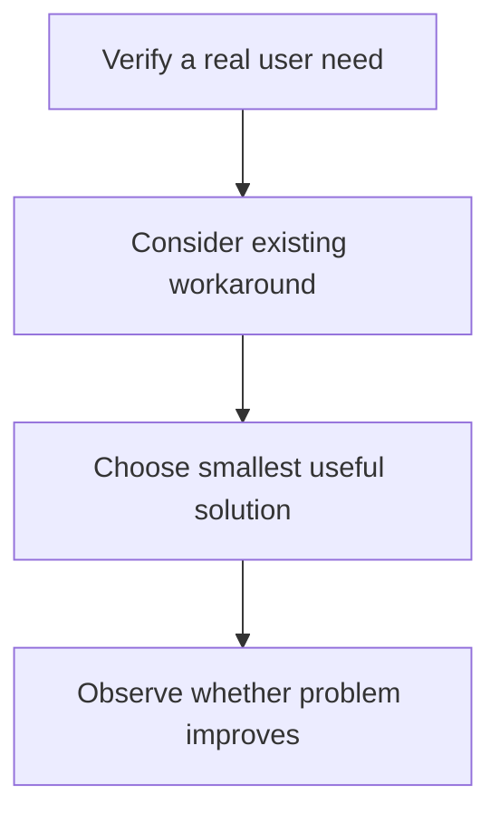

Every chapter before this one assumed the thing being built was worth
building, and focused entirely on building it well. This chapter is the
question that comes BEFORE that one — and an engineer who can build
anything, flawlessly, but never asks whether it's worth building, is
genuinely dangerous to a team's actual effectiveness, not merely
incomplete.

> [!WHY] A team delivers a polished feature on time, then discovers users
> already had an adequate workaround. The engineering success leaves
> maintenance and navigation costs without a corresponding solved need.

> [!GOALS]
>
> - Explain costs beyond initial implementation
> - Choose a smallest useful solution from user evidence
> - Define observable product success

## The question that comes before "how"

```text
  "how should I build this feature"        the question
                                              engineering skill
                                              answers

  "should this feature EXIST, and does       the question
  it solve a REAL problem, for a REAL          product sense
  user, better than the alternatives"           answers
```

```text
  → a team that's extremely skilled at the FIRST question and
    never asks the SECOND one builds things EXTREMELY WELL that
    NOBODY actually needed — this is a genuinely common,
    genuinely expensive failure mode, and it's invisible from
    the INSIDE of "how" work, since the code itself can be
    excellent, well-tested, and shipped on time, while still
    solving a problem nobody actually had.
```

## Users and problems: starting from the actual need, not the solution

```text
  "build a dashboard with these 15 specific charts"    ✗ a
                                                            SOLUTION,
                                                            arriving
                                                            pre-decided

  "the support team can't tell WHICH customers are         ✓ the
  about to churn, so they can't intervene in time"            actual
                                                                PROBLEM
                                                                underneath
```

```text
  → starting from the SOLUTION (build 15 charts) skips
    straight past the actual PROBLEM, and the fifteen charts
    might not even be the RIGHT solution to that underlying
    problem at all — starting from the PROBLEM leaves room to
    discover a genuinely BETTER solution than the one that was
    first proposed (maybe it's one alert, not fifteen charts;
    maybe it's a single number, not a dashboard) — this is
    directly this project's own architecture-rules discipline
    ("ask, don't decide, when a spec is ambiguous about
    structure") applied one level up, to the PRODUCT question
    rather than to a technical one.
```

## Trade-offs: every feature costs something, even when it costs no code

```text
  → a feature has a REAL cost beyond the engineering time spent
    building it: ONGOING maintenance burden (forever, or until
    it's explicitly removed), added COMPLEXITY for every user
    (even ones who never actually use this specific feature,
    who still have to navigate around it), and OPPORTUNITY COST
    (the time spent on THIS is time that could have gone to
    something else instead) — "it doesn't cost much to build"
    is frequently TRUE and still genuinely the wrong reason to
    build something, because the ONGOING cost, paid indefinitely
    after shipping, often dwarfs the one-time building cost by
    a wide margin.
```

## Knowing which engineering work is worth doing at all

```text
  the practical, recurring questions worth asking BEFORE
  starting any nontrivial engineering work, not after:

    ✓  who SPECIFICALLY has this problem, and how do we actually
       know they have it (a real, first-hand signal — not an
       assumption nobody's actually verified)
    ✓  what happens if we DON'T build this — is there a
       reasonable WORKAROUND already available, or is the
       problem genuinely, actively painful without it
    ✓  is this the SMALLEST version that genuinely solves the
       real problem, or is it accumulating scope beyond what
       the actual problem requires
    ✓  how will we actually KNOW if this worked, after shipping
       it — what's the concrete, observable signal
```

```text
  → this is directly the "smallest reasonable extension" and
    "don't add scope beyond what's needed" instinct from
    CLAUDE.md's own architecture rules, generalized from a
    TECHNICAL decision (how much abstraction does this specific
    change actually need) to a PRODUCT one (how much FEATURE
    does this actual problem genuinely need) — the same
    underlying discipline, aimed at a different kind of
    question.
```



## Saying no, and why it's a genuine engineering skill

```text
  → "no, we shouldn't build that, because X" is a real skill,
    not merely stubbornness or a lack of eagerness to help — a
    team that says yes to EVERYTHING eventually drowns in
    accumulated complexity and half-finished, poorly-maintained
    features, each one individually well-intentioned when it
    was first approved.

  → the SKILLED version isn't a flat, unexplained "no" — it's
    "no, because [specific, examinable reasoning] — but HERE's
    an alternative that might actually solve your real
    underlying problem instead" — this is the Web Application
    Security chapter's OWASP-pattern-recognition instinct,
    generalized: recognizing a REQUEST-SHAPED problem (someone
    asking for a specific solution) that's actually a
    NEED-SHAPED problem underneath (a real need that specific
    solution may not even be the best way to solve), and
    engaging with the underlying need directly rather than
    reflexively building whatever was literally asked for.
```

> [!PITFALL] A low implementation estimate leaves maintenance, user
> complexity and opportunity cost unpaid rather than absent.

> [!INTERVIEW] Identify the specific user and evidence of their problem
> before selecting the feature shape.

> [!CHECK] Why ask what happens if nothing is built?
>
> An existing workaround may adequately meet the need, changing whether
> new complexity is worth adding.

> [!CHECK] Why can excellent code still be wasted work?
>
> Technical quality does not establish that the implemented feature solves
> a real problem.

> [!CHECK] How does saying no well differ from a bare refusal?
>
> It explains the underlying concern and proposes an alternative that
> addresses the actual need.

## What to take away

1. "How should I build this" and "should this exist at all" are genuinely
   different questions — a team skilled only at the first can build
   excellent things nobody needed, and that failure is invisible from
   inside the building work itself.
2. Starting from the actual problem, not a pre-decided solution, leaves
   room to discover a genuinely better answer than the one first proposed
   — the same "ask, don't decide" discipline applied to product instead of
   architecture.
3. A feature's real cost extends past the code it takes to build —
   ongoing maintenance, complexity for every user, and opportunity cost
   often dwarf the one-time building cost.
4. Asking who specifically has this problem, what happens without it, and
   how you'll know it worked, before starting, is the "smallest reasonable
   extension" instinct generalized from a technical decision to a product one.
5. Saying no well means engaging with the real underlying need rather than
   reflexively building the specific solution someone asked for — a real
   engineering skill, not stubbornness, and the alternative to a team that
   eventually drowns in accumulated, individually-reasonable complexity.

## Exercises

> [!EXERCISE recall] What costs remain after a feature’s code is written?
>
> **Solution:** Ongoing maintenance, complexity for users including
> nonusers of the feature, and the opportunity cost of work that could
> have been done instead.

> [!EXERCISE apply] Users repeatedly export a report and email it to a
> colleague. A proposal calls for a full collaboration workspace, but
> observation shows the current pain is keeping that colleague’s copy up
> to date. Choose a first version and name what evidence would justify
> expanding it later.
>
> **Solution:** Test whether a simple shared current report view solves
> the repeated export/email problem, and verify that both people can use
> the updated information in their workflow. Expand only when observed
> unresolved needs justify more collaboration features. Building the full
> workspace first assumes a proposed solution is necessary and incurs
> complexity before demonstrating value.

> [!EXERCISE stretch] A team wants to declare success when a new feature
> ships. Recommend a success condition for the user problem and a weaker
> alternative to avoid.
>
> **Solution:** Define an observable signal that the intended users’
> problem improved, such as whether support can now identify and intervene
> in the cases the feature targets. A weaker answer counts only on-time
> delivery or number of charts: those show implementation happened, not
> that the underlying need was met.
