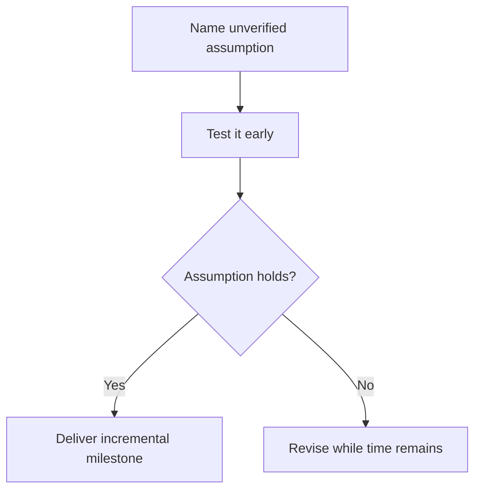

A design doc (the previous chapter) decides WHAT to build. This chapter is
turning that decision into a sequence of actual work that ships — and the
gap between "we decided what to build" and "it's actually running in
production" is where most of a project's real risk and most of its genuine
schedule uncertainty actually live.

> [!WHY] A project builds all the familiar screens before testing its
> unfamiliar integration. Discovering the integration cannot support the
> plan late in the schedule makes the visible progress expensive to
> discard.

> [!GOALS]
>
> - Explain incremental delivery’s feedback value
> - Sequence work to retire named risk
> - Define independently verifiable milestones

## Breaking work down: smaller than feels natural, on purpose

```text
  "build the new checkout flow"              ✗ a project, not
                                                  a task — far
                                                  too large to
                                                  estimate,
                                                  sequence, or
                                                  track
                                                  meaningfully

  "add the cart-total calculation
   endpoint" / "build the payment-form
   UI" / "wire up the confirmation email"     ✓ genuinely
                                                  independent,
                                                  individually
                                                  estimable,
                                                  individually
                                                  TESTABLE tasks
```

```text
  → this is the Software Craft track's "one function, one job"
    discipline, at PROJECT scale rather than at the level of a
    single function — a task that's genuinely too large to
    estimate confidently is USUALLY too large to safely execute
    confidently too, for the identical underlying reason: nobody
    actually understands its full shape and scope well enough
    yet, in either case.
```

## Sequencing: which order actually reduces risk fastest

```text
  → the practical, genuinely useful question when sequencing a
    breakdown: which task, if it turns out to be genuinely
    HARDER than expected, would we most want to discover THAT
    fact EARLY rather than late — front-load the parts with
    real, substantial UNCERTAINTY (an unfamiliar API, an
    unverified assumption about how a third-party system
    actually behaves), and leave the well-understood,
    predictable, low-risk parts for later in the sequence.
```

```text
  → this directly inverts a common, intuitive-feeling but
    genuinely wrong instinct: doing the comfortable, familiar,
    well-understood parts FIRST (because they feel good, and
    show visible progress quickly) while deferring the
    genuinely SCARY, uncertain parts until later — which means
    discovering a project-threatening problem only once
    there's already very little schedule left to actually
    respond to it or change course.
```

## Milestones: checkpoints that are actually verifiable, not just dates on a calendar

```text
  "50% done" (an estimate)            ✗ UNVERIFIABLE — nobody
                                          can actually confirm
                                          or refute this claim
                                          independently

  "the API returns real data for        ✓ VERIFIABLE — a
  the happy path" (a concrete,             specific, concrete
  demonstrable state)                       state someone can
                                              actually go check
                                              for themselves,
                                              directly
```

```text
  → a milestone genuinely worth having is a specific,
    demonstrable STATE the system can be shown to be in — not a
    percentage estimate of effort spent, which is fundamentally
    unverifiable by anyone other than whoever's personally
    reporting that specific number. "90% done" has a well-earned
    reputation for staying stubbornly, suspiciously true for
    weeks at a stretch, precisely because it's a subjective
    feeling rather than an objective, checkable state.
```

## Shipping incrementally: the actual point of breaking work down at all

```text
  → the entire underlying reason to break a large project into
    smaller pieces in the first place: SHIP the pieces
    INCREMENTALLY, getting real, genuine feedback along the way,
    rather than integrating everything together and revealing
    the ENTIRE thing all at once, at the very end, only to
    discover then whether it actually works and whether it was
    actually the right thing.
```

```text
  → this is the How Software Gets Built chapter's entire Agile
    argument, resurfacing at the level of a SINGLE project's own
    internal execution rather than at the level of a whole
    product's overall roadmap — the SAME underlying reasoning
    (bound how long you can be wrong before finding out) applies
    identically at both scales, just at different granularities
    of "how long before we actually find out."
```

## Risk: naming it explicitly, rather than discovering it by surprise

```text
  → every nontrivial project genuinely carries risk — the
    practical discipline is NAMING it explicitly, upfront
    ("we're assuming the third-party API supports batch
    requests — if it doesn't, this whole approach needs to
    change"), rather than discovering an unstated, unexamined
    assumption was silently, invisibly wrong only once a real
    amount of work has already been built directly on top of it.
```

```text
  → a project's SEQUENCING (above) should be directly informed
    by its NAMED risks — the task that would most conclusively
    validate or invalidate the riskiest unverified assumption
    generally belongs EARLY in the sequence, specifically so a
    genuinely wrong assumption is discovered while there's still
    real, meaningful schedule left to actually change course in
    response to it.
```



> [!PITFALL] A percentage-complete estimate does not identify a state
> another person can independently verify.

> [!INTERVIEW] Name the assumption that could overturn the plan and show
> where the schedule tests it.

> [!CHECK] Why split a project into smaller tasks?
>
> Independent, estimable and testable pieces expose a clearer shape for
> execution and tracking.

> [!CHECK] Why are familiar tasks tempting to do first?
>
> They show comfortable visible progress, but can defer the uncertainty
> most likely to threaten the project.

> [!CHECK] Why name risk rather than relying on intuition?
>
> Explicit assumptions can guide sequencing and deliberate validation
> before much work depends on them.

## What to take away

1. Breaking work into genuinely independent, estimable, testable tasks is
   the "one function, one job" discipline at project scale — a task too
   large to estimate confidently is usually too large to execute
   confidently too.
2. Sequence the riskiest, most uncertain parts first, not the comfortable
   familiar ones — discovering a project-threatening problem early, while
   there's still schedule left to respond, beats discovering it late.
3. A real milestone is a specific, verifiable state someone can check for
   themselves — "90% done" is an unverifiable feeling, which is exactly
   why it has a reputation for staying stubbornly true for weeks.
4. Shipping incrementally is the Agile argument (bound how long you can be
   wrong before finding out) resurfacing at the scale of one project's
   internal execution, not just a whole roadmap.
5. Naming a project's risks explicitly, upfront, and sequencing to validate
   the riskiest assumptions first is what prevents discovering a silently
   wrong assumption only after real work has already been built on top of
   it.

## Exercises

> [!EXERCISE recall] Why ship pieces incrementally rather than only break
> them into internal tasks?
>
> **Solution:** Actual delivery produces real feedback before the entire
> project is integrated, bounding how long a mistaken assumption can
> remain uncorrected.

> [!EXERCISE apply] A reporting migration needs familiar screens and an
> unfamiliar import library assumed to preserve timestamps across a round
> trip. Losing that information would invalidate historical reports.
> Choose the first validation task and describe what result changes the
> remaining sequence.
>
> **Solution:** Run a focused import/export round-trip check on
> representative timestamped data before building the screens around the
> library. If the required information survives, continue incremental
> end-to-end delivery; otherwise revise the import approach while schedule
> remains. Starting with familiar screens defers the assumption that could
> invalidate the reporting plan.

> [!EXERCISE stretch] A milestone says “checkout 80% done.” Recommend a
> replacement that an independent reviewer can verify.
>
> **Solution:** Use a concrete demonstrable state, such as “the checkout
> API returns real data for the happy path,” with a way to exercise that
> behaviour. A weaker answer changes the estimate to a more detailed
> percentage: it still reports subjective effort rather than a checkable
> system state.
