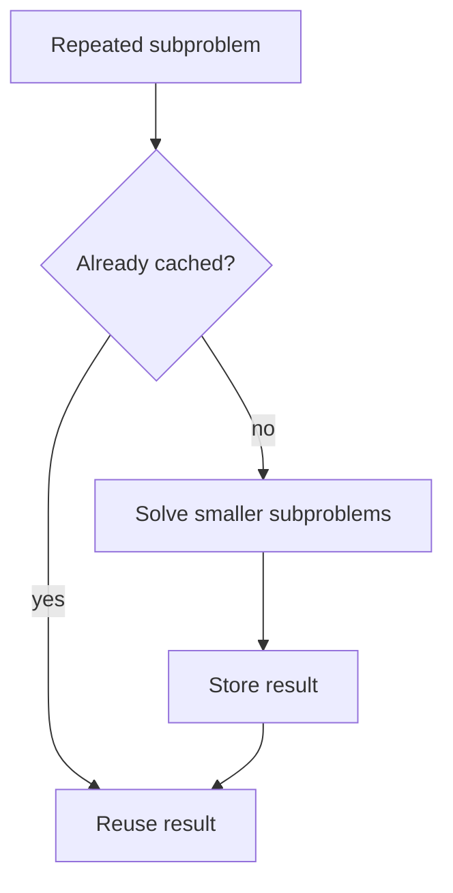

Nearly every hard programming problem, once you strip away its specific
domain, reduces to one of a small number of recurring algorithmic shapes.
This chapter isn't every algorithm — it's the shapes themselves, which is
what lets you recognize a new problem as an old one in disguise.

> [!WHY] A search routine passes its tests on sorted records, then
> silently misses records after ingestion changes their order. An
> algorithm’s precondition can decide correctness even when the code still
> runs without an exception.

> [!GOALS]
>
> - Explain when memoization pays off
> - Choose algorithms from workload requirements
> - Test a greedy choice with a counterexample

## Sorting: the baseline every comparison builds on

```text
  COMPARISON SORTS have a PROVEN lower bound of O(n log n) —
  no comparison-based sort can beat this in the general case
  (a proof from information theory: distinguishing n! possible
  orderings needs at least log₂(n!) ≈ n log n comparisons).

    MERGE SORT     O(n log n) guaranteed, STABLE (equal
                   elements keep their relative order),
                   needs O(n) extra space
    QUICKSORT       O(n log n) average, O(n²) worst case,
                   in-place, but NOT stable
    NON-COMPARISON   RADIX/COUNTING sort can beat O(n log n)
    SORTS            by exploiting structure in the data
                   (bounded integer range) — they don't
                   compare elements at all, so the lower
                   bound doesn't apply to them
```

```text
  → "stable" matters concretely: sorting a list of orders by
    STATUS after it's already sorted by DATE, with a stable
    sort, preserves date order WITHIN each status group — an
    unstable sort scrambles that secondary ordering silently.
```

## Searching: binary search's precondition

```text
  binary search is O(log n) — but it REQUIRES sorted input.
  running it on unsorted data doesn't error; it silently
  returns a WRONG answer, because the algorithm's correctness
  proof depends entirely on the sortedness invariant it never
  checks.

  → this is the recurring theme across every algorithm in this
    chapter: each one has a PRECONDITION its correctness
    depends on, and violating it usually doesn't crash — it
    silently produces a wrong result, which is far more
    dangerous than a crash.
```

## Graph traversal: BFS vs DFS

```text
  BFS (Breadth-First)    explores LEVEL BY LEVEL — the first
                        time BFS reaches a node is via the
                        SHORTEST path (in an unweighted graph)
                        — this is WHY BFS is the standard
                        choice for shortest-path-in-hops
                        problems

  DFS (Depth-First)       explores AS DEEP AS POSSIBLE before
                        backtracking — natural for problems
                        about REACHABILITY, cycle detection,
                        or exploring every possibility (a
                        maze, a dependency graph's full
                        traversal)
```

```text
  → the choice isn't stylistic — "shortest path in an
    unweighted graph" REQUIRES BFS's level-by-level property;
    DFS finding A path doesn't guarantee it's the SHORTEST one.
```

## Dynamic programming: memoizing overlapping subproblems

```text
  fib(n) = fib(n-1) + fib(n-2)     naive recursion: O(2ⁿ) —
                                      recomputes fib(3) many,
                                      many times across the
                                      recursion tree

  memo = {}
  function fib(n) {
    if (n in memo) return memo[n];      // ✓ O(n) — each
    return memo[n] = fib(n-1)+fib(n-2);    distinct
  }                                          subproblem
                                              computed ONCE
```

```text
  → DP applies when a problem has OVERLAPPING SUBPROBLEMS (the
    same smaller computation needed repeatedly) AND OPTIMAL
    SUBSTRUCTURE (the best overall solution is built from best
    solutions to subproblems) — without overlap, memoization
    buys nothing (nothing to cache); without optimal
    substructure, a greedy or brute-force approach may not
    combine correctly.
```

```text
    → this is the Complexity and Analysis chapter's amortized-cost idea,
    applied differently: the FIRST computation of
    each
    subproblem pays its real cost; every SUBSEQUENT reference
    to the same subproblem is O(1) — the total cost collapses
    from exponential (recomputing) to polynomial (computing
    once, reading many times).
```




## Greedy algorithms: locally optimal, sometimes globally correct

```text
  a GREEDY algorithm makes the LOCALLY best choice at each
  step, never reconsidering — cheap, but only PROVABLY correct
  for problems with a specific structure (the "greedy choice
  property": a locally optimal choice is always part of SOME
  globally optimal solution).

  → making change with US coin denominations (25, 10, 5, 1):
    greedy (always take the largest coin that fits) IS
    provably optimal.
  → making change with denominations (25, 10, 1) needs 30
    cents: greedy takes 25+1+1+1+1+1 (six coins); the actual
    optimal is 10+10+10 (three coins) — greedy FAILS here,
    silently producing a valid-but-suboptimal answer, because
    THIS denomination set lacks the property that made it work
    for US coins.
```

```text
  → the practical lesson: greedy's correctness is NOT
    "usually works" — it's a per-problem PROOF OBLIGATION.
    verify the greedy-choice property holds for YOUR specific
    problem before trusting a greedy approach, rather than
    assuming it generalizes from a case where it happened to
    work.
```

## Divide and conquer

```text
  DIVIDE the problem into smaller subproblems of the SAME
  shape, CONQUER each recursively, COMBINE the results — merge
  sort (divide into halves, sort each, merge) and binary search
  (divide the search space in half each step) are both this
  same pattern.

  → the recurrence T(n) = 2T(n/2) + O(n) (the Master Theorem's
    standard form) is what resolves to O(n log n) — recognizing
    a new problem fits THIS shape lets you predict its
    complexity from the recurrence alone, before writing or
    benchmarking any code.
```

> [!PITFALL] Binary search on unsorted input can return a wrong answer
> silently; sortedness is part of its correctness contract.

> [!INTERVIEW] Name the algorithm’s precondition before its complexity:
> sortedness for binary search, equal edge costs for BFS, and a proved
> greedy-choice property for greedy optimisation.

> [!CHECK] What is the general comparison-sort lower bound?
>
> O(n log n); counting and radix sorts escape it by exploiting value
> structure rather than comparing arbitrary elements.

> [!CHECK] Why is DFS not a shortest-hop substitute for BFS?
>
> It follows depth rather than distance layers, so the first path it finds
> need not use the fewest hops.

> [!CHECK] Which divide-and-conquer recurrence gives O(n log n) here?
>
> T(n) = 2T(n/2) + O(n), as in splitting, sorting halves and merging.

## What to take away

1. Comparison sorts have a proven O(n log n) lower bound; non-comparison
   sorts (radix, counting) can beat it because they exploit structure in the
   data instead of comparing elements.
2. Nearly every algorithm here has a precondition (sortedness for binary
   search, a specific graph shape for BFS's shortest-path guarantee) whose
   violation silently produces a wrong answer rather than an error.
3. BFS's level-by-level exploration is what guarantees the first path found
   is shortest in an unweighted graph — DFS finding a path doesn't guarantee
   it's the shortest one.
4. Dynamic programming applies when a problem has overlapping subproblems
   and optimal substructure — memoization turns exponential recomputation
   into polynomial compute-once-read-many-times cost.
5. A greedy algorithm's correctness is a per-problem proof obligation, not a
   general heuristic — the same greedy strategy that's provably optimal for
   one denomination set fails silently, with a valid but suboptimal answer,
   for another.

## Exercises

> [!EXERCISE recall] Which two properties make dynamic programming useful,
> and what fails without each?
>
> **Solution:** Overlapping subproblems let stored results avoid repeated
> computation; optimal substructure lets correct subproblem solutions
> combine into a correct overall solution. Without overlap there is no
> repeated work to cache; without the required structure those choices
> need not combine correctly.

> [!EXERCISE apply] A report must sort tickets by priority while retaining
> arrival order among equal priorities, then search many sorted ticket
> ids. Choose a sort and a search, naming the relevant guarantees and
> costs.
>
> **Solution:** Choose stable merge sort for O(n log n) guaranteed sorting
> with O(n) extra space; stability preserves arrival order within priority
> groups. Use binary search for the separately sorted ids at O(log n),
> ensuring sortedness first. An unstable sort can lose the arrival
> ordering, and binary search on unsorted ids is invalid.

> [!EXERCISE stretch] A machine has coin values 8, 5 and 1 and must return
> 10 units with as few coins as possible. Evaluate largest-first greedy,
> recommend an approach, and explain the weaker claim that greedy worked
> for another coin system.
>
> **Solution:** Greedy picks 8, then 1, then 1: three coins. Two 5s make
> 10 with two coins, and no single available coin makes 10, so two is
> optimal. Reject unproved greedy here; use an exact method that considers
> alternatives, such as dynamic programming. Success on another
> denomination set is a weaker justification because the greedy-choice
> property belongs to the particular problem.
