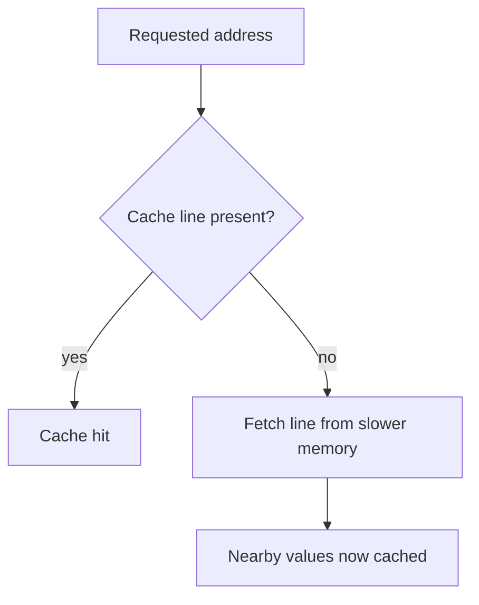

Two algorithms with the same Big-O complexity can differ in real wall-clock
speed by an order of magnitude, and the reason is almost never the algorithm
— it's how well each one's memory access pattern matches the hardware
underneath it. This chapter is that hardware, at the level of detail that
explains the difference.

> [!WHY] A matrix aggregation saturates memory access while CPU arithmetic
> remains cheap. Rewriting the arithmetic leaves the delay intact if the
> loop still jumps between distant rows instead of following contiguous
> storage.

> [!GOALS]
>
> - Explain spatial and temporal locality
> - Choose a traversal to match storage layout
> - Evaluate padding cost at collection scale

## The memory hierarchy

```text
  REGISTERS      ~0.3 ns    a handful of values, on-die
  L1 CACHE        ~1 ns      ~32-64 KB
  L2 CACHE         ~4 ns      ~256 KB - 1 MB
  L3 CACHE          ~15 ns     several MB, shared across cores
  MAIN MEMORY        ~100 ns    GBs
  SSD                  ~100 µs    TBs
  NETWORK (same DC)     ~500 µs
```

```text
  → each level is roughly an ORDER OF MAGNITUDE slower and
    larger than the one above it — this exact table is what the
    Back-of-Envelope Estimation chapter's numbers are built
    from, and it's worth having memorized rather than looked
    up: an L1 hit and a main-memory access differ by roughly
    100×, which is the entire reason caching (at every level,
    from a CPU cache to the Caching chapter's Redis layer)
    exists at all.
```

## Why caches work: locality

```text
  TEMPORAL LOCALITY     if you accessed X recently, you'll
                       likely access it again soon (a loop
                       variable, a hot function)

  SPATIAL LOCALITY       if you accessed X, you'll likely
                       access something NEAR X soon (the next
                       element in an array)
```

```text
  → a cache doesn't fetch ONE byte on a miss — it fetches an
    entire CACHE LINE (typically 64 bytes) around the requested
    address, betting on spatial locality that nearby bytes will
    be needed next. this single fact is the entire explanation
    for why array iteration is fast and pointer-chasing (a
    linked list, a tree with scattered allocations) is slow,
    even at identical Big-O.
```




## Row-major iteration: the classic cache-locality bug

```text
  // a 1000×1000 matrix, stored ROW-MAJOR (rows contiguous
  // in memory)

  for (let j = 0; j < 1000; j++)          // ✗ COLUMN-major
    for (let i = 0; i < 1000; i++)           traversal —
      sum += matrix[i][j];                    each access
                                                jumps 1000
                                                elements away
                                                from the last,
                                                missing the
                                                cache virtually
                                                every time

  for (let i = 0; i < 1000; i++)          // ✓ ROW-major
    for (let j = 0; j < 1000; j++)           traversal —
      sum += matrix[i][j];                   sequential,
                                              matches the
                                              storage layout,
                                              stays in cache
```

```text
  → both loops are O(n²), doing the IDENTICAL number of
    additions — and the row-major version is commonly 5-10×
    faster in practice, purely from cache behavior. this is the
    canonical example that "same Big-O" does not mean "same
    speed," and it's a real, measurable difference, not a
    theoretical one.
```

## Branch prediction

```text
  if (condition) { doA(); } else { doB(); }

  → the CPU doesn't wait to know which branch a condition
    takes before starting work — it PREDICTS (based on
    history: "this branch was taken the last several times")
    and speculatively executes ahead. a correct prediction
    costs nothing extra; a MISPREDICTION means discarding the
    speculative work and restarting — a real, measurable
    penalty, often 10-20 cycles.
```

```text
  → a branch with a PREDICTABLE pattern (mostly one direction,
    or a periodic pattern) predicts well; a branch on
    essentially RANDOM data predicts poorly. the well-known
    demonstration: sorting an array before a loop that branches
    on each element's value can make the loop measurably
    FASTER, purely because sorted data makes the branch
    predictable — an optimization that looks nonsensical
    (why would sorting speed up an unrelated loop?) until you
    know why.
```

## Pipelining and instruction-level parallelism

```text
  a CPU doesn't execute one instruction fully before starting
  the next — it PIPELINES: fetch, decode, execute, and
  write-back stages for DIFFERENT instructions overlap,
  processing several instructions concurrently at different
  stages, the same way a factory assembly line overlaps work
  on different units.

  → a DATA DEPENDENCY (instruction 2 needs instruction 1's
    result) can stall this overlap — code with independent
    operations that the compiler/CPU can interleave freely
    pipelines better than a long chain of each result
    depending on the previous one.
```

## Words, alignment, and struct padding

```text
  struct Bad {                    struct Good {
    bool a;      // 1 byte          int32 b;   // 4 bytes
    int32 b;     // 4 bytes         int32 c;   // 4 bytes
    bool c;      // 1 byte          bool a;    // 1 byte
  }                                 bool d;    // 1 byte
  // → often 12 bytes with        }
  //   padding between fields     // → often 8 bytes — same
  //   to keep b ALIGNED           //   data, ordered by size,
                                    //   far less padding
```

```text
  → the CPU reads memory in ALIGNED chunks (a 4-byte value
    generally needs to start at a 4-byte-aligned address for
    efficient access) — the compiler inserts PADDING to
    satisfy this, and a struct's FIELD ORDER (not just its
    fields) determines how much padding gets wasted. this
    matters concretely at scale: a struct with 4 extra bytes
    of padding, allocated a million times, is 4MB of pure
    waste from field ordering alone.
```

> [!PITFALL] Identical Big-O does not imply identical speed: pointer
> chasing and strided access can squander locality.

> [!INTERVIEW] Explain the access pattern, not just Big-O. Say whether
> neighbouring operations touch the same cache line and whether
> dependencies or branch misses stall the CPU.

> [!CHECK] Approximately how much slower is main memory than an L1 hit in
> the table?
>
> 100 ns ÷ 1 ns ≈ 100 times.

> [!CHECK] Why can a mispredicted branch cost time?
>
> The CPU discards speculative work and restarts; the chapter gives a
> penalty often around 10–20 cycles.

> [!CHECK] Why can a dependency chain limit instruction-level overlap?
>
> An instruction must wait for a previous result rather than executing
> independently alongside other work.

## What to take away

1. The memory hierarchy's roughly-10×-per-level cost gap is the entire
   reason caching exists at every level of a system, from an L1 cache line
   to a Redis layer.
2. A cache fetches an entire cache line on a miss, betting on spatial
   locality — this single fact explains why array iteration is fast and
   pointer-chasing is slow at identical Big-O.
3. Row-major vs column-major matrix traversal is the canonical proof that
   identical Big-O doesn't mean identical speed — a 5-10× real difference
   from access pattern alone.
4. Branch misprediction has a real, measurable cost, which is why sorting
   data before a loop that branches on it can genuinely speed the loop up —
   sorted data makes the branch predictable.
5. A struct's field order determines how much alignment padding is wasted —
   ordering fields by size can shrink a struct meaningfully at scale, with
   no change to the data it holds.

## Exercises

> [!EXERCISE recall] Distinguish spatial and temporal locality and explain
> how fetching a cache line uses one of them.
>
> **Solution:** Temporal locality means recently accessed data is likely
> to be reused. Spatial locality means nearby addresses are likely to be
> accessed. Fetching a whole cache line brings nearby bytes in together,
> exploiting spatial locality.

> [!EXERCISE apply] A row-major 600 by 400 matrix is summed with column
> index outermost and row index innermost. Choose loop order and contrast
> the consecutive address steps in elements without claiming a new Big-O.
>
> **Solution:** Put row index i outside and column index j inside. In the
> original inner loop, matrix[i][j] to matrix[i+1][j] jumps 400 elements
> because each row holds 400. In the revised loop, matrix[i][j] to
> matrix[i][j+1] steps one element. Both perform 600 × 400 = 240,000
> additions and remain quadratic for square scaling; locality changes
> elapsed time, not the addition count.

> [!EXERCISE stretch] A layout review finds 4 avoidable padding bytes in
> each of two million records. Recommend whether to investigate field
> order and name a weaker argument based only on algorithmic complexity.
>
> **Solution:** Investigate reordering fields by alignment needs and
> verify the resulting layout. The avoidable space is 4 × 2,000,000 =
> 8,000,000 bytes, or 8 MB. Reducing record size can improve cache density
> without changing held data. A weaker answer leaves the layout unchanged
> because the algorithm is still O(n): Big-O omits both memory footprint
> and cache behaviour.
