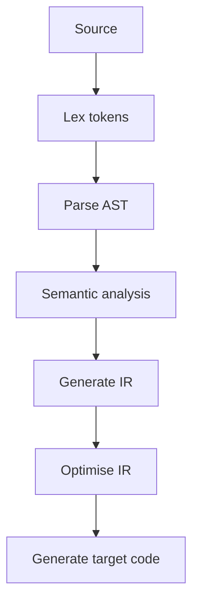

Every error message, every optimization, and every "why did the compiler
reject this" moment traces back to a specific stage in a pipeline that turns
source text into executable code. Knowing the stages is what turns a
confusing compiler error into a diagnosable one — the error message usually
tells you exactly which stage failed, if you know what each stage is
looking for.

> [!WHY] A build error says an operation has incompatible types, but the
> developer keeps changing parentheses. Locating the failing compiler
> stage avoids spending the debugging session repairing grammar that
> already parsed correctly.

> [!GOALS]
>
> - Explain why IR separates frontends from targets
> - Trace precedence and identify failing stages
> - Choose evidence before hand-optimising source

## The pipeline

```text
  SOURCE TEXT
       ↓
  LEXING (tokenizing)     — break characters into TOKENS
       ↓
  PARSING                  — tokens → an AST (Abstract Syntax
                            Tree), enforcing GRAMMAR
       ↓
  SEMANTIC ANALYSIS          — type checking, name resolution
       ↓
  IR GENERATION                — AST → an Intermediate
                              Representation
       ↓
  OPTIMIZATION                   — transform the IR to be
                              faster, preserving meaning
       ↓
  CODE GENERATION                  — IR → actual machine code
                              (or bytecode)
```

```text
  → each stage catches a DIFFERENT class of error, and this is
    exactly why compiler errors are categorized the way they
    are: a SYNTAX error ("unexpected token") is a PARSING
    failure; a TYPE error ("cannot assign string to number")
    is a SEMANTIC ANALYSIS failure — these happen at genuinely
    different stages, and knowing which one you're looking at
    tells you what kind of mistake to look for.
```



## Lexing and parsing

```text
  "x = 5 + y * 2"

  LEXING:    [IDENT x] [EQUALS] [NUM 5] [PLUS] [IDENT y]
             [STAR] [NUM 2]
             → just TOKENS, no structure yet

  PARSING:   builds a TREE respecting operator PRECEDENCE —
             the AST for this expression has * as a DEEPER
             node than +, because multiplication binds
             tighter:

                    =
                   / \
                  x   +
                     / \
                    5   *
                       / \
                      y   2
```

```text
  → this is why "x = 5 + y * 2" correctly computes 5 + (y*2),
    not (5+y)*2 — the GRAMMAR (a formal specification of valid
    structure, and how ambiguous-looking expressions resolve)
    encodes precedence directly into how the parser builds the
    tree, not as an afterthought applied to a flat token list.
```

## Type checking

```text
  the Designing with Types chapter covered USING a type system
  well; this is what actually happens when you do: the SEMANTIC
  ANALYSIS stage walks the AST, tracking each expression's
  TYPE, and rejects the program if an operation's types don't
  match what it requires — "cannot add a string and a number"
  is this stage detecting a type mismatch BEFORE any code
  generation happens, which is exactly why a type error is
  caught at COMPILE time rather than surfacing as a runtime
  crash.
```

## Intermediate representations

```text
  why not compile DIRECTLY from AST to machine code?

  → an IR is a LOWER-LEVEL, but still PLATFORM-INDEPENDENT
    representation — this is what lets ONE frontend (parsing C,
    or Rust, or Swift) target MANY different backends (x86,
    ARM, WebAssembly) by only needing to write N frontends + M
    backends, rather than N×M direct compilers, one per
    language-per-target pair. LLVM's IR is the best-known
    example of this exact design: Clang, Rust, and Swift all
    compile TO LLVM IR, and LLVM's shared backend handles
    every supported target FROM there.
```

## Optimization passes

```text
  x = 2 + 3;              → CONSTANT FOLDING: computed at
                              compile time, becomes x = 5

  y = x;  z = y;  use(z);  → COPY PROPAGATION /
                              DEAD CODE ELIMINATION: if y and z
                              are never used for anything else,
                              this collapses toward use(x)
                              directly

  for (...) { const c = expensive(); ... }   →
    LOOP-INVARIANT CODE MOTION: if `expensive()` doesn't
    depend on the loop variable, HOIST it OUTSIDE the loop —
    computed once instead of every iteration
```

```text
  → these are exactly why hand-optimizing "obviously
    inefficient-looking" code is frequently pointless — the
    compiler ALREADY performs many of these transformations
    automatically. this is the Performance Engineering
    chapter's "measure before optimizing" applied specifically
    to source-level micro-optimization: a change that "should"
    help can measure as IDENTICAL, because the compiler was
    already doing it.
```

## Interpreters vs compilers vs JIT

```text
  INTERPRETER       executes source (or a simple bytecode)
                   DIRECTLY, line by line — no separate
                   compilation step, but SLOWER per-operation,
                   since the same analysis repeats every
                   execution

  AHEAD-OF-TIME       compiles ENTIRELY to machine code BEFORE
  (AOT) COMPILER       running — fast execution, but a separate
                   build step, and the compiled output is
                   tied to a specific target platform

  JIT (Just-In-Time)     starts INTERPRETING, but compiles
                   HOT code paths (ones actually run
                   frequently) to machine code WHILE the
                   program runs — this is EXACTLY the JIT
                   warmup the Performance Engineering
                   chapter's benchmarking section warned about:
                   a JIT-compiled function's first few calls
                   run interpreted/unoptimized, and only later
                   calls reach the fully-optimized compiled
                   version.
```

> [!PITFALL] A syntax error and a type error belong to different stages;
> changing syntax cannot repair an already-parsed type mismatch.

> [!INTERVIEW] Place an error in the pipeline before proposing a fix:
> tokens and grammar, then names and types, then the IR and target code.

> [!CHECK] What does lexing produce before parsing?
>
> Tokens such as identifiers, numbers and operators, without the AST’s
> grammatical structure.

> [!CHECK] Which optimisation replaces 2 + 3 with 5 before execution?
>
> Constant folding.

> [!CHECK] Why should a JIT benchmark account for warm-up?
>
> Early calls may execute interpreted or unoptimised code; only later hot
> calls reach compiled steady-state performance.

## What to take away

1. The compiler pipeline's stages (lexing, parsing, semantic analysis, IR
   generation, optimization, codegen) each catch a different class of error
   — a syntax error and a type error fail at genuinely different stages.
2. A parser's grammar encodes operator precedence directly into how it
   builds the AST, which is why `5 + y * 2` correctly parses as `5 +
(y*2)` rather than needing precedence applied as an afterthought.
3. A type error is caught at semantic analysis, before code generation ever
   runs — which is exactly why it surfaces at compile time rather than as a
   runtime crash.
4. An intermediate representation is what lets one frontend target many
   backends without N×M direct compilers — LLVM IR is the best-known
   example, shared by Clang, Rust, and Swift.
5. Compilers already perform many "obvious" optimizations (constant
   folding, dead code elimination, loop-invariant hoisting) automatically —
   which is why hand-optimizing source that "should" help can measure as
   identical, and why measuring before optimizing applies at the
   source-code level too.

## Exercises

> [!EXERCISE recall] Why does a shared IR reduce the number of compiler
> components needed for many source languages and machine targets?
>
> **Solution:** Each source frontend emits the shared IR and each backend
> consumes it. N frontends plus M backends replace N × M direct
> language-target compilers; optimisation passes can also operate on the
> shared form.

> [!EXERCISE apply] Parse x = 7 + y * 3 assuming y is numeric. Show the
> operator nesting and the value if y = 4. Then identify the stage that
> rejects an undeclared y versus a missing closing parenthesis.
>
> **Solution:** The assignment’s right side is +(7, *(y, 3));
> multiplication is deeper because it binds more tightly. With y = 4, the
> product is 4 × 3 = 12 and the sum is 7 + 12 = 19. An undeclared y fails
> name resolution in semantic analysis; a missing parenthesis fails
> grammar checking during parsing.

> [!EXERCISE stretch] A developer manually hoists a loop calculation and
> sees no speedup. Recommend the next step rather than expanding the
> rewrite.
>
> **Solution:** Measure and inspect whether the compiler already performed
> loop-invariant code motion on the IR. Keep a source rewrite only when
> evidence supports its value and meaning is preserved. A weaker answer
> duplicates the same manual optimisation throughout the codebase:
> unchanged output performance may simply reflect that the compiler had
> already done the work.
