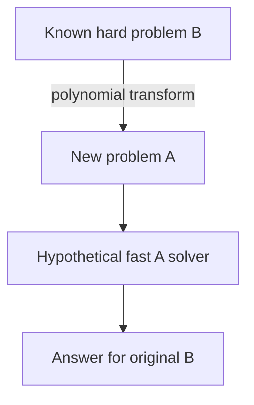

Some problems don't have a slow solution waiting to be optimized — they have
no known efficient solution at all, and a large body of theory says there
almost certainly isn't one. Recognizing when a problem you're facing belongs
to this category is worth knowing before spending real engineering effort
trying to beat it.

> [!WHY] A planner’s exact optimisation stalls as customer constraints
> grow. Recognising an NP-hard shape can redirect effort toward a bounded
> approximation or a small exact instance before the roadmap depends on an
> efficient exact solver nobody has found.

> [!GOALS]
>
> - Explain undecidable versus unknown efficient solution
> - Choose the direction of a hardness reduction
> - Recommend a tractable compromise

## Decidability: problems with no algorithm at all

```text
  the HALTING PROBLEM: given a program and an input, will it
  eventually HALT, or run forever?

  → Turing proved this is UNDECIDABLE — there is PROVABLY no
    algorithm that correctly answers this for EVERY possible
    program and input (the proof is a clever self-reference
    argument: assume such an algorithm exists, then construct
    a program that does the OPPOSITE of what the algorithm
    predicts about itself, a contradiction). this isn't "we
    haven't found one yet" — it's a mathematical proof that no
    such algorithm CAN exist, ever, for any computer.
```

```text
  → this is not purely theoretical: it's WHY no static analysis
    tool can PERFECTLY detect every infinite loop, and why "will
    this program terminate" is fundamentally unanswerable in
    the general case — real tools (linters, type checkers)
    instead answer a WEAKER, DECIDABLE question ("does this
    specific pattern look like an infinite loop"), accepting
    false negatives, because the general question has no
    algorithm at all.
```

## P vs NP: the question behind everything in this chapter

```text
  P     problems SOLVABLE in polynomial time (efficiently)

  NP     problems whose SOLUTION, once given, can be VERIFIED
        in polynomial time — even if FINDING that solution
        might take far longer

  → EVERY problem in P is also in NP (if you can solve it
    quickly, you can obviously verify a solution quickly too)
    — the open question, one of the most famous unsolved
    problems in mathematics, is whether NP problems can ALWAYS
    be solved as fast as they can be verified (P = NP), or
    whether some genuinely require much longer to solve than
    to check (P ≠ NP).
```

```text
  → the overwhelming expert consensus is P ≠ NP — most
    computer scientists believe SOME problems genuinely have
    no efficient solution, even though a proof has eluded
    everyone for decades (it's one of the Clay Institute's
    Millennium Prize Problems, with a $1 million reward
    unclaimed for exactly this reason).
```

## NP-complete: the hardest problems in NP

```text
  an NP-complete problem is one that's IN NP, and EVERY other
  NP problem can be REDUCED to it in polynomial time — meaning
  a fast solution to ANY ONE NP-complete problem would give a
  fast solution to ALL of them (they're all, in a precise
  sense, equally hard).

  classic examples: the TRAVELING SALESMAN problem (shortest
  route visiting every city once), BOOLEAN SATISFIABILITY
  (can a logical formula be made true), the KNAPSACK PROBLEM
  (choose items maximizing value under a weight limit),
  GRAPH COLORING (color a graph with k colors, no two adjacent
  nodes sharing a color).
```

```text
  → recognizing that YOUR real-world problem IS one of these
    (or reduces to one) is a genuinely valuable skill: it tells
    you, with strong theoretical backing, "stop looking for an
    efficient EXACT algorithm — one almost certainly doesn't
    exist" — and redirects effort toward what actually works
    instead (below), rather than continuing to search for
    something the field's best minds haven't found in decades.
```

## Reductions: proving hardness by relating problems

```text
  a REDUCTION shows problem A is "at least as hard as" problem
  B, by demonstrating: any INSTANCE of B can be TRANSFORMED
  (efficiently) into an instance of A, such that solving A
  solves the original B.

  → this is exactly how NP-completeness proofs work in
    practice: prove a NEW problem is NP-complete by reducing a
    KNOWN NP-complete problem TO it (showing the new problem is
    at least as hard) — this is the standard technique, and it's
    why the FIRST NP-completeness proof (Cook-Levin, for
    Boolean satisfiability) was the hard one; every subsequent
    proof reduces FROM an already-known NP-complete problem.
```




## What to actually do with an NP-complete problem

```text
  since an efficient EXACT algorithm almost certainly doesn't
  exist, real systems facing an NP-complete problem choose
  among:

    APPROXIMATION      accept a solution PROVABLY within some
                       bound of optimal (e.g., "at most 2×
                       the true minimum"), computable
                       efficiently — a real, useful guarantee
                       weaker than exact optimality

    HEURISTICS           no guarantee at all, but works WELL
                       in practice on realistic inputs (a
                       greedy nearest-neighbor approach to
                       traveling salesman, genetic algorithms,
                       simulated annealing)

    EXPONENTIAL, BUT       for SMALL enough instances, an
    ACCEPTABLE               exponential algorithm's actual
                          runtime is fine — NP-hardness is
                          about SCALING, and a genuinely small
                          n can still be solved exactly, just
                          not one that scales

    RESTRICT THE PROBLEM     the general problem is
                          NP-complete, but a RESTRICTED version
                          (a graph with special structure, a
                          bounded number of variables) can be
                          efficiently solvable — recognizing
                          your ACTUAL instance has that special
                          structure is a real, valuable
                          escape hatch
```

```text
  → this is precisely the reasoning behind the Design Interview
    Method chapter's trade-off discipline applied to algorithm
    choice specifically: NP-completeness doesn't mean "give
    up," it means "stop looking for exact and efficient
    together — choose which one you're willing to give up."
```

> [!PITFALL] Reducing your problem to a known hard problem does not prove
> your problem is hard; the hardness proof needs the opposite direction.

> [!INTERVIEW] State whether you need exactness, a quality bound or only
> practical usefulness. For a hardness claim, explicitly give the
> direction of the polynomial reduction.

> [!CHECK] Does P lie inside NP?
>
> Yes. A polynomial-time solution also permits polynomial-time
> verification.

> [!CHECK] What two properties define NP-completeness?
>
> Membership in NP and a polynomial-time reduction from every problem in
> NP.

> [!CHECK] Does NP-hardness rule out exact solutions for small inputs?
>
> No. It concerns scaling; an exponential solver can still be acceptable
> on genuinely small instances.

## What to take away

1. The halting problem is provably undecidable — not "unsolved," but proven
   to have no algorithm at all for the general case, which is why no static
   analysis tool can perfectly detect every infinite loop.
2. P vs NP asks whether every efficiently-verifiable problem is also
   efficiently solvable — nearly every solvable-quickly problem is also
   verifiable-quickly (P ⊆ NP), but the reverse remains one of the most
   famous open questions in mathematics.
3. NP-complete problems are all, in a precise sense, equally hard —
   recognizing your real problem reduces to one is valuable because it says
   "stop searching for an efficient exact algorithm."
4. NP-completeness proofs work by reduction: showing a known NP-complete
   problem reduces to the new one, which is why the very first such proof
   (Cook-Levin) was the genuinely hard one.
5. Facing an NP-complete problem, real systems choose among approximation
   (a provable bound), heuristics (no guarantee, works well in practice),
   accepting exponential cost at small scale, or restricting the problem to
   a tractable special case.

## Exercises

> [!EXERCISE recall] How does the general halting problem differ from an
> NP-complete problem’s lack of a known efficient exact solution?
>
> **Solution:** The halting problem has a proof that no algorithm decides
> every program-input pair correctly. NP-complete problems are decidable
> and solutions are efficiently verifiable, but no general polynomial-time
> exact algorithm is known; P versus NP remains open.

> [!EXERCISE apply] A team wants to show a new allocation decision problem
> A is NP-hard using a known NP-complete problem B. Choose the
> transformation direction and explain how a hypothetical fast A solver
> would be used.
>
> **Solution:** Transform every instance of B into an instance of A in
> polynomial time, preserving the answer. Solve the transformed instance
> using the hypothetical fast A solver, then interpret its answer for B.
> This makes a fast A solver solve B. Reducing A to B would only show A
> can use a B solver, not establish A’s hardness.

> [!EXERCISE stretch] An exact route optimiser exceeds its runtime budget
> on large inputs, while dispatch accepts a non-optimal route. Recommend
> options and distinguish a genuine guarantee from a weaker answer.
>
> **Solution:** Choose a bounded approximation when a provable quality
> bound is required; use a heuristic when empirical route quality
> suffices, measuring realistic inputs. Small instances can still use
> exact search, or a tractable restriction may help. A weaker answer calls
> any nearest-neighbour heuristic an approximation guarantee: practical
> success alone supplies no bound on distance from optimality.
