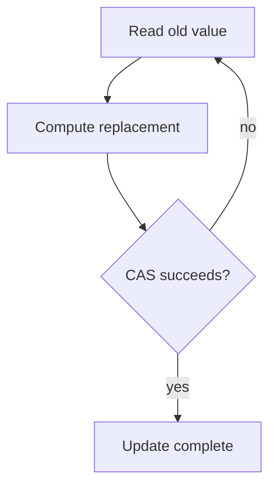

Concurrency and parallelism are frequently used interchangeably, and they're
genuinely different: concurrency is about STRUCTURE (multiple tasks
in-flight, possibly interleaved on one core); parallelism is about EXECUTION
(multiple tasks genuinely running simultaneously, on multiple cores). A
single-core machine can be concurrent; it cannot be parallel.

> [!WHY] A service publishes a ready flag before another worker can see
> the associated data. Passing casual tests does not make the
> unsynchronised publication safe; a stale read can send a response built
> from the wrong state.

> [!GOALS]
>
> - Explain concurrency versus parallelism
> - Trace a compare-and-swap retry
> - Choose synchronisation for publication

## The race condition

```text
  let counter = 0;
  function increment() { counter = counter + 1; }
  // two threads BOTH call increment() "simultaneously"

  thread A: READ counter (0)
  thread B: READ counter (0)          ← both read the SAME
  thread A: WRITE counter = 0+1 = 1      stale value
  thread B: WRITE counter = 0+1 = 1    ← B's write OVERWRITES
                                          A's — one increment
                                          is LOST
  // expected: 2. actual: 1.
```

```text
  → `counter = counter + 1` LOOKS like one operation and is
    actually THREE (read, add, write) — a race condition
    happens when the read-modify-write isn't ATOMIC, and
    another thread's operation interleaves in the gap. this
    exact shape recurs everywhere: a "check-then-act" pattern
    (a database's optimistic concurrency, a queue handler's
    idempotency check) is this same race, at a different scale.
```

## Locks: mutual exclusion

```text
  the fix: a MUTEX (mutual exclusion lock) — only one thread
  can hold it at a time; others attempting to acquire it BLOCK
  until it's released.

    lock.acquire();
    counter = counter + 1;
    lock.release();
```

```text
  → the lock turns the read-modify-write back into an EFFECTIVE
    atomic operation, by making sure no OTHER thread can
    interleave its own read-modify-write in the middle —
    correctness restored, at the cost of one thread waiting
    for another (contention), which is real, measurable
    slowdown under heavy concurrent access to the same lock.
```

## Deadlock, livelock, and starvation

```text
  DEADLOCK       the Operating Systems chapter's four
                conditions — circular waiting, nobody
                proceeds, forever

  LIVELOCK        threads actively keep changing state in
                response to each other, but NONE makes actual
                progress (two people repeatedly stepping the
                same direction trying to avoid each other in a
                hallway) — busy, but stuck

  STARVATION        a thread NEVER gets the resource it needs,
                because OTHER threads keep getting priority —
                technically making progress overall, but this
                one thread specifically never does
```

```text
  → these are three DIFFERENT failure modes with different
    fixes — a fair scheduling policy (round-robin lock
    acquisition, not always-favor-the-most-recent-requester)
    fixes starvation specifically; it does nothing for deadlock,
    which needs lock-ordering or timeout-based detection instead.
```

## Atomics: lock-free primitives

```text
  atomicCounter.compareAndSwap(expectedOld, newValue);

  → a COMPARE-AND-SWAP (CAS) is a single HARDWARE instruction:
    "if the current value equals expectedOld, replace it with
    newValue — atomically, as one indivisible operation." this
    is what lock-free data structures are built from — no
    thread ever BLOCKS waiting for a lock; instead, a thread
    whose CAS fails (someone else changed the value first)
    simply RETRIES.
```

```text
  → lock-free is not free of complexity — it trades "blocking
    while waiting for a lock" for "retry loops and genuinely
    subtle correctness reasoning" (the ABA problem — a value
    changes from A to B and back to A between a thread's read
    and its CAS, which the CAS cannot detect — is a real,
    famous gotcha specific to this approach).
```




## Memory models: what "happens before" actually means

```text
  thread A: data = 42; ready = true;
  thread B: while (!ready) {} ; console.log(data);

  → WITHOUT a memory model guarantee, thread B might see
    `ready = true` but STILL see the OLD value of `data` —
    the compiler and CPU are both allowed to REORDER
    independent-looking operations for optimization, and a
    write becoming visible to ANOTHER thread isn't guaranteed
    to happen in the order it was written, absent an explicit
    synchronization point.
```

```text
  → this is precisely why "just use a shared variable, no lock
    needed, it's a simple flag" is a genuine, documented bug
    pattern — a memory model's HAPPENS-BEFORE relationship
    (established by locks, atomics with the right memory
    ordering, or language-specific synchronization primitives)
    is what actually guarantees another thread sees writes in
    the order you wrote them; a plain unsynchronized variable
    provides NO such guarantee, even though it usually appears
    to work in casual testing.
```

## Async runtimes: concurrency without threads

```text
    JavaScript's single-threaded event loop (the JavaScript deep-dive
    chapter's mechanism) achieves CONCURRENCY (many
  in-flight operations) WITHOUT parallelism or threads at all —
  an async function yields control at each `await`, letting
  OTHER code run, then resumes later.

  → this SIDESTEPS the entire race-condition category above for
    plain JavaScript object mutation (only one piece of JS code
    ever runs at a time) — but it does NOT eliminate races on
    external, genuinely shared state (two concurrent requests
    both reading-then-writing the same database row can still
    race, because the DATABASE is the shared mutable state, not
    a JS variable in one process).
```

> [!PITFALL] A plain shared flag is not a publication barrier; source
> order alone does not establish happens-before.

> [!INTERVIEW] Name the shared state and the synchronisation relationship.
> Explain whether you need mutual exclusion, a single atomic update or
> ordered publication rather than saying threads are safe.

> [!CHECK] Which failure mode involves continual activity without
> progress?
>
> Livelock; deadlock involves circular waiting, and starvation denies a
> particular thread the resource it needs.

> [!CHECK] Which failure mode does a fair acquisition policy directly
> address?
>
> Starvation, rather than circular-wait deadlock.

> [!CHECK] What can CAS fail to notice in the ABA problem?
>
> A value changed from A to B and back to A between a read and the CAS;
> equality with A does not reveal the intervening changes.

## What to take away

1. Concurrency is about structure (multiple tasks in flight); parallelism is
   about simultaneous execution on multiple cores — a single core can be
   concurrent but never parallel.
2. A race condition happens because an operation that looks atomic (like
   `counter++`) is actually multiple steps another thread can interleave
   into — the same check-then-act shape recurs at every scale, from a memory
   race to a database optimistic-concurrency check.
3. Deadlock, livelock, and starvation are three distinct failure modes with
   different fixes — a fairness policy solves starvation but does nothing
   for deadlock, which needs lock ordering instead.
4. Lock-free structures trade blocking for retry loops built on
   compare-and-swap, with their own subtle failure mode (the ABA problem) —
   not a free upgrade over locking.
5. A memory model's happens-before relationship, established by explicit
   synchronization, is what actually guarantees another thread sees writes
   in order — a plain unsynchronized shared variable often appears to work
   in testing while providing no real guarantee.

## Exercises

> [!EXERCISE recall] Can a single-core event loop be concurrent without
> parallel execution, and what external race remains possible?
>
> **Solution:** Yes. Tasks interleave at awaits while only one runs at a
> time. Concurrent requests can still read and write shared external
> state, such as the same database row, in a racing order.

> [!EXERCISE apply] A counter is 7. Threads A and B both read 7 and plan
> CAS(7, 8). A succeeds first; B fails. Trace B’s correct retry and
> contrast an ordinary stale write.
>
> **Solution:** A’s CAS changes 7 to 8. B’s CAS expects 7 but sees 8, so
> it changes nothing. B rereads 8, computes 9 and tries CAS(8, 9); if no
> other write intervenes it succeeds. Final counter is 9. An ordinary
> write of B’s stale 8 would overwrite rather than add the second
> increment.

> [!EXERCISE stretch] A producer writes data then sets a plain shared
> ready flag; a reviewer says source order guarantees consumers see both.
> Recommend a publication rule.
>
> **Solution:** Establish a happens-before relationship with a lock or
> correctly ordered atomic synchronisation before consumers use the data.
> A weaker answer keeps the plain flag because testing never observed
> failure: compiler and CPU reordering and visibility rules are not proved
> by successful runs. Merely checking the flag more frequently does not
> establish ordering.
