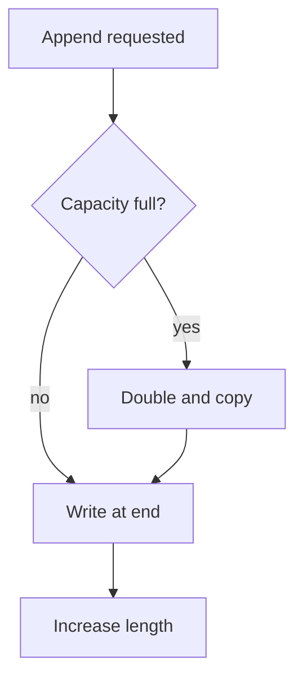

# Arrays and the memory model

An array is the only data structure the hardware gives you directly. Everything
else in this track is built on top of it, so it is worth understanding exactly
what it is before adding abstractions.

> [!WHY] A queue inserts every new item at the front of a growing array.
> Each insertion shifts the existing workload, so a design that passed a
> tiny test can spend its time moving elements as traffic grows.

> [!GOALS]
>
> - Explain the address formula for array access
> - Compute growth and copying under doubling
> - Choose an array strategy from the operation mix

## The one-line definition

An array is a **contiguous block of memory** holding `n` elements of equal size
`s`. That single property produces every performance characteristic arrays have.

Given a base address `A` and an index `i`, the address of element `i` is:

```text
address(i) = A + i * s
```

That is one multiply and one add — a constant amount of work regardless of how
large `n` is, and regardless of which `i` you ask for. This is what O(1) random
access means, and it is the reason `arr[999999]` is not slower than `arr[0]`.

## What contiguity costs

The same property that makes indexing free makes structural change expensive.

| Operation           | Cost | Why                                  |
| ------------------- | ---- | ------------------------------------ |
| Read/write at index | O(1) | Address arithmetic                   |
| Append (amortized)  | O(1) | Usually spare capacity at the end    |
| Insert at front     | O(n) | Every later element must shift right |
| Delete at index     | O(n) | Every later element must shift left  |
| Search (unsorted)   | O(n) | No structure to exploit              |

Inserting at the front of a million-element array means moving a million
elements. There is no clever implementation that avoids this — it follows from
the definition.

## Dynamic arrays and amortized cost

A fixed-size array cannot grow, so most languages ship a _dynamic_ array
(`vector`, `ArrayList`, Python's `list`, JavaScript's `Array`). When it runs out
of capacity it allocates a larger block — typically **double** the size — and
copies everything across.

```python
# Conceptually, what append does:
def append(self, value):
    if self.length == self.capacity:
        self._grow(self.capacity * 2)   # allocate + copy: O(n)
    self.data[self.length] = value      # O(1)
    self.length += 1
```

A single append can therefore cost O(n). But the expensive ones are rare: to
trigger the _next_ resize you must perform another `capacity` cheap appends.
Spread over a sequence of `n` appends, the total copying work is
`1 + 2 + 4 + ... + n < 2n`, so the **amortized** cost per append is O(1).

Growing by a _constant_ amount instead of doubling breaks this: you would resize
every `k` appends, giving `n/k` resizes averaging `n/2` copies each — O(n²)
total. The doubling is not an implementation detail; it is what makes the
amortized bound hold.




## Why arrays are faster than their big-O suggests

Big-O counts operations, not time. Arrays win on constants for a reason
Complexity & Analysis will make precise:

- **Cache lines.** Memory moves between RAM and cache in blocks (usually 64
  bytes). Reading `arr[0]` pulls `arr[1..15]` along with it for free.
- **Prefetching.** A sequential scan is a pattern the CPU recognises and runs
  ahead of.

A linked list with identical asymptotic complexity for traversal is routinely
several times slower in practice, because each node may sit anywhere in memory
and every step is a potential cache miss.

> [!PITFALL] Growing capacity by a constant increment loses the amortized
> O(1) append bound.

> [!CHECK] For base address 400, element size 8 and index 6, what address
> is used?
>
> 400 + 6 × 8 = 448.

> [!CHECK] Is every append into a dynamic array O(1)?
>
> No. A resize copies O(n) elements, but doubling spreads that cost so
> append is amortized O(1).

## What to take away

1. Random access is O(1) _because_ the elements are contiguous.
2. Insertion and deletion in the middle are O(n) for the _same_ reason.
3. Doubling on growth is what makes append amortized O(1).
4. Constant factors favour arrays heavily; prefer one unless a measured need
   says otherwise.

Next: hash tables, which buy O(1) _search_ by giving up ordering.

## Exercises

> [!EXERCISE recall] Why do equal-sized contiguous elements give
> constant-time indexing but not constant-time insertion at the front?
>
> **Solution:** Index i is at A + i × s, one fixed calculation. Inserting
> at the front must move every existing element to preserve contiguity and
> order.

> [!EXERCISE apply] A dynamic array starts empty with capacity 2 and
> doubles only when full. Append nine values. List every capacity increase
> and copied-element count, then compare with growing capacity by 2.
>
> **Solution:** Doubling grows 2 → 4 at append 3, copying 2; 4 → 8 at
> append 5, copying 4; 8 → 16 at append 9, copying 8. Total copied = 2 + 4
> + 8 = 14. Growth by 2 gives capacities 2 → 4 → 6 → 8 → 10 and copies 2 +
> 4 + 6 + 8 = 20. The fixed increment keeps paying increasingly large
> copies at fixed intervals; doubling spaces them out geometrically.

> [!EXERCISE stretch] An append-heavy dataset is scanned sequentially and
> rarely changes in the middle. Recommend whether occasional resize copies
> justify replacing its array with linked nodes.
>
> **Solution:** Keep the dynamic array unless measurement shows a binding
> requirement otherwise. Doubling gives amortized constant-time append,
> while contiguous scans benefit from cache lines and prefetching. A
> weaker answer chooses linked nodes solely because one append can be
> O(n), ignoring the total sequence cost and traversal locality.
