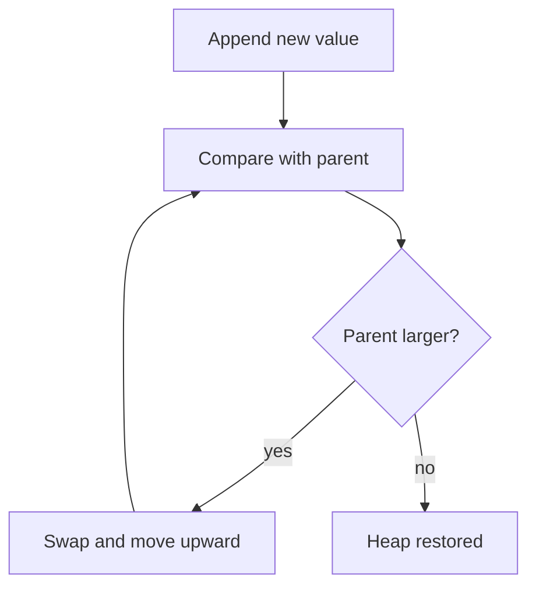

# Trees and heaps

Arrays give you position. Hash tables give you lookup. Trees give you **ordered**
data you can still search quickly — which is what you need the moment a question
becomes "the smallest key above X" rather than "the value for exactly X".

> [!WHY] A scheduler sorts all waiting jobs again whenever it needs the
> next one. A structure that maintains only the minimum can avoid paying
> for a complete ordering the scheduler never uses.

> [!GOALS]
>
> - Explain the distinct BST and heap invariants
> - Trace heap insertion in array form
> - Choose an ordered structure for a workload

## Binary search trees

A binary search tree keeps an invariant at every node:

```text
all keys in left subtree  <  node.key  <  all keys in right subtree
```

Searching walks down from the root, discarding half the remaining tree at each
step — O(h), where `h` is the height.

The catch is that `h` is not automatically `log n`. Inserting sorted data into a
naive BST produces a linked list of height `n`, and every operation degrades to
O(n). This is not a rare pathology; sorted input is extremely common.

**Self-balancing** trees (AVL, red-black) do extra work on insert and delete to
keep `h = O(log n)`. Every standard-library ordered map is one of these.

## B-trees, briefly

Databases and filesystems use **B-trees**, which are the same idea with a much
higher branching factor — hundreds of keys per node instead of one.

The reason is the memory hierarchy: a disk or SSD read has a fixed minimum cost
regardless of how few bytes you want. A binary tree over a billion keys is ~30
levels, so ~30 reads. A B-tree with 500 keys per node is ~4 levels, so ~4 reads.
Same asymptotics, an order of magnitude fewer round trips. Database Internals
returns to this.

## Heaps

A binary heap is a different invariant, and a weaker one:

```text
node.key <= both children's keys      (a min-heap)
```

That says nothing about left versus right, so a heap is **not** searchable — but
the minimum is always at the root, and the weaker invariant is cheap to restore.

| Operation            | Cost     |
| -------------------- | -------- |
| Peek minimum         | O(1)     |
| Insert               | O(log n) |
| Extract minimum      | O(log n) |
| Build from `n` items | O(n)     |

Because a heap is a _complete_ binary tree, it needs no pointers at all — it
lives in a plain array, with children of index `i` at `2i + 1` and `2i + 2`.
Contiguous, cache-friendly, and no allocation per node.

```python
def push(heap, value):
    heap.append(value)
    i = len(heap) - 1
    while i > 0:                          # sift up
        parent = (i - 1) // 2
        if heap[parent] <= heap[i]:
            break
        heap[parent], heap[i] = heap[i], heap[parent]
        i = parent
```

Building from `n` items is O(n), not O(n log n): most nodes are near the bottom
and sift down only a level or two, and the sum converges.




## Choosing between them

- Need exact-key lookup only → **hash table**.
- Need ordering, ranges, or "next key after X" → **balanced BST**.
- Need repeated access to the extreme → **heap**.
- Ordering on disk → **B-tree**.

The heap is the data structure behind priority queues, and priority queues are
behind Dijkstra's algorithm, A*, event simulation and every scheduler — which is
where Algorithms picks this up.

> [!CHECK] What happens when sorted keys are inserted into a naive BST?
>
> Its height can become n, reducing search and updates to O(n); balancing
> maintains logarithmic height.

> [!CHECK] Why is bottom-up heap construction O(n), not O(n log n)?
>
> Most nodes are near the bottom and move only a few levels, so the total
> sift work is linear.

## What to take away

A balanced BST supports ordered search; a heap maintains only the extreme.
Use a B-tree when reducing storage round trips matters.

## Exercises

> [!EXERCISE recall] Compare the ordering guarantees of a BST and a
> min-heap. Why does only one support efficient ordered key search?
>
> **Solution:** A BST orders every left subtree below the node and every
> right subtree above it, allowing a search to discard a side. A heap only
> orders each parent before its children; it does not order siblings or
> subtrees, so arbitrary key search lacks that guarantee.

> [!EXERCISE apply] Run push on heap [2, 6, 4, 9] with value 1. Show
> indices, parent comparisons and the final array.
>
> **Solution:** Append 1 at index 4: [2, 6, 4, 9, 1]. Parent (4 − 1)//2 =
> 1 holds 6, so swap: [2, 1, 4, 9, 6]. Now i = 1, parent = 0 holds 2;
> swap: [1, 2, 4, 9, 6]. At i = 0 stop. The minimum is 1 at the root.

> [!EXERCISE stretch] A service needs both repeated minimum extraction and
> arbitrary range queries. A teammate proposes one heap for everything.
> Recommend a choice and the trade-off.
>
> **Solution:** Use a balanced ordered tree when range queries are
> essential; it retains ordered search and can find extremes while updates
> remain logarithmic. A heap is the weaker single-structure answer for
> this workload: its cheap minimum does not provide subtree ordering for
> ranges. On disk, the chapter’s high-branching B-tree reduces read round
> trips.
