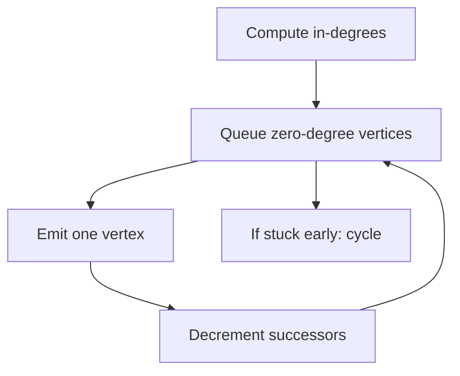

A graph is a set of **vertices** and a set of **edges** between them. That is
almost nothing as a definition, which is why it describes so much: a linked list
is a graph, a tree is a graph, a filesystem is a graph, a dependency chain is a
graph, a social network is a graph, a road network is a graph, and the call
graph of the program you are debugging is a graph.

The practical skill is twofold: recognising that a problem is a graph problem —
which is most of the difficulty — and picking a representation, because the same
algorithm can be fast or unusably slow depending on how you stored the edges.

> [!WHY] A dependency runner has free workers but no runnable tasks
> because its prerequisites form a cycle. Treating dependencies as a graph
> gives the runner a way to detect the blocked plan before waiting
> forever.

> [!GOALS]
>
> - Explain sparse graph representation costs
> - Trace a topological ordering
> - Choose traversal from the path requirement

## The vocabulary that matters

```text
  DIRECTED, WEIGHTED                  UNDIRECTED, UNWEIGHTED

      A ──5──▶ B                          A ───── B
      │        │                          │       │
      3        2                          │       │
      ▼        ▼                          │       │
      C ──1──▶ D                          C ───── D

  edges have direction and cost      edges are mutual, all equal
```

- **Degree** — how many edges touch a vertex. Directed graphs have in-degree and
  out-degree separately.
- **Path** — a sequence of vertices connected by edges. A **cycle** is a path
  returning to its start.
- **DAG** — directed acyclic graph. Enormously important: dependency graphs,
  build systems, git history, task schedulers and dataflow pipelines are all
  DAGs, and being acyclic is what makes them orderable.
- **Connected** — every vertex reachable from every other. For directed graphs
  the strong version requires it in both directions.
- **Dense vs sparse** — a graph with `V` vertices has at most `V²` edges. If `E`
  is close to `V²` it is dense; if `E` is closer to `V` it is sparse. **Nearly
  every real-world graph is sparse**, and that fact decides the representation.

## Three representations

### Adjacency list

For each vertex, a list of its neighbours. This is the default and correct
choice for almost everything.

```text
  A: [B, C]
  B: [D]
  C: [D]
  D: []
```

- Space: **O(V + E)**
- Iterate a vertex's neighbours: **O(degree)** — optimal
- "Is there an edge A→B?": O(degree of A)

### Adjacency matrix

A `V × V` grid where `m[i][j]` is 1 (or the weight) if the edge exists.

```text
        A   B   C   D
    A [ 0   1   1   0 ]
    B [ 0   0   0   1 ]
    C [ 0   0   0   1 ]
    D [ 0   0   0   0 ]
```

- Space: **O(V²)** regardless of how few edges exist
- "Is there an edge A→B?": **O(1)**
- Iterate a vertex's neighbours: **O(V)**, scanning mostly zeros

The space term is not a detail. A social graph with 1,000,000 users needs 10¹²
matrix cells — a terabyte at one byte each — to store perhaps 10⁸ friendships.
The adjacency list stores those in about a gigabyte.

Matrices win in three places: small graphs (V in the hundreds), genuinely dense
graphs, and algorithms expressed as linear algebra — Floyd–Warshall, PageRank,
and graph neural networks all want a matrix because they want matrix
multiplication.

### Edge list

Just a list of `(u, v, weight)` triples. Poor for traversal, ideal for
algorithms that process all edges in sorted order — Kruskal's minimum spanning
tree, and any graph that arrives as a CSV.

|                 | Adjacency list    | Adjacency matrix              | Edge list                |
| --------------- | ----------------- | ----------------------------- | ------------------------ |
| Space           | O(V + E)          | O(V²)                         | O(E)                     |
| Edge exists?    | O(deg)            | O(1)                          | O(E)                     |
| Neighbours of v | O(deg)            | O(V)                          | O(E)                     |
| Add edge        | O(1)              | O(1)                          | O(1)                     |
| Best for        | almost everything | dense, small, or matrix maths | sorting edges, ingestion |

A useful hybrid: adjacency list for traversal plus a hash set of `(u, v)` pairs
for O(1) edge lookup. Two structures over the same data, each answering the
question it is good at — the same move as the LRU cache.

## The two traversals

Everything else is built on these.

**Breadth-first search** explores level by level using a queue. On an unweighted
graph it finds the **shortest path**, because it reaches every vertex at the
minimum number of hops.

```text
  start at A:

  level 0:  A
  level 1: B  C          ← everything one hop away, before anything two hops
  level 2:  D  E
  level 3:  F

  queue: [A] → [B,C] → [C,D] → [D,E] → [E,F] → [F] → []
```

**Depth-first search** goes as deep as possible before backtracking, using a
stack (or recursion). It does not find shortest paths, but it exposes structure:
cycle detection, topological order, connected components, and articulation
points all fall out of DFS.

```text
  A → B → D → (dead end, back up) → E → (back up) → C → F
```

Both are **O(V + E)** with an adjacency list: every vertex is visited once and
every edge examined once.

```python
from collections import deque

def bfs(graph, start):
    seen = {start}                       # mark on ENQUEUE, not on dequeue
    queue = deque([start])
    order = []
    while queue:
        v = queue.popleft()
        order.append(v)
        for n in graph[v]:
            if n not in seen:
                seen.add(n)
                queue.append(n)
    return order
```

The comment is the bug people write. Marking a vertex as seen when you _dequeue_
it lets the same vertex be enqueued several times before it is first processed —
still correct, but the queue can blow up to O(E) and on a dense graph that is
the difference between working and running out of memory.

**The other classic bug:** forgetting `seen` entirely. On a tree that is fine.
On a graph with any cycle it is an infinite loop. If your traversal hangs, this
is the first thing to check.

## The algorithms worth knowing cold

| Problem                             | Algorithm             | Complexity       | Note                    |
| ----------------------------------- | --------------------- | ---------------- | ----------------------- |
| Shortest path, unweighted           | BFS                   | O(V + E)         |                         |
| Shortest path, non-negative weights | Dijkstra              | O((V+E) log V)   | needs a heap            |
| Shortest path, negative weights     | Bellman–Ford          | O(V·E)           | detects negative cycles |
| All pairs shortest paths            | Floyd–Warshall        | O(V³)            | wants a matrix          |
| Dependency order                    | Topological sort      | O(V + E)         | DAGs only               |
| Cycle detection                     | DFS with colours      | O(V + E)         |                         |
| Minimum spanning tree               | Kruskal / Prim        | O(E log V)       |                         |
| Connected components                | BFS/DFS or union-find | O(V + E) / ~O(E) |                         |

**Dijkstra is BFS with a priority queue.** That is the whole idea: BFS explores
in order of hop count because every edge costs 1; when edges have different
costs, explore in order of accumulated cost instead, which means a min-heap
rather than a FIFO queue. Seeing it that way makes it something you can derive
rather than memorise.

Dijkstra requires non-negative weights, and the reason is worth holding: it
finalises a vertex the moment it is popped, on the assumption that no later path
can be shorter. A negative edge breaks that assumption, and you need
Bellman–Ford.

## Topological sort, the one you will actually use

Given a DAG, produce an order where every vertex comes before everything that
depends on it. This is what a build system, a migration runner, a task
scheduler, and a package manager all do.

Kahn's algorithm:

```text
  1. compute in-degree for every vertex
  2. queue every vertex with in-degree 0        ← nothing blocks these
  3. pop v, emit it, and decrement the in-degree
     of each of its successors; queue any that hit 0
  4. repeat

  if you emit fewer than V vertices, the leftovers are in a CYCLE
```

That last line is the part people forget, and it is the most useful part: the
same algorithm that orders your dependencies also _detects the circular
dependency_ and tells you exactly which items are in it. This is precisely how
`assignLayers` in this app's own curriculum layout works — layering the topic
graph and reporting whatever a cycle stranded.




## Recognising a graph problem

The framing is most of the work. Signals that a problem is a graph problem even
though nobody said "graph":

- "Shortest / fewest / minimum number of steps" → BFS.
- "Can I get from X to Y?" → reachability, DFS or BFS.
- "In what order must these run?" → topological sort.
- "Is there a circular dependency?" → cycle detection.
- "Which items are related to which?" → connected components.
- A grid or maze → a graph where each cell has up to four neighbours; you never
  need to build it explicitly, just generate neighbours on demand.
- State puzzles (word ladders, lock combinations, board positions) → vertices are
  **states**, edges are **legal moves**, and BFS finds the fewest moves.

That last reframing is the one that unlocks a whole class of interview problems.
The graph is implicit; the skill is seeing it.

> [!CHECK] When should BFS mark a vertex seen?
>
> On enqueue, preventing several predecessors from queueing the same
> vertex before its first dequeue.

> [!CHECK] What is the traversal cost for BFS or DFS with adjacency lists?
>
> O(V + E): each vertex is visited and each edge examined a bounded number
> of times.

## What to take away

1. A graph is vertices plus edges, and almost every structure and dependency
   relationship is one.
2. Real graphs are sparse, so an adjacency list at O(V + E) is the default;
   a matrix costs O(V²) and is for small, dense, or linear-algebra cases.
3. BFS gives shortest paths on unweighted graphs; DFS exposes structure. Both are
   O(V + E), and both require a `seen` set or they never terminate on a cycle.
4. Mark vertices as seen when enqueuing, not when dequeuing.
5. Dijkstra is BFS with a priority queue, and needs non-negative weights because
   it finalises a vertex on pop.
6. Topological sort orders a DAG _and_ identifies the cycle when there isn't one.

Next: putting all of this together — how to actually choose a data structure
under real constraints.

## Exercises

> [!EXERCISE recall] Why is an adjacency list the default for sparse
> graphs, and when is a matrix still appropriate?
>
> **Solution:** A list stores O(V + E) space and visits only actual
> neighbours. A matrix always costs O(V²) but gives constant-time edge
> tests and suits small, dense or linear-algebra workloads.

> [!EXERCISE apply] Tasks have edges P→R, Q→R and R→S. Run Kahn’s
> algorithm, breaking queue ties alphabetically. Then add S→R and say
> which vertices can still be emitted.
>
> **Solution:** Initial in-degrees are P=0, Q=0, R=2, S=1. Queue [P,Q];
> emit P and lower R to 1, then emit Q and lower R to 0. Emit R, lower S
> to 0, then emit S: [P,Q,R,S]. Adding S→R raises R’s initial in-degree to
> 3. P and Q emit, but R remains at 1 and S at 1, so processing stops
> after two vertices, detecting a cycle.

> [!EXERCISE stretch] A route planner changes from equal-cost hops to
> non-negative travel times. Recommend whether its BFS queue remains
> sufficient, and name the next boundary of your choice.
>
> **Solution:** Use Dijkstra with a min-priority queue so exploration
> follows accumulated cost rather than hop count. Keeping FIFO BFS is
> weaker because fewer hops need not mean lower travel time. If negative
> weights are later introduced, Dijkstra’s finalisation assumption fails;
> the chapter gives Bellman–Ford for that case.
