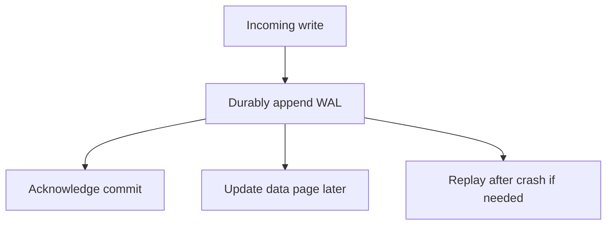

The Relational Modeling and SQL chapter covered how to USE a database
correctly; this chapter is what's actually running underneath, and knowing
it explains behavior that otherwise looks arbitrary — why some indexes are
faster to write and slower to read than others, why a crash doesn't corrupt
committed data, and why a query planner sometimes makes a choice that looks
wrong until you see the statistics behind it.

> [!WHY] A committed write survives in the log but not yet in its final
> data page when the database crashes. Recovery depends on the ordering of
> durable logging and acknowledgement, not on hoping the page write
> finished first.

> [!GOALS]
>
> - Explain the durability ordering of WAL
> - Choose B-tree or LSM from a workload
> - Evaluate a surprising query plan

## B-trees: the classic index structure

```text
              [50]
            /      \
        [20,35]    [70,90]
       /  |  \      /  |  \
    ...  ... ...  ... ... ...

  → a B-TREE keeps data SORTED and BALANCED — every leaf is
    the SAME DEPTH from the root, which guarantees O(log n)
    lookup, insert, and range scan, REGARDLESS of insertion
    order (unlike a naive binary search tree, which can
    degrade to a linked list on sorted input).
```

```text
  → a B-tree is specifically designed around DISK I/O, not
    just algorithmic complexity: each NODE is sized to fit one
    DISK PAGE (traditionally 4-16KB), so one node read is one
    disk read — a B-tree's BRANCHING FACTOR (often hundreds of
    children per node) is chosen specifically to keep the
    tree's DEPTH (and therefore the number of disk reads per
    lookup) extremely small even for billions of rows — a
    3-4 level B-tree can index billions of rows in just 3-4
    disk reads.
```

## LSM trees: optimizing for write throughput

```text
  WRITE      → append to an in-memory MEMTABLE (fast, no disk
              seek) + a write-ahead log (durability, below)
  MEMTABLE     fills up → flushed to disk as an immutable
  FLUSH         SSTABLE (Sorted String Table)
  COMPACTION     periodically, multiple SSTables are MERGED
              into fewer, larger ones — removing overwritten/
              deleted entries along the way
```

```text
  → an LSM tree (used by Cassandra, RocksDB, and many modern
    write-heavy stores) trades READ complexity for WRITE
    speed: a write is nearly free (just an in-memory append),
    but a READ may need to check the memtable AND several
    SSTables (a value's most recent write could be in any of
    them) — this is the OPPOSITE trade-off from a B-tree,
    which keeps reads simple by paying more per WRITE to keep
    everything sorted in place.
```

```text
  → this is exactly why the choice between them tracks
    workload shape: a write-heavy system (time-series
    ingestion, event logging) favors LSM; a read-heavy,
    point-lookup-heavy system favors a B-tree — "which
    database is faster" is workload-dependent, not a fixed
    ranking.
```

## The buffer pool: caching pages in memory

```text
  a database doesn't read from disk on EVERY query — a BUFFER
  POOL caches recently-used disk PAGES in memory, the same
  fundamental idea as a CPU cache (the Computer Architecture
  chapter's memory hierarchy), applied one level up the stack.

  → this is why a QUERY that's slow the FIRST time can be fast
    the SECOND time on the identical query — not because the
    query itself changed, but because the pages it needs are
    now in the buffer pool instead of requiring a disk read.
    "warming up" a database (running representative queries
    before real traffic hits) exploits exactly this.
```

## Write-ahead logging: durability without waiting for the real write

```text
  the problem: writing data DIRECTLY to its final on-disk
  location, THEN crashing mid-write, can leave that location
  in a CORRUPTED, partially-written state.

  the fix: BEFORE modifying the actual data, first APPEND the
  intended change to a WRITE-AHEAD LOG (WAL) — a simple,
  sequential, append-only file. only once the log entry is
  durably written is the transaction considered COMMITTED; the
  actual data pages are updated LATER, and on crash recovery,
  the WAL is REPLAYED to reconstruct any changes that hadn't
  yet made it to the actual data pages.
```

```text
  → this is precisely why a database can guarantee "a
    committed transaction survives a crash" without requiring
    every commit to wait for a slow RANDOM-access write to the
    actual data location — the WAL's write is sequential (fast)
    and durable; the real data update can happen later,
    asynchronously, because the WAL already has enough
    information to reconstruct it if the process crashes first.
```



## MVCC: reads that never block writes

```text
  Multi-Version Concurrency Control: instead of one current
  value per row, the database keeps MULTIPLE VERSIONS — a
  transaction reading a row sees the version that was current
  AS OF when its own transaction started, even if another
  transaction commits a NEWER version while the read is still
  in progress.

  → this is the actual mechanism behind PostgreSQL's READ
    COMMITTED (the Transactions and Isolation chapter's
    default) not blocking readers against writers — a reader
    never waits for a writer's lock, because it's reading a
    CONSISTENT SNAPSHOT rather than contending for the same
    physical row. old versions are eventually cleaned up
    (VACUUM, in Postgres) once no active transaction could
    still need them.
```

## Query planning: why EXPLAIN sometimes surprises you

```text
  the planner chooses a JOIN ORDER and an ACCESS METHOD (index
  scan vs. sequential scan) based on STATISTICS it maintains
  about table size, value distribution, and index selectivity
  — not by trying every possible plan and measuring, which
  would be far too slow to do per-query.

  → a plan that looks obviously wrong ("why is it doing a
    sequential scan when there's an index?") is frequently
    correct given the ACTUAL data distribution — for a table
    where a WHERE clause matches 80% of rows, a full sequential
    scan genuinely IS faster than using an index and fetching
    each matching row individually, and the planner is
    choosing correctly based on statistics a quick glance at
    the schema wouldn't reveal.
```

> [!PITFALL] An index does not automatically make a low-selectivity query
> faster; fetching most rows individually can lose to a sequential scan.

> [!INTERVIEW] Connect the access pattern to where work is paid: sorted
> page maintenance for a B-tree, or flushes, read fan-out and compaction
> for an LSM. State what must be durable before acknowledgement.

> [!CHECK] Why can an identical second query be faster?
>
> Its pages may now be in the buffer pool instead of requiring disk reads.

> [!CHECK] Why do B-tree nodes have high branching factors?
>
> Page-sized nodes keep the number of levels and storage reads small.

> [!CHECK] How can MVCC let a reader avoid waiting for a concurrent
> writer?
>
> It reads an appropriate retained row version rather than contending for
> the writer’s current physical row; versions no longer needed can later
> be cleaned up.

## What to take away

1. A B-tree's branching factor is chosen specifically to keep its depth
   (and disk reads per lookup) tiny even at billions of rows — a 3-4 level
   tree serves billions of rows in 3-4 disk reads.
2. LSM trees trade read complexity for write speed (append-only, merge
   later); B-trees trade write complexity for read simplicity — the right
   choice tracks whether the workload is write-heavy or read-heavy.
3. A buffer pool caches disk pages the same way a CPU cache works one level
   down — this is why an identical query can be slow the first time and
   fast the second, purely from cache warmth.
4. Write-ahead logging guarantees crash durability by appending a
   sequential, fast log entry before the actual (slower, random-access) data
   update happens — the log alone is enough to replay and reconstruct on
   crash recovery.
5. MVCC lets a reader see a consistent snapshot without blocking against a
   concurrent writer, which is the actual mechanism behind Postgres's
   default isolation level not making readers wait on writes.

## Exercises

> [!EXERCISE recall] What must be durable before commit is acknowledged in
> the WAL model, and how is an unfinished data-page write recovered?
>
> **Solution:** The intended change must be durably appended to the log
> before commit is acknowledged. Final data pages may be written later;
> recovery replays the log to reconstruct changes not yet reflected in
> them.

> [!EXERCISE apply] Choose an index family for an event collector
> dominated by writes and another for a service dominated by point reads.
> Explain where each pays its deferred work.
>
> **Solution:** Choose an LSM for write-heavy collection: update the
> memtable and WAL, flush immutable SSTables, then compact by merging.
> Reads may check memory and multiple tables. Choose a B-tree for
> read-heavy point lookup: writes maintain sorted balanced pages, trading
> more write work for a simpler read path. The workload, rather than a
> universal speed ranking, decides.

> [!EXERCISE stretch] A query selects most of a table, yet a reviewer
> insists the existing index must beat a sequential scan. Recommend a way
> to judge the plan.
>
> **Solution:** Inspect EXPLAIN and the planner’s statistics on
> selectivity and distribution. A sequential scan can be appropriate when
> most rows match, avoiding individual indexed row fetches. A weaker
> answer forces the index because it exists: that ignores the access
> pattern and the statistics on which the planner chose its method.
