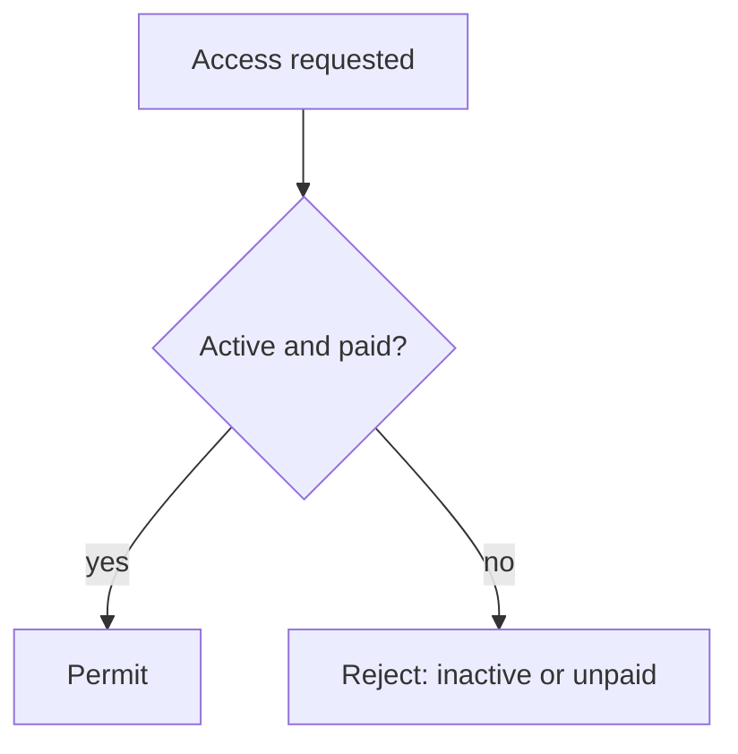

Discrete math isn't a separate subject from programming — it's the notation
programming's own correctness arguments are written in. Every "this
algorithm is correct" claim, every complexity bound, and every database
schema's constraint is, underneath, a statement in this vocabulary.

> [!WHY] A permission guard negates two requirements with the wrong
> boolean operator. A user missing only one requirement can slip through,
> so a small logical rewrite changes the access policy rather than merely
> its spelling.

> [!GOALS]
>
> - Explain induction as a correctness argument
> - Compute combinations versus ordered selections
> - Apply logical negation to a guard

## Propositional logic

```text
  AND (∧)    both true            P ∧ Q
  OR  (∨)    at least one true    P ∨ Q
  NOT (¬)    negation             ¬P
  IMPLIES (→) if P then Q         P → Q  — FALSE only when
                                    P is true and Q is false;
                                    vacuously TRUE whenever P
                                    is false
```

```text
  the implication truth table trips people up specifically at
  its vacuous case:

    "if it's raining, the ground is wet"  (P → Q)

  → on a DRY day (P is false), the statement is still TRUE —
    it made no claim about dry days at all. this exact
    reasoning is why "if a list is empty, every element
    satisfies X" is vacuously true in code — a loop over zero
    elements trivially satisfies any per-element condition,
    which is precisely why an empty-input edge case so often
    "just works" without special-casing.
```

```text
  DE MORGAN'S LAWS:
    ¬(P ∧ Q)  ≡  ¬P ∨ ¬Q
    ¬(P ∨ Q)  ≡  ¬P ∧ ¬Q

  → this is the exact rule behind "negating a compound
    condition" in code: !(a && b) is !a || !b, not !a && !b —
    a mistake here is a real, recurring bug in guard clauses.
```




## Sets

```text
  ∈   "is an element of"        3 ∈ {1, 2, 3}
  ⊆   "is a subset of"           {1, 2} ⊆ {1, 2, 3}
  ∪   union                     {1,2} ∪ {2,3} = {1,2,3}
  ∩   intersection                {1,2} ∩ {2,3} = {2}
  \   difference                  {1,2,3} \ {2} = {1,3}
  ∅   the empty set
```

```text
  → a SET's defining property is that it has NO DUPLICATES and
    NO ORDER — this is precisely a hash set / hash table's
    contract in code (the Data Structures chapter), and the
    reason "convert to a Set to deduplicate" works: the data
    structure IS the mathematical set.
```

```text
  a POWER SET (the set of ALL subsets of a set) has SIZE 2ⁿ for
  a set of size n — this is not a coincidence with "n binary
  choices, include or exclude each element" — it's the SAME
  fact, which is why a problem framed as "choose any subset"
  has an inherently exponential number of possibilities, and
  why brute-forcing all subsets of even a modest-sized set
  (n=30 → over a billion subsets) is infeasible.
```

## Combinatorics: counting without enumerating

```text
  PERMUTATIONS   ORDER matters — "how many ways to arrange n
                distinct items": n!
                → n=10 gives 3,628,800 — this is WHY a naive
                  "try every ordering" approach to something
                  like the traveling salesman problem is
                  infeasible past a small n

  COMBINATIONS    order does NOT matter — "how many ways to
                 CHOOSE k items from n": C(n,k) = n!/(k!(n-k)!)
                → "how many 5-card poker hands from 52 cards"
                  is C(52,5), not 52!/47! — the distinction
                  between these two is the single most common
                  combinatorics mistake
```

```text
  → the practical test: does swapping the order of two chosen
    items produce a DIFFERENT outcome? a race's 1st/2nd/3rd
    place (order matters — permutation) vs. a committee of 3
    from 10 people (order doesn't matter — combination).
```

## Graphs

```text
  a graph is VERTICES (nodes) plus EDGES (connections) — the
  single most reused structure across this entire curriculum:
  a social network, a dependency graph, a road network, a
  neural network's layers, this project's own curriculum
  prerequisite map, are all, mathematically, THE SAME OBJECT.
```

```text
  DIRECTED     an edge has a DIRECTION (A → B doesn't imply
              B → A) — a prerequisite graph, a web link
  UNDIRECTED    an edge is symmetric (A—B implies B—A) — a
              friendship graph
  WEIGHTED       an edge carries a COST/VALUE — a road network's
              distances, a network's latencies
  ACYCLIC         no path leads back to where it started — a
              DAG (Directed Acyclic Graph) specifically is
              what allows a TOPOLOGICAL ORDER: a linear
              sequence respecting every dependency, which is
              exactly how this project's own curriculum
              layers topics by prerequisite
```

```text
  → the Algorithms and Complexity and Analysis chapters build
    directly on this vocabulary — "traverse," "shortest path,"
    "cycle detection" are all graph-theoretic terms with
    precise definitions BEFORE they're implementations.
```

## Induction: proving something true for every case, without checking every case

```text
  the structure of a proof by induction:

    BASE CASE      prove it's true for the smallest case
                   (n=0 or n=1)

    INDUCTIVE STEP   prove: IF it's true for n, THEN it's
                   true for n+1

  → together, these prove it true for EVERY n, without
    checking each one individually — the base case is a
    single check; the inductive step is a single, general
    argument that chains forward indefinitely.
```

```text
  → this is the EXACT logical structure behind proving a
    recursive function or a loop invariant correct: the base
    case is the recursion's stopping condition; the inductive
    step is "assuming the recursive call on a smaller input is
    correct, is THIS call correct" — which is precisely how
    you reason about recursion without mentally unwinding every
    call.
```

> [!PITFALL] Negating a conjunction requires OR between the negated
> operands; keeping AND changes the policy.

> [!INTERVIEW] Say whether swapping two selected items changes the outcome
> before choosing a counting formula. For a guard rewrite, test the case
> where exactly one requirement fails.

> [!CHECK] When is P implies Q false?
>
> Only when P is true and Q is false; a false antecedent makes the
> implication vacuously true.

> [!CHECK] How many subsets does a set of five elements have?
>
> Each element has include/exclude choices, so 2⁵ = 32 subsets.

> [!CHECK] What graph property allows topological ordering of directed
> dependencies?
>
> Acyclicity: the prerequisite graph must be a DAG.

## What to take away

1. Implication's vacuous truth (P → Q is true whenever P is false) is the
   exact logic behind why an empty-input case so often satisfies a
   condition trivially, without special-casing.
2. De Morgan's laws are the precise rule for negating a compound boolean
   condition correctly — `!(a && b)` is `!a || !b`, a common source of bugs
   when gotten backwards.
3. A power set's size (2ⁿ) is the same fact as "n independent binary
   choices," which is why enumerating all subsets of even a modest set is
   infeasible.
4. Permutations (order matters) and combinations (order doesn't) are
   distinguished by one test: does swapping two chosen items change the
   outcome — mixing them up is the most common combinatorics mistake.
5. A graph is vertices plus edges, the single most reused structure in this
   curriculum — and induction (a base case plus an inductive step) is the
   exact logical shape behind proving a recursive function correct.

## Exercises

> [!EXERCISE recall] What are the two obligations in induction, and how do
> they correspond to recursive correctness?
>
> **Solution:** Prove a base case and prove that truth for n implies truth
> for n+1. For recursion, establish the stopping case and justify the
> current call assuming the smaller recursive case is correct.

> [!EXERCISE apply] Choose two reviewers from six engineers. Compute the
> number of choices when their roles are interchangeable, then when one
> must be primary and the other secondary.
>
> **Solution:** Interchangeable roles give C(6,2) = 6!/(2!4!) = (6 × 5)/2
> = 15 pairs. Ordered roles give 6 choices for primary and 5 remaining for
> secondary: 6 × 5 = 30. Swapping the selected people changes the second
> outcome but not the first.

> [!EXERCISE stretch] Access requires active AND paid. Recommend the
> rejection guard and test a case that exposes the weaker rule not-active
> AND not-paid.
>
> **Solution:** Reject when not-active OR not-paid, by De Morgan’s law. If
> active is true and paid is false, access must be rejected: false OR true
> is true. The weaker AND guard evaluates false AND true to false and
> incorrectly permits access. Checking only the case where both
> requirements fail would miss this defect.
