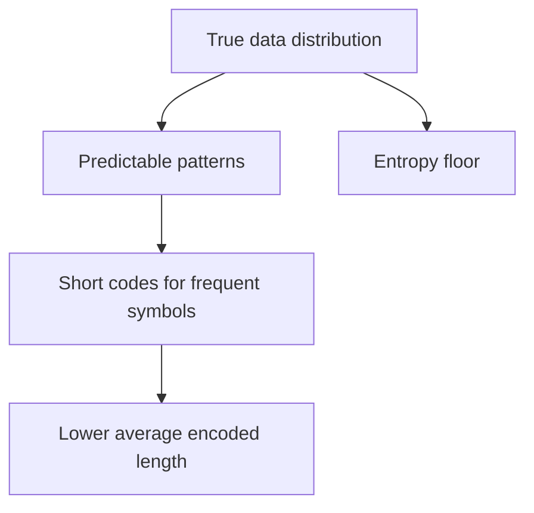

Information theory answers a deceptively simple question: how much can a
message be compressed, in principle, before you start losing information?
The answer — entropy — turns out to be the same concept underneath both
lossless compression and, in a different guise, the loss function that
trains most modern machine learning models.

> [!WHY] A pipeline tries to save bandwidth by compressing
> already-compressed images again. With little remaining predictability to
> exploit, the work can consume CPU without delivering the expected
> payload reduction.

> [!GOALS]
>
> - Explain entropy and the compression floor
> - Compute cross-entropy and KL for a small distribution
> - Choose compression from predictability

## Entropy: the theoretical compression floor

```text
  ENTROPY H(X) = -Σ p(x) log₂ p(x)

  → measures the AVERAGE information content (in BITS) of a
    random variable's outcomes — intuitively, how SURPRISING
    an outcome is, on average.
```

```text
  a FAIR coin flip: entropy = 1 bit (maximally uncertain —
  you genuinely need the full bit to know the outcome)

  a coin that lands heads 99% of the time: entropy is much
  LOWER (well under 1 bit) — because MOST of the time, the
  outcome is entirely PREDICTABLE (heads), and encoding
  "predictable" events needs far fewer bits than encoding
  genuinely surprising ones.
```

```text
  → entropy is the THEORETICAL MINIMUM average bits needed to
    encode outcomes from this distribution — NO lossless
    compression scheme can beat it, on average, for data that
    genuinely follows that distribution. this is a hard
    mathematical floor, not an engineering target to someday
    exceed.
```

## Why compression works: exploiting non-uniform distributions

```text
  → gzip (and similar compressors) work because REAL DATA
    (English text, source code, most files) is NOT uniformly
    random — some byte sequences occur far more often than
    others. HUFFMAN CODING (the classical technique) assigns
    SHORTER bit sequences to MORE FREQUENT symbols and LONGER
    ones to rarer symbols — exactly mirroring the intuition
    above: predictable, frequent things cost fewer bits;
    surprising, rare things cost more.
```

```text
  → this is precisely why gzip barely compresses
    ALREADY-compressed or genuinely random data (a JPEG, encrypted
    data, random noise) — such data is already close to
    MAXIMUM entropy for its size (no exploitable predictability
    left), so there's nothing left to compress — a compressor
    can only exploit the GAP between a message's actual entropy
    and its raw bit-length, and that gap is already gone.
```




## Cross-entropy: the actual loss function training a classifier

```text
  cross-entropy H(p, q) = -Σ p(x) log q(x)

  → measures how many EXTRA bits you'd need if you encoded
    data from the TRUE distribution p, using a code OPTIMIZED
    for a DIFFERENT, predicted distribution q — the WORSE q's
    predictions match reality, the MORE extra bits (higher
    cross-entropy) it costs.
```

```text
  → this is EXACTLY the loss function training most
    classification models: p is the TRUE label (a one-hot
    "this image IS a cat"), q is the MODEL'S predicted
    probability distribution over classes — minimizing
    cross-entropy loss during training is, quite literally,
    training the model to need FEWER extra bits to describe
    reality, which is the same thing as training it to predict
    reality more accurately. "loss function" and "coding
    efficiency" are the SAME underlying mathematical object,
    applied to different problems.
```

## KL divergence: the gap between two distributions

```text
  KL(p‖q) = H(p,q) − H(p)
          = cross-entropy − entropy
          = the EXTRA bits ONLY, from p and q disagreeing —
            with p's own inherent uncertainty subtracted out

  → KL divergence is ZERO exactly when p and q are IDENTICAL
    distributions, and grows as they diverge — it measures
    ONLY the cost of q being a WRONG model of p, isolated from
    p's own baseline unpredictability (its own entropy, which
    no model could reduce regardless of how good it is).
```

```text
  → this is why minimizing cross-entropy and minimizing KL
    divergence during training are EQUIVALENT objectives — they
    differ by exactly H(p), which is a CONSTANT with respect to
    the model's own parameters (the true label distribution
    doesn't change during training) — so minimizing one
    automatically minimizes the other, and frameworks
    conventionally implement cross-entropy specifically because
    it's simpler to compute directly.
```

> [!PITFALL] Cross-entropy includes the true distribution’s entropy; KL is
> the excess caused by model mismatch. Keep total cost and excess cost
> separate.

> [!INTERVIEW] Separate entropy, total cross-entropy and excess KL cost.
> State the log base and which distribution is fixed before claiming two
> training objectives are equivalent.

> [!CHECK] How does Huffman coding exploit symbol frequency?
>
> It assigns shorter codes to frequent symbols and longer codes to rarer
> symbols.

> [!CHECK] When is KL(p‖q) zero?
>
> When p and q are identical distributions.

> [!CHECK] Why do cross-entropy and KL give the same minimisation
> objective for fixed p?
>
> They differ by H(p), a constant with respect to the model’s parameters.

## What to take away

1. Entropy is the theoretical minimum average bits needed to encode a
   distribution's outcomes — a hard mathematical floor no lossless
   compressor can beat, not an engineering target.
2. Compression works by exploiting non-uniform distributions in real data —
   assigning shorter codes to frequent patterns and longer ones to rare
   ones, which is exactly why already-compressed or random data barely
   compresses further.
3. Cross-entropy measures the extra bits needed when encoding true data
   with a code optimized for a different, predicted distribution — the
   worse the prediction, the higher the cost.
4. Minimizing cross-entropy loss during classifier training is literally
   the same operation as minimizing the extra bits needed to describe
   reality with the model's predicted distribution — "loss function" and
   "coding efficiency" are the same object.
5. KL divergence isolates the cost of a model being wrong from the true
   distribution's own inherent unpredictability — it differs from
   cross-entropy by exactly the true distribution's entropy, a constant during
   training, which is why minimizing either one is equivalent.

## Exercises

> [!EXERCISE recall] What does entropy measure, and why does a strongly
> biased coin need fewer average bits than a fair coin?
>
> **Solution:** Entropy measures average information or surprise in bits.
> A fair coin is maximally uncertain and needs one bit; a strongly biased
> outcome is more predictable, so a code exploiting that distribution can
> use fewer average bits.

> [!EXERCISE apply] Use base-2 logs. True labels are p = (1/2, 1/2), but a
> model predicts q = (1/4, 3/4). Given log₂(3/4) ≈ −0.415, compute H(p),
> H(p,q) and KL(p‖q).
>
> **Solution:** H(p) = −(1/2)(−1) − (1/2)(−1) = 1 bit. H(p,q) = −(1/2)(−2)
> − (1/2)(−0.415) = 1 + 0.2075 = 1.2075 bits. KL = H(p,q) − H(p) = 1.2075
> − 1 = 0.2075 bits. Cross-entropy is total expected code length; KL
> isolates the excess over the entropy floor.

> [!EXERCISE stretch] A bandwidth plan assumes every JPEG and encrypted
> payload will shrink dramatically under gzip. Recommend how to revise it
> and identify the weaker planning assumption.
>
> **Solution:** Measure the actual payload mix and expect little further
> compression for already-compressed or genuinely random data; focus
> compression effort on predictable data such as text or source. A weaker
> answer budgets the same ratio for every file type: lossless coding
> exploits distributional redundancy, and cannot promise savings when that
> redundancy is already gone.
