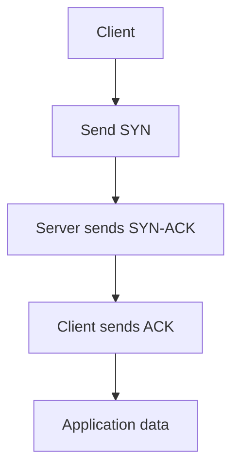

Every network request travels through a stack of layers, each one solving a
problem the layer above doesn't have to think about — until something goes
wrong, and knowing which layer actually made which guarantee is what turns
"the network is being weird" into a diagnosable problem.

> [!WHY] A client repeats short requests over fresh encrypted connections
> and spends its latency budget before useful data flows. Connection setup
> can dominate even when server processing is fast.

> [!GOALS]
>
> - Explain the transport trade between TCP and UDP
> - Compute repeated connection setup overhead
> - Choose a diagnostic from the failure layer

## The layers, and what each one guarantees

```text
  APPLICATION    HTTP, DNS, TLS — the actual DATA you care
                about, and its meaning

  TRANSPORT       TCP or UDP — end-to-end delivery semantics
                between two PROCESSES (identified by port)

  NETWORK          IP — routing between MACHINES across
                networks (identified by IP address)

  LINK              Ethernet/WiFi — delivery within ONE local
                network segment (identified by MAC address)
```

```text
  → each layer ADDS a guarantee the one below doesn't make —
    IP alone doesn't guarantee delivery, ORDER, or even that a
    packet arrives ONCE rather than duplicated; TCP is
    specifically the layer that adds all three on top of IP's
    weaker guarantee.
```

## TCP vs UDP: a real, deliberate trade-off

```text
  TCP    RELIABLE (retransmits lost packets), ORDERED
        (reassembles out-of-order packets correctly),
        CONNECTION-oriented (a handshake establishes state
        before data flows) — at the cost of overhead: the
        handshake, acknowledgments, and retransmission all
        add LATENCY

  UDP     NONE of those guarantees — packets can arrive out of
        order, be duplicated, or simply never arrive, with NO
        automatic recovery — but with far LESS overhead and
        LOWER latency, since there's no connection state or
        retransmission machinery
```

```text
  → UDP isn't "worse TCP" — it's the right choice specifically
    when an APPLICATION can tolerate loss better than it can
    tolerate LATENCY: video calls (a dropped frame is fine;
    waiting for a retransmitted one that arrives late is worse
    than just skipping it), DNS lookups (small enough to just
    retry the whole request if it's lost, cheaper than TCP's
    full handshake for one tiny query), and real-time gaming
    (a slightly-stale position update is fine; waiting for a
    guaranteed-in-order one isn't).
```

## The TCP handshake and connection overhead

```text
  client → SYN → server
  client ← SYN-ACK ← server
  client → ACK → server
  (connection now established — THEN application data flows)

  → this is a FULL ROUND TRIP before even ONE byte of actual
    data is sent — over a high-latency connection (say, 100ms
    round trip), that's 100ms spent JUST establishing the
    connection, before the request itself even starts. this is
    exactly why connection REUSE (HTTP keep-alive, connection
    pooling) matters: paying the handshake cost once and
    reusing the connection for many requests avoids paying it
    again on every single one.
```



## DNS: a name resolves through a chain of authority

```text
  www.example.com → (root servers) → (.com TLD servers) →
                     (example.com's authoritative servers) →
                     the actual IP address
```

```text
  → this chain is EXPENSIVE if walked in full on every lookup
    — which is why DNS relies HEAVILY on CACHING at every
    level (a browser's own DNS cache, the OS resolver, an ISP's
    resolver) with an explicit TTL (Time To Live) the
    authoritative server sets — this is exactly why "I updated
    my DNS record and it's not showing up yet" is a real,
    common, and entirely expected experience: cached copies
    with time remaining on their TTL are still being served,
    by design, not by bug.
```

## TLS: encryption on top of a reliable stream

```text
  TLS sits BETWEEN the transport layer (TCP) and the
  application layer (HTTP) — HTTPS is literally HTTP running
  INSIDE a TLS-encrypted connection, not a different protocol.

  → the TLS HANDSHAKE (negotiating encryption, verifying the
    server's certificate) is ANOTHER round trip (or more, for
    older TLS versions) ON TOP OF TCP's own handshake — this
    compounding cost is exactly why TLS 1.3 specifically
    reduced its handshake to fewer round trips than TLS 1.2,
    and why connection reuse matters even MORE once TLS is
    added on top of TCP.
```

## What "the network is down" actually means

```text
  a request can fail at ANY layer, and the failure mode differs
  meaningfully by WHICH layer failed:

    DNS resolution fails       → the DOMAIN doesn't resolve at
                                all — fails before a connection
                                is even attempted
    TCP connection refused      → the SERVER is reachable, but
                                nothing is LISTENING on that
                                port (the service is down, not
                                the network)
    TCP connection times out     → the network path itself is
                                the problem (a firewall
                                silently dropping packets, or
                                genuine unreachability)
    TLS handshake fails           → reachable, listening, but a
                                CERTIFICATE problem (expired,
                                wrong hostname, untrusted issuer)
    HTTP 5xx                       → everything BELOW worked;
                                the APPLICATION itself failed
```

```text
  → diagnosing "it doesn't work" starts with figuring out
    WHICH of these it actually is — each points to a
    completely different place to look, and treating them as
    interchangeable ("the network is down") wastes debugging
    time on the wrong layer.
```

> [!PITFALL] A DNS failure, refused connection, TLS error and HTTP 5xx
> point to different layers; treating them as one network fault wastes
> investigation.

> [!INTERVIEW] Name the last layer known to have succeeded. Distinguish
> DNS, connection setup, certificate verification and application response
> before recommending a retry or configuration change.

> [!CHECK] What addresses identify the endpoints at transport versus
> network level?
>
> Ports identify processes at transport level; IP addresses identify
> machines for routing.

> [!CHECK] Why can a changed DNS record still return its previous address?
>
> Caches may legitimately serve a copy until its remaining TTL expires.

> [!CHECK] What does connection refused suggest compared with a silent
> connection timeout?
>
> Refusal suggests a reachable host with no listener on the port; a
> timeout warrants investigating reachability or dropped packets along the
> path.

## What to take away

1. Each network layer adds a guarantee the one below doesn't make — TCP is
   specifically the layer that adds reliability, ordering, and
   connection-oriented delivery on top of IP's weaker guarantee.
2. UDP isn't a worse TCP — it's the right choice when an application
   tolerates loss better than latency, which is precisely the trade video
   calls, DNS, and real-time gaming make deliberately.
3. TCP's handshake is a full round trip before any data flows, which is why
   connection reuse (keep-alive, pooling) matters — paying that cost once
   and reusing it beats paying it on every request.
4. DNS caching with an explicit TTL is why a DNS record update doesn't
   appear everywhere immediately — cached copies with remaining TTL are
   being served by design, not by bug.
5. A failed request can fail at any layer, and which layer failed points to
   a completely different cause — DNS failure, connection refused, connection
   timeout, TLS failure, and an HTTP 5xx are five different problems, not
   interchangeable symptoms of "the network is down."

## Exercises

> [!EXERCISE recall] Why might a real-time application deliberately accept
> UDP’s weaker guarantees rather than TCP’s ordered retransmission?
>
> **Solution:** It can value a fresh update more than a late recovered
> one. UDP does not automatically recover loss or establish ordered
> connection state; the application accepts or handles those costs in
> exchange for lower setup and delivery overhead.

> [!EXERCISE apply] Six sequential commands require a reliable ordered
> byte stream. Each opens fresh TCP and TLS connections on a 70 ms
> round-trip path; assume one setup round trip for TCP and one for TLS.
> Choose between switching to bare UDP and reusing the encrypted TCP
> connection, and compute the setup budget before and after, excluding
> request processing.
>
> **Solution:** Reuse encrypted TCP: bare UDP does not supply the required
> reliability and ordering. Each fresh connection pays 1 + 1 = 2 setup
> round trips, or 2 × 70 = 140 ms. Six connections pay 6 × 140 = 840 ms.
> One reused connection pays 140 ms once, avoiding 840 − 140 = 700 ms of
> setup. Application exchanges and processing are excluded; the
> one-round-trip TLS cost is the scenario’s assumption.

> [!EXERCISE stretch] A client resolves the hostname and reaches the port,
> then fails certificate verification. Recommend where to investigate and
> name a weaker diagnosis.
>
> **Solution:** Investigate TLS certificate validity, hostname and trusted
> issuer. A weaker answer changes DNS or adds application retries because
> the network is down: resolution and connection already succeeded, and
> neither fixes the certificate failure. Distinguish this from an HTTP
> 5xx, which arrives after lower layers worked and points at the
> application.
