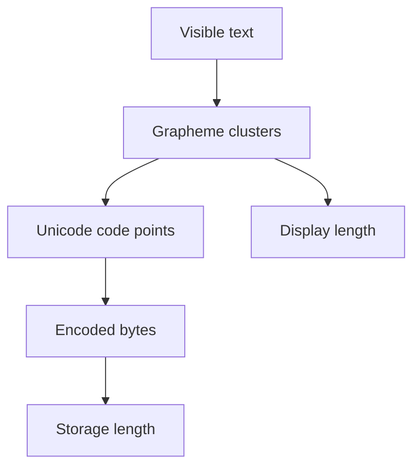

Every value a program manipulates is, underneath, a fixed number of bits
interpreted according to a specific encoding. Most of the "impossible" bugs
that turn out to have a simple, mechanical explanation — a number that
silently wraps, a comparison that's mysteriously false, text that looks
identical but isn't — trace back to that encoding.

> [!WHY] A browser receives a large database id as a JavaScript number and
> later requests a different record. Integer precision can be lost before
> any visible arithmetic, so the representation chosen at the boundary
> decides whether the id survives intact.

> [!GOALS]
>
> - Explain why large ids need an exact representation
> - Compute byte lengths and interpret byte order
> - Choose grapheme-safe text limits

## Integer width and overflow

```text
  a 32-bit signed integer's range: -2,147,483,648 to
  2,147,483,647

  2,147,483,647 + 1   → OVERFLOWS — wraps to
                          -2,147,483,648 (in a language with
                          fixed-width integer wraparound, like
                          C or Java's `int`)
```

```text
  → this is not a hypothetical: it's a real, documented cause
    of production incidents (a counter that wraps to negative
    after enough increments, a timestamp calculation that
    overflows) — the fix is either using a WIDER type (64-bit),
    an ARBITRARY-PRECISION type (BigInt), or explicitly
    checking for overflow before an operation that could
    trigger it, chosen deliberately rather than assumed away.
```

```text
  → JavaScript's `number` type is a 64-bit FLOAT (see below),
    not a fixed-width integer — this is why
    Number.MAX_SAFE_INTEGER (2⁵³ - 1) exists and matters: past
    that point, INTEGER values themselves start losing
    precision, not just fractional ones, which is exactly why
    a 64-bit id (a Snowflake id, a large database primary key)
    needs to be handled as a STRING in JavaScript rather than a
    number, or it silently corrupts.
```

## Floating point

```text
  0.1 + 0.2 === 0.30000000000000004

  → 0.1 and 0.2 have NO EXACT binary floating-point
    representation — the same way 1/3 has no exact finite
    decimal representation (0.333...), 0.1 has no exact finite
    BINARY representation. the stored value is the CLOSEST
    representable float, and the tiny rounding errors from two
    such approximations don't cancel out perfectly on addition.
```

```text
  → NEVER compare floats with ===/== for "did this computation
    produce the expected result" — compare within an EPSILON
    (a small tolerance): Math.abs(a - b) < 0.0001. this is
    exactly why the Time, Dates and Money chapter's rule
    ("never store money as a float") exists — this imprecision
    is unacceptable for values that must be EXACT, not just
    approximately right.
```

```text
  NaN !== NaN    — by IEEE 754's own definition, NaN
                    ("Not a Number," the result of an
                    undefined operation like 0/0) never equals
                    itself
  → Number.isNaN(x), not x === NaN, is the only correct way to
    check — the naive comparison always returns false, even
    when x genuinely IS NaN.
```

## Unicode and text encoding

```text
  a "character" is not one universal, simple concept:

    CODE POINT    a single Unicode value (U+0041 = 'A')
    GRAPHEME        what a HUMAN perceives as one character —
    CLUSTER          can be MULTIPLE code points combined (an
                    emoji with a skin-tone modifier, an accented
                    character built from a base letter plus a
                    combining diacritic)
```

```text
  "café".length         → can be 4 OR 5, depending on whether
                            "é" is stored as ONE precomposed
                            code point or as "e" + a combining
                            accent — the SAME visible text, two
                            different underlying representations
```

```text
  → "reverse this string" or "get the Nth character" using a
    NAIVE code-unit-based approach can SPLIT a multi-code-point
    grapheme in half, producing corrupted, unrenderable text
    (a common cause of mangled emoji when a naive
    string-truncation limit cuts a message mid-character) — text
    processing that needs to be CORRECT (truncating a
    user-facing string, reversing display text) needs a
    grapheme-aware API, not a naive length/index operation.
```

## UTF-8, UTF-16, and byte-length surprises

```text
  UTF-8    ASCII characters: 1 byte. many other scripts (Latin
          with accents, Cyrillic): 2 bytes. CJK characters
          (Chinese/Japanese/Korean): typically 3 bytes. some
          emoji: 4 bytes.
```

```text
  → "this string is under the 280-character limit" and "this
    string is under the 280-BYTE limit" are NOT the same
    check, and the gap is not small — a message entirely in
    Chinese characters can hit a byte-based storage limit at
    roughly a THIRD of the character count an English message
    would, a real and easy-to-miss internationalization bug
    (the Internationalization and Localization chapter's
    territory, at the byte level rather than the layout level).
```




## Endianness

```text
  the integer 0x12345678, stored in memory:

    BIG-ENDIAN      12 34 56 78   (most significant byte first
                    — "reads" in the order written)
    LITTLE-ENDIAN     78 56 34 12   (least significant byte
                    first — x86/ARM's native format)
```

```text
  → this matters concretely when reading raw bytes across a
    boundary that doesn't share your machine's endianness — a
    binary file format, a network protocol (network byte order
    is BIG-endian by convention) — reading a multi-byte value
    with the wrong endianness assumption produces a
    completely wrong number, not a subtly wrong one, and it's
    a real, recurring bug in low-level parsing code.
```

> [!PITFALL] A character limit is not a byte limit, and code points are
> not always user-perceived characters.

> [!INTERVIEW] State the unit at the boundary: exact integer, floating
> approximation, grapheme, code point or byte. A length or equality check
> is meaningful only after that choice.

> [!CHECK] Why can 0.1 + 0.2 miss an exact comparison with 0.3?
>
> These decimals lack exact finite binary representations; their stored
> approximations accumulate rounding error.

> [!CHECK] How should JavaScript test for NaN?
>
> Use Number.isNaN rather than equality with NaN, which is not equal to
> itself.

> [!CHECK] Which broad choices prevent fixed-width counter overflow?
>
> Choose a wider or arbitrary-precision representation, or explicitly
> check before the risky operation.

## What to take away

1. Fixed-width integer overflow is a real, documented cause of production
   incidents — the fix (wider type, arbitrary precision, or an explicit
   check) has to be chosen deliberately, not assumed away.
2. Floats like 0.1 have no exact binary representation, which is why
   comparing computed floats with `===` is wrong and why money is never
   stored as a float — compare within an epsilon, or use an exact
   representation for values that must be precise.
3. A "character" can mean a code point or a human-perceived grapheme
   cluster built from several — naive string operations (length, truncate,
   reverse) can split a grapheme and produce corrupted text.
4. A character-based length limit and a byte-based one are genuinely
   different checks — a message in CJK characters can hit a byte limit at a
   fraction of the character count an English message would.
5. Endianness determines byte order for a multi-byte value across a format
   or protocol boundary — getting it wrong produces a completely wrong
   number, not a subtly wrong one.

## Exercises

> [!EXERCISE recall] Why can an integer id lose precision in JavaScript
> number, and what representation avoids that at an API boundary?
>
> **Solution:** number is a binary64 floating-point value with a maximum
> safe integer of 2⁵³ − 1. Larger integer ids can round, so transmit and
> retain them as strings or use an appropriate exact integer
> representation rather than converting through number.

> [!EXERCISE apply] A payload contains 20 ASCII letters and 10 CJK
> characters, each CJK character occupying 3 UTF-8 bytes. Does it fit a
> 45-byte field? Also interpret bytes 01 02 as a two-byte unsigned
> big-endian value and contrast little-endian.
>
> **Solution:** ASCII contributes 20 × 1 = 20 bytes and CJK contributes 10
> × 3 = 30, for 50 bytes; it exceeds 45 despite having 30 visible
> characters. Big-endian 01 02 is 1 × 256 + 2 = 258. Little-endian reads
> the same bytes as 2 × 256 + 1 = 513.

> [!EXERCISE stretch] A display-name limit truncates by raw code units and
> claims that an emoji is always one element. Recommend a text policy and
> distinguish the storage check.
>
> **Solution:** Use grapheme-aware segmentation for a user-visible length
> and truncate only at grapheme boundaries. Check encoded byte length
> separately when storage has a byte limit. A weaker answer counts code
> points instead of code units and assumes that solves display characters:
> a grapheme may still combine multiple code points, so it can still be
> split.
