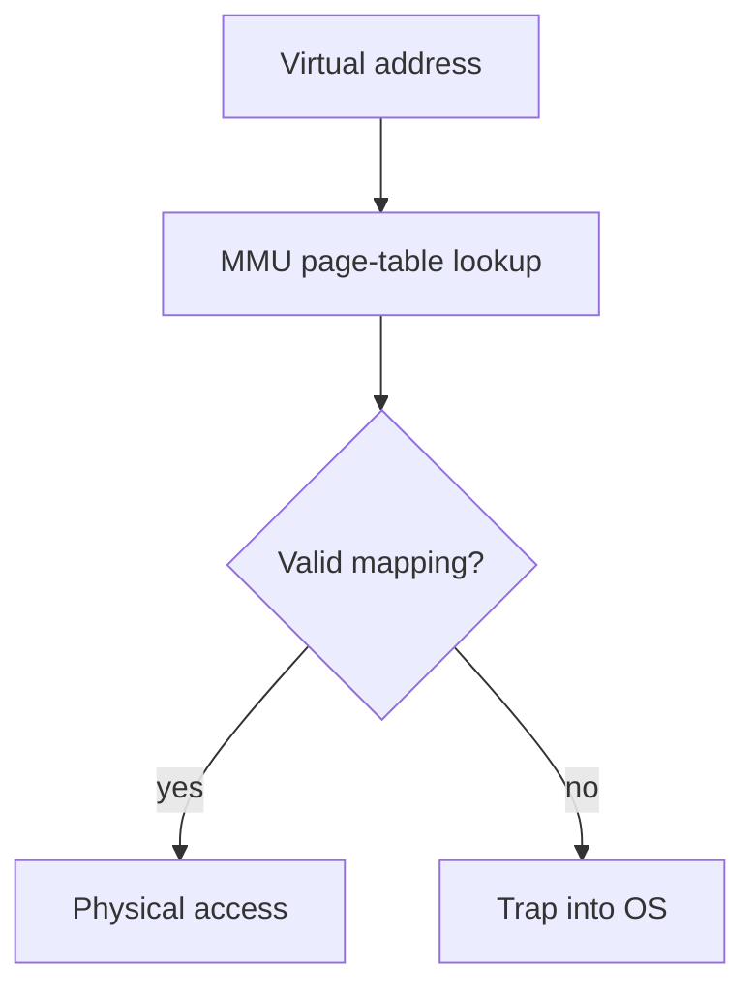

An application never talks to hardware directly — every file read, every
byte sent over a socket, every allocated page of memory passes through the
operating system, which is what makes "my program" and "a running process"
different concepts worth distinguishing precisely.

> [!WHY] A worker process spawns far more runnable CPU threads than cores
> and throughput falls. The scheduler must spend real time switching
> state, so adding concurrency can consume capacity instead of creating
> it.

> [!GOALS]
>
> - Explain virtual-address translation and isolation
> - Choose a consistent lock acquisition order
> - Recommend a process or thread boundary

## Processes vs threads

```text
  PROCESS      an independent unit with its OWN memory space —
              one process cannot directly read another's memory
              (a real isolation boundary, enforced by the OS
              and hardware together)

  THREAD        runs WITHIN a process, SHARING that process's
              memory space with every other thread in it — much
              cheaper to create/switch between than a process,
              but with NO memory isolation between threads of
              the same process
```

```text
  → this is exactly why a crash in one thread can corrupt data
    a DIFFERENT thread in the same process was using (shared
    memory, no isolation), while a crash in one PROCESS cannot
    directly corrupt another process's memory at all — the
    isolation trade-off is the entire reason a browser runs
    each tab as a SEPARATE PROCESS (one tab crashing doesn't
    take down the others) rather than a thread.
```

## Scheduling

```text
  the OS's SCHEDULER decides which of potentially MANY
  runnable threads/processes actually get the CPU right now —
  on a machine with 8 cores and 200 runnable threads, most
  threads are NOT running at any given instant; the scheduler
  gives each a small TIME SLICE, then switches (a CONTEXT
  SWITCH) to another.

  → a context switch has REAL cost — saving one thread's
    complete register state, loading another's — which is
    exactly why having far more threads than cores, all
    genuinely contending for CPU, degrades throughput: the
    machine spends real time switching between threads instead
    of doing useful work.
```

## Virtual memory: the illusion every process gets

```text
  every process sees its OWN complete, private address space
  (0 to some huge number) — as though it has the ENTIRE
  machine's memory to itself, starting from address zero.

  → this is an ILLUSION the OS and hardware maintain together:
    a VIRTUAL address a program uses gets TRANSLATED to a
    PHYSICAL address by the MMU (Memory Management Unit,
    hardware) on every single memory access, via a PAGE TABLE
    the OS maintains — this is what makes memory isolation
    between processes possible AND lets the OS give a process
    MORE virtual memory than physically exists (via paging to
    disk).
```

```text
  → this is also the mechanism behind a SEGFAULT: accessing a
    virtual address with no valid page-table entry (an
    uninitialized/null pointer, memory past what was actually
    allocated) — the hardware itself detects the invalid
    translation and traps into the OS, which terminates the
    process. it is not "corrupted memory" being detected after
    the fact; it's the translation failing BEFORE the access
    ever reaches real memory.
```




## File systems and syscalls

```text
  fs.readFile('data.json')

  → this looks like ONE operation, but crosses a real boundary:
    the APPLICATION calls a LIBRARY function, which issues a
    SYSCALL — a controlled, deliberate transition into KERNEL
    mode, since only the kernel has the privilege to actually
    touch the disk hardware. the "user mode / kernel mode"
    split is a hardware-enforced privilege boundary — user code
    genuinely CANNOT directly issue disk I/O, by design, which
    is exactly the mechanism that makes OS-level isolation and
    security guarantees possible at all.
```

```text
  → a syscall is SLOWER than a plain function call, specifically
    because of this mode transition — this is the actual reason
    "minimize syscalls, batch I/O where possible" is real
    performance advice rather than folklore: each syscall pays a
    real, fixed transition cost regardless of how little work it
    does.
```

## Deadlock

```text
  process A holds lock 1, wants lock 2.
  process B holds lock 2, wants lock 1.
  → neither can proceed. FOREVER, unless something intervenes.
```

```text
  → this is the Debugging and Profiling chapter's lock-ordering
    discussion, at the OS level rather than the application
    level — the SAME four
    conditions (mutual exclusion, hold-and-wait, no preemption,
    circular wait) must ALL hold for deadlock to occur, and
    breaking ANY ONE of them (a consistent lock acquisition
    order breaks circular wait specifically) prevents it
    entirely.
```

> [!PITFALL] Threads share a memory space; moving unsafe work into a
> second thread does not create a process isolation boundary.

> [!INTERVIEW] Explain the isolation requirement before choosing processes
> or threads. When discussing deadlock prevention, name which of the four
> necessary conditions the policy breaks.

> [!CHECK] Why do many runnable CPU-bound threads on few cores incur
> overhead?
>
> The scheduler repeatedly saves and restores register state during
> context switches instead of doing useful application work.

> [!CHECK] Why can batching I/O improve performance?
>
> Each syscall pays a fixed user-to-kernel transition cost, so fewer
> larger operations can reduce boundary crossings.

> [!CHECK] Name the four deadlock conditions.
>
> Mutual exclusion, hold-and-wait, no preemption and circular wait;
> breaking any one prevents that deadlock pattern.

## What to take away

1. A process has its own isolated memory space; a thread shares its
   process's memory with every other thread in it — which is exactly why a
   browser runs each tab as a separate process rather than a thread.
2. A context switch has real, measurable cost — far more contending threads
   than cores degrades throughput from switching overhead, not just from
   contention itself.
3. Virtual memory is an illusion maintained by the OS and MMU together, with
   every access translated via a page table — a segfault is that
   translation failing before the access reaches real memory, not corrupted
   memory detected afterward.
4. A syscall is a deliberate, privilege-crossing transition into kernel
   mode, with a real fixed cost — which is why batching I/O to minimize
   syscalls is genuine performance advice, not folklore.
5. Deadlock requires all four of mutual exclusion, hold-and-wait, no
   preemption, and circular wait — breaking any single one (a consistent
   lock order breaks circular wait) prevents it entirely, at the OS level
   the same way it does at the application level.

## Exercises

> [!EXERCISE recall] How do the OS and MMU make identical-looking virtual
> addresses in separate processes refer to isolated memory?
>
> **Solution:** Each process uses its own address space and page-table
> mappings. The MMU translates virtual to physical addresses under the
> OS’s mappings, so an address in one process does not grant direct access
> to another process’s memory.

> [!EXERCISE apply] Worker A acquires locks X then Y; worker B acquires Y
> then X. Show the stuck schedule and choose a revised order for both that
> breaks a named deadlock condition.
>
> **Solution:** A acquires X, B acquires Y, A waits for Y and B waits for
> X: a circular wait. Require both workers to acquire X before Y. If A
> holds X, B waits before holding Y, so A can acquire Y and finish.
> Consistent ordering breaks circular wait rather than relying on a
> fortunate schedule.

> [!EXERCISE stretch] An application runs untrusted, crash-prone plugins
> beside important host state. Recommend whether plugins should be threads
> in the host or separate processes, with the stated trade.
>
> **Solution:** Use separate processes when memory isolation is the
> requirement. A thread shares the host’s address space, so a corrupting
> plugin can damage unrelated host data. Threads are a weaker isolation
> answer even if cheaper to create and switch; separate processes pay more
> overhead to obtain the boundary the workload needs.
