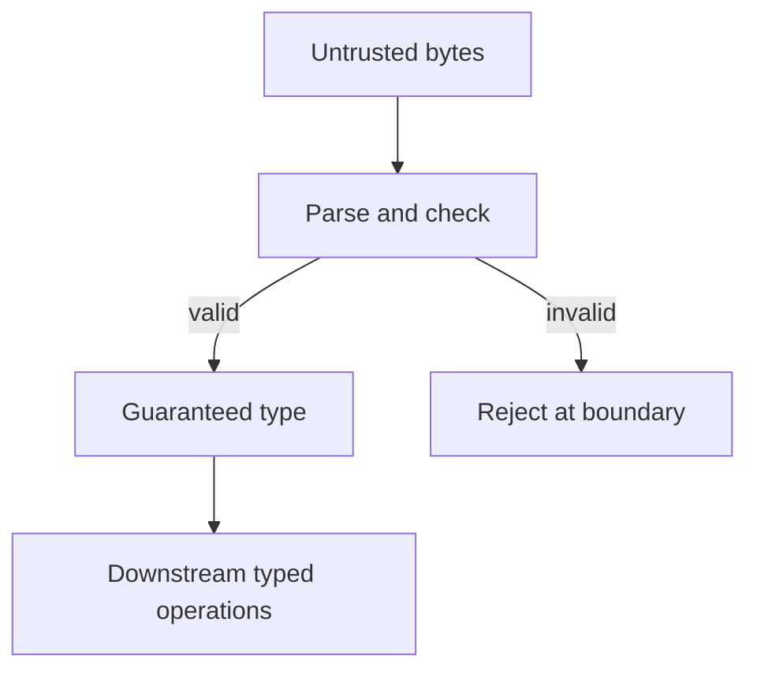

Arguments about static versus dynamic typing are usually arguments about two
different things — how much a compiler can prove, and how much you have to
write down — treated as one. Separating them makes the whole debate tractable,
and turns "types" from a chore into the cheapest correctness tool available.

> [!WHY] A network payload is cast to a TypeScript interface and reaches
> the UI with an invalid field. The build stays green because erased types
> do not inspect incoming bytes, leaving the customer to discover the
> broken assumption.

> [!GOALS]
>
> - Explain the three independent typing axes
> - Design a discriminated union for legal states
> - Choose a parsing boundary for untrusted input

## What a type actually is

A type is a **set of values plus the operations valid on them**. `bool` is
`{true, false}` with and/or/not. `int32` is about four billion values with
arithmetic. A type is a _claim_ about what can be in a slot, and a type checker
is a proof engine that checks your claims are consistent.

The essential consequence: **a type error is a proof that a class of runtime
error cannot happen**. `int + string` failing to compile is a promise that this
line will never fail that way at 3am with a customer watching.

## Three axes, not one

People say "typed language" and mean up to three unrelated things.

**Static vs dynamic — _when_ is the check?**

```text
  static:   check at compile time, before anything runs
  dynamic:  check at run time, when the operation is attempted
```

**Strong vs weak — _how much implicit coercion_ is there?**

```text
  strong:  "1" + 1  is an error                (Python, Rust)
  weak:    "1" + 1  is "11" or 2, silently     (JavaScript, C)
```

**Explicit vs inferred — _who writes the annotations_?**

```text
  explicit:  Map<String, List<Integer>> m = new HashMap<>();
  inferred:  let m = HashMap::new();     // compiler works it out
```

These are independent, and the combinations explain a lot:

| Language      | When            | Coercion   | Annotation                |
| ------------- | --------------- | ---------- | ------------------------- |
| Python        | dynamic         | strong     | inferred (optional hints) |
| JavaScript    | dynamic         | weak       | none                      |
| C             | static          | weak       | explicit                  |
| Java          | static          | strong     | explicit (some inference) |
| Rust, Haskell | static          | strong     | heavily inferred          |
| TypeScript    | static (erased) | strong-ish | inferred                  |

Notice C: _static_ but _weak_. It checks at compile time and then lets you cast
a pointer to anything you like. Static typing is not automatically safety.

And notice TypeScript's "erased". TypeScript checks at compile time and then
throws all types away — the emitted JavaScript has no checks in it. So a value
arriving from `JSON.parse`, a network response, or `any` can be a complete lie
about its type and nothing will notice until it fails somewhere else entirely.
This is the single most important thing to understand about TypeScript: **it
validates your code, not your data.** Parse and validate at the boundary.

## Nominal vs structural

Does compatibility come from the _name_ or the _shape_?

```typescript
// structural (TypeScript, Go interfaces): shape is enough
type Point = { x: number; y: number };
const p: Point = { x: 1, y: 2 }; // fine, never mentioned Point
```

```java
// nominal (Java, C#, Rust): you must declare the relationship
class Point implements Positioned { ... }
```

Structural is flexible — you can satisfy an interface you have never heard of,
which is how Go's `io.Reader` ends up implemented by hundreds of unrelated
types. Nominal is safer against _accidental_ compatibility: a `Meters` and a
`Feet` that are both `{ value: number }` are interchangeable structurally, which
is exactly the confusion that lost the Mars Climate Orbiter.

The structural workaround is a _branded_ type — adding a phantom field that
exists only in the type system:

```typescript
type Meters = number & { readonly __brand: "Meters" };
type Feet = number & { readonly __brand: "Feet" };
// now a Meters cannot be passed where a Feet is expected
```

## The real prize: making illegal states unrepresentable

This is where types stop being paperwork and start being design.

Consider modelling a network request. The obvious version:

```typescript
interface RequestState {
  isLoading: boolean;
  data: Result | null;
  error: Error | null;
}
```

Three fields, `2 × 2 × 2 = 8` representable states. How many are _legal_? Three:
loading, succeeded, failed. The other five are nonsense — loading _and_ having
an error, having both data and an error, having neither while not loading — and
every one of them is a state your UI code has to defend against, forever,
because the type permits it.

```text
   representable states (8)          legal states (3)
   ┌────────────────────────┐        ┌──────────────┐
   │  ████ legal            │        │  loading     │
   │  ░░░░░░░░░░ nonsense   │   ───▶ │  success(d)  │
   │  ░░░░░░░░░░ nonsense   │        │  failure(e)  │
   └────────────────────────┘        └──────────────┘
    every ░ is a bug you must         nothing to defend
    handle or a bug you will have     against
```

The fix is a **discriminated union** (also: sum type, tagged union, enum with
payloads):

```typescript
type RequestState =
  | { status: "loading" }
  | { status: "success"; data: Result }
  | { status: "failure"; error: Error };
```

Now the illegal states cannot be constructed. And the checker gives you a second
gift: **exhaustiveness**. Add a fourth case — `"cancelled"` — and every `switch`
that does not handle it becomes a compile error, listing the exact files to fix.
That is refactoring with a checklist generated for you.

```typescript
function render(s: RequestState) {
  switch (s.status) {
    case "loading":
      return spinner();
    case "success":
      return view(s.data); // s.data exists HERE only
    case "failure":
      return alert(s.error);
    default: {
      const _exhaustive: never = s; // compile error if a case is missed
      return _exhaustive;
    }
  }
}
```

Note `s.data` is accessible only inside the `success` branch. That is
**narrowing**: the checker tracks what it has learned from the discriminant. It
is the mechanism that makes this pattern pleasant rather than ceremonial.

## Null, and the billion-dollar mistake

Tony Hoare called introducing the null reference in 1965 his "billion-dollar
mistake". The problem is not that absence exists; it is that in most languages
absence is a valid value of _every_ reference type, so nothing can be trusted
and nothing forces you to check.

The modern answer is to make absence a separate type that must be unwrapped:

| Language                        | Nullable by default? | Absence type          |
| ------------------------------- | -------------------- | --------------------- |
| Java (pre-annotations)          | yes                  | `Optional<T>`, opt-in |
| Kotlin, Swift, C# 8+            | no                   | `T?`, checked         |
| Rust                            | no null at all       | `Option<T>`           |
| TypeScript (`strictNullChecks`) | no                   | `T \| null`           |

```rust
fn find(id: u32) -> Option<User> { ... }

let name = find(7).map(|u| u.name).unwrap_or("unknown".into());
//         ^ cannot forget the absent case; it will not compile
```

If you work in a language where this is optional — `strictNullChecks`, Kotlin's
platform types, C#'s nullable context — turn it on. It is the highest
bug-per-unit-effort setting available in any compiler.

## Parse, don't validate

The pattern that ties this together. Validation _checks_ and returns a boolean;
parsing _transforms_ into a type that carries the guarantee.

```python
# validate — the knowledge evaporates
def is_valid_email(s: str) -> bool: ...

def send(to: str):                  # is `to` validated? no way to know
    ...

# parse — the knowledge is in the type
class Email:
    def __init__(self, raw: str):
        if not EMAIL_RE.fullmatch(raw):
            raise ValueError(f"not an email: {raw!r}")
        self.value = raw

def send(to: Email):             # cannot be called with an unchecked string
    ...
```

Once `Email` exists, every function downstream is relieved of checking, and
"did someone validate this?" stops being a question anyone can get wrong. The
check happens once, at the edge, where the untrusted string arrives.

This is the same idea as the discriminated union, applied to scalars: move the
guarantee from a convention you must remember into a type the compiler enforces.




## What types cannot do

Being honest about the limits is what keeps types from becoming a religion.

- **They do not check values.** `age: int` permits −5. Refinement types and
  dependent types can express "positive integer", but they are rare outside
  research languages; in practice you use a constructor that validates, as above.
- **They do not check behaviour.** A `Comparator` that violates transitivity
  type-checks perfectly and will corrupt a sort. Property-based testing covers
  this ground.
- **They do not check the outside world.** Every byte from a socket, a file, a
  database driver or `JSON.parse` enters as an assertion, not a proof.
- **They cost expressiveness at the margins.** Some correct programs cannot be
  expressed in a given type system, which is what escape hatches — `any`,
  `unsafe`, `interface{}`, reflection — exist for. Using one is fine; using one
  silently is not.
- **They can be over-engineered.** Type-level metaprogramming that takes a
  colleague an hour to read has spent more than it saved. The bar is: does this
  prevent a bug someone would plausibly write?

## Gradual typing, in practice

Python's hints and TypeScript's `any` let you adopt types incrementally, which
is the only realistic path for an existing codebase. Two rules make it work:

1. **Type the boundaries first.** Public functions, module edges, data coming in
   from outside. That is where wrong assumptions cost the most and where
   annotations document the most.
2. **Make untyped code loud.** `strict: true`, `disallow_untyped_defs`, ratchets
   in CI that forbid _new_ untyped code even while old code is grandfathered. A
   gradual migration with no ratchet stays at 40% forever.

> [!CHECK] What does strict null checking force a caller to handle?
>
> Absence is a separate nullable or option case that must be handled
> before using the value.

> [!CHECK] Can a type-correct comparator still break sorting?
>
> Yes. Ordinary types do not prove behavioural properties such as
> transitivity.

## What to take away

1. A type is a set of values plus valid operations; a type error is a proof that
   a whole class of runtime failure cannot occur.
2. Static/dynamic, strong/weak and explicit/inferred are three independent axes.
   C is static and weak; TypeScript is static and erased.
3. The highest-value use of types is making illegal states unrepresentable —
   discriminated unions plus exhaustiveness turn a refactor into a checklist.
4. Null-by-default is the single largest source of type-system-shaped bugs;
   turn on strict null checking wherever it is optional.
5. Parse, don't validate: put the guarantee in a type at the boundary so nothing
   downstream can forget it.
6. Types do not check values, behaviour, or anything arriving from outside the
   process. Know the boundary and validate at it.

Next: state and mutation — the other half of correctness, and the reason two
identical-looking functions can behave completely differently.

## Exercises

> [!EXERCISE recall] Separate static versus dynamic, strong versus weak,
> and explicit versus inferred typing. Why does static not imply safe?
>
> **Solution:** They describe when checks run, how much implicit coercion
> is allowed, and who supplies annotations. C is static yet permits weak
> coercions and casts; the timing of checking alone does not establish
> safety.

> [!EXERCISE apply] Model a file export with exactly three legal states:
> running, ready with a path, or failed with an error. Choose fields so
> ready data cannot coexist with failure data, and say how adding
> cancelled should affect rendering.
>
> **Solution:** Use a sum type: {status: "running"} | {status: "ready";
> path: string} | {status: "failed"; error: Error}. Each variant carries
> only its own payload. A switch narrows by status; a never exhaustiveness
> branch must fail checking when cancelled is added until rendering
> handles it.

> [!EXERCISE stretch] An email sender accepts a raw string after a boolean
> validation helper was called elsewhere. Recommend an interface that
> keeps the guarantee downstream.
>
> **Solution:** Parse the untrusted string once into an Email value
> through a validating constructor, and make send accept Email. A weaker
> answer keeps send(string) and relies on callers remembering the boolean
> check; the type no longer records whether the string passed validation.
> A cast alone is also insufficient at a runtime boundary.
