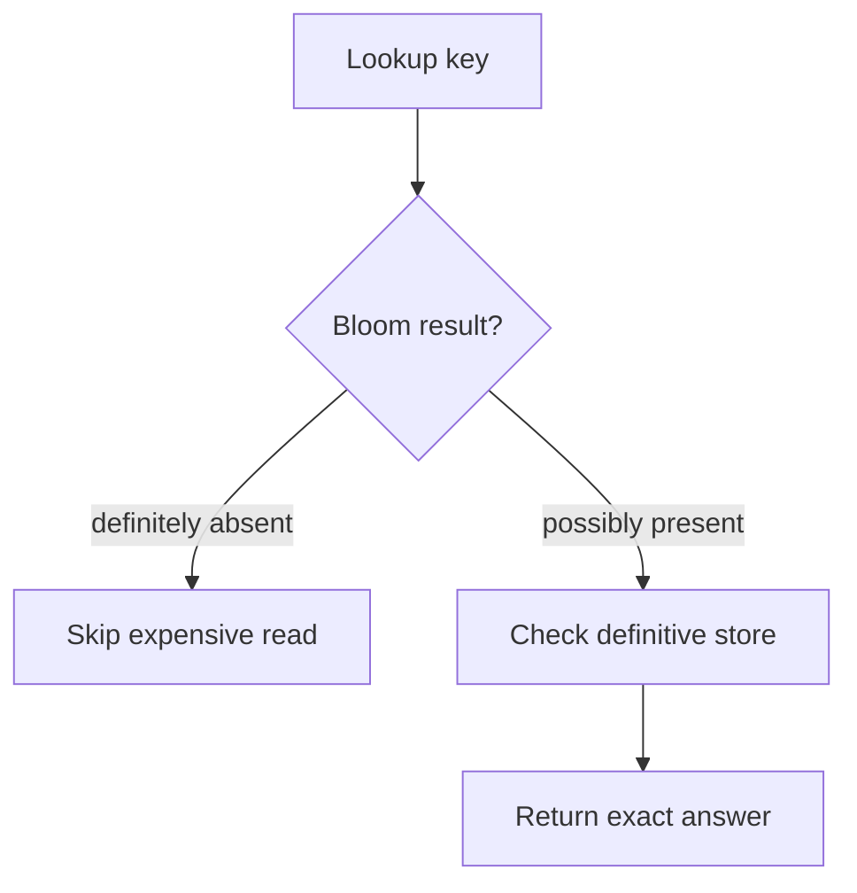

Every algorithm covered so far computes an EXACT answer. This chapter is
different: each structure here deliberately trades a small, bounded,
quantifiable amount of accuracy for a dramatic reduction in time or memory —
and for many real questions, that trade is not a compromise, it's obviously
correct.

> [!WHY] A deduplication service drops an event solely because a Bloom
> filter says it has been seen. A false positive can discard a new event,
> so a memory optimisation can become data loss if a probabilistic
> pre-check becomes the final answer.

> [!GOALS]
>
> - Explain a Bloom filter’s one-sided error
> - Compute reservoir sampling probabilities
> - Choose approximation only where exactness is optional

## Hashing, and why a good hash function matters probabilistically

```text
  a hash table's O(1) average-case lookup is a PROBABILISTIC
  claim, not a guarantee — it depends on the hash function
  distributing keys roughly UNIFORMLY across buckets. a
  PATHOLOGICAL input (every key hashing to the same bucket)
  degrades a hash table to O(n) — this is a REAL, EXPLOITABLE
  attack (HashDoS): a malicious input crafted to collide
  deliberately, turning an O(1) operation into an O(n) one at
  every single lookup, is a genuine denial-of-service vector
  against a service that hashes user-controlled input without
  a randomized hash seed.
```

## Bloom filters: probably-present, definitely-absent

```text
  a BLOOM FILTER answers "have I seen this before?" using a
  bit array and several hash functions, in a FIXED, tiny
  amount of memory regardless of how many items were added —
  at the cost of a specific, one-directional kind of error:

    "definitely NOT present"    → ALWAYS correct, no false
                                   negatives, ever
    "probably present"            → can be WRONG — a FALSE
                                   POSITIVE is possible (a
                                   different combination of
                                   items happened to set all
                                   the same bits)
```

```text
  → this asymmetry is exactly why a Bloom filter is used as a
    CHEAP PRE-CHECK before an expensive definitive check, never
    as the definitive answer itself: a database checking "might
    this key exist on disk?" before doing an actual disk read
    can SKIP the read entirely on a definite "no" (saving a
    real disk I/O), and only pays for the expensive check on a
    "maybe" — the false-positive rate is tuned by the filter's
    size, trading MORE memory for FEWER false positives.
```




## HyperLogLog: counting distinct items without storing them

```text
  "how many DISTINCT visitors hit this site today" — the exact
  answer needs storing every unique visitor id seen (a SET,
  growing without bound as visitors grow).

  → HYPERLOGLOG answers this APPROXIMATELY, using a FIXED,
    tiny amount of memory (a few KB) REGARDLESS of whether the
    true count is a thousand or a billion — the algorithm
    exploits a genuinely clever probabilistic fact: the
    LONGEST RUN of leading zero bits seen across many hashed
    values gives a statistical estimate of how many distinct
    values were hashed, with a well-understood, boundable
    error rate (typically under 2%).
```

```text
  → this is the standard choice for a metrics dashboard's
    "unique users" counter specifically because the EXACT count
    isn't actually needed — knowing "approximately 1.2 million,
    ±2%" serves the real business question just as well as
    "exactly 1,203,847," at a fraction of the memory an exact
    set would require, and that memory saving is the entire
    point.
```

## Reservoir sampling: a uniform random sample from a stream of unknown length

```text
  the problem: pick ONE random item, with EQUAL probability,
  from a STREAM you can only read ONCE, of UNKNOWN total
  length (you don't know n in advance — it could be a
  live event log with no defined end).

  → RESERVOIR SAMPLING solves this with O(1) memory: keep the
    FIRST item as the current pick; for each SUBSEQUENT item
    (the k-th seen), replace the current pick with probability
    1/k. this simple rule provably gives every item EQUAL
    probability of being the final pick, without ever knowing
    the stream's total length in advance — a genuinely
    surprising result the first time you see the proof.
```

## Randomized quickselect: expected linear time

```text
  finding the MEDIAN (or the k-th smallest element) of an
  unsorted array — sorting first and indexing would be
  O(n log n); QUICKSELECT (quicksort's partitioning idea,
  recursing into only the HALF containing the target) achieves
  EXPECTED O(n) — by choosing the PIVOT randomly, the algorithm
  makes its worst case (a specific adversarial input) vanishingly
  unlikely rather than eliminating it entirely.
```

```text
  → this is the general pattern behind MANY randomized
    algorithms: RANDOMIZATION doesn't eliminate a bad case, it
    makes the bad case's PROBABILITY negligible, which is a
    genuinely different and often sufficient guarantee — the
    same idea quicksort's randomized pivot choice (the
    Algorithms chapter) uses to avoid its own O(n²) worst case
    in practice.
```

## The trade-off, stated plainly

```text
  every structure in this chapter trades EXACTNESS for a
  MASSIVE reduction in time or space — and the trade is only
  worth it when:

    ✓  the EXACT answer isn't actually needed (approximately
       1.2 million unique visitors is fine)
    ✓  the ERROR RATE is well-understood and BOUNDED (not "it
       might be wildly wrong sometimes," but "provably within
       2% with overwhelming probability")
    ✓  the SAVINGS (memory, time) are dramatic enough to matter
       at the actual scale involved

  ✗  NOT worth it for anything requiring an EXACT count for a
     legal, financial, or safety-critical reason — a probabilistic
     structure's whole value proposition is trading away
     exactness deliberately, which is the wrong trade when
     exactness is the actual requirement.
```

> [!PITFALL] Probably present must not become definitely duplicate; a
> Bloom false positive can otherwise discard unseen data.

> [!INTERVIEW] State exactly which error is permitted and where the
> definitive answer comes from. Expected runtime, approximate counts and
> one-sided membership errors are different contracts.

> [!CHECK] Why does a random hash seed help with attacker-chosen keys?
>
> It makes deliberate collision construction harder; average lookup
> depends on distributing keys rather than putting them into one bucket.

> [!CHECK] What is quickselect’s expected cost versus sorting first?
>
> Expected O(n) versus O(n log n) for sorting before selecting.

> [!CHECK] Does randomising the pivot eliminate every bad quickselect
> case?
>
> No. It changes the probability and expected cost rather than giving a
> guarantee that every run avoids the worst case.

## What to take away

1. A hash table's average-case O(1) is a probabilistic claim about roughly
   uniform key distribution, not a guarantee — a crafted pathological input
   can degrade it to O(n), which is a real, exploitable denial-of-service
   vector (HashDoS).
2. A Bloom filter never has false negatives but can have false positives —
   which is exactly why it's used as a cheap pre-check before an expensive
   definitive lookup, never as the definitive answer itself.
3. HyperLogLog counts distinct items in fixed, tiny memory regardless of
   true count, with a bounded error — the standard choice when an
   approximate count serves the real question just as well as an exact one.
4. Reservoir sampling picks a uniform random item from a stream of unknown
   length in O(1) memory, by replacing the current pick with probability
   1/k on the k-th item seen.
5. Randomization in algorithms like quickselect doesn't eliminate a bad
   case — it makes its probability negligible, a genuinely different and
   often sufficient guarantee from eliminating it entirely.

## Exercises

> [!EXERCISE recall] Why is a Bloom filter safe as a negative pre-check
> but insufficient as a definitive positive membership test?
>
> **Solution:** A negative rules out membership under the filter’s
> contract; a positive can result from other items setting the same bits.
> Use a definitive store after a positive to distinguish actual membership
> from a false positive.

> [!EXERCISE apply] A reservoir samples one item from a four-item stream.
> Compute the final probability that the second item is selected, and
> compare with the fourth item.
>
> **Solution:** The second item replaces the first with probability 1/2.
> It must survive item 3, probability 1 − 1/3 = 2/3, and item 4,
> probability 1 − 1/4 = 3/4. Multiply: (1/2)(2/3)(3/4) = 1/4. The fourth
> is selected directly with probability 1/4. Both have equal probability
> without knowing the final length in advance.

> [!EXERCISE stretch] One product needs an approximate daily
> distinct-visitor dashboard; another needs an exact per-customer count.
> Recommend whether both should share a HyperLogLog-only implementation.
>
> **Solution:** Use HyperLogLog for the dashboard if its bounded
> estimation error meets the business question and memory savings matter.
> Keep an exact structure for the product requiring exact counts. A weaker
> answer uses HyperLogLog for both because its memory is small: an
> understood error rate still does not satisfy an exactness requirement.
