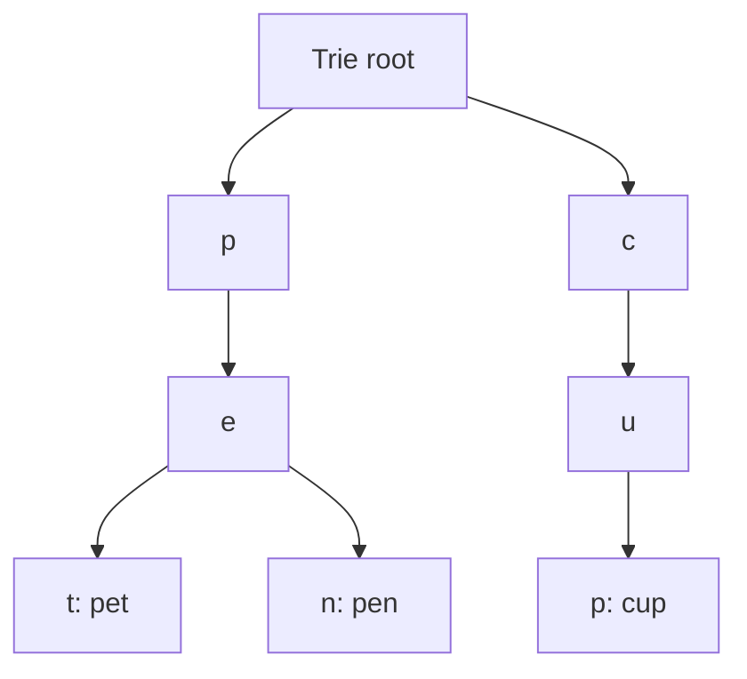

Text looks like the simplest data type — just a sequence of characters — and
that appearance is exactly what makes string algorithms deceptively tricky:
the "obvious" approach to searching or matching text is usually correct for
ASCII and quietly wrong once real Unicode text arrives.

> [!WHY] A validator accepts user-controlled text with a nested-repeat
> regex. A long near-match can monopolise the request worker, so an
> innocuous-looking pattern can turn a validation path into a denial of
> service.

> [!GOALS]
>
> - Explain how KMP preserves matched information
> - Choose prefix versus substring indexing
> - Recommend a safe matching engine for hostile input

## Naive pattern matching, and why it's slow

```text
  searching for pattern "ABAB" in text "ABABABABABC":

  the NAIVE approach: try matching the pattern starting at
  EVERY position in the text, character by character, giving
  up and shifting one position on a mismatch.

  → worst case O(n·m) (text length × pattern length) — a
    pathological input (repetitive text and pattern) makes
    this genuinely slow, not just theoretically.
```

## KMP: never re-examining a character you've already matched

```text
  the insight: when a mismatch happens partway through a
  match, the ALREADY-MATCHED prefix tells you something —
  specifically, whether a shorter prefix of the pattern
  already matches the text you're currently looking at, so you
  can SKIP re-checking characters you've already confirmed.

  → KMP precomputes a FAILURE FUNCTION (for each position in
    the pattern, "how much can I skip on a mismatch here") in
    O(m), then scans the text in O(n) — O(n+m) total,
    GUARANTEED, no pathological worst case, unlike the naive
    approach.
```

```text
  → the general lesson beyond this specific algorithm: a naive
    algorithm that seems to "waste" information (re-examining
    characters it's already looked at) usually has a smarter
    version that PRESERVES what was already learned instead of
    discarding it on every mismatch — this exact pattern
    (precompute once, reuse across the scan) recurs constantly
    in string and array algorithms.
```

## Tries: a tree shaped by shared prefixes

```text
              root
             /    \
           c        d
          /          \
        a              o
       / \               \
      t   r                g
      |    \
      (cat) s
              \
             (cars)

  → a TRIE stores strings by their SHARED PREFIXES — "cat" and
    "cars" share the "ca" path, diverging only where the
    strings actually differ. lookup, insert, and — critically —
    "all strings with this prefix" are all O(length of the
    string/prefix), INDEPENDENT of how many total strings are
    stored.
```

```text
  → this is the actual mechanism behind autocomplete (the
    Case: Search and Autocomplete chapter's territory, at the
    data-structure level): typing "ca" and getting every word
    starting with "ca" is a single trie traversal to the "ca"
    node, then enumerating everything below it — not a scan of
    every stored word checking which ones start with "ca."
```




## Suffix structures: substring queries at scale

```text
  a SUFFIX ARRAY (every suffix of a string, sorted) or SUFFIX
  TREE (a trie of every suffix) answers "does this substring
  appear anywhere in this text, and where" in time INDEPENDENT
  of how many times it's searched — after O(n log n) or O(n)
  preprocessing, EACH substring query is fast, which matters
  enormously when the SAME large text is searched repeatedly
  (a genome, a codebase's full-text search index) rather than
  once.
```

## Regex engines: two genuinely different implementations

```text
  BACKTRACKING           tries a path, and on failure,
  (most languages'        BACKTRACKS to try an alternative —
  regex engines)          expressive (supports backreferences,
                        lookahead) but can have CATASTROPHIC
                        worst-case behavior on certain patterns

  FINITE AUTOMATON         compiles the pattern into a state
  (RE2, Rust's regex        machine, no backtracking —
  crate)                    GUARANTEED linear time in input
                        length, but cannot support some
                        backtracking-only features
                        (backreferences)
```

```text
  → CATASTROPHIC BACKTRACKING is a REAL, EXPLOITABLE
    vulnerability (ReDoS — Regular expression Denial of
    Service): a pattern like (a+)+b against a long string of
    "a"s with no trailing "b" can take EXPONENTIAL time on a
    backtracking engine — a user-controlled regex, or a
    hardcoded regex applied to user-controlled input, both
    need this checked, since the pathological input isn't
    exotic — it's often just "a long string that doesn't
    quite match."
```

## Where Unicode breaks the naive approach

```text
  the Numbers and Encoding chapter already covered grapheme
  clusters breaking naive length/truncation — the SAME issue
  reappears here specifically for PATTERN MATCHING: searching
  byte-by-byte or code-point-by-code-point in a multi-byte
  encoding (UTF-8) can match a pattern that spans PART of one
  grapheme and part of another, producing a match that doesn't
  correspond to anything a human would recognize as the
  searched text.

  → text algorithms that need to be CORRECT for real-world
    international text operate on GRAPHEME CLUSTERS (or use a
    library that already handles this), not raw bytes or code
    points — this is not an edge case reserved for unusual
    input; it's the norm for any text that isn't pure ASCII.
```

> [!PITFALL] A regex that is fast on matching examples may still backtrack
> exponentially on a long near-match.

> [!INTERVIEW] Distinguish prefix search from arbitrary substring search,
> account for output enumeration, and name the regex engine’s worst-case
> guarantee before accepting user-controlled input.

> [!CHECK] What is naive pattern matching’s worst-case cost?
>
> O(n × m) for text length n and pattern length m.

> [!CHECK] Why must autocomplete account for output enumeration?
>
> Reaching the prefix node is only the lookup step; returning all
> completions still requires enumerating the descendants that are output.

> [!CHECK] Why can matching raw code points miss the intended visible-text
> boundary?
>
> A user-perceived grapheme may comprise several code points, so a match
> can split or span parts of visible characters.

## What to take away

1. Naive pattern matching is O(n·m) worst case; KMP achieves guaranteed
   O(n+m) by never re-examining a character it's already confirmed matched
   — precompute once, reuse across the scan.
2. A trie stores strings by shared prefixes, making prefix-based queries
   (autocomplete) independent of the total number of stored strings — the
   actual mechanism behind typeahead search.
3. Suffix arrays/trees trade upfront preprocessing for fast repeated
   substring queries, which pays off specifically when the same large text
   is searched many times.
4. A backtracking regex engine can have catastrophic exponential-time
   behavior on certain patterns (ReDoS) — a real, exploitable vulnerability,
   not a theoretical concern, on any user-influenced regex or input.
5. Text algorithms operating on raw bytes or code points instead of
   grapheme clusters can match or split part of a multi-code-point
   character — the norm for real international text, not an edge case.

## Exercises

> [!EXERCISE recall] What information does KMP retain after a partial
> match fails, and what are its preprocessing and scan costs?
>
> **Solution:** The failure function records how an already-matched suffix
> can align with a shorter pattern prefix. It avoids discarding all
> learned matches: preprocessing costs O(m) and scanning costs O(n),
> giving O(n + m) overall.

> [!EXERCISE apply] A dictionary contains pet, pen and cup. Draw the
> shared trie paths and list results under prefix pe. Separately choose an
> index for many arbitrary-substring queries against one fixed large
> document.
>
> **Solution:** The root branches to p and c. The p path continues to e,
> which branches to terminal t and n, yielding pet and pen; c→u→p yields
> cup. Prefix pe reaches the shared p→e node, then enumerates pen and pet.
> For repeated arbitrary substrings within one fixed document, use a
> suffix array or suffix tree: its preprocessing targets substring
> queries, unlike a dictionary trie’s word-prefix lookup.

> [!EXERCISE stretch] A user-input validator needs no backreferences but
> uses (a+)+b in a backtracking engine. Recommend a safer engine direction
> and name the weaker mitigation.
>
> **Solution:** Use a finite-automaton engine such as the chapter’s RE2 or
> Rust regex model when the required feature set permits it, to obtain
> linear-time matching. A weaker answer keeps the same backtracking
> behaviour because normal test strings are fast: a long run of a
> characters without b triggers the pathological near-match. Verify
> required regex features rather than assuming engine substitution is
> always feature-compatible.
