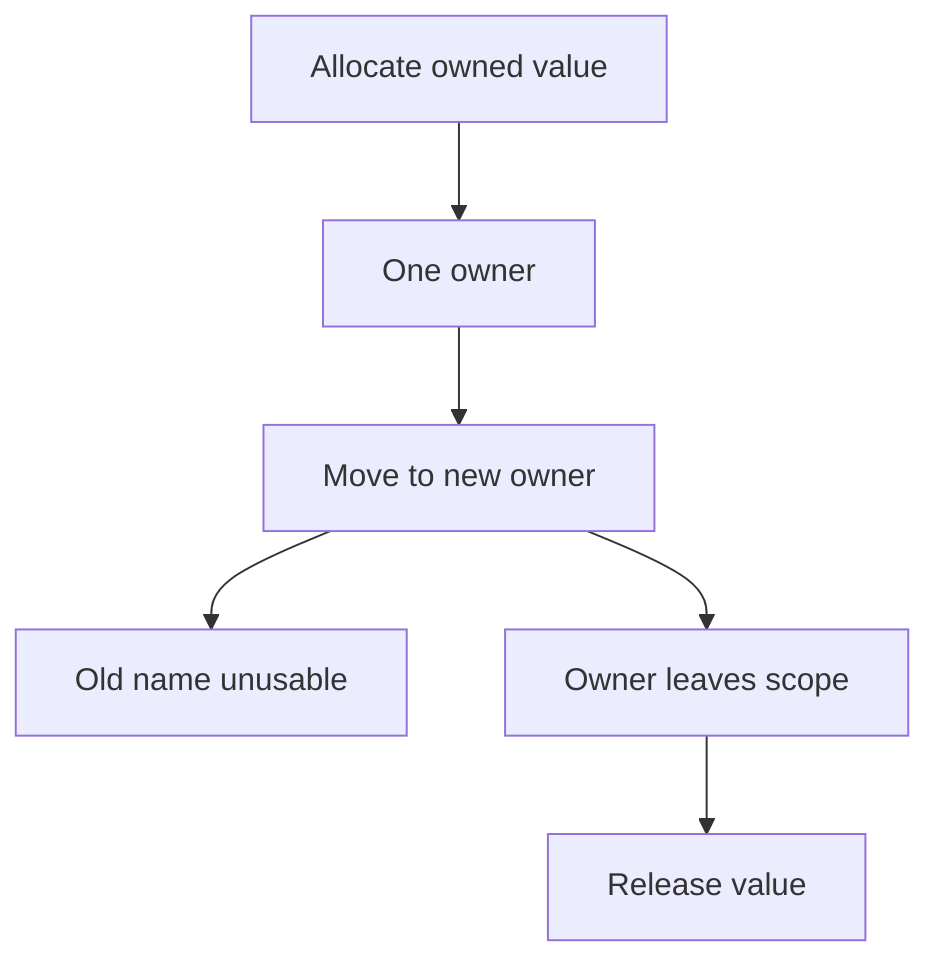

Every language covered so far in this curriculum runs on top of a runtime —
a garbage collector, a bounds-checked array, an exception handler catching a
null dereference. Systems programming is what's underneath all of that: code
with no safety net, where a mistake isn't caught and reported, it simply
produces undefined behavior.

> [!WHY] A C helper returns a pointer after freeing its allocation, and a
> test still prints the expected value. A passing run does not keep the
> lifetime alive; a later allocation can reuse those bytes and turn the
> same code into corruption.

> [!GOALS]
>
> - Explain the limits of undefined behaviour
> - Trace ownership moves and borrowing choices
> - Choose an auditable unsafe boundary

## Pointers: an address, nothing more

```text
  int x = 42;
  int *p = &x;      // p holds the ADDRESS of x
  *p = 100;          // DEREFERENCE p, write 100 to that
                         address — x is now 100
```

```text
  → a pointer is just a NUMBER (a memory address) with a TYPE
    attached telling the compiler how to interpret what's
    there — there is NOTHING preventing a pointer from holding
    an invalid address (uninitialized, or the address of memory
    that's since been freed) — dereferencing it then is
    UNDEFINED BEHAVIOR: the program might crash, might read
    garbage, or might APPEAR to work while corrupting unrelated
    memory, and which of these happens can differ between
    otherwise identical runs.
```

## Undefined behavior: worse than an error

```text
  int arr[5];
  arr[10] = 1;    // ✗ out-of-bounds write — in C, this does
                     NOT throw an error. it writes to WHATEVER
                     memory happens to be 10 ints past arr's
                     start — possibly another variable, possibly
                     the call stack's own return address
```

```text
  → "undefined behavior" means the LANGUAGE SPECIFICATION makes
    NO GUARANTEE about what happens — not "it will crash"
    (which would at least be predictable), but genuinely
    ANYTHING, including appearing to work correctly on one
    compiler/platform/optimization level and corrupting memory
    on another. this exact class of bug (the Memory Management
    and GC chapter's use-after-free, plus buffer overflows like
    this one) is the source of a huge fraction of real-world
    security vulnerabilities — an attacker who can trigger
    undefined behavior in a specific, controlled way
    can often turn it into arbitrary code execution.
```

## Manual memory: the discipline C demands

```text
  int *p = malloc(sizeof(int) * 10);   // allocate
  // ... use p ...
  free(p);                              // release — the
                                            PROGRAMMER's
                                            responsibility,
                                            entirely
```

```text
  → every allocation needs EXACTLY one matching free — not zero
    (a leak), not two (a double-free, corrupting the
    allocator), and NOTHING may use the pointer AFTER free()
    is called on it (use-after-free). C provides NO help
    tracking which of these rules a given piece of code is
    actually following — it's entirely a matter of programmer
    discipline, code review, and tools (address sanitizers,
    valgrind) that catch violations AFTER the fact, not before.
```

## Rust's ownership: the compiler enforces the discipline instead

```text
  fn main() {
      let s1 = String::from("hello");
      let s2 = s1;           // s1 is MOVED into s2
      println!("{}", s1);    // ✗ COMPILE ERROR — s1 was
                                 moved, using it again is
                                 rejected BEFORE the program
                                 ever runs
  }
```

```text
  → Rust's OWNERSHIP model: every value has exactly ONE owner
    at a time; assigning it (or passing it to a function) MOVES
    ownership, and the compiler tracks this AT COMPILE TIME —
    using a moved-from value, or a value after its owner goes
    out of scope, is a COMPILE ERROR, not a runtime crash and
    not a silent memory bug. this is precisely how Rust achieves
    memory safety with NO garbage collector and NO manual
    free() — the discipline C leaves entirely to the programmer
    is enforced by the compiler instead, mechanically, on every
    build.
```

```text
  BORROWING lets code use a value WITHOUT taking ownership
  (&s1, a reference) — the compiler enforces (again, at compile
  time) that you can have EITHER multiple READ-ONLY borrows OR
  exactly ONE mutable borrow, never both simultaneously — this
  specific rule is what makes a DATA RACE (the Concurrency and
  Parallelism chapter's mutation-from-two-places-at-once
  problem) literally UNREPRESENTABLE in safe Rust: the compiler
  simply refuses to compile code where it could happen.
```



## `unsafe`: the escape hatch, used deliberately

```text
  unsafe {
      let raw_ptr = &value as *const i32;
      println!("{}", *raw_ptr);
  }
```

```text
  → Rust's `unsafe` block doesn't disable the type system — it
    disables a SPECIFIC, small set of additional checks (raw
    pointer dereferencing, calling into C code via FFI) for
    code that genuinely needs to step outside what the borrow
    checker can prove safe (talking to hardware, calling a C
    library, implementing a low-level data structure the
    borrow checker can't verify). the discipline: keep `unsafe`
    blocks SMALL and AUDITABLE — they're exactly where a
    memory-safety bug can still occur in otherwise-safe Rust
    code, so isolating them makes a security review's job
    actually tractable.
```

## Why this still matters, layered under everything else

```text
  every garbage-collected language's RUNTIME is itself written
  in C, C++, or Rust — the JavaScript engine, the Python
  interpreter, the JVM — all sit on exactly this layer,
  managing exactly these risks, so that application code
  written ON TOP of them never has to.

  → this is the foundation the Memory Management and GC
    chapter, and every higher-level language's safety
    guarantee, is ultimately built on — understanding it
    explains WHY those guarantees exist and what they cost to
    provide, not just that they exist.
```

> [!PITFALL] Appearing to work after free does not validate an access;
> freed storage may be reused, and undefined behaviour has no dependable
> outcome.

> [!INTERVIEW] Track who owns the allocation and how long each reference
> is valid. For unsafe code, identify the small operation whose safety the
> compiler cannot prove and the obligation the wrapper must maintain.

> [!CHECK] What does dereferencing a valid pointer do?
>
> It accesses the value at the address, interpreted using the pointer’s
> associated type.

> [!CHECK] What three lifetime obligations accompany a manual allocation?
>
> Release it exactly once, do not leak it, and never use it after release.

> [!CHECK] Why does ownership not require a tracing collector?
>
> The compiler tracks the owner and prevents use after move or scope end;
> cleanup follows ownership rather than a runtime reachability trace.

## What to take away

1. A pointer is just an address with a type attached — nothing prevents it
   from holding an invalid address, and dereferencing an invalid one is
   undefined behavior, not a predictable error.
2. Undefined behavior means the language specification makes no guarantee at
   all — not "it will crash," but genuinely anything, including appearing to
   work while silently corrupting memory, which is why it's the root of a
   huge fraction of real-world security vulnerabilities.
3. C's manual memory management requires exactly one free per allocation,
   with no compiler help tracking whether that rule is being followed —
   entirely a matter of programmer discipline.
4. Rust's ownership model enforces that discipline at compile time instead —
   using a moved-from or out-of-scope value is a compile error, achieving
   memory safety with no garbage collector and no manual free.
5. Rust's borrowing rule (many read-only borrows OR one mutable borrow,
   never both) makes a data race literally unrepresentable in safe code —
   the compiler refuses to compile it, rather than catching it at runtime.

## Exercises

> [!EXERCISE recall] Why is undefined behaviour a weaker guarantee than a
> predictable runtime error, and why is a successful run not evidence of
> safety?
>
> **Solution:** The language makes no guarantee once the program violates
> its rules. It may appear to work, crash or corrupt memory depending on
> compilation and execution. Observing one success does not establish that
> the invalid access is permitted.

> [!EXERCISE apply] A Rust String belongs to a; assignment let b = a moves
> it, and a later line tries to print a. Decide which name remains usable.
> Choose how a helper can inspect the same String while the caller retains
> ownership, and whether a simultaneous mutable borrow is permitted.
>
> **Solution:** After the move b owns the String; using a is rejected at
> compile time. Give the inspecting helper a read-only borrow of b rather
> than transferring ownership. Multiple read-only borrows may coexist, but
> a mutable borrow cannot coexist with them; code needing mutation must
> respect the exclusive mutable-borrow rule.

> [!EXERCISE stretch] A wrapper around a C library puts an entire Rust
> module inside unsafe blocks for convenience. Recommend a reviewable
> boundary and reject a specific weaker justification.
>
> **Solution:** Keep raw-pointer dereferences and FFI operations in small,
> auditable unsafe blocks, documenting and maintaining the lifetime and
> validity obligations around them. Keep the surrounding logic safe. A
> weaker answer broadens unsafe because the code currently passes tests:
> tests do not establish all memory-safety preconditions, and a broad
> boundary makes the remaining risk harder to audit. unsafe also does not
> turn off the entire type system.
