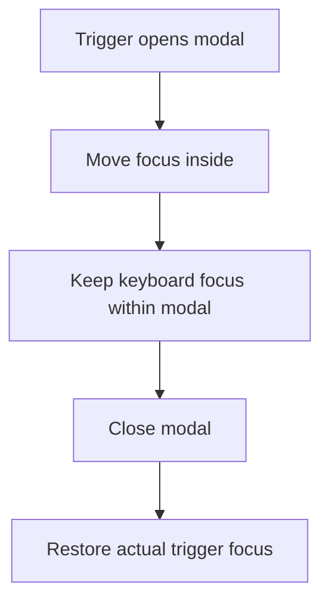

Accessibility is frequently treated as a checklist applied after a feature
ships. Built in from the start, most of it is nearly free — semantic HTML
and correct focus management cost little more than the alternative, and they
determine whether a real percentage of users can use the product at all.

> [!WHY] A checkout modal appears but keyboard focus remains on the page
> underneath. A customer can see the next step yet cannot reach its
> controls, so a visually complete flow still prevents completion.

> [!GOALS]
>
> - Explain native button behaviour
> - Trace focus through a modal lifecycle
> - Choose contrast rules for readable text

## Semantic HTML is the foundation, not decoration

```text
  the HTML/CSS chapter already made this point structurally;
  here's the accessibility payoff directly: a <button> is
  focusable, activatable with Space/Enter, and announced as
  "button" by a screen reader — all for free. reimplementing
  that with a styled <div onClick> means manually adding
  tabIndex, a keydown handler for Space/Enter, and role="button"
  — and it's easy to get one of the three subtly wrong.
```

```text
  → reach for the semantic element FIRST (button, nav, main,
    article, label) — ARIA exists to fill gaps semantic HTML
    genuinely can't cover, not to replace elements that already
    do the job.
```

## Keyboard navigation

```text
  the baseline test: can EVERY interactive element be reached
  and activated using ONLY Tab, Shift+Tab, Enter, Space, and
  arrow keys — no mouse at all?

  → this isn't a niche use case: screen reader users, users
    with motor impairments who can't operate a mouse precisely,
    and power users who simply prefer the keyboard all depend
    on this working. a custom dropdown or modal built with only
    click handlers and no keyboard support is unusable, not
    just inconvenient, for a real portion of users.
```

```text
  TAB ORDER should follow the VISUAL/LOGICAL order of the page
  — a positive tabindex (tabindex="5") REORDERS tab sequence
  manually and is almost always a mistake, since it's nearly
  impossible to keep synchronized with the actual visual layout
  as a page evolves.

  tabindex="0"   → makes a non-natively-focusable element
                 focusable, in its NORMAL document-order position
  tabindex="-1"  → makes an element focusable via JavaScript
                 (for programmatic focus-management) but
                 NOT reachable via Tab — used for things like
                 focusing a heading after a route change
```

## Focus management

```text
  opening a modal WITHOUT managing focus: the user's focus
  stays on whatever was behind the modal — Tab continues moving
  through the BACKGROUND page content, invisible behind the
  modal overlay, while the modal itself is entirely unreachable
  by keyboard.
```

```text
  → a modal needs: focus MOVED into it on open (usually to its
    first focusable element, or the modal itself), a FOCUS TRAP
    (Tab cycles only among the modal's own focusable elements,
    not escaping to the page behind it) while open, and focus
    RESTORED to whatever triggered it on close — three explicit
    steps, none of which happen automatically just from
    rendering a modal-looking div.
```



## ARIA: filling gaps, not a cure-all

```text
  <div role="button" tabindex="0"
       onKeyDown={handleEnterOrSpace}
       aria-pressed={isActive}>
    Toggle
  </div>
```

```text
  → ARIA attributes describe a custom widget's ROLE and STATE
    to assistive technology when a semantic element genuinely
    can't express it (a custom toggle, a combobox with a
    non-native visual design) — but ARIA changes NOTHING about
    actual keyboard behavior; role="button" does not make
    Space/Enter activate the element, you still implement that
    yourself. this is the single most common ARIA mistake:
    adding the role without the behavior it implies.
```

```text
  → "no ARIA is better than bad ARIA" — an incorrect
    aria-label or a role that doesn't match actual behavior
    actively MISLEADS a screen reader user, which is worse than
    the plain, unstyled default the element would otherwise
    announce.
```

## Contrast and visual accessibility

```text
  WCAG AA requires a contrast ratio of at least 4.5:1 for normal
  text against its background (3:1 for large text) — light gray
  text on a white background is a common, easy-to-miss
  violation that looks "clean" in a mockup and is genuinely
  unreadable for a real portion of users with low vision.
```

```text
  → contrast is CHECKABLE mechanically (a contrast checker, or
    a browser devtools panel) — this isn't subjective the way
    "does this look good" is; a specific ratio either passes
    or it doesn't, and it's worth checking BEFORE shipping a
    color pairing, not discovering it fails an audit later.
```

## Screen readers: what they actually announce

```text
  a screen reader announces, roughly: the element's ROLE
  ("button", "link", "heading level 2"), its ACCESSIBLE NAME
  (the visible text, or an aria-label if the visible text isn't
  descriptive enough), and its STATE (pressed, expanded,
  disabled, checked).
```

```text
  <button></button>   ✗ announces just
                                               "button" — no
                                               indication of
                                               WHAT it does

  <button aria-label="Delete item">
    
  </button>                                 ✓ announces "Delete
                                               item, button" —
                                               the icon's alt is
                                               empty (decorative,
                                               the label already
                                               covers it) to
                                               avoid announcing
                                               it TWICE
```

> [!PITFALL] A modal-looking overlay is not keyboard interaction; focus
> must move in, remain contained and return on close.

> [!INTERVIEW] Explain role, accessible name, keyboard operation and focus
> lifecycle separately; a screenshot establishes none of them by itself.

> [!CHECK] How should an icon-only delete button get a usable name?
>
> Give it an accessible name such as Delete item and keep the decorative
> icon from duplicating that announcement.

> [!CHECK] Does ARIA implement the behaviour implied by a role?
>
> No. It describes role and state; the actual keyboard behaviour must
> exist too.

> [!CHECK] What order should normal keyboard traversal follow?
>
> The page’s logical and visual order, rather than an independently
> maintained positive-tabindex sequence.

## What to take away

1. Reach for semantic HTML first — a button, nav, or label comes with free
   keyboard and screen-reader behavior that a styled div requires manually
   reimplementing, correctly, in three separate places.
2. Every interactive element must be reachable and operable via keyboard
   alone — this isn't a niche use case, it's a baseline a real portion of
   users depend on.
3. A modal needs focus explicitly moved in on open, trapped while open, and
   restored to the trigger on close — none of that happens automatically
   just from rendering a modal-looking element.
4. ARIA describes role and state to assistive technology but implements no
   actual behavior itself — adding `role="button"` without also handling
   Space/Enter is the single most common ARIA mistake, and incorrect ARIA is
   worse than none at all.
5. Contrast is mechanically checkable, not subjective — a specific ratio
   either passes WCAG AA or it doesn't, and it's worth verifying before
   shipping a color pairing that looks clean but is genuinely unreadable for
   low vision.

## Exercises

> [!EXERCISE recall] What does choosing a native button supply that a
> click handler on a div does not?
>
> **Solution:** It supplies native keyboard focusability, activation with
> Space and Enter, and a button role for assistive technology. Recreating
> the visual shape on a div does not implement those behaviours.

> [!EXERCISE apply] Two buttons can open the same address editor. A
> keyboard user opens it from the second button, tabs through the fields,
> then closes it. Choose focus behaviour at all three stages and compare
> tabindex=-1 with positive tabindex for a programmatically focused
> heading.
>
> **Solution:** Move focus into the editor on open, keep Tab within its
> controls while open, and return focus to the actual second trigger on
> close. A heading can use tabindex=-1 for programmatic focus without
> entering normal Tab order. A positive tabindex instead reorders the
> page’s sequence and is not the mechanism needed for the heading.

> [!EXERCISE stretch] A design uses 4:1 contrast for both normal and large
> text and calls it acceptable because large text passes. Recommend a
> review decision.
>
> **Solution:** Require at least 4.5:1 for the normal text; 4:1 already
> exceeds the chapter’s 3:1 large-text threshold. Adjust the normal-text
> colour pairing and measure it. A weaker answer approves every size using
> the large-text rule, leaving normal text below its distinct requirement.
> Visual cleanliness is not the numerical contrast test.
