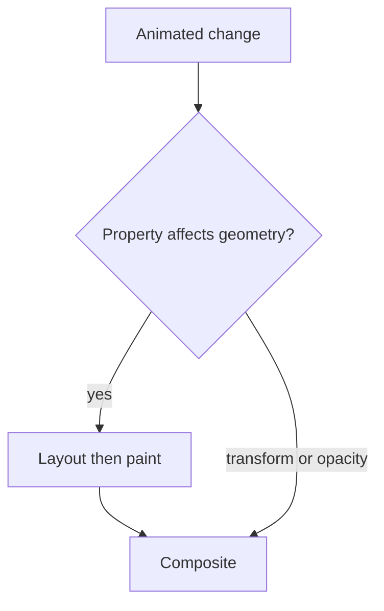

The Browser Internals and the DOM chapter already established which CSS
properties skip layout and paint entirely. This chapter is animation built on
top of that fact deliberately — plus the orchestration and accessibility
considerations that separate a smooth, purposeful animation from a
distracting one.

> [!WHY] A drawer animates its width while data updates rerender the page.
> Layout work on every frame consumes the motion budget, turning a
> polished idle demo into a visibly stuttering interaction under real
> load.

> [!GOALS]
>
> - Explain transition, keyframe and spring timing
> - Compute a frame budget for two animation paths
> - Design a functional reduced-motion fallback

## Animating on the compositor

```text
  the render-pipeline mechanism, restated for animation
  specifically: `transform` and `opacity` changes can run
  ENTIRELY on the compositor thread — no layout, no paint,
  often on the GPU — which is what makes a transform-based
  animation stay smooth even while the main thread is busy with
  something else.

  animating `width`, `top`, `left`, or `margin` instead forces
  LAYOUT on every single frame of the animation — 60fps means
  16.6ms per frame, and a layout-triggering animation on a
  complex page can genuinely miss that budget, producing
  visible jank.
```

```text
  → prefer transform (translateX/Y, scale, rotate) and opacity
    for anything animated — this isn't a stylistic preference,
    it's the direct consequence of which pipeline stages each
    property can skip.
```



## Transitions vs keyframes vs spring physics

```text
  CSS TRANSITION    a single property, from A to B, over a
                    fixed duration — simplest, for a direct
                    state change (hover, a toggle)

  CSS KEYFRAMES      a defined SEQUENCE of states over a
                    timeline — for a repeating or multi-step
                    animation a simple transition can't express

  SPRING PHYSICS      models a mass-spring-damper system rather
  (this project's       than a fixed duration — the animation's
  own motion approval)   TIMING emerges from physical parameters
                         (stiffness, damping) rather than being
                         hand-authored, which is why it feels
                         more natural for interruptible,
                         physical-feeling motion (a dragged
                         card, a hover state)
```

```text
  → this project's own approved use of `motion` is deliberately
    narrow: spring-physics for genuinely spring-like
    interactions (hover, exit/enter crossfades), while a
    continuous per-frame animation loop (an orbital view's
    position math) stays outside the library entirely, mutating
    DOM refs directly with zero React re-renders per frame —
    matching the RIGHT tool to the specific kind of motion,
    rather than reaching for one library for everything animated.
```

## Orchestration

```text
  a multi-element animation (a list of cards fading in one
  after another, a page transition coordinating an outgoing and
  incoming view) needs explicit SEQUENCING and TIMING
  relationships between elements — a naive "animate every
  element independently, all starting at once" produces a
  jarring simultaneous flash rather than an orchestrated
  sequence.
```

```text
  → STAGGERING (each element's animation starting a small,
    consistent delay after the previous one) is the specific
    technique behind the "list items cascade in" effect seen
    constantly in polished UIs — a small delay (30-80ms) per
    item, applied consistently, reads as deliberate motion
    rather than a list simply rendering.
```

## Respecting reduced motion

```text
  @media (prefers-reduced-motion: reduce) {
    * { animation-duration: 0.01ms !important;
        transition-duration: 0.01ms !important; }
  }
```

```text
  → `prefers-reduced-motion` is an OS-level accessibility
    setting a user turns on explicitly, usually because motion
    triggers a real physical response — vestibular disorders,
    where parallax/zoom/spin effects can cause genuine nausea
    or dizziness, not merely a stylistic annoyance.

  → this is not optional polish — it's a real accessibility
    requirement, and it needs an ACTUAL functional fallback (the
    orbital hub's own reduced-motion mode places nodes correctly
    without the orbit animation, rather than merely making the
    animation instant), not just "make everything happen
    instantly," which can itself be jarring in its own way.
```

## Performance budget for animation

```text
  an animation running WHILE other work competes for the main
  thread (a data fetch resolving, a heavy re-render) can drop
  frames even if the animation itself is compositor-only — a
  transform animation is CHEAP, not FREE, and a page doing
  enough OTHER work can still miss frame budget regardless of
  which properties are animating.
```

```text
  → test animation performance under REALISTIC conditions (the
    Web Performance chapter's real-device testing point,
    applied specifically to motion) — an animation that's
    buttery smooth on an idle page in devtools can visibly
    stutter once real application work is happening
    concurrently.
```

> [!PITFALL] Compositor-friendly animation is cheap rather than free;
> other work can still exhaust the frame budget.

> [!INTERVIEW] State which render stages the property changes, the frame
> budget and the no-motion interaction before choosing animation
> machinery.

> [!CHECK] Which expensive stage can changing width trigger each frame?
>
> Layout, followed by paint and compositing.

> [!CHECK] Why test motion while data and rendering work are happening?
>
> An idle demonstration omits competing main-thread work that can cause
> real dropped frames.

> [!CHECK] Why can per-frame position math stay outside React state?
>
> Updating DOM refs directly can move the visual without rerunning React
> components on every frame, as in the chapter’s orbital example.

## What to take away

1. Animate transform and opacity, not width/top/left/margin — this follows
   directly from which pipeline stages each property class can skip, not
   from stylistic preference.
2. Spring physics models timing from physical parameters rather than a
   fixed duration, which is why it suits interruptible, physical-feeling
   motion better than a hand-authored transition or keyframe sequence.
3. Multi-element animations need explicit orchestration — staggering each
   element's start by a small consistent delay is what separates a
   deliberate cascade from a jarring simultaneous flash.
4. `prefers-reduced-motion` is a real accessibility requirement tied to a
   genuine physical response some users have to motion, and it needs an
   actual functional fallback, not just an instant version of the same
   effect.
5. A compositor-only animation is cheap, not free — enough competing
   main-thread work can still cause it to drop frames, which is why animation
   performance needs testing under realistic, not idle, conditions.

## Exercises

> [!EXERCISE recall] When do transitions, keyframes and springs supply
> different timing models?
>
> **Solution:** A transition expresses a direct A-to-B state change over a
> duration. Keyframes specify a timed sequence or repetition. A spring
> derives motion from physical parameters and suits interruptible,
> physical-feeling interaction rather than a fixed timeline.

> [!EXERCISE apply] At 60 fps, use the chapter’s 16.6 ms budget. A width
> animation spends 9 ms in layout, 6 ms in paint, 2 ms compositing and 5
> ms in other work per frame. A transform version skips the first two
> costs under the scenario’s assumptions. Compare both paths and choose a
> candidate to test.
>
> **Solution:** Width totals 9 + 6 + 2 + 5 = 22 ms, exceeding 16.6 ms by
> 5.4 ms. Transform totals 2 + 5 = 7 ms, leaving 16.6 − 7 = 9.6 ms of
> budget. Test the transform version under representative concurrent work;
> skipping stages improves the budget but is not a promise that every real
> frame will be free of contention.

> [!EXERCISE stretch] A continuously orbiting navigation view handles
> reduced motion by making the orbit complete instantly. Recommend a
> usable alternative.
>
> **Solution:** Provide a stable layout with nodes already placed and
> every navigation action still reachable, omitting the continuous orbit.
> A weaker answer merely compresses the same movement into an instant
> effect: it preserves neither the intended reduced-motion experience nor
> a deliberate static fallback. The feature must function without the
> motion.
