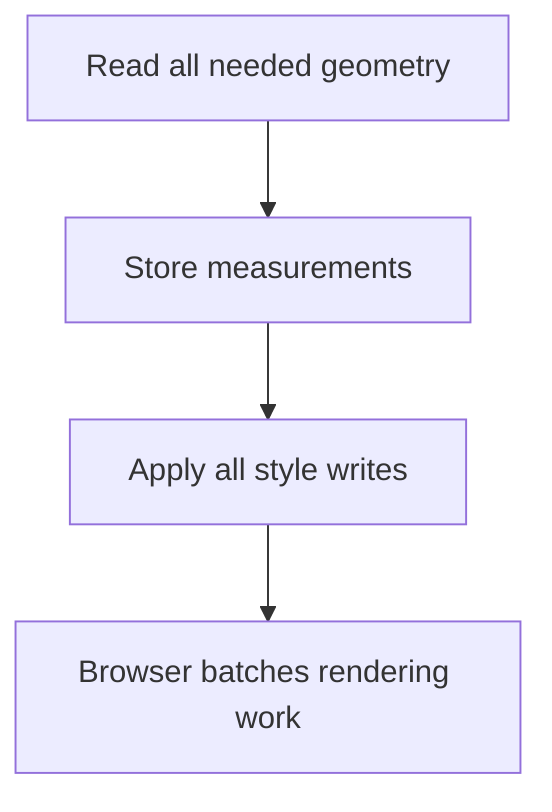

Every "why is this janky" performance question in a browser traces back to
the render pipeline: a specific, ordered sequence of stages the browser runs
to turn HTML/CSS/JS into pixels. Knowing which stage a given operation
touches is what separates "this feels slow" from knowing exactly why.

> [!WHY] A table resize interleaves geometry reads with style writes for
> every row. The browser repeatedly recalculates layout synchronously, so
> a small-looking loop can stall interaction across the entire page.

> [!GOALS]
>
> - Explain the ordered rendering pipeline
> - Choose a read/write schedule that avoids thrashing
> - Move heavy computation without moving DOM ownership

## The render pipeline

```text
  PARSE HTML → build DOM
  PARSE CSS  → build CSSOM
       ↓
  DOM + CSSOM → RENDER TREE (visible nodes + computed styles)
       ↓
  LAYOUT (a.k.a. reflow)  — compute each element's exact
                              geometry (size, position)
       ↓
  PAINT                     — fill in pixels: color, text,
                              images, shadows, borders
       ↓
  COMPOSITE                  — combine painted layers onto
                              the screen, possibly on the GPU
```

```text
  → each stage's OUTPUT is the next stage's input — changing
    something that affects an earlier stage forces every stage
    after it to re-run. this is the entire reason some CSS
    properties are dramatically cheaper to animate than others.
```

## Layout, paint, composite: what triggers what

```text
  changing `width`, `height`, `top`, `left` (or anything
  affecting an element's box)
    → triggers LAYOUT (recompute geometry) → PAINT → COMPOSITE
    → the most expensive path: a layout change can cascade —
      resizing one element can shift everything below/around it

  changing `background-color`, `color`, `box-shadow`
    → SKIPS layout (geometry unchanged) → PAINT → COMPOSITE
    → cheaper, but still repaints pixels

  changing `transform`, `opacity`
    → SKIPS layout AND paint entirely — the compositor just
      re-combines EXISTING painted layers with a new transform/
      opacity, often on the GPU
    → this is why animating `transform: translateX()` is
      dramatically smoother than animating `left` for the exact
      same visual movement
```

```text
  → this is the concrete mechanism behind "animate transform
    and opacity, not layout properties" — it isn't a rule of
    thumb, it's which pipeline stages each property class can
    skip.
```

## Layout thrashing

```text
  for (const el of elements) {
    el.style.width = box.offsetWidth + 'px';   // ✗ WRITE,
                                                    then READ
                                                    offsetWidth
                                                    on the NEXT
                                                    iteration —
                                                    forces
                                                    layout to
                                                    run
                                                    SYNCHRONOUSLY
                                                    on EVERY
                                                    loop
                                                    iteration
  }
```

```text
  → reading a layout-dependent property (offsetWidth,
    getBoundingClientRect, scrollHeight) right after a WRITE
    forces the browser to run layout IMMEDIATELY and
    synchronously, to give an up-to-date answer — rather than
    batching it once per frame as it normally would. this
    pattern, repeated in a loop, is called LAYOUT THRASHING and
    is a genuinely common, genuinely severe performance bug.

  → fix: batch ALL reads first, then all writes — read every
    offsetWidth you need into variables, THEN apply every
    style change, so layout runs once instead of once per
    iteration.
```



## The main thread and blocking

```text
  the browser has ONE thread doing: JavaScript execution, DOM
  updates, and (mostly) layout/paint — a long-running
  JavaScript function BLOCKS all of it, including user input
  handling, until it finishes.
```

```text
  → this is why a computationally heavy operation (parsing a
    huge JSON blob, a complex synchronous calculation) freezes
    the ENTIRE page, including scrolling and clicking, not just
    the operation's own visual output — there's no separate
    thread for "everything except this one function."

  → the fix for genuinely heavy computation: a WEB WORKER —
    a real separate thread with no DOM access, communicating
    with the main thread via message passing — moves the
    computation off the thread that has to stay responsive.
```

## Events: capturing, bubbling, and delegation

```text
  <div id="outer">
    <button id="inner">Click</button>
  </div>

  a click on #inner fires, in order:
    1. CAPTURING phase: outer → inner (top-down)
    2. TARGET phase: on #inner itself
    3. BUBBLING phase: inner → outer (bottom-up)

  → most listeners attach during BUBBLING (the default) —
    capturing listeners are rarer, used when a PARENT needs to
    intercept an event before a child's own handler runs.
```

```text
  EVENT DELEGATION exploits bubbling: instead of one listener
  per row in a 1,000-row table, ONE listener on the table
  itself, checking `event.target` to determine which row was
  clicked:

    table.addEventListener('click', (e) => {
      const row = e.target.closest('tr');
      if (row) handleRowClick(row);
    });

  → one listener instead of 1,000 — and it automatically
    covers rows added to the table LATER, since the listener is
    on the parent, not on each row.
```

> [!PITFALL] Extracting a blocking function does not move it off the main
> thread, just as shortening a loop does not change its layout
> dependencies.

> [!INTERVIEW] Name the operation that invalidates geometry and the later
> read that demands it synchronously; diagnose a pipeline mechanism rather
> than calling the page janky.

> [!CHECK] Which changes can skip layout while still repainting?
>
> Changes such as colour or background colour do not change geometry but
> still change pixels.

> [!CHECK] What event path does a click follow?
>
> Capture toward the target, target handling, then bubbling back through
> ancestors.

> [!CHECK] Why can one table listener handle rows added later?
>
> Delegation listens on the parent and uses bubbling and the event target
> to find the clicked row.

## What to take away

1. The render pipeline runs parse → style → layout → paint → composite in
   order, and each stage's output feeds the next — which is why animating
   `transform`/`opacity` (compositor-only) is dramatically cheaper than
   animating `width`/`left` (forces layout).
2. Reading a layout-dependent property right after writing one forces a
   synchronous layout recalculation — repeated in a loop, this is layout
   thrashing, fixed by batching all reads before all writes.
3. JavaScript, DOM updates, and layout/paint share one main thread — a long
   synchronous computation freezes the entire page, not just its own output;
   a Web Worker is the real fix for genuinely heavy computation.
4. Events capture top-down, then bubble bottom-up — most listeners use
   bubbling, and event delegation exploits it to use one listener instead of
   one per row, automatically covering elements added later.
5. Knowing which pipeline stage a given CSS/DOM operation touches turns
   "this feels slow" into a specific, checkable reason.

## Exercises

> [!EXERCISE recall] How do layout, paint and compositing transform the
> output of earlier render stages?
>
> **Solution:** Layout computes geometry from styled visible nodes, paint
> produces pixels for that geometry, and compositing combines painted
> layers on screen. A change affecting an earlier stage can require
> downstream stages to run again.

> [!EXERCISE apply] A dashboard measures widths of six cards, then needs
> to apply new widths based on those measurements. A proposal measures and
> writes one card at a time. Choose a safer operation order and explain
> why simply making the loop shorter does not fix it.
>
> **Solution:** Read all six required widths into variables first, then
> apply all six style writes. Geometry reads after layout-affecting writes
> can force immediate recalculation; separating phases lets the browser
> batch work rather than alternating freshness demands. A shorter syntax
> with the same read/write interleaving leaves that mechanism unchanged.

> [!EXERCISE stretch] A large synchronous calculation freezes controls; a
> teammate moves it into a different ordinary function but keeps calling
> it on the main thread. Recommend a real execution boundary.
>
> **Solution:** Put genuinely heavy computation in a Web Worker and
> exchange data through messages, leaving DOM access on the main thread. A
> weaker answer only renames or extracts the same synchronous function: it
> still occupies the thread responsible for interaction and rendering. A
> worker has no direct DOM access, so return computed data for the page to
> apply.
