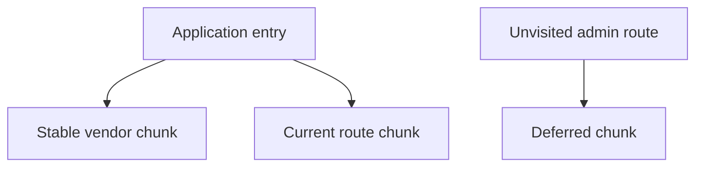

A bundler's job sounds mechanical — combine files into fewer files — but the
decisions inside it (what counts as "used," how to split output, how fast
feedback arrives during development) determine both a shipped bundle's size
and how painful the day-to-day development loop feels.

> [!WHY] A small application change forces returning visitors to download
> a large unchanged vendor bundle again. Packaging stable dependencies
> with volatile route code has turned a tiny release into repeated
> transfer and parsing cost.

> [!GOALS]
>
> - Explain module reachability
> - Compute transfer under a chunk split
> - Choose private production debugging artifacts

## The module graph

```text
  // app.js
  import { formatDate } from './utils.js';
  import { Button } from './Button.js';

  → the bundler starts from an ENTRY POINT (app.js) and follows
    every import, building a GRAPH of every module actually
    reachable — a file that exists in the project but is never
    imported from anywhere reachable from the entry point is
    simply NOT part of the graph, and never ships.
```

```text
  → this graph is also what makes CIRCULAR IMPORTS (A imports
    B, B imports A) a real, sometimes-broken situation rather
    than an abstract concern — depending on which module
    finishes evaluating first, one side of the cycle can see an
    incomplete/undefined export from the other, a subtle bug
    that only shows up depending on import ORDER.
```

## Tree shaking

```text
  // math-utils.js
  export function add(a, b) { return a + b; }
  export function multiply(a, b) { return a * b; }  // unused
                                                        anywhere
  // app.js
  import { add } from './math-utils.js';

  → the bundler can determine `multiply` is never imported ANYWHERE in the
    graph and OMIT it entirely from the output — this is the JavaScript
    chapter's ES-modules-are-statically-analyzable point, paying off
    concretely: tree shaking needs the import graph to be knowable WITHOUT
    running the code, which only a static import (not a conditional CommonJS
    require) guarantees.
```

```text
  → a library published as CommonJS, or one with SIDE EFFECTS
    at module scope (code that runs just from being imported,
    not from any export being used) defeats tree shaking even
    if you only use one function from it — this is why a
    library's `package.json` can declare `"sideEffects": false`,
    an explicit promise to the bundler that importing without
    using breaks nothing, which is what lets it be shaken safely.
```

## Code splitting, at the bundler level

```text
  a SINGLE bundle containing an entire application means every
  visitor downloads all of it — SPLITTING breaks the output
  into multiple chunks, loaded on demand:

    a route-level split (Routing and Navigation's chunk-per-route)
    a vendor split (third-party dependencies in their own chunk, which
      changes far less often than application code — letting the BROWSER
      cache it across deploys even when application code changes)
```

```text
  → the vendor-chunk split specifically exploits browser
    caching: if `vendor.js`'s CONTENT hasn't changed between
    deploys, a returning visitor's browser serves it from cache
    instead of re-downloading — bundling vendor code together
    WITH frequently-changing application code would invalidate
    that cache on every single deploy, even when no dependency
    actually changed.
```



## Transpilation

```text
  const greet = (name) => `Hello, ${name}`;   // modern syntax

  → BABEL/SWC transpile modern syntax down to a target that
    OLDER browsers/environments understand — this is a
    SEPARATE concern from bundling (combining files), though
    most build tools do both in one pipeline.

  → the target matters: transpiling for a browser baseline
    from years ago ships MORE polyfill/transpiled code (larger
    bundle) than transpiling for "browsers actually used by
    this product's real audience" — an overly conservative
    target is a real, quantifiable size cost paid by every
    visitor, for compatibility with browsers that may not
    exist in the actual user base at all.
```

## Source maps

```text
  a bundled, minified file in production:
    function a(b,c){return b+c}e.a=a

  → USELESS for debugging a production error directly. a
    SOURCE MAP records the mapping from this minified output
    back to the ORIGINAL source file, line, and variable names
    — an error-tracking tool (or devtools) uses it to show the
    stack trace against the REAL source, even though what
    actually shipped and ran is the minified version.
```

```text
  → source maps should be uploaded to an error-tracking service (or kept
    server-side) rather than shipped PUBLICLY alongside the bundle — a
    public source map hands anyone the de-minified original source, which is
    a real information-disclosure concern for closed-source
    application code.
```

## Dev server ergonomics

```text
  the day-to-day development loop's speed is a SEPARATE metric
  from production bundle quality:

    a slow dev server rebuild on every file save (seconds,
      compounding over hundreds of saves per day) is a real,
      measurable productivity cost, distinct from whether the
      PRODUCTION bundle is well-optimized
```

```text
  → modern dev tooling (Vite, and Next.js's Turbopack) prioritizes
    FAST INCREMENTAL rebuilds during development, sometimes via
    a genuinely different mechanism than the PRODUCTION build
    (serving native ES modules unbundled to the browser during
    development, bundling only for production) — dev-time speed
    and production-bundle optimization are different problems,
    solved differently, and a build tool can excel at one while
    being mediocre at the other.
```

> [!PITFALL] A dependency chunk loses its caching benefit if every
> application edit changes the same combined artifact.

> [!INTERVIEW] Distinguish module reachability, unused-export elimination
> and chunk caching before attributing every bundle-size change to tree
> shaking.

> [!CHECK] Why can module-scope side effects obstruct tree shaking?
>
> Importing the module may perform required work even when a particular
> export is unused.

> [!CHECK] Why should a transpilation target reflect the actual audience?
>
> An unnecessarily old target can add compatibility code and bundle size
> for browsers the product does not serve.

> [!CHECK] Does a fast dev server establish a small production bundle?
>
> No. Incremental feedback speed and production output optimisation are
> separate metrics and mechanisms.

## What to take away

1. A bundler builds a module graph starting from an entry point — a file
   never imported from anywhere reachable simply isn't part of the shipped
   output.
2. Tree shaking needs a statically-analyzable import graph, which is
   exactly why ES modules enable it and CommonJS generally doesn't — a
   library's side effects at module scope can defeat it even for a single
   used export.
3. A vendor-chunk split exploits browser caching: bundling stable
   third-party code separately from frequently-changing application code
   means a returning visitor doesn't re-download it on every deploy.
4. An overly conservative transpilation target is a real, quantifiable size
   cost — every visitor pays for compatibility with browsers that may not
   exist in the actual user base.
5. Source maps should stay off the public bundle and go to an error-tracking
   service instead — a public source map hands anyone the de-minified
   original source.

## Exercises

> [!EXERCISE recall] How does the bundler decide whether a source file
> belongs to an application’s module graph?
>
> **Solution:** It follows imports reachable from an entry point. A file
> merely existing in the repository does not make it reachable or part of
> that entry’s shipped graph.

> [!EXERCISE apply] An application contains 240 KB of stable vendor code,
> 80 KB for a common route and 180 KB for an unvisited admin route.
> Compare a monolithic transfer with route splitting, then a repeat visit
> after only the common route changes and the vendor chunk remains cached.
> Ignore compression and overhead.
>
> **Solution:** A monolith transfers 240 + 80 + 180 = 500 KB. Loading the
> common route with separate chunks transfers 240 + 80 = 320 KB, avoiding
> 180 KB of admin code. On the repeat visit the unchanged vendor chunk is
> reused, so only the changed 80 KB route chunk is transferred rather than
> another combined 320 KB. The split exploits both reachability and
> stable-content caching.

> [!EXERCISE stretch] A production error is minified and the team wants to
> publish source maps beside every public script for debugging. Recommend
> an alternative.
>
> **Solution:** Upload matching source maps to the error-tracking service
> or retain them server-side so traces can map to original locations
> without publishing the source representation. A weaker answer exposes
> all maps publicly simply to recover readable traces, ignoring the
> chapter’s information-disclosure trade for closed-source code.
