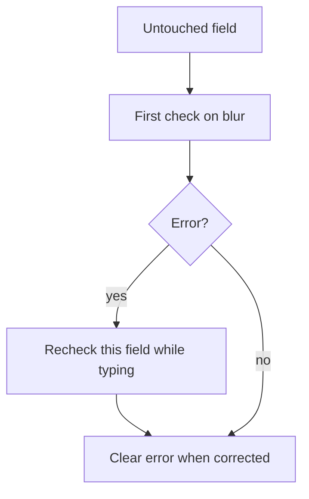

Forms look like the simplest part of a frontend and are consistently where
the most subtle UX bugs live — a validation error that fires too early, a
controlled input that fights the user's typing, a multi-step flow that loses
data on back. This chapter is the decisions that separate a form that feels
smooth from one that feels like it's fighting you.

> [!WHY] A multi-step registration flow discards the first step’s input
> when the user goes back. The network may be fine, but remount-local
> state makes the customer repeat work and distrust the form.

> [!GOALS]
>
> - Explain controlled and uncontrolled ownership
> - Choose validation timing during correction
> - Preserve multi-step data and final validity

## Controlled vs uncontrolled inputs

```text
  CONTROLLED    the input's value comes FROM React state, and
               every keystroke updates that state via onChange
               — React is the single source of truth for the
               value at all times

    <input value={name} onChange={e => setName(e.target.value)} />

  UNCONTROLLED   the DOM owns the value directly; React reads
                it only when needed (on submit, via a ref),
                not on every keystroke

    <input ref={nameRef} defaultValue="" />
```

```text
  → controlled inputs make validation, formatting-as-you-type,
    and conditionally disabling submit all straightforward
    (the value is always available in state) — at the cost of
    a re-render on every keystroke, which matters for a form
    with hundreds of fields but not for a typical one.

  → uncontrolled inputs (or a library like react-hook-form,
    which manages this internally without a re-render per
    keystroke) trade that convenience for performance on very
    large forms — the choice is a real trade-off, not "always
    use one."
```

## Validation timing

```text
  ON EVERY KEYSTROKE    validates before the user has even
                       finished typing — "Invalid email" while
                       they're three characters into typing
                       one is a hostile, ambushing experience

  ON BLUR (leaving the  validates once the user has moved on
  field)                 from the field — the field they just
                        finished with gets checked, not the
                        one they're still typing into

  ON SUBMIT              validates everything at once, only
                        when the user is done with the whole
                        form
```

```text
  → the usual right answer combines these: validate ON BLUR
    for the FIRST validation of a field (giving feedback once
    they've moved past it, not while still typing), then — ONCE
    a field has shown an error — switch to validating ON EVERY
    KEYSTROKE for THAT field specifically, so the error clears
    the moment they've actually fixed it, rather than waiting
    for them to blur again.
```



## Error messages someone can act on

```text
  "Invalid input"                     ✗ WHICH field, invalid
                                          HOW

  "Email must contain an @ symbol"     ✓ specific field,
                                          specific rule, tells
                                          the user exactly what
                                          to fix
```

```text
  → this is the Errors and Failure Design chapter's "errors
    someone can act on" discipline, applied specifically to the
    field where a USER (not a developer reading logs) is the
    one who has to act on the message — vague form errors are a
    support-ticket generator in exactly the way a vague API
    error is a debugging generator.
```

```text
  → position the error NEXT TO the field it describes, not in
    a single list at the top of the form — a list at the top
    forces the user to map each message back to a field
    themselves, and on a long form, that mapping is real,
    avoidable friction.
```

## Multi-step forms

```text
  the state-preservation problem: a user fills step 1, moves to
  step 2, then clicks BACK to step 1 — does their input
  survive?

  → YES, it must — losing step 1's data on navigating back is
    one of the most consistently frustrating form experiences,
    and it's avoidable: the multi-step form's state should live
    ABOVE the individual step components (lifted state, from
    the client-state chapter), not reset per-step-mount.
```

```text
  → validate each step's OWN fields before allowing "Next," but
    consider whether the ENTIRE form's cross-step validity
    (a later step's answer invalidating an earlier one) needs
    checking on final submit too — a multi-step form's fields
    aren't always independent of each other.
```

## Accessible form structure

```text
  <input type="text" placeholder="Email">           ✗ NO
                                                        <label>
                                                        — a
                                                        screen
                                                        reader
                                                        announces
                                                        this as
                                                        an
                                                        unlabeled
                                                        text
                                                        field

  <label for="email">Email</label>
  <input id="email" type="email">                    ✓
                                                        programmatically
                                                        associated
```

```text
  → a placeholder is NOT a label — it disappears the moment the
    user starts typing, and isn't reliably announced by every
    screen reader the way an actual <label> is. this is the
    Accessibility chapter's territory specifically, and it
    recurs in forms constantly because a placeholder LOOKS like
    a label visually while providing none of a label's actual
    guarantees.
```

> [!PITFALL] Validating an earlier step once does not establish final
> validity when later answers can change its constraints.

> [!INTERVIEW] State where values survive, when the first error appears
> and how correction clears it; these are separate form decisions.

> [!CHECK] Why is a placeholder insufficient as a form label?
>
> It disappears during entry and does not replace an explicit programmatic
> label association.

> [!CHECK] When does controlled-input rerender cost become more
> significant?
>
> In a form with hundreds of fields rather than a typical small form.

> [!CHECK] What makes a validation message actionable?
>
> It identifies the field and the concrete rule the user must fix.

## What to take away

1. Controlled inputs make validation and conditional logic straightforward
   at the cost of a re-render per keystroke; uncontrolled inputs trade that
   convenience for performance on very large forms.
2. Validate on blur for a field's first check, then switch to on-keystroke
   once an error has shown, so the error clears the moment it's actually
   fixed rather than waiting for another blur.
3. A form error needs the same actionable specificity as an API error
   message, and it belongs next to the field it describes, not in a single
   list the user has to map back themselves.
4. A multi-step form's state must survive navigating back to an earlier
   step — that means lifting the state above the individual step components,
   not resetting it per mount.
5. A placeholder is not a label — it disappears once typing starts and isn't
   reliably announced by a screen reader, despite looking like a label
   visually.

## Exercises

> [!EXERCISE recall] How do controlled and uncontrolled inputs differ in
> value ownership and update cost?
>
> **Solution:** Controlled values come from React state and update it on
> each change, making current values available to logic while rerendering.
> Uncontrolled values live in the DOM and are read when needed, reducing
> per-keystroke React work for very large forms.

> [!EXERCISE apply] A user enters an unfinished email, leaves the field,
> sees an error, then types the missing part. Choose when the first error
> should appear, when it should clear, and where the message belongs.
>
> **Solution:** Do the first field check on blur rather than ambushing
> incomplete typing. Once that field has an error, recheck it as the user
> types so correction clears the error immediately. Put a specific rule
> next to that field rather than making the user map a generic top-of-form
> error list back to the input.

> [!EXERCISE stretch] A later step changes an option that invalidates an
> earlier answer, and going back remounts the earlier component. Recommend
> a state and validation design.
>
> **Solution:** Keep the form’s values above the step components so back
> navigation preserves input. Validate each step before Next and recheck
> cross-step validity at final submit. A weaker answer stores all values
> only inside each mounted step and trusts earlier validation forever:
> remounting can lose data and later answers can invalidate earlier
> assumptions.
