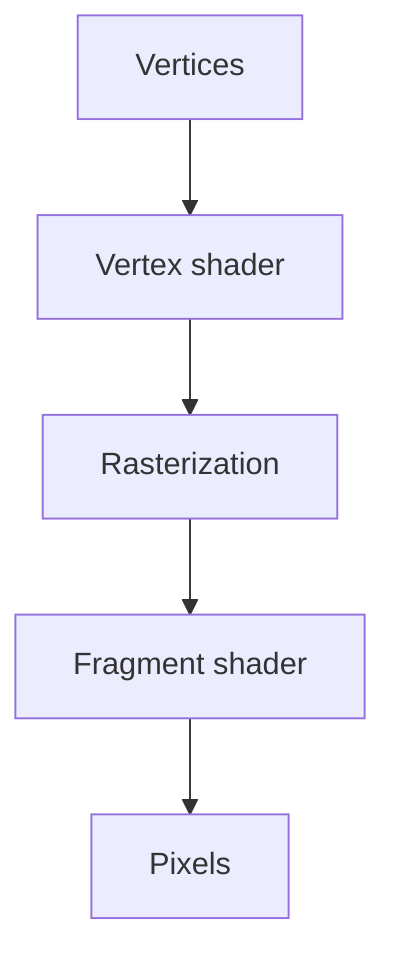

The DOM is a retained-mode system: every element is a persistent object the
browser tracks, diffs, and re-renders individually. That model breaks down
past a few thousand elements — Canvas and WebGL exist for exactly that
breaking point, trading the DOM's convenience for raw drawing throughput.

> [!WHY] A dense plot creates a DOM element for every observation and
> becomes unusable as the dataset grows. Moving to pixels can reduce
> per-point bookkeeping, but it also removes the semantics and event
> conveniences the DOM supplied.

> [!GOALS]
>
> - Explain retained versus immediate drawing
> - Choose a renderer and scale for dense data
> - Design an accessible alternative to pixels

## Retained mode vs immediate mode

```text
  DOM (retained mode)
    → every element is a PERSISTENT object; the browser tracks
      it, and updating it means changing that object's
      properties — this is what React's reconciliation (the
      React and Component Models chapter) diffs against.

  CANVAS (immediate mode)
    → there are no persistent "shape objects" — you issue DRAW
      COMMANDS onto a pixel buffer, and the moment a command
      executes, the shape is just PIXELS. there is no "the
      circle" to select or update later — to change anything,
      you clear the canvas and REDRAW everything, every frame.
```

```text
  → this is the actual reason Canvas outperforms the DOM at
    scale: the DOM's per-element bookkeeping (event listeners,
    layout participation, style resolution) costs real memory
    and CPU per element — a chart with 100,000 points as DOM
    elements is simply not viable; the same 100,000 points as
    pixels drawn onto one canvas element costs a fraction of
    that, because there ARE no per-point objects to track.
```

## When Canvas is the right tool

```text
  ✓  a chart/visualization with thousands of data points (a scatter plot, a
     dense time-series) — the DOM element-per-point approach hits real
     performance limits well before Canvas does

  ✓  a game, or anything needing frame-by-frame redraw of custom visuals

  ✓  pixel-level manipulation (image filters, a drawing app)

  ✗  interactive UI with a small, bounded number of elements — the DOM's
     accessibility (frontend.a11y), event handling, and CSS styling are FREE
     there and have to be manually rebuilt on Canvas, which draws only
     pixels with no semantic structure a screen reader can announce
```

```text
  → Canvas content is, by default, INVISIBLE to assistive
    technology — a chart drawn on canvas needs an explicit
    accessible alternative (a data table, or ARIA live region
    summarizing what the chart shows) alongside it, since there
    is no DOM structure underneath for a screen reader to
    discover on its own.
```

## The GPU pipeline, briefly

```text
  VERTEX SHADER      runs once PER VERTEX — transforms a
                     point's position (3D → 2D screen
                     coordinates, typically)
       ↓
  RASTERIZATION       determines which PIXELS a shape covers
       ↓
  FRAGMENT SHADER      runs once PER PIXEL — determines that
                      pixel's final COLOR
```

```text
  → this is MASSIVELY PARALLEL by design — a GPU runs the
    vertex shader on every vertex and the fragment shader on
    every pixel SIMULTANEOUSLY across thousands of cores, which
    is why a GPU-accelerated approach (WebGL) can render far
    more geometry than a CPU-bound approach (2D Canvas context,
    which draws sequentially) at the same frame budget.
```

```text
  → WebGL is lower-level and genuinely harder to use directly
    than the 2D Canvas API — most applications reach for a
    LIBRARY (Three.js for 3D, D3 combined with Canvas/WebGL for
    data-heavy visualization, deck.gl for large-scale
    geospatial data) rather than writing raw WebGL shader code,
    the same way most web development doesn't hand-write
    assembly.
```



## Scales and axes: the actual hard part of a chart

```text
  the RENDERING (drawing dots) is usually the easy part of a
  chart; the SCALE — mapping a data value to a pixel position —
  is where the real design decisions live:

    LINEAR SCALE      equal data differences → equal pixel
                     differences — the default, appropriate
                     for most data
    LOG SCALE          equal RATIOS → equal pixel differences —
                     needed when data spans several orders of
                     magnitude (a chart mixing values of 10 and
                     10,000 on a linear scale crushes the small
                     values into invisibility near the axis)
    TIME SCALE          handles irregular intervals (months of
                     different lengths, daylight saving
                     transitions) correctly, unlike treating
                     dates as evenly-spaced categories
```

```text
  → choosing the wrong scale for the data's actual distribution
    produces a technically-accurate but practically-useless
    chart — this is a data-communication decision, not a
    rendering detail, and it's the part a charting library's
    defaults get wrong most often for skewed or exponential
    data.
```

## Rendering more points than the DOM can hold

```text
  the technique that makes "chart with a million points" viable
  at all: OFFSCREEN aggregation/downsampling BEFORE drawing —
  a million raw points rendered onto a 1200px-wide canvas has
  many points landing on the SAME pixel column anyway, so
  pre-aggregating (binning, or a level-of-detail reduction
  based on current zoom) draws far fewer actual shapes while
  looking visually identical at the current zoom level.
```

```text
  → this is the same "measure before optimizing" and "the
    real cost is often not where intuition points" discipline
    from the Performance Engineering chapter, applied to
    rendering specifically: the naive "draw every point"
    approach seems obviously correct and is precisely why
    million-point charts without this optimization are
    unusably slow.
```

> [!PITFALL] A fast pixel renderer does not supply the accessible semantic
> structure that individual DOM elements had.

> [!INTERVIEW] State the dataset size, scale and accessible representation
> before choosing a graphics API; drawing throughput is only one
> requirement.

> [!CHECK] What does a vertex shader principally transform here?
>
> Vertex positions toward screen coordinates, before rasterization and
> fragment colouring.

> [!CHECK] Why use a time scale for irregular dates?
>
> Actual temporal intervals need not match evenly spaced category
> positions.

> [!CHECK] Why downsample a million points for a narrow display?
>
> Many raw points land in the same pixel columns, so drawing all of them
> repeats invisible work at that zoom.

## What to take away

1. The DOM is retained-mode (persistent, trackable elements); Canvas is
   immediate-mode (draw commands producing pixels with no persistent
   objects) — this is the actual reason Canvas scales past the DOM's
   per-element bookkeeping cost.
2. Canvas content is invisible to assistive technology by default — a
   chart drawn on canvas needs an explicit accessible alternative alongside
   it, since there's no DOM structure for a screen reader to find.
3. A GPU pipeline is massively parallel by design (vertex and fragment
   shaders running across thousands of cores simultaneously), which is why
   WebGL renders far more geometry than a sequential 2D Canvas context at
   the same frame budget.
4. A chart's scale (linear, log, time) is the real design decision, not the
   drawing itself — choosing the wrong one for the data's distribution
   produces a technically accurate but practically useless chart.
5. Pre-aggregating points before drawing (binning, level-of-detail
   reduction) is what makes a million-point chart viable — the naive
   draw-every-point approach looks obviously correct and is exactly why it's
   unusably slow without this step.

## Exercises

> [!EXERCISE recall] What remains after a Canvas draw command, and how
> does that differ from a DOM shape?
>
> **Solution:** Canvas retains pixels rather than a persistent selectable
> shape object. The application redraws to change the scene; the DOM
> instead tracks persistent elements, their styles, events and layout
> participation.

> [!EXERCISE apply] A plot has 80,000 observations with positive
> magnitudes 1, 1000 and 1000000, and must make the three magnitude groups
> visible. Choose a rendering and scale approach; explain the equal-ratio
> spacing.
>
> **Solution:** Use Canvas or a suitable GPU-backed drawing approach to
> avoid one DOM object per observation. Use a log scale for the magnitude
> spread: 1000/1 = 1000 and 1000000/1000 = 1000, so the two intervals
> receive equal pixel distance. A linear scale would compress the small
> values near the origin. Pre-aggregate at the current display resolution
> when many observations share pixels.

> [!EXERCISE stretch] A canvas chart has no textual data and a proposal
> adds only a generic chart role. Recommend an alternative users can
> actually inspect.
>
> **Solution:** Provide an accessible data table or meaningful textual
> summary alongside the drawing, keeping it aligned with the presented
> data. A weaker answer labels the canvas chart and stops: a role does not
> create per-point semantic values or expose information that exists only
> as pixels. Small ordinary controls can remain in the DOM rather than
> rebuilding their accessibility on Canvas.
