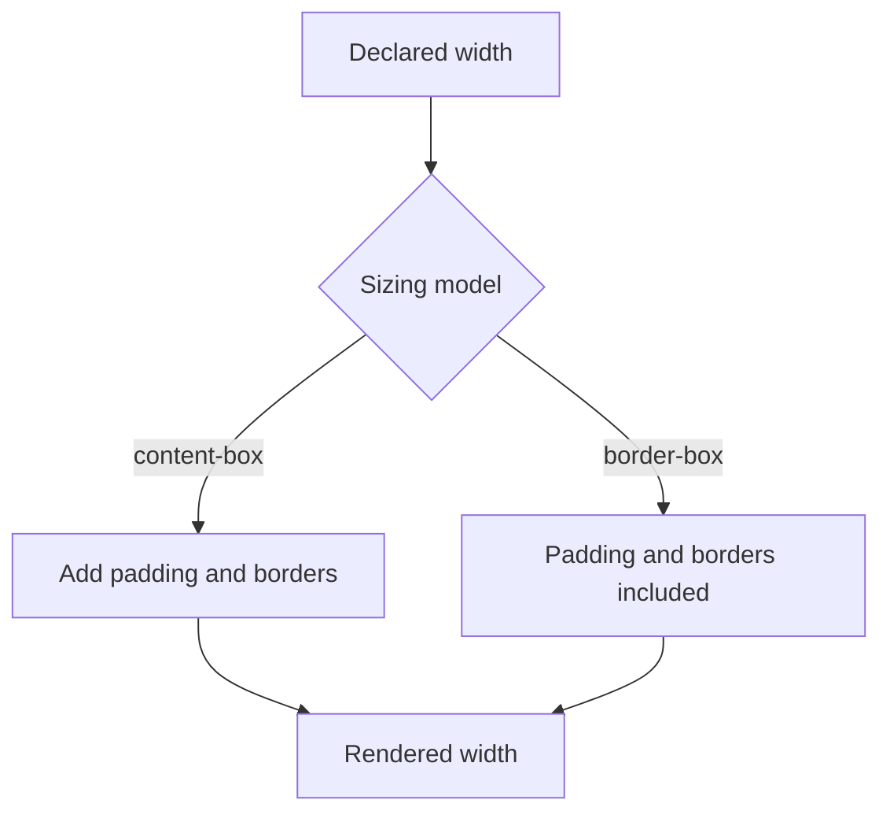

Every frontend framework eventually compiles down to HTML and CSS, and every
layout bug that survives to production is usually a gap in the mental model
of one of these two, not a framework problem. This chapter is that mental
model — box model, cascade, and the two layout systems that replaced decades
of hacks.

> [!WHY] A card fits placeholder text but clips a real customer’s longer
> name. Fixed dimensions and an item that refuses to shrink can break an
> otherwise tidy layout precisely when real content arrives.

> [!GOALS]
>
> - Explain semantic element behaviour
> - Compute content-box and border-box widths
> - Choose layout rules for variable content

## Semantic HTML, and why it isn't just style preference

```text
  <div onclick="submit()">Submit</div>              ✗
  <button type="submit">Submit</button>              ✓
```

```text
  the div version LOOKS identical after styling, but a
  <button> comes with real behavior a <div> doesn't: keyboard
  focusable by default, activatable with Space/Enter, announced
  as "button" by a screen reader, and included in an HTML
  <form>'s native submit handling — all without one line of
  JavaScript.
```

```text
  → semantic elements (<nav>, <button>, <article>, <label>) are
    not stylistic choices — they're free ACCESSIBILITY and
    BEHAVIOR that a generic <div> requires you to hand-build
    with ARIA attributes and event handlers, and re-implementing
    them yourself is easy to get subtly wrong (frontend.a11y
    covers exactly how).
```

## The box model

```text
  ┌─── margin ───────────────────┐
  │  ┌─── border ──────────────┐  │
  │  │  ┌─── padding ───────┐  │  │
  │  │  │     content        │  │  │
  │  │  └────────────────────┘  │  │
  │  └──────────────────────────┘  │
  └────────────────────────────────┘

  width: 200px   → by DEFAULT, this is the CONTENT box only —
                    padding and border are ADDED on top, so
                    the element's actual rendered width is
                    200 + padding*2 + border*2
```

```text
  box-sizing: border-box;   → width: 200px NOW INCLUDES
                                padding and border — the
                                element's rendered width is
                                exactly 200px, period.

  → nearly every modern reset applies border-box globally,
    because the default (content-box) makes "make this element
    200px wide" require doing arithmetic every time padding
    changes — border-box makes the number on the element mean
    what it says.
```



## The cascade: why a rule doesn't apply

```text
  SPECIFICITY, roughly, from lowest to highest:
    element selector (p)           1 point
    class/attribute (.button)       10 points
    id (#header)                     100 points
    inline style (style="...")        wins over all of the above
    !important                         wins over EVERYTHING

  a MORE SPECIFIC selector wins regardless of source order; an
  EQUALLY specific one, the LATER rule in the stylesheet wins.
```

```text
  the recurring confusion: "I changed the CSS and nothing
  happened" is almost always a MORE SPECIFIC rule elsewhere
  still winning — not the browser ignoring the new rule. open
  devtools, find the winning rule, and the specificity math
  explains it every time.

  → reaching for !important is treating the symptom — it wins
    the current fight but makes the NEXT override need
    !important too, escalating rather than fixing the
    underlying specificity conflict.
```

## Flexbox: one-dimensional layout

```text
  .row { display: flex; justify-content: space-between; }

  ┌──────────────────────────────────┐
  │ [item]      [item]      [item]   │   ← justify-content:
  └──────────────────────────────────┘      MAIN axis
                                          align-items:
                                            CROSS axis
```

```text
  → flexbox is for a SINGLE ROW OR COLUMN of items that should
    share space, wrap, or align along one axis — a navbar, a
    button group, centering one thing. the two axes
    (main/cross) flip depending on flex-direction, which is the
    usual source of "align-items isn't doing what I expected"
    confusion — it's aligning the CROSS axis, which is
    vertical in a row but horizontal in a column.
```

## Grid: two-dimensional layout

```text
  .layout {
    display: grid;
    grid-template-columns: 200px 1fr;
    grid-template-rows: auto 1fr auto;
  }

  ┌────────┬───────────────────────┐
  │ sidebar │        header          │
  │ (200px) ├───────────────────────┤
  │         │         main            │
  │         ├───────────────────────┤
  │         │        footer            │
  └────────┴───────────────────────┘
```

```text
  → grid is for a layout defined by ROWS AND COLUMNS together
    — a page shell, a card layout, anything where an item's
    position matters in TWO dimensions at once. flexbox can
    fake a grid with enough nested rows, but grid's
    `grid-template-areas` names each region directly, which
    reads far more clearly than nested flex containers for a
    genuinely 2D layout.
```

## Layout that survives real content

```text
  the layout bug that only shows up in production: a fixed-height card
  designed around placeholder text, breaking the moment a real product name
  is three lines instead of one.

    height: 80px;              ✗ breaks on longer content
    min-height: 80px;           ✓ grows to fit; never shrinks
                                   below the design's floor
```

```text
  → design and test layout against REALISTIC content —
    a name with 40 characters, a list with zero items, a list
    with 200 — not the shortest placeholder that happened to
    be in the mockup. min-width/min-height plus overflow
    handling (truncate, wrap, or scroll — decided deliberately,
    not defaulted into) is what makes a layout survive content
    nobody anticipated at design time.
```

```text
  the specific, very common failure this project's own history
  has hit: a flex or grid ITEM defaults to `min-width: auto`,
  which means it will NOT shrink below its content's natural
  width even inside a container with min-w-0 — the fix is
  `min-w-0` on the ITEM itself, not just the container, and
  it's easy to add it to the wrong element.
```

> [!PITFALL] min-w-0 on a parent does not automatically remove a flex or
> grid item’s own content-based minimum.

> [!INTERVIEW] Calculate the rendered box and identify the actual
> shrinking item before treating overflow as a framework problem.

> [!CHECK] When equally specific CSS rules conflict, which wins?
>
> The later source rule; a more specific rule can win regardless of that
> order.

> [!CHECK] What changes when flex-direction becomes column?
>
> The main axis becomes vertical and the cross axis horizontal, changing
> what alignment properties address.

> [!CHECK] When does grid fit better than nested flex rows?
>
> When the layout’s relationships are genuinely defined by rows and
> columns together.

## What to take away

1. Semantic HTML elements come with free accessibility and behavior (focus,
   keyboard activation, screen-reader announcement) that a generic div
   requires hand-building.
2. `box-sizing: border-box` makes a width declaration mean the element's
   actual rendered width — the default content-box makes padding change the
   real size.
3. "The CSS change did nothing" is almost always a more specific selector
   elsewhere still winning, not the browser ignoring the rule — check
   specificity before reaching for `!important`, which only escalates the
   next conflict.
4. Flexbox is for one axis of items sharing space; grid is for a layout
   defined by rows and columns together — grid's named template areas read
   more clearly than nested flex containers for genuinely 2D layouts.
5. Design and test against realistic content (long names, empty lists, huge
   lists) rather than mockup placeholders — a flex/grid item's own
   `min-width: auto` default is a specific, recurring cause of layout that
   only breaks once real content arrives.

## Exercises

> [!EXERCISE recall] Why can a semantic submit button be a better
> foundation than a visually identical clickable div?
>
> **Solution:** It supplies focus, keyboard activation, a button role and
> native form-submit integration without separately recreating those
> behaviours. Styling alone does not give a div the same contract.

> [!EXERCISE apply] A panel must fit a 300 px slot. Its declared width is
> 280 px, padding is 12 px on each side and borders are 2 px per side.
> Compare content-box and border-box widths and choose a model that fits.
>
> **Solution:** Content-box renders 280 + 2 × 12 + 2 × 2 = 308 px,
> exceeding the slot by 8 px. Border-box includes padding and border in
> the declared 280 px, leaving 280 − 24 − 4 = 252 px of content and 20 px
> of slot space. Choose border-box when the intended width should include
> the complete padded box.

> [!EXERCISE stretch] A long title overflows a flex card even though the
> outer container has min-w-0; the card also has a fixed height. Recommend
> a content-resilient fix.
>
> **Solution:** Allow the flex item itself to shrink with min-w-0, choose
> wrapping, truncation or scrolling deliberately, and use a minimum height
> when the card should grow for content. A weaker answer adds min-w-0 only
> to the container again and keeps the fixed height: it leaves the item’s
> automatic minimum and content clipping unchanged.
