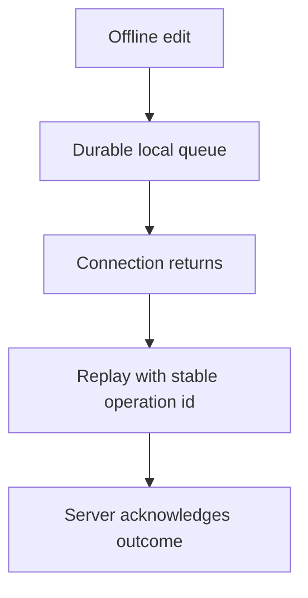

Most web development quietly assumes a reliable network is always there.
Offline and local-first design starts from the opposite assumption — the
network is unreliable by default — and that single reversal changes almost
every architectural decision downstream of it.

> [!WHY] A traveller submits an edit as the train loses connectivity, then
> the sync process restarts during replay. Without a durable local queue
> and repeated-write protection, the edit can either disappear or be
> applied twice.

> [!GOALS]
>
> - Explain the service-worker boundary
> - Choose offline caches and storage by resource
> - Choose a conflict policy that preserves intent

## Service workers: a proxy the app controls

```text
  a SERVICE WORKER is a script that runs SEPARATELY from the
  page, sitting between the app and the network — every fetch
  request from the page can be INTERCEPTED by the service
  worker, which decides: serve from cache, go to network, or
  some combination.

  self.addEventListener('fetch', (event) => {
    event.respondWith(
      caches.match(event.request).then(cached =>
        cached || fetch(event.request)
      )
    );
  });
```

```text
  → this is what makes "the app still loads with no network at all" possible
    — the service worker serves the app's SHELL (HTML, CSS, JS) from a local
    cache instead of failing when the network request has nothing to reach.
    it runs even when the page that registered it isn't open, which is also
    the mechanism behind PUSH NOTIFICATIONS (the Mobile and Cross-Platform
    chapter's PWA section) arriving while the app isn't running at all.
```

## Caching strategies

```text
  CACHE FIRST      check cache, fall back to network — fastest,
                   right for assets that rarely change (app
                   shell, static assets)

  NETWORK FIRST     try network, fall back to cache on failure
                   — right for data that should be as FRESH as
                   possible when a connection exists, but still
                   usable when it doesn't

  STALE-WHILE-      serve cache IMMEDIATELY, update the cache
  REVALIDATE         in the background for NEXT time — the
                   data-fetching chapter's pattern, at the
                   network-request level instead of the
                   application-data level
```

```text
  → the choice per resource matters — cache-first for the app
    shell means instant loads even offline; network-first for
    a live data feed means the user sees current data whenever
    possible, falling back gracefully rather than failing
    outright when there's no connection.
```

## Local storage engines

```text
  localStorage       synchronous, string-only, ~5-10MB limit —
                    fine for small settings/preferences, WRONG
                    choice for real application data (the
                    synchronous API blocks the main thread on
                    every read/write, at real data volumes)

  IndexedDB           asynchronous, structured data, much
                    larger practical limits, supports indexes
                    and transactions — the actual database for
                    an offline-capable app's real data
```

```text
  → this project's own Reader module uses IndexedDB-class
    storage for exactly this reason — a PDF's annotations are
    real application data that needs to survive offline and be
    queryable, not a small setting localStorage's synchronous,
    string-only model is built for.
```

## Sync: reconciling local changes with the server

```text
  the OFFLINE QUEUE pattern: a write made while offline is
  queued LOCALLY (in IndexedDB) rather than failing outright —
  when connectivity returns, the queue is replayed against the
  server.

  → this is the Queues and Async Jobs chapter's at-least-once
    delivery and idempotency discipline, reappearing on the
    CLIENT: a queued
    write might be sent twice if the sync process itself is
    interrupted mid-replay, so the same idempotency-key pattern
    applies here as it does to any at-least-once delivery
    system.
```



## Conflict resolution

```text
  the genuinely hard part: TWO DEVICES edit the SAME record
  while both were offline, then both reconnect and try to sync.

    LAST WRITE WINS       simplest — whichever sync reaches the
                          server last overwrites the other,
                          SILENTLY discarding the earlier
                          change — acceptable for low-stakes
                          data, a real data-loss risk for
                          anything that matters

    MERGE (CRDT-based)    the Collaborative Editing: OT & CRDTs chapter's
                          mechanism, applied at the SAME scale this
                          project's own collaborative-editing case study
                          covers — both edits are preserved and merged
                          automatically, avoiding last-write-wins' silent
                          data loss

    MANUAL RESOLUTION       surface the conflict to the USER
                          explicitly ("you edited this offline,
                          it also changed elsewhere — which
                          version?") — appropriate when an
                          automatic merge genuinely cannot be
                          trusted to preserve intent
```

```text
  → choosing between these is a PRODUCT decision as much as a
    technical one — last-write-wins is fine for a UI preference
    that rarely conflicts; a shared document or financial record
    needs either a real CRDT or explicit manual resolution, and
    picking the wrong one silently loses data users trusted the
    app to keep.
```

> [!PITFALL] A sync connection returning does not resolve competing edits
> by itself; the conflict policy decides what data survives.

> [!INTERVIEW] Separate offline loading, durable local writes, replay
> identity and conflict resolution before claiming an application works
> offline.

> [!CHECK] Why does an offline replay need idempotency keys?
>
> An interrupted sync can resend a queued write after its earlier attempt
> already took effect.

> [!CHECK] How does stale-while-revalidate differ from waiting for the
> network?
>
> It serves a cached response immediately and refreshes the cache in the
> background.

> [!CHECK] Why is localStorage better suited to small preferences than a
> large offline database?
>
> Its synchronous string-only operations and smaller practical capacity
> are a poor match for structured application data at volume.

## What to take away

1. A service worker intercepts network requests at the browser level and
   runs even when the app's page isn't open, which is what makes true
   offline loading (and push notifications) possible.
2. The right caching strategy is per-resource — cache-first for a stable app
   shell, network-first for data that should be as fresh as possible when a
   connection exists.
3. localStorage's synchronous, string-only API is fine for small settings
   but wrong for real application data at volume — IndexedDB is the actual
   database for offline-capable data.
4. A client-side offline write queue needs the same at-least-once-delivery
   idempotency discipline as any server-side queue, since a sync process
   interrupted mid-replay can resend a write.
5. Conflict resolution between two offline edits to the same record is a
   product decision as much as a technical one — last-write-wins silently
   discards data, which is fine for a low-stakes preference and a real risk
   for anything that matters.

## Exercises

> [!EXERCISE recall] How does a service worker make an application shell
> load without a reachable network?
>
> **Solution:** It runs separately from the page and intercepts requests,
> choosing a cached shell response rather than depending entirely on a
> network fetch. The application can define different cache/network
> behaviour for different resources.

> [!EXERCISE apply] An offline field app has stable shell assets,
> frequently updated reference data and a large structured collection of
> pending edits. Choose a fetch policy and storage home for each rather
> than putting every byte in localStorage.
>
> **Solution:** Use cache-first for the stable shell. Use network-first
> with cached fallback for reference data that should be current when
> connected. Keep structured pending edits in IndexedDB with asynchronous
> indexed and transactional handling, rather than blocking string-only
> localStorage at application-data volume. Replay queued changes when
> connected using a stable operation identity.

> [!EXERCISE stretch] Two devices change a low-stakes display preference
> and a high-value shared record while offline. Recommend whether one
> last-write-wins rule should cover both.
>
> **Solution:** Last-write-wins may be acceptable for the preference if
> that loss is a deliberate product choice. For the important record, use
> a trustworthy merge model or surface manual conflict resolution when
> automatic merging cannot preserve intent. A weaker answer silently takes
> the latest arriving sync for both: arrival order does not establish that
> discarding the other device’s important change is acceptable.
