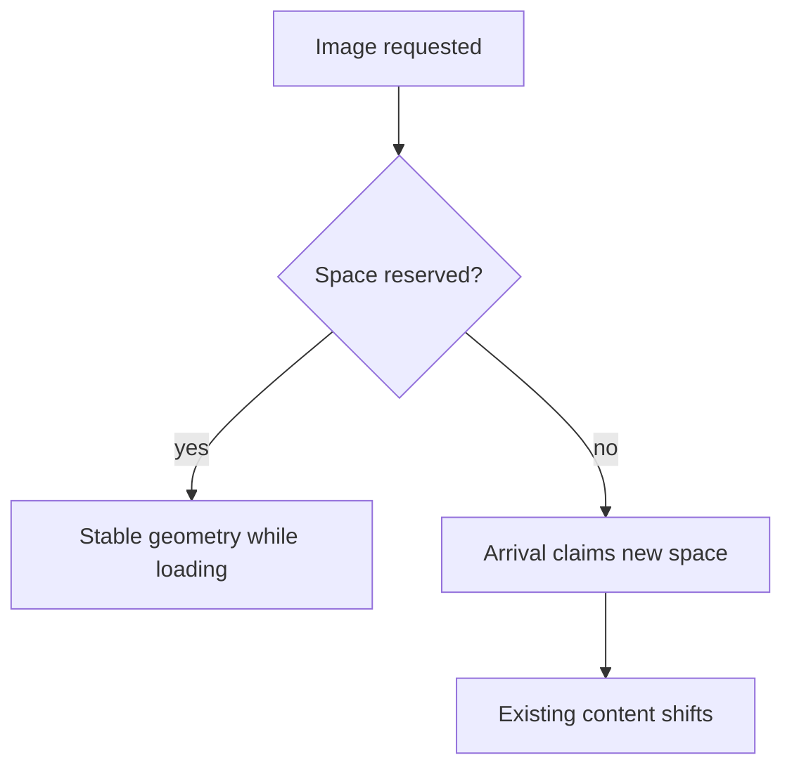

Web performance used to be measured by proxy metrics (page weight, request
count) that correlated only loosely with what a user actually experiences.
Core Web Vitals are the industry's answer: three metrics chosen specifically
because each maps to a real, felt moment in loading a page.

> [!WHY] A page paints its hero quickly but moves the purchase button when
> an image arrives. A fast-looking load metric has not prevented an
> unstable interface that causes users to click the wrong place.

> [!GOALS]
>
> - Explain the three user-experience metrics
> - Choose remedies from concrete symptoms
> - Design representative performance measurement

## The three Core Web Vitals

```text
  LCP   Largest Contentful Paint — when does the BIGGEST
        visible element (usually a hero image or heading)
        finish rendering — this is the browser's stand-in for
        "does the page feel loaded"

  INP   Interaction to Next Paint — how long between a user's
        interaction (click, tap, keypress) and the NEXT frame
        reflecting its result — "does the page feel responsive"

  CLS   Cumulative Layout Shift — how much visible content
        SHIFTS POSITION unexpectedly after initial render —
        "does the page feel stable, or does it jump around
        under you"
```

```text
  → each metric targets a DIFFERENT felt experience — a page
    can have excellent LCP (loads fast) and terrible CLS (jumps
    around once loaded) or excellent CLS and terrible INP
    (stable, but unresponsive to clicks) — optimizing only one
    doesn't guarantee the others, and a real user's complaint
    ("this feels slow") can map to any of the three depending
    on what specifically they're experiencing.
```

## What causes CLS, specifically

```text
                      ✗ no dimensions —
                                              the browser
                                              doesn't know the
                                              image's aspect
                                              ratio until it
                                              LOADS, so the
                                              layout shifts
                                              once it arrives
                                              and claims space

     ✓ the browser
                                                       RESERVES
                                                       the correct
                                                       space
                                                       immediately,
                                                       before the
                                                       image data
                                                       arrives
```

```text
  → the recurring CLS causes: images/ads/embeds without
    reserved dimensions, a web font swapping in and reflowing
    text (FOUT — flash of unstyled text — with a different
    metric than the fallback font), and content injected ABOVE
    existing content (a banner appearing at the top pushes
    everything down) — all fixable by reserving space upfront
    rather than letting layout react to content as it arrives.
```



## What causes poor INP

```text
  a click handler that does expensive synchronous work BLOCKS
  the main thread (the Browser Internals and the DOM chapter's mechanism
  directly) — the browser cannot paint the NEXT frame until
  that JavaScript finishes, so the interaction visibly lags
  even though the click was registered instantly.
```

```text
  → break up long synchronous work (chunk it, defer non-critical parts to
    `requestIdleCallback` or a microtask boundary) so the main thread gets
    control back between chunks, letting the browser paint an intermediate
    frame instead of one long unresponsive block.
```

## Bundle size and code splitting

```text
  every kilobyte of JavaScript must be DOWNLOADED, PARSED, and
  EXECUTED before it can do anything — a large bundle delays
  BOTH the first meaningful paint (if it blocks rendering) and
  time-to-interactive (parsing/executing takes real time,
  proportional to bundle size, even on a fast connection).
```

```text
  → this is exactly why the Routing and Navigation chapter's
    code-splitting-by-route matters for performance
    specifically, not just organization — a user visiting the
    homepage shouldn't download the admin panel's JavaScript at
    all, and every route NOT visited this session is bytes
    never parsed, purely from splitting correctly.
```

## Images and fonts

```text
  → serve images in a MODERN FORMAT (WebP/AVIF) at the
    ACTUAL DISPLAY SIZE — a 4000px-wide image displayed at
    400px wastes nearly all of its downloaded bytes on
    resolution nobody sees, the File Storage and Media chapter's "serve
    the resized variant, never the original" rule applied
    specifically to a browser's viewport.

  → `font-display: swap` shows FALLBACK text immediately while
    a custom web font loads, rather than showing INVISIBLE text
    until the font arrives (the default, called FOIT — flash of
    invisible text) — trading a brief font-swap flash for text
    being readable immediately, which is usually the right
    trade.
```

## Measuring on real devices, not just a fast laptop

```text
  a page tested only on a developer's fast laptop, fast wifi, and empty
  browser cache measures a scenario almost no real user experiences — REAL
  USER MONITORING (RUM, collecting actual field metrics from real visitors'
  actual devices and connections) and DEVICE/NETWORK THROTTLING in devtools
  both exist because lab conditions systematically understate
  real-world performance.
```

```text
  → a mid-range phone on a throttled 4G connection is a far
    more representative test than an M-series laptop on office
    wifi — performance work aimed at the laptop scenario can
    look great in testing and still be genuinely slow for the
    median real user.
```

> [!PITFALL] A good first-paint result does not establish stable layout or
> responsive interaction.

> [!INTERVIEW] Translate the complaint into loading, responsiveness or
> stability, and evaluate that mechanism on the affected devices.

> [!CHECK] Why size an image for its actual display area?
>
> A much larger source transfers resolution that the viewer does not use.

> [!CHECK] What does font-display swap trade?
>
> It makes fallback text readable immediately while the custom font loads,
> trading invisible text for a possible font swap.

> [!CHECK] Why can route splitting help even on a fast network?
>
> Unvisited route code also avoids parsing and execution work, not only
> transfer.

## What to take away

1. LCP, INP, and CLS each measure a different felt experience — a page can
   excel at one and fail badly at another, so optimizing only one metric
   doesn't guarantee the others.
2. CLS is caused by content claiming space it wasn't reserved for upfront —
   reserving image dimensions and font-swap space prevents most of it.
3. Poor INP traces back to the main thread being blocked by synchronous
   work, exactly the browser-internals mechanism — breaking up long work
   lets the browser paint intermediate frames.
4. Bundle size delays both paint and interactivity proportionally, which is
   why route-based code splitting is a performance decision, not just
   organizational tidiness.
5. Lab conditions (a fast laptop, fast wifi, empty cache) systematically
   understate real-world performance — real user monitoring and throttled
   testing represent the median user far better than a developer's own
   machine.

## Exercises

> [!EXERCISE recall] What distinct experiences do LCP, INP and CLS
> describe?
>
> **Solution:** LCP describes when the largest visible content paints, INP
> describes interaction-to-next-paint responsiveness, and CLS describes
> unexpected visual movement. Strong performance on one does not prove the
> others are good.

> [!EXERCISE apply] A product page shows three symptoms: its hero is late,
> its text jumps when an image loads, and a click handler performs a long
> synchronous calculation. Choose a targeted investigation for each
> instead of reporting one generic slow-page defect.
>
> **Solution:** Investigate hero delivery and display-size/format for the
> loading issue. Reserve image dimensions for the shift so the browser
> allocates space before bytes arrive. Reduce or break up the synchronous
> interaction work for responsiveness. These map to different loading,
> stability and response mechanisms, so fixing image transfer alone cannot
> establish that the click handler is responsive.

> [!EXERCISE stretch] A developer’s idle laptop benchmark improves but
> real phone users still report delays. Recommend a measurement plan.
>
> **Solution:** Collect actual field metrics with RUM and test
> representative device and network constraints with throttling or real
> devices. A weaker answer repeats the same fast-laptop measurement until
> its variance shrinks: it still samples a workload and hardware
> environment unlike the affected users. Keep the metric tied to the
> specific user complaint.
