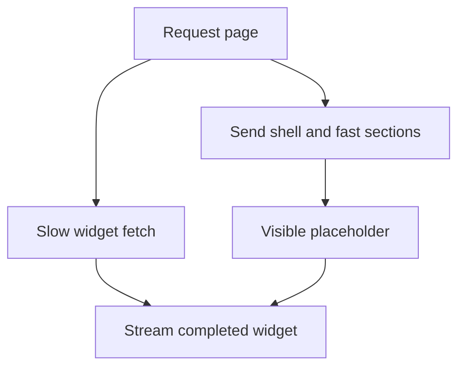

"Where does the HTML come from" and "when does the page become interactive"
are two separate questions, and every rendering strategy answers them
differently. Confusing the strategies usually comes from not keeping those
two questions apart.

> [!WHY] A server-rendered page looks ready but its buttons do not respond
> until a large client bundle hydrates. Delivering HTML early has not
> removed the separate cost of making the interactive parts work.

> [!GOALS]
>
> - Explain HTML delivery versus interactivity
> - Choose rendering by page needs
> - Design streaming around a slow section

## The spectrum

```text
  CSR   Client-Side Rendering — the server sends a nearly
        empty HTML shell; the BROWSER downloads JS, runs it,
        and builds the entire page client-side

  SSR   Server-Side Rendering — the server renders the FULL
        HTML for THIS request, on every request, then the
        client hydrates it

  SSG   Static Site Generation — the FULL HTML is rendered
        ONCE, at BUILD time, and served identically to every
        visitor — no per-request server work at all

  ISR   Incremental Static Regeneration — like SSG, but a
        stale page can be REGENERATED in the background after
        a set interval, without a full rebuild
```

```text
  → CSR ships the LEAST HTML upfront (slowest to show
    anything, since the browser has to run JS first) but is
    cheapest to HOST (a static file server, no per-request
    compute). SSR/SSG/ISR ship COMPLETE HTML immediately (fast
    first paint) at increasing amounts of server infrastructure
    (SSR needs a server per request; SSG needs none after
    build).
```

## Time to First Byte vs Time to Interactive

```text
  TTFB    when does the BROWSER receive the first byte of the
          response — for SSG, near-instant (a pre-built file);
          for SSR, however long the server takes to render

  TTI     when can the user actually CLICK something and have
          it respond — this requires JavaScript to have
          downloaded, parsed, and HYDRATED the page
```

```text
  → SSR can have an EXCELLENT TTFB/first-paint (the HTML is
    already there, visible immediately) and a POOR TTI if the
    JS bundle hydrating it is large — the user SEES a complete
    page and tries to click something before hydration
    finishes, which either does nothing or produces a jarring
    delayed response. this gap (looks ready, isn't actually
    interactive yet) is a real, common UX problem, not a
    theoretical one.
```

## Hydration cost

```text
  HYDRATION is React attaching event listeners and internal
  state to server-rendered HTML that's ALREADY on the page —
  it has to walk the entire rendered tree and reconcile it
  against what a client-side render would have produced, even
  though the visible output doesn't change.

  → this is real, non-trivial JavaScript work proportional to
    the PAGE'S SIZE — a large, deeply nested page has a longer
    gap between "looks interactive" (SSR'd HTML visible) and
    "actually is interactive" (hydration complete) purely from
    the volume of DOM to reconcile.
```

```text
  → PARTIAL/PROGRESSIVE hydration and React Server Components
    both exist specifically to shrink this cost: server
    components ship NO client JavaScript for themselves at all
    (frontend.react covers the model), so only the genuinely
    interactive PARTS of a page pay hydration's cost, rather
    than the whole tree.
```

## Streaming

```text
  without streaming: the server must finish rendering the
  ENTIRE page (including a slow data fetch deep in the tree)
  before sending ANY of it — a slow widget at the bottom of the
  page delays every byte of the response, including the fast
  parts at the top.

  WITH streaming: the server sends the SHELL and fast parts
  immediately, and streams in slower sections as their data
  becomes ready — the fast parts of the page appear right
  away, and a loading placeholder fills in for the slow part
  until its chunk arrives.
```

```text
  → this decouples "the page's slowest dependency" from "how
    long the user waits to see ANYTHING" — a page with one slow
    widget and nine fast ones no longer makes every visitor
    wait for the slow one before seeing the nine.
```



## Choosing by page type

```text
  a blog post that changes rarely           → SSG (or ISR, if
                                                editors publish
                                                updates that
                                                should appear
                                                without a full
                                                rebuild)

  a dashboard showing per-user, real-time
  data                                       → SSR or CSR — the
                                                content is
                                                genuinely
                                                different per
                                                request/user,
                                                so pre-building
                                                it once doesn't
                                                make sense

  a highly interactive tool (a spreadsheet,
  a design canvas) where SEO and first-paint
  matter far less than in-app responsiveness → CSR, often, since
                                                nearly everything
                                                the user cares
                                                about happens
                                                AFTER the app
                                                loads anyway
```

```text
  → these aren't mutually exclusive within one application —
    a real product frequently mixes them: SSG for marketing
    pages, SSR for a personalized dashboard, CSR-heavy for an
    in-app editor — matching the strategy to what each PAGE
    actually needs, rather than picking one strategy for the
    whole site.
```

> [!PITFALL] Complete-looking HTML and completed hydration are not the
> same state.

> [!INTERVIEW] State when HTML is created, when bytes arrive and which
> client regions must hydrate before calling a page fast.

> [!CHECK] Where is SSG’s HTML produced?
>
> At build time, then served without per-request rendering work.

> [!CHECK] What work does SSR add on each request?
>
> The server produces that request’s HTML before the client hydrates its
> interactive parts.

> [!CHECK] How can server components reduce client-side work?
>
> They ship no JavaScript for themselves, leaving only genuinely
> interactive regions to pay client costs.

## What to take away

1. Rendering strategy and interactivity timing are two separate questions —
   an SSR page can show complete HTML immediately and still not be
   clickable until hydration finishes.
2. CSR ships the least HTML upfront but needs the least server
   infrastructure; SSR/SSG/ISR ship complete HTML sooner at increasing
   amounts of server work, from per-request (SSR) to none after build (SSG).
3. Hydration cost scales with page size — it's real JS work reconciling an
   already-visible DOM tree, which is exactly what server components and
   partial hydration exist to shrink.
4. Streaming decouples a page's slowest data dependency from how long a
   visitor waits to see anything, by sending fast sections immediately and
   filling in slow ones as they become ready.
5. These strategies commonly mix within one application — matching the
   strategy to what each page specifically needs beats picking one strategy
   site-wide.

## Exercises

> [!EXERCISE recall] Why does visible server-rendered HTML not establish
> that client interactions are ready?
>
> **Solution:** Hydration still needs client JavaScript to load, parse and
> attach the interactive model to existing HTML. The visible page can
> precede that work, so first bytes, first paint and interaction readiness
> are separate observations.

> [!EXERCISE apply] Choose strategies for a public guide that updates
> without a full rebuild, a personalised account dashboard and a highly
> interactive design editor with little SEO need. State the decisive
> requirement for each.
>
> **Solution:** ISR suits the guide’s prebuilt content with background
> regeneration. SSR or CSR suits genuinely user-dependent dashboard data
> rather than one identical build artifact for everyone. A CSR-heavy
> editor can suit work dominated by interaction after loading. The
> application can mix these strategies instead of enforcing one page model
> everywhere.

> [!EXERCISE stretch] One slow recommendations widget delays an otherwise
> ready page. Recommend how to deliver useful content earlier and contrast
> a weaker wait-for-everything policy.
>
> **Solution:** Stream the shell and ready sections while a placeholder
> marks the slow widget, then fill it when its data arrives. A weaker
> answer withholds all HTML until the slowest dependency resolves: it
> makes users wait for unavailable secondary content before seeing
> already-ready information. Streaming improves delivery timing; it does
> not by itself erase hydration cost.
