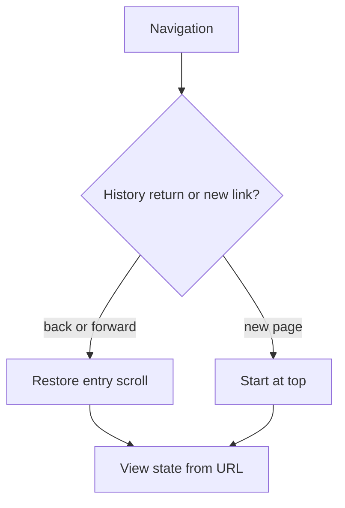

A URL is not just a navigation target — treated correctly, it's a piece of
application STATE that happens to be shareable, bookmarkable, and
back-button-able for free. Most routing bugs come from fighting that
property instead of using it.

> [!WHY] A user copies a filtered search view but the recipient sees the
> default list. Keeping shareable selection only in component state made
> the visible view disappear at the URL boundary.

> [!GOALS]
>
> - Explain which view state belongs in a URL
> - Design share and back-navigation behaviour
> - Choose targeted prefetching

## URLs as state

```text
  useState(false) for "is the filter panel open"
    ✗ lost on refresh, not shareable

  /products?filters=open
    ✓ refresh-safe, shareable, works with the browser
      back button automatically
```

```text
  → the test for whether a piece of UI state belongs in the URL:
    would a user want to SHARE this exact view, or return to it
    via the back button, or reload the page and keep seeing it?
    a selected tab, an active filter, a search query, a pagination
    page are all state a URL represents naturally — a dropdown's
    open/closed transient state usually isn't.
```

## Nested layouts

```text
  /dashboard/settings/billing

  <Layout>                    ← shared shell: nav, sidebar
    <DashboardLayout>          ← dashboard-specific chrome
      <SettingsLayout>          ← settings-specific chrome
        <BillingPage />          ← the actual page content
      </SettingsLayout>
    </DashboardLayout>
  </Layout>
```

```text
  → nested routing means each URL SEGMENT can own its own
    layout, and navigating between /dashboard/settings/billing
    and /dashboard/settings/security only RE-RENDERS the
    innermost differing piece — the shared Layout and
    DashboardLayout don't unmount and remount on that
    navigation, which both preserves their state (a scroll
    position, an open menu) and avoids unnecessary work.
```

## Code splitting by route

```text
  without splitting: EVERY route's code ships in one bundle —
  a user visiting only the homepage downloads the settings
  page's, the admin panel's, and every other route's JavaScript
  too, whether they'll ever visit those routes or not.

  with splitting: each route's code is a SEPARATE chunk, loaded
  ONLY when that route is actually navigated to.
```

```text
  → this is frontend.build's tree-shaking idea applied at ROUTE granularity
    rather than at the module level — a router with built-in code splitting
    (most modern ones) handles the mechanics; the design decision is which
    boundaries actually deserve their own chunk (a rarely-visited admin
    section, yes; two tabs a user flips between constantly, probably not — a
    chunk boundary there adds a loading flicker on every tab switch).
```

## Prefetching

```text
  a link the user is likely to click NEXT (hovering over it, or
  it's visible in the viewport) can have its route's code
  (and sometimes its data) fetched BEFORE the click happens —
  so by the time the user actually clicks, the navigation feels
  instant rather than showing a loading state.
```

```text
  → the trade: prefetching EVERY visible link wastes bandwidth
    on navigations that never happen (a user scanning a page
    without clicking most links) — most frameworks default to
    prefetching links currently in the VIEWPORT, or on hover,
    rather than the entire page's links eagerly on load.
```

## Scroll restoration

```text
  the behavior a user actually expects:

    clicking a link (new page)         → scroll to TOP
    clicking BACK to a previous page     → scroll to WHERE
                                            they were before
                                            navigating away
```

```text
  → this needs the router to REMEMBER a scroll position per
    history entry, and restore it specifically on back/forward
    navigation, not on a forward link click — getting this
    wrong (always scrolling to top, even on back) is a small
    but constantly-felt UX regression, since users navigate
    back far more often than they consciously notice.
```



## Route parameters and typed routing

```text
  /products/:id     → params: { id: string }

  → a route parameter arrives as a STRING always, even when
    the URL segment "looks like" a number — `/products/42`
    gives you params.id === "42" (string), not 42 (number).
    forgetting this and comparing params.id === 42 (a number)
    silently fails, since === does no coercion.
```

```text
  → some frameworks generate TYPED route helpers (a function
    that builds `/products/${id}` and validates the params
    shape at compile time) — this is the type-design chapter's
    "make illegal states unrepresentable" applied to routing: a
    typo'd route path or a missing required param becomes a
    compile error instead of a 404 discovered by a user.
```

> [!PITFALL] Scrolling every navigation to the top loses the position
> users expect when returning to a history entry.

> [!INTERVIEW] Separate persistent view state, transient interaction state
> and per-history-entry scroll before choosing router behaviour.

> [!CHECK] Why do nested layouts preserve a shared shell across sibling
> routes?
>
> Only the differing route region changes rather than remounting all
> shared layout state.

> [!CHECK] What cost can excessively fine route splitting introduce?
>
> A loading boundary or flicker on frequently used transitions.

> [!CHECK] Why can params.id === 42 fail for /products/42?
>
> The route parameter is the string "42", not the number 42.

## What to take away

1. A URL is state, not just a destination — the test for whether UI state
   belongs there is whether a user would want to share, bookmark, or
   back-button to that exact view.
2. Nested layouts let a URL segment own its own chrome, so navigating
   between sibling routes only re-renders the innermost differing piece
   rather than remounting shared shells.
3. Route-based code splitting is tree-shaking applied at route granularity —
   the design decision is which boundaries deserve their own chunk, since
   splitting too finely adds a loading flicker to frequent transitions.
4. Prefetching trades bandwidth for perceived instant navigation — most
   frameworks default to viewport/hover-based prefetching rather than
   fetching every link on the page eagerly.
5. A route parameter always arrives as a string, even for a numeric-looking
   segment — comparing it to a number with `===` silently fails with no
   coercion to save you.

## Exercises

> [!EXERCISE recall] What test decides whether a value belongs in URL
> state rather than transient component state?
>
> **Solution:** Ask whether users should share, bookmark, reload or
> navigate back to the exact view. Search terms, selected tabs and
> pagination often qualify; a temporary hover or dropdown interaction
> usually does not.

> [!EXERCISE apply] A reader filters orders to pending on page 3, opens an
> order, then presses Back. Design the state location and scrolling
> behaviour, distinguishing an unrelated transient tooltip.
>
> **Solution:** Put the pending filter and page selection in the URL so
> they survive share, reload and history navigation. Preserve scroll for
> the previous history entry and restore it on Back; a forward link to a
> new page should normally start at the top. Keep a temporary tooltip’s
> visibility local rather than encoding every transient interaction in the
> shareable view.

> [!EXERCISE stretch] A page has many rarely visited links on a metered
> connection. A proposal eagerly fetches every route and its data.
> Recommend a navigation preparation policy.
>
> **Solution:** Prioritise likely next navigations, such as relevant
> viewport or hover-triggered candidates, and choose chunk boundaries for
> meaningful routes rather than every rapidly switched tab. A weaker
> answer prefetches everything immediately: bandwidth is spent on routes
> the user never opens, even though the goal was perceived responsiveness
> for likely navigation.
