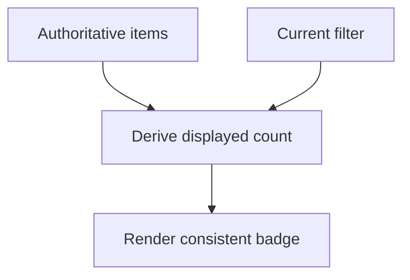

The hardest state management problem isn't picking a library — it's
correctly classifying what KIND of state a given value is. Most "state
management is hard" complaints trace back to treating server data, shared UI
state, and local component state as one undifferentiated pile, when each has
a genuinely different right home.

> [!WHY] A badge count is stored separately from the list and one removal
> path forgets to update it. The interface now shows two conflicting
> answers because a derived fact became another independently writable
> source of truth.

> [!GOALS]
>
> - Explain local, shared and server state
> - Choose derived values rather than duplicate storage
> - Choose narrow store subscriptions

## The three kinds of state

```text
  LOCAL          belongs to ONE component, nobody else cares
                 ("is this dropdown open") — useState, kept
                 exactly where it's used

  SHARED (CLIENT) needed by multiple, possibly distant
                 components (current theme, the logged-in
                 user) — a store (this project's own rule:
                 one Zustand store PER MODULE, never one
                 global store)

  SERVER          data that actually lives in a database,
                 fetched over the network — NOT the same kind
                 of thing as the above two, covered fully in
                 frontend.data-fetching, because it has its own
                 concerns (staleness, refetching, caching) that
                 client state doesn't
```

```text
  → the mistake that causes most of the real pain: copying
    SERVER data into a client state store ("let me just keep
    the user list in Zustand too") — now there are TWO sources
    of truth for the same data, and every update has to keep
    them in sync manually, forever. server state deserves its
    own dedicated handling, not a copy sitting in client state.
```

## Derived state: the state that shouldn't exist

```text
  const [items, setItems] = useState([]);
  const [itemCount, setItemCount] = useState(0);   // ✗

  function addItem(item) {
    setItems([...items, item]);
    setItemCount(itemCount + 1);   // now TWO places to keep
  }                                    in sync, and they CAN
                                       drift if one call site
                                       forgets the second
                                       update
```

```text
  const itemCount = items.length;   // ✓ COMPUTED, not stored
                                        — cannot drift, because
                                        there's nothing to keep
                                        in sync
```

```text
  → if a value can be COMPUTED from other state, it should be
    computed at render time, not stored as its own state — this
    is the single most common source of "these two things got
    out of sync" bugs, and the fix is always the same: delete
    the redundant state variable, compute it instead.
```



## Lifting state up, and its natural limit

```text
  two SIBLING components need to share state → move the state
  to their nearest common PARENT, pass it down as props.

  → this works cleanly for a FEW levels — beyond that, lifting
    state up far enough to be shared means passing it back down
    through components that don't use it (prop drilling, from
    the React chapter) — the natural point to reach for a
    store instead of lifting further.
```

## Selectors: subscribing to a slice, not the whole store

```text
  // ✗ re-renders on ANY change to the store, even unrelated
  //   fields this component never reads
  const store = useAppStore();

  // ✓ re-renders ONLY when `user.name` specifically changes
  const userName = useAppStore(state => state.user.name);
```

```text
  → a SELECTOR subscribes a component to a SLICE of the store,
    not the whole thing — this is a real performance mechanism,
    not just cleaner code: a component reading only `user.name`
    via a selector does not re-render when an unrelated part of
    the same store (say, a UI preference) changes.
```

## Optimistic updates and rollback

```text
  function toggleLike(postId) {
    setLiked(true);                          // 1. update UI
                                                  IMMEDIATELY,
                                                  before the
                                                  network call
                                                  resolves
    api.like(postId).catch(() => {
      setLiked(false);                        // 2. roll back
                                                  ONLY if the
                                                  request
                                                  actually fails
    });
  }
```

```text
  → this is the pattern this project's own stores use
    throughout (CLAUDE.md's error-handling rule sits directly
    on top of it): update state optimistically for
    responsiveness, keep the PREVIOUS value around, and revert
    to it specifically on failure — the user sees an instant
    response on the common (success) path, and a correct
    rollback on the rare (failure) path.
```

## Colocate state with where it's used

```text
  the general principle underlying all of the above: state
  should live as CLOSE as possible to the components that
  actually need it, and move UP only as far as sharing actually
  requires — not "start with a global store and put everything
  in it," which makes every component's dependencies harder to
  trace and turns unrelated changes into potential re-render
  sources for everyone subscribed broadly.
```

> [!PITFALL] A stored count that is completely determined by a list
> creates a second update obligation without adding information.

> [!INTERVIEW] Classify ownership and derivation before choosing a
> library; describe exactly which state slice each consumer needs.

> [!CHECK] What must an optimistic mutation retain for failure?
>
> The previous value to restore, while reverting only when the request
> fails.

> [!CHECK] When does lifting state become cumbersome?
>
> When it forces props through distant intermediaries that do not use
> them.

> [!CHECK] Why can copying fetched data into another store create drift?
>
> Both copies then need every mutation and refresh synchronised manually.

## What to take away

1. Local, shared-client, and server state are three genuinely different
   kinds of state, each with a different right home — copying server data
   into a client store creates two sources of truth that can drift.
2. If a value can be computed from other state, compute it at render time
   instead of storing it — a stored derived value is the most common source
   of "these two things got out of sync" bugs.
3. Lift state to the nearest common parent for a few levels of sharing;
   beyond that, prop drilling to reach it is the signal to move to a store
   instead.
4. A selector subscribes a component to a slice of a store, not the whole
   thing — this is a real re-render optimization, not just tidier code.
5. Optimistic updates apply the change immediately and roll back only on
   failure, keeping the previous value around to revert to — the pattern
   this project's own stores use throughout.

## Exercises

> [!EXERCISE recall] How do local UI state, shared-client state and server
> state differ?
>
> **Solution:** Local state belongs to one component, shared-client state
> coordinates multiple components, and server state originates remotely
> with freshness and fetching concerns. They need different ownership
> rather than one undifferentiated global bucket.

> [!EXERCISE apply] A filter panel owns its open state, sibling controls
> share a selected category, and a server-fetched item list displays a
> matching count. Choose homes for all three inputs and for the count.
>
> **Solution:** Keep panel openness local. Lift category selection to the
> nearest common parent or the relevant shared boundary when distance
> warrants it. Keep the item list under its server-data handling rather
> than creating a second independent copy. Compute the matching count from
> the list and selection, so removing or filtering an item cannot leave a
> separately stored count behind.

> [!EXERCISE stretch] A name label rerenders whenever an unrelated
> preference changes because it subscribes to an entire module store.
> Recommend a narrower dependency.
>
> **Solution:** Subscribe with a selector for the name slice the label
> actually uses. A weaker answer creates a second global store copy of the
> whole user just to suppress rerenders: it adds synchronisation and
> ownership cost instead of stating the component’s real dependency. Keep
> state close to use and share only as far as required.
