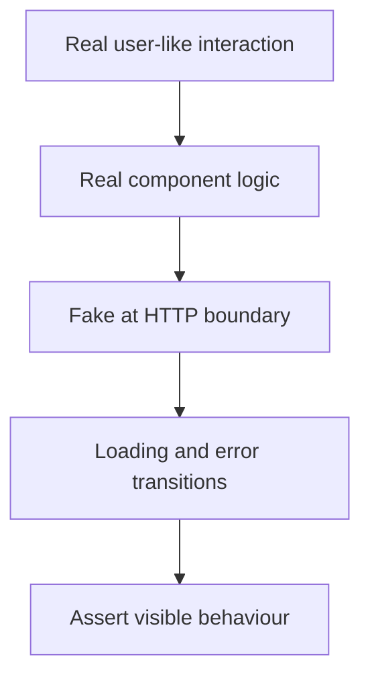

The Testing Strategy chapter's "test behavior, not implementation" principle
has a specific, sharp form in frontend work: test what a USER can see and
do, not the component's internal structure. Following that one rule
eliminates most of the fragile, refactor-breaking tests frontend suites
accumulate.

> [!WHY] A form test replaces the data hook entirely and always returns
> success. The real component’s loading and failure transitions remain
> untested even though the snapshot and internal-state assertions stay
> green.

> [!GOALS]
>
> - Explain component versus end-to-end evidence
> - Design a network-boundary failure test
> - Choose assertions that survive internal refactoring

## Query by what a user perceives, not implementation details

```text
  screen.getByTestId('submit-button')            weakest — an
                                                     ARTIFICIAL
                                                     attribute a
                                                     user never
                                                     sees, added
                                                     purely for
                                                     the test

  screen.getByClassName('.btn-primary')          fragile — a
                                                     CSS class is
                                                     a styling
                                                     decision,
                                                     not a
                                                     semantic
                                                     fact about
                                                     the element

  screen.getByRole('button', { name: 'Submit' }) strongest —
                                                     queries by
                                                     the SAME
                                                     information
                                                     a screen
                                                     reader uses:
                                                     role and
                                                     accessible
                                                     name
```

```text
  → getByRole querying the same information assistive
    technology relies on means a passing test is ALSO a weak
    accessibility check for free — if a button has no
    discoverable role or name, the test can't find it either,
    surfacing the same gap the Accessibility chapter warns
    about.

  → this ordering (role/label > test-id > class/structure) is
    Testing Library's own explicit priority, and it exists
    because a test-id survives a REFACTOR that changes markup,
    but a getByRole query survives BOTH a refactor AND a purely
    visual restyle, since neither changes the element's role
    or accessible name.
```

## Simulating real user interaction

```text
  fireEvent.click(button);                      ✗ dispatches
                                                    ONE
                                                    synthetic
                                                    click event
                                                    directly —
                                                    skips
                                                    everything a
                                                    REAL click
                                                    triggers
                                                    along the way

  await userEvent.click(button);                 ✓ simulates the
                                                    FULL sequence
                                                    a real click
                                                    produces:
                                                    pointerdown,
                                                    mousedown,
                                                    focus,
                                                    mouseup,
                                                    click — in
                                                    order
```

```text
  → this distinction matters concretely: a component relying
    on a FOCUS event (a dropdown that opens on focus, a
    validation that runs onBlur) can pass with fireEvent.click
    (which skips focus entirely) and FAIL for a real user,
    because the test never actually exercised the focus
    behavior the real interaction depends on.
```

## What NOT to assert

```text
  expect(wrapper.state('isOpen')).toBe(true);     ✗ asserts on
                                                     INTERNAL
                                                     component
                                                     state —
                                                     breaks on
                                                     any
                                                     refactor
                                                     that
                                                     changes HOW
                                                     openness is
                                                     tracked,
                                                     even if the
                                                     visible
                                                     behavior is
                                                     identical

  expect(screen.getByRole('dialog')).toBeVisible(); ✓ asserts on
                                                        what a
                                                        USER
                                                        actually
                                                        sees —
                                                        survives
                                                        any
                                                        internal
                                                        refactor
```

```text
  → this is exactly the Testing Strategy chapter's "assert on
    outputs, not internals" principle — a frontend test's
    OUTPUT is what renders on screen and what a user can
    interact with, never a component's internal state shape.
```

## Mocking the network, not the component

```text
  → mock at the NETWORK boundary (intercepting the actual
    fetch/HTTP call, via something like MSW) rather than
    mocking a component's internals or its data-fetching hook
    directly — this exercises the REAL component code
    (including its actual loading and error-state handling)
    against a fake network response, rather than replacing the
    component's logic with a fake and testing nothing about
    whether that logic actually works.
```



## Component tests vs end-to-end tests

```text
  COMPONENT TEST   renders ONE component (or a small subtree)
                  in isolation, fast, no real browser — proves
                  the component's OWN behavior in response to
                  props/interaction

  E2E TEST          drives a REAL browser through the ACTUAL
                  application, proves the WHOLE system works
                  together — including routing, real API
                  calls (or a realistic fake server), and
                  cross-component integration a component test
                  can't see
```

```text
  → this is the Testing Strategy chapter's pyramid, restated
    for frontend specifically: many fast component tests for
    individual behavior, a smaller number of E2E tests for the
    critical user flows that only a real browser running the
    whole app can actually verify — this project's own E2E
    suite is explicitly the substitute for human code review on
    cascade logic and multi-step flows, precisely because a
    component test in isolation can't see across that boundary.
```

> [!PITFALL] Mocking the component’s data hook can remove the very loading
> and error logic the test claims to prove.

> [!INTERVIEW] Name the user-visible result and the boundary being faked;
> explain what the real component still executes before trusting the test.

> [!CHECK] Why can a role-and-name query expose an accessibility gap?
>
> The control must have the discoverable role and name assistive
> technology also uses.

> [!CHECK] What can dispatching a single synthetic click miss?
>
> The focus and pointer-event sequence of a real interaction, including
> behaviour tied to focus changes.

> [!CHECK] Why retain a smaller set of whole-app browser flows?
>
> Critical navigation and multi-step integration cross boundaries an
> isolated subtree cannot see.

## What to take away

1. Query by role and accessible name, not test-id or CSS class — it's the
   same information a screen reader relies on, so a passing test is also a
   weak accessibility check for free.
2. `userEvent` simulates the full sequence a real interaction produces
   (including focus); `fireEvent` dispatches one synthetic event and can
   miss behavior that depends on the rest of that sequence.
3. Assert on what a user sees, never on internal component state — the
   frontend-specific form of testing outputs rather than implementation.
4. Mock at the network boundary, not inside the component, so the test
   exercises the component's real loading/error logic against a fake
   response rather than replacing that logic entirely.
5. Component tests prove one component's own behavior fast and in isolation;
   E2E tests prove the whole system works together — the testing pyramid
   restated for frontend, with this project's own E2E suite as the
   substitute for human review on multi-step flows.

## Exercises

> [!EXERCISE recall] What can an isolated component test establish that
> still leaves a reason for end-to-end testing?
>
> **Solution:** It can exercise that component’s observable behaviour
> quickly with controlled inputs. It does not establish actual routing and
> cross-component system integration, which a real browser flow can
> observe.

> [!EXERCISE apply] A save form should show loading, then a field error
> when its HTTP write is rejected. Choose where to fake the failure and
> how to exercise submission, rather than replacing the save hook with an
> error object.
>
> **Solution:** Intercept the network response while keeping the
> component’s real request, loading and error handling. Find the labelled
> inputs and submit button through their accessible interface, use a
> realistic interaction sequence including focus/blur where relevant, and
> assert the visible loading and error outcome. Replacing the hook removes
> the behaviour under test rather than checking how it responds to a
> failed request.

> [!EXERCISE stretch] A dialog changes its internal state shape and markup
> classes but preserves its visible name and interactions. Recommend
> whether tests should still assert isOpen and a specific CSS selector.
>
> **Solution:** Assert the visible dialog by role and accessible name and
> test the user actions that open and close it. A weaker answer rewrites
> assertions around the new private state or class names: the next valid
> refactor breaks them again even when user behaviour is unchanged.
> Perceptible semantics are the stable contract.
