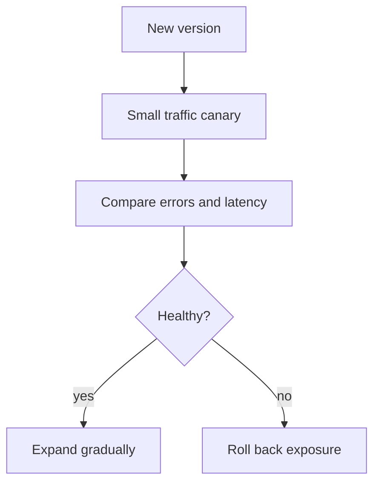

A team's actual velocity is bounded less by how fast engineers write code
than by how safely and quickly a change can go from committed to running in
production. CI/CD is the machinery that determines which of those two it
is — and a bad pipeline is a tax paid on every single deploy, forever.

> [!WHY] A release looks healthy in staging but produces errors on a small
> share of real requests. Gradual exposure and a verified rollback path
> can limit the incident before the change reaches every customer.

> [!GOALS]
>
> - Explain delivery versus deployment
> - Evaluate a canary against its baseline
> - Choose merged-result integration evidence

## Continuous Integration: catching problems at merge time, not release time

```text
  every push → automated pipeline runs:
    1. BUILD     does it compile / bundle successfully?
    2. TEST       unit tests, integration tests
    3. LINT        style/type checks
    4. produce an ARTIFACT (a built binary, a container image)
```

```text
  → the actual point of CI isn't "running tests" — it's
    catching integration problems EARLY, at the moment they're
    cheapest to fix. two branches that each pass their OWN
    tests in isolation can still conflict badly when merged
    together — CI running against the MERGED result (not just
    each branch alone) is what catches that, at merge time
    rather than discovering it three weeks later when both
    changes are already tangled into everything else.
```

## Continuous Delivery vs Continuous Deployment

```text
  CONTINUOUS DELIVERY      every passing build is DEPLOYABLE
                          (a human decides WHEN to actually
                          deploy it — a button, not automatic)

  CONTINUOUS DEPLOYMENT      every passing build DEPLOYS
                          AUTOMATICALLY, with no human
                          gate at all
```

```text
  → these are genuinely different, and the distinction matters
    in practice: continuous deployment requires GENUINE
    confidence in the test suite and rollback mechanisms (the
    testing-strategy chapter's whole suite of guarantees, taken
    seriously) — a team without that confidence yet should
    stay at continuous DELIVERY (human-gated) rather than
    pretending automatic deployment is safe before the safety
    net actually is.
```

## Blue-green deployment: instant, safe cutover

```text
  BLUE (current production)     GREEN (new version, deployed
                                but NOT yet receiving traffic)

  → deploy the NEW version to a completely SEPARATE environment
    (green) while blue keeps serving ALL production traffic —
    once green is verified healthy, switch the router/load
    balancer to send traffic to green INSTANTLY — blue stays
    running, idle, as an instant ROLLBACK path (switch the
    router back) if anything goes wrong.
```

```text
  → the real cost: running TWO full production environments
    simultaneously during the cutover window — this is a
    genuine resource cost, paid specifically for an
    instantaneous, low-risk cutover with an equally instant
    rollback available the whole time.
```

## Canary releases: gradual, observed rollout

```text
  route 5% of traffic → NEW version
  route 95% of traffic → OLD version
  → MONITOR the 5% closely (error rate, latency)
  → if healthy: gradually increase (5% → 25% → 50% → 100%)
  → if NOT healthy: roll back the 5%, most users NEVER
    experienced the problem
```

```text
  → this is the OPPOSITE trade from blue-green: instead of an
    instant full cutover, exposure to the new version GROWS
    gradually, bounding the BLAST RADIUS of a bad deploy to a
    small percentage of traffic rather than either 0% or 100%
    — a canary specifically catches problems that ONLY show up
    under REAL production load/data (which staging, however
    good, never perfectly replicates), while limiting how many
    real users experience them before the rollout is stopped.
```



## Feature flags: decoupling deploy from release

```text
  if (featureFlags.isEnabled('new-checkout-flow', user)) {
    return newCheckoutFlow();
  }
  return oldCheckoutFlow();

  → a feature flag lets code DEPLOY to production (in a disabled state)
    SEPARATELY from when it's actually RELEASED (turned on) — this
    decoupling is genuinely powerful: a deploy becomes a low-risk, purely
    mechanical event (the code is there, inert, doing nothing new yet), and
    a RELEASE becomes an instant, no-deploy-required toggle — including an
    instant KILL SWITCH if a newly-enabled feature causes a problem,
    reverting to old behavior in seconds rather than requiring an emergency
    deploy and rollback.
```

## Rollbacks: the property that makes shipping fast feel safe

```text
  a FAST, RELIABLE rollback is what actually makes shipping
  FREQUENTLY feel safe — counterintuitively, teams that deploy
  MORE often tend to have SMALLER, less risky individual
  deploys (each one is a smaller diff, easier to reason about
  and easier to roll back cleanly) than teams that deploy
  rarely in large, high-risk batches.

  → this is precisely why investing in rollback speed and
    reliability pays for itself repeatedly — it's the safety
    net that makes EVERY subsequent deploy less stressful, not
    a one-time cost paid for a single risky release.
```

> [!PITFALL] A low aggregate error rate can hide a severe canary
> regression when most requests still use the healthy old version.

> [!INTERVIEW] Compare the exposed cohort with its baseline and state the
> rollback condition before increasing the rollout percentage.

> [!CHECK] What resource cost buys blue-green’s fast cutover and reversal?
>
> Both full environments run during the cutover window so traffic can
> switch back to the old one.

> [!CHECK] How does a feature flag separate deploy from release?
>
> Code can be deployed disabled, then enabled or disabled without another
> code deployment.

> [!CHECK] Why can frequent small releases be easier to recover from?
>
> Their smaller diffs are easier to understand and reverse than rare large
> batches, given reliable rollback machinery.

## What to take away

1. CI's real value is catching integration problems at merge time, when two
   independently-passing branches conflict once combined — cheapest to fix
   right then, not three weeks later.
2. Continuous delivery (human-gated) and continuous deployment (fully
   automatic) are genuinely different — deployment without genuine
   confidence in tests and rollback is pretending a safety net exists
   before it does.
3. Blue-green trades running two full environments simultaneously for an
   instant, low-risk cutover with an equally instant rollback path.
4. Canary releases bound a bad deploy's blast radius to a small percentage
   of real traffic, catching problems that only appear under genuine
   production load that staging never perfectly replicates.
5. Feature flags decouple deploying code (a low-risk mechanical event) from
   releasing it (an instant toggle, including an instant kill switch) — and
   fast, reliable rollback is what makes frequent, small deploys feel safer
   than rare, large ones.

## Exercises

> [!EXERCISE recall] What is the difference between continuous delivery
> and continuous deployment, and what confidence does automatic deployment
> require?
>
> **Solution:** Delivery keeps passing builds deployable with a decision
> about when to release them. Deployment automatically sends passing
> builds to production, so test evidence and reliable rollback must
> justify removing that checkpoint.

> [!EXERCISE apply] A canary handles 1000 of 20000 requests and fails 20;
> the old version handles 19000 and fails 19. Compute each error rate and
> the combined rate. Choose whether a combined rate below 1% is enough to
> expand the canary.
>
> **Solution:** The canary rate is 20/1000 = 2%. The old rate is 19/19000
> = 0.1%. Combined, 39/20000 = 0.195%. The canary is twenty times the old
> rate despite the small aggregate. Do not expand merely because the
> aggregate is below 1%; stop or roll back the canary and investigate its
> observed regression.

> [!EXERCISE stretch] Two branches pass independently but their combined
> change fails. Recommend CI evidence before accepting the integration.
>
> **Solution:** Build and test the merged result so interactions between
> the changes are exercised early. A weaker answer only reruns the same
> isolated branch tests: each can remain green while the combination is
> still broken. Preserve a deployable artifact and rollback confidence
> rather than treating separate success as proof of integration.
