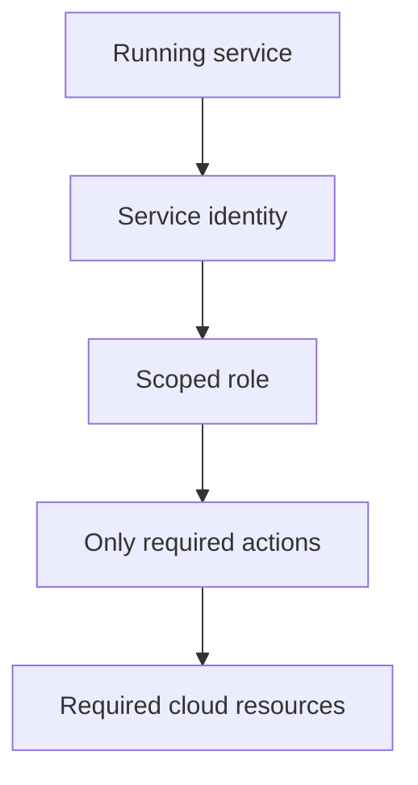

AWS, GCP, and Azure each have hundreds of product names, and it's genuinely
easy to mistake that for hundreds of genuinely different concepts. Underneath
the branding, nearly everything reduces to a small number of primitives every
provider offers some version of — learning the primitives transfers across
providers in a way memorizing product names never does.

> [!WHY] A small service receives cloud-admin permissions because scoping
> access takes longer. If that service is compromised, setup convenience
> becomes access to resources unrelated to its actual job.

> [!GOALS]
>
> - Explain the compute control spectrum
> - Choose storage by required access pattern
> - Choose service permissions by actual need

## Compute: three shapes, one spectrum

```text
  VIRTUAL MACHINES        a full VM you manage — EC2, Compute
                         Engine, Azure VMs — most control,
                         most operational responsibility
                         (patching, scaling, the OS itself)

  CONTAINERS (managed)      you provide a container image; the
                         platform runs it — ECS/Fargate, Cloud
                         Run, Azure Container Apps — less
                         control over the underlying machine,
                         less operational burden

  FUNCTIONS (serverless)      you provide just CODE for one
                         request/event; the platform handles
                         literally everything else — Lambda,
                         Cloud Functions, Azure Functions —
                         least control, least operational
                         burden, covered fully in Serverless
                         and Edge
```

```text
  → this is a SPECTRUM trading control for operational burden,
    not a strict quality ranking — a VM is the right choice
    when you genuinely need OS-level control (a specific kernel
    module, unusual networking); a function is right for
    event-driven work with no persistent state to manage.
```

## Storage: three shapes by access pattern

```text
  OBJECT STORAGE        S3, GCS, Azure Blob — flat key→blob,
                        the Backend Engineering track's File
                        Storage and Media chapter's actual
                        substrate — cheap, durable, NOT a
                        filesystem (no directory listing
                        semantics, no partial-file edits)

  BLOCK STORAGE           EBS, Persistent Disk — behaves like
                        an actual attached DISK — a VM's own
                        filesystem lives here, mountable,
                        resizable, but tied to ONE machine at
                        a time (usually)

  MANAGED DATABASE           RDS, Cloud SQL, Cosmos DB — the
                        Database Internals chapter's structures,
                        operated FOR you (backups, failover,
                        patching handled by the provider)
```

```text
  → choosing between these is choosing by ACCESS PATTERN, the
    same discipline the Backend Engineering track's NoSQL
    chapter applies to database choice — object storage for
    unstructured blobs accessed by key, block storage for a
    filesystem a single VM needs, a managed database for
    structured, queryable data you don't want to operate
    yourself.
```

## Networking: VPCs, subnets, and the shapes from the previous chapter

```text
  → this is directly the Practical Networking chapter's VPC/
    subnet material, provider-specific in naming (AWS VPC,
    GCP VPC, Azure Virtual Network) but IDENTICAL in shape:
    private subnets for internal resources, public subnets with
    an internet gateway for externally-reachable ones, security
    groups/firewall rules controlling traffic between them —
    the exact same isolation boundary, under a different name
    per provider.
```

## IAM: identity and access management

```text
  a cloud account's OWN authentication/authorization layer —
  the same AuthN/AuthZ ideas the Backend Engineering track
  covers for an application, applied to controlling who (or
  WHAT — a running service, not just a human) can do what to
  cloud resources themselves.

    a USER          a human, with credentials
    a ROLE            a set of PERMISSIONS, assignable to a
                     user OR to a running resource
    a SERVICE           a running EC2 instance/container ASSUMING
    IDENTITY            a role, letting IT (not a human, and not
                     a hardcoded credential) call other cloud
                     APIs with exactly that role's permissions
```

```text
  → the recurring, genuinely dangerous IAM mistake:
    OVER-PROVISIONING — granting broad permissions ("just give
    it admin, it's easier") because narrowing them down
    correctly takes real, tedious effort. this is the LEAST
    PRIVILEGE principle from the Security Foundations chapter,
    made concrete: a compromised service with admin permissions
    can do FAR more damage than one scoped to exactly what it
    actually needs, and the gap between "convenient to set up"
    and "actually least-privilege" is where most real cloud
    security incidents originate.
```



## Managed services: the actual value proposition

```text
  a MANAGED service (a managed database, a managed Kubernetes
  control plane, a managed message queue) trades COST (managed
  services cost more per unit than running the equivalent
  yourself) for OPERATIONAL BURDEN removed (patching, backups,
  high availability, the 3am page when the underlying
  infrastructure has a problem, handled by the provider instead
  of your team).

  → this trade is almost always WORTH IT for anything that
    isn't your product's actual core differentiator — running
    your own database cluster is real, ongoing operational work
    that rarely differentiates your product from a competitor's,
    which is exactly the kind of work worth paying a provider to
    absorb instead.
```

## Same shapes, different names: reading a new provider quickly

```text
  the practical skill this chapter builds: given an UNFAMILIAR
  provider's product catalog, map each product to ONE of the
  handful of shapes above (compute spectrum, storage by access
  pattern, networking boundary, IAM) — this is dramatically
  faster than learning a new provider's hundreds of product
  names from scratch, and it's why an engineer experienced with
  AWS can become productive on GCP or Azure in days rather than
  starting over.
```

> [!PITFALL] Giving a service admin rights for convenience makes a
> compromise’s blast radius far larger than its legitimate task.

> [!INTERVIEW] Map the workload to a compute, storage, network and
> identity primitive before memorising a provider’s product names.

> [!CHECK] What does a managed service primarily trade for its price
> premium?
>
> Operational work such as patching, backups and availability handling
> that the team would otherwise own.

> [!CHECK] What does a cloud service identity avoid?
>
> A running resource can assume permissions instead of relying on a
> hardcoded human credential.

> [!CHECK] What conceptual networking distinction transfers between
> providers?
>
> Public and private network placement plus firewall rules, despite
> different product names.

## What to take away

1. Compute across every provider reduces to a spectrum from VMs (most
   control, most operational burden) to functions (least of both) — a
   quality trade-off, not a strict ranking.
2. Storage choice is an access-pattern decision: object storage for
   key-addressed blobs, block storage for a single VM's filesystem, a
   managed database for structured queryable data — the same discipline
   backend NoSQL choice applies.
3. Every provider's VPC/subnet material is identical in shape to what
   practical networking already covered — private/public subnets and
   firewall rules under a different product name per provider.
4. Cloud IAM's most dangerous, recurring mistake is over-provisioning
   permissions for convenience — least privilege applied to cloud resources
   the same way it applies to any other security boundary.
5. A managed service trades higher per-unit cost for removed operational
   burden, which is almost always worth it for anything that isn't your
   product's actual core differentiator.

## Exercises

> [!EXERCISE recall] How do VMs, managed containers and functions trade
> control against operations?
>
> **Solution:** VMs offer OS-level control with responsibility for
> patching and scaling. Managed containers let the platform run a supplied
> image with less machine control. Functions focus on event code with
> still less persistent-environment control. They are workload choices,
> not a universal quality ranking.

> [!EXERCISE apply] A team proposes one attached filesystem for public
> media blobs, a VM’s local filesystem needs and structured customer
> queries. Choose which storage primitive fits each and explain why one
> shape is not a substitute for all three.
>
> **Solution:** Use object storage for durable key-addressed media blobs,
> block storage for an attached disk/filesystem requirement, and a managed
> database for structured querying when the team wants its operation
> handled. The blob access, mounted filesystem and query semantics differ;
> putting everything on one disk does not supply object delivery or
> database query operations.

> [!EXERCISE stretch] An image-processing service needs only its assigned
> object data, but a proposal grants the whole account’s admin role.
> Recommend an identity and permission boundary.
>
> **Solution:** Use a service identity with a role limited to the
> resources and actions the job actually needs, rather than embedding
> broad human credentials. A weaker answer grants admin because the
> network is private: network location does not reduce the damage possible
> with over-provisioned cloud permissions if the service is compromised.
