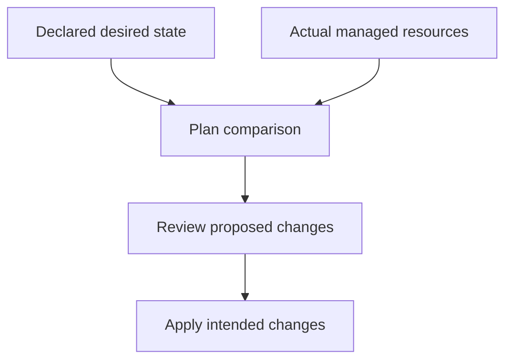

Infrastructure as Code takes the Git and Version Control chapter's core
insight — changes should be reviewable, reproducible, and tracked — and
applies it to something that used to be done by hand: clicking through a
cloud console, one server at a time, with no record of who changed what or
why.

> [!WHY] An emergency console change increases capacity, but the
> repository still declares the old size. The next apparently routine
> apply can undo the mitigation because desired and actual state have
> diverged.

> [!GOALS]
>
> - Explain state-file mapping versus declaration
> - Review a drift plan before applying
> - Choose reusable environment definitions

## Declarative infrastructure

```text
  resource "aws_instance" "web" {
    ami           = "ami-12345"
    instance_type = "t3.medium"
    count         = 3
  }

  → declares WHAT should exist ("3 instances of this type"),
    not the STEPS to create it — the exact same declarative
    idea Kubernetes's control loop applies to pod replicas
    (the Kubernetes and Orchestration chapter), now applied to
    the cloud resources UNDERNEATH the cluster itself, one
    layer down.
```

```text
  → the tool (Terraform, Pulumi, CloudFormation) computes the
    STEPS needed to get from current state to desired state —
    if you already have 2 instances and declare 3, it creates
    ONE more; if you declare 1, it DESTROYS two — you never
    write "create" or "destroy" yourself, only the end state
    you want.
```

## State files: the tool's memory of what it created

```text
  the tool needs to remember WHAT it created and manages,
  separately from your declaration of what SHOULD exist —
  this is the STATE FILE: a record mapping each declared
  resource to the ACTUAL cloud resource it corresponds to.

  → this is WHY manually creating or modifying a resource the
    IaC tool is supposed to manage (clicking around in the
    cloud console "just this once") causes real problems: the
    tool's state file doesn't know about that manual change,
    and the next time it runs, it may try to "fix" what it
    sees as an unexpected difference — either reverting your
    manual change, or erroring out entirely because reality no
    longer matches what the state file expects.
```

## Drift: reality diverging from declaration

```text
  DRIFT is exactly this gap: the ACTUAL cloud state no longer
  matches what's DECLARED, usually from a manual change made
  outside the IaC tool (an emergency console fix during an
  incident, a change made by someone who didn't know the
  resource was IaC-managed).

  → `terraform plan` DETECTS drift by comparing actual state
    against declared state, showing what would change WITHOUT
    actually applying anything — running this REGULARLY (not
    just before an intentional change) is how drift gets
    caught before it causes a confusing surprise on the NEXT
    real deployment, rather than being discovered mid-incident.
```



## Modules: reusable infrastructure components

```text
  module "web_server" {
    source = "./modules/web-server"
    instance_type = "t3.medium"
    environment   = "staging"
  }

  → a MODULE packages a reusable INFRASTRUCTURE PATTERN
    (a standard web server setup: instance + security group +
    load balancer attachment) parameterized by inputs — the
    exact same "don't repeat yourself, extract the reusable
    shape" discipline as a function in application code, applied
    to infrastructure definitions instead.
```

```text
  → this is what makes "spin up an identical staging
    environment" a REAL, practical operation rather than an
    aspiration — the same module, called with different
    parameters (environment = "staging" vs "production"),
    produces a genuinely IDENTICAL infrastructure shape, which
    is exactly what makes staging a trustworthy proxy for how
    production will actually behave.
```

## Reviewable environments: infrastructure changes as pull requests

```text
  the actual payoff of treating infrastructure as CODE: an
  infrastructure change goes through the SAME workflow as an
  application code change — a pull request, a diff a
  reviewer can actually read (`terraform plan`'s output shows
  EXACTLY what will change before it changes), and a git
  history of every infrastructure change ever made, with WHO
  made it and WHY (the commit message), rather than an
  undocumented click in a console that nobody remembers making
  six months later.
```

```text
  → this is the Code Review chapter's discipline, applied to
    infrastructure: a reviewer can catch "this is about to
    delete the production database" in a `terraform plan`'s
    diff BEFORE it happens, the same way a code reviewer
    catches a logic bug before it ships — infrastructure
    changes get the same second set of eyes application code
    changes do, instead of being exempt from review because
    they "aren't really code."
```

> [!PITFALL] A plan that reverts an emergency change may accurately
> reflect a stale declaration rather than the capacity currently required.

> [!INTERVIEW] Explain declaration, managed identity and observed drift
> separately, then review the intended resource effect before an apply.

> [!CHECK] What does declarative infrastructure specify?
>
> The desired end state; the tool computes creation, update or removal
> steps.

> [!CHECK] Why run plan-only checks regularly?
>
> They can reveal drift before the next intentional deployment surprises
> the operator.

> [!CHECK] What does infrastructure Git history preserve beyond a resource
> inventory?
>
> Who changed the declared infrastructure and why, with a reviewable diff
> and rationale.

## What to take away

1. IaC tools are declarative — you state the desired end state, and the
   tool computes the steps to get there, the same core idea as a
   Kubernetes control loop applied one layer down, to the cloud resources
   underneath the cluster.
2. A state file is the tool's memory of what it manages — manually
   modifying a resource outside the tool desyncs that memory from reality,
   which is why "just this once, click around in the console" causes real
   problems later.
3. Drift is the gap between actual and declared state, usually from a
   manual out-of-band change — running a plan-only check regularly catches
   it before it surfaces as a confusing surprise mid-deployment.
4. A module packages a reusable infrastructure pattern parameterized by
   inputs — the same DRY discipline as a function, applied to
   infrastructure, and what makes an identical staging environment a real
   operation rather than an aspiration.
5. Infrastructure changes going through the same pull-request review as
   application code means a reviewer catches "this deletes the production
   database" in a plan's diff before it happens, rather than after.

## Exercises

> [!EXERCISE recall] Why is an IaC state file different from the
> declaration of desired resources?
>
> **Solution:** The declaration says what should exist; the state file
> maps managed declarations to actual cloud resource identities. The tool
> needs both that mapping and observed reality to reason about changes, so
> out-of-band edits can create surprises.

> [!EXERCISE apply] After an emergency, five instances are required and
> running, but the declaration still requests three. A plan proposes
> removing two. Choose a next step that preserves the intended mitigation
> while making the change reviewable.
>
> **Solution:** Do not blindly apply the stale desired count. Confirm the
> emergency requirement and managed resources, update the declared desired
> capacity to five if that requirement remains, and review a new plan
> before applying. The removal of 5 − 3 = 2 is a consequence of the old
> declaration, not proof that reducing capacity is now appropriate. Record
> why the desired state changed.

> [!EXERCISE stretch] Staging is hand-built separately and drifts from
> production conventions. Recommend a reproducible definition strategy.
>
> **Solution:** Reuse a parameterised infrastructure module for the common
> shape, supplying intentional environment-specific inputs and reviewing
> their plans. A weaker answer keeps a console checklist for manually
> recreating staging: it leaves unrecorded deviations and repeats
> provisioning knowledge rather than versioning the shared pattern.
