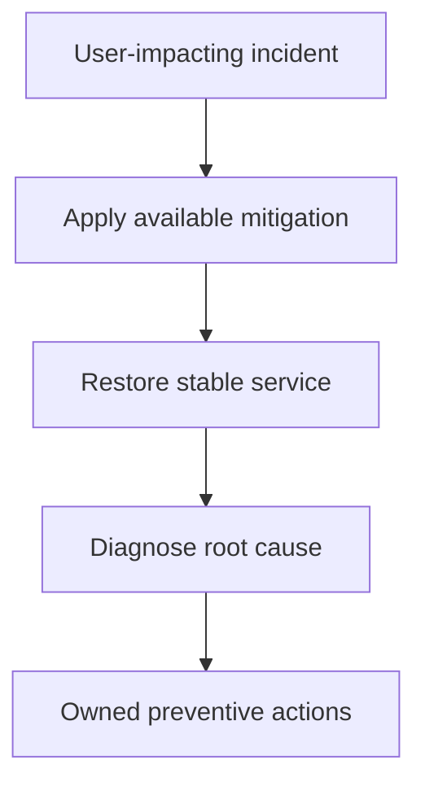

An incident is not the time to understand root cause — it's the time to
stop the bleeding. That distinction, mitigation before diagnosis, is the
single most important discipline in this chapter, and it's the one that's
hardest to follow under real pressure, when the instinct to "figure out what
actually happened" is strongest.

> [!WHY] A regression starts immediately after a deploy, but responders
> spend the outage debating its root cause while an available rollback
> sits unused. Every extra diagnostic minute prolongs avoidable user
> impact.

> [!GOALS]
>
> - Explain mitigation before diagnosis
> - Compute detection versus repair impact
> - Design actionable blameless follow-up

## Mitigate before you diagnose

```text
  the instinct under pressure: "let's understand WHY this is
  happening before we do anything" — this feels RESPONSIBLE,
  and it is frequently the WRONG call.

  → if a ROLLBACK is available and the incident STARTED right
    after a deploy, roll back FIRST — restore service, THEN
    investigate root cause with the system already stable and
    users no longer affected. every minute spent diagnosing
    WHILE the system is still down is a minute of ACTUAL,
    ongoing user impact that a faster mitigation could have
    already stopped.
```

```text
  → this doesn't mean skip diagnosis — it means SEQUENCE it
    correctly: STOP the bleeding first (rollback, failover,
    a feature-flag kill switch, scaling up), THEN understand
    root cause once users are no longer actively affected. the
    Zero-Downtime Migrations chapter's expand/contract
    discipline and a feature flag's instant kill switch (the
    CI/CD chapter) are exactly the kind of pre-built mitigation
    paths that make "roll back fast" actually possible in the
    moment, rather than only in theory.
```



## Detection: how you find out, and how fast

```text
  the gap between "the incident STARTS" and "someone NOTICES"
  is often a LARGER contributor to total user impact than the
  time spent actually FIXING it once detected.

  → this is exactly why symptom-based alerting (the SLOs and
    Reliability Engineering chapter) matters concretely here:
    automated detection (an alert fires the moment error rate
    crosses a threshold) finds problems in SECONDS to MINUTES;
    waiting for a USER to notice and report it can take far
    longer — and every minute in that gap is additional,
    entirely avoidable impact.
```

## Communication during an incident

```text
  → a DESIGNATED INCIDENT COMMANDER coordinates the response —
    NOT necessarily the person actually fixing the problem.
    this separation is deliberate: the person deep in
    diagnosing/fixing shouldn't ALSO be the one fielding
    "what's the status" questions from stakeholders every five
    minutes — that's real, disruptive context-switching cost,
    at exactly the moment focus matters most.
```

```text
  → regular, even when there's NOTHING NEW to report, STATUS
    UPDATES (to stakeholders, to a status page for external
    users) prevent the WORSE alternative: silence, during which
    people assume the WORST and start independently pinging for
    updates, each ping itself a further, avoidable distraction
    from the actual fix.
```

## Blameless postmortems

```text
  "Bob's bad code caused the outage"         ✗ BLAME — this
                                                 actively
                                                 discourages the
                                                 NEXT engineer
                                                 from being
                                                 honest about a
                                                 near-miss, for
                                                 fear of being
                                                 the next "Bob"

  "the deploy pipeline had no automated       ✓ SYSTEM focus —
  check that would have caught this bug          asks what about
  before it reached production"                  the SYSTEM
                                                   allowed a
                                                   human mistake
                                                   (which is
                                                   inevitable,
                                                   eventually,
                                                   for ANYONE) to
                                                   become a
                                                   production
                                                   incident
```

```text
  → the reasoning: individual mistakes are INEVITABLE, over a
    long enough time horizon, for every single engineer —
    a blameless postmortem asks what about the SYSTEM allowed
    that inevitable mistake to become an actual incident, and
    fixes THAT, rather than extracting an apology from one
    person for a mistake anyone eventually makes. this is what
    keeps FUTURE incidents honestly reported rather than hidden
    or minimized out of fear.
```

## A postmortem that actually changes something

```text
  a postmortem that's just a detailed TIMELINE ("at 14:32 X
  happened, at 14:35 Y happened...") with NO resulting action
  items is DOCUMENTATION, not IMPROVEMENT — it explains what
  happened without making the NEXT similar incident any less
  likely.

  → the actual payoff is in the ACTION ITEMS: specific, OWNED,
    TRACKED changes ("add an automated check for X," "add an
    alert for Y," "document the manual runbook for Z") — and
    genuinely following through on THOSE, not just writing the
    document and moving on, is what makes the NEXT similar
    incident either not happen at all, or get caught and
    mitigated faster than this one was.
```

> [!PITFALL] A detailed incident timeline without owned improvements
> documents recurrence risk rather than reducing it.

> [!INTERVIEW] Separate impact, detection, mitigation and later diagnosis,
> then name the follow-up owner and completion evidence.

> [!CHECK] Why separate incident commander from the person fixing the
> problem?
>
> Coordination and stakeholder questions otherwise interrupt the focused
> diagnosis or mitigation work.

> [!CHECK] Why provide regular status updates even without new findings?
>
> Silence prompts independent requests for status, adding distraction and
> uncertainty.

> [!CHECK] What makes an instant rollback or kill switch useful during an
> incident?
>
> It must already be built and reliable enough to restore service quickly,
> rather than being merely a theoretical option.

## What to take away

1. Mitigate before you diagnose — a rollback or kill switch that restores
   service now is usually the right call over understanding root cause
   while users remain actively affected.
2. The gap between an incident starting and someone noticing is often a
   bigger contributor to total impact than the time spent fixing it —
   which is why symptom-based automated alerting matters concretely.
3. A designated incident commander, separate from whoever is actually
   fixing the problem, prevents disruptive context-switching at exactly the
   moment focus matters most.
4. A blameless postmortem asks what about the system allowed an inevitable
   human mistake to become an incident, rather than extracting blame from
   one person — which is what keeps future near-misses honestly reported.
5. A postmortem's real value is in specific, owned, tracked action items
   that get followed through on — a detailed timeline with no resulting
   changes is documentation, not improvement.

## Exercises

> [!EXERCISE recall] Why can rollback be the right first action even
> before the root cause is known?
>
> **Solution:** The incident’s immediate job is restoring service and
> ending user impact. A plausible reversible mitigation can stabilise the
> system first, leaving diagnosis to happen without continuing harm. This
> sequences investigation rather than abandoning it.

> [!EXERCISE apply] An incident goes unnoticed for 24 minutes, then takes
> six minutes to mitigate. Option A reduces detection to three minutes;
> option B reduces mitigation to four. Compare total impact durations and
> choose the larger reduction under these assumptions.
>
> **Solution:** The baseline is 24 + 6 = 30 minutes. A yields 3 + 6 = 9
> minutes, saving 21. B yields 24 + 4 = 28 minutes, saving two. Improve
> detection first for the larger stated benefit, while retaining
> mitigation capability. This explains why the time before anyone notices
> can dominate the visible repair work.

> [!EXERCISE stretch] A postmortem concludes that one engineer should be
> more careful and records only a timeline. Recommend a follow-up that
> changes future outcomes.
>
> **Solution:** Identify the system condition that let the mistake reach
> users and create specific owned, tracked actions, such as a missing
> automated check or alert. A weaker answer retains only blame and
> chronology: it neither changes the failure path nor encourages honest
> reporting of future near-misses. Track completion rather than
> considering the document itself the repair.
