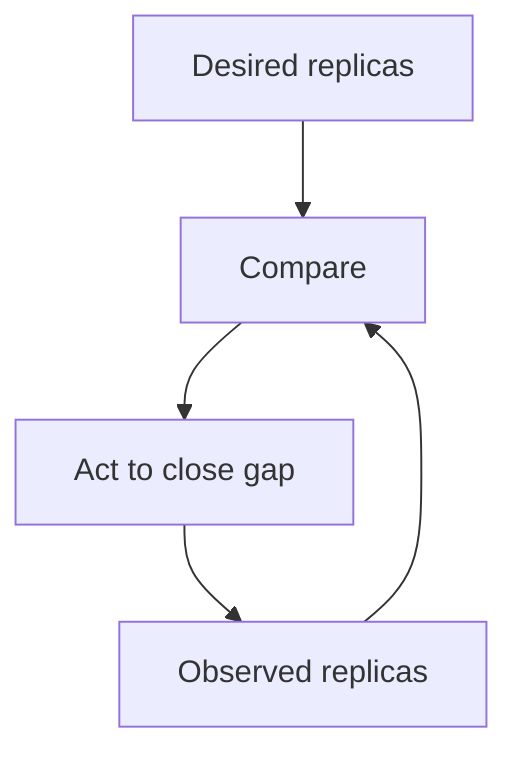

Kubernetes has a genuinely large API surface, and most of it is a
restatement of one core idea applied to a different resource: you declare
what you WANT, and a controller continuously works to make reality match it.
Understanding that one loop explains far more of Kubernetes's behavior than
memorizing its object types does.

> [!WHY] A client hardcodes a pod’s IP and loses its backend after a
> normal replacement. The orchestration system is keeping replicas
> healthy, but the caller bypassed the stable service boundary meant to
> survive that churn.

> [!GOALS]
>
> - Explain the desired-state control loop
> - Choose self-healing and stable discovery
> - Separate runtime configuration from image bytes

## The control loop: declarative, not imperative

```text
  IMPERATIVE     "start 3 containers, right now" — a one-time
                COMMAND

  DECLARATIVE      "there should ALWAYS be 3 replicas running"
                — a continuously ENFORCED DESIRED STATE
```

```text
  CONTROLLER LOOP, running forever:

    1. OBSERVE    what's the current actual state?
    2. DIFF        how does it differ from the desired state?
    3. ACT          take action to CLOSE the gap
    4. repeat, forever
```

```text
  → this single loop is EVERY Kubernetes controller — a
    Deployment controller ensures N pod replicas exist (if one
    crashes, it's NOT "handled" by an alert waking a human up;
    the controller notices the gap and starts a REPLACEMENT
    automatically, continuously, without anyone intervening); a
    Service controller ensures traffic routing rules match the
    current set of healthy pods; an autoscaler ensures replica
    count matches current load. same loop, different resource,
    different "desired state" being enforced.
```



## Pods: the actual unit of scheduling

```text
  a POD is ONE OR MORE containers that ALWAYS run TOGETHER, on
  the SAME machine, sharing a network namespace (they can reach
  each other via localhost) — it is the SMALLEST unit
  Kubernetes schedules, not an individual container.

  → a MULTI-CONTAINER pod (a "sidecar" pattern — a main
    application container plus a logging/proxy/init container)
    is for containers that are genuinely COUPLED and must be
    co-located — this is NOT the default; most pods run exactly
    one container, and a sidecar is a deliberate choice for a
    specific coupling need, not a general pattern to reach for.
```

## Deployments: managing pod replicas and rollouts

```text
  a DEPLOYMENT manages a set of IDENTICAL pod REPLICAS, and
  handles ROLLING UPDATES: replacing OLD pods with NEW ones
  gradually (a few at a time), rather than all at once —
  keeping the service available throughout the rollout.

  → this is the Zero-Downtime Migrations chapter's expand/
    contract discipline, at the DEPLOYMENT level rather than
    the schema level: old and new pod versions run
    SIMULTANEOUSLY during a rolling update, which is exactly
    why an application's API must stay backward-compatible
    across a deploy — some requests hit old pods, some hit new
    ones, for the DURATION of the rollout, not instantaneously.
```

## Services: stable networking for pods that come and go

```text
  pods are EPHEMERAL — they get killed and replaced constantly
  (a crash, a rolling update, a scale-down), and each new pod
  gets a NEW IP address. nothing else in the cluster can
  reliably reference a pod by its own IP.

  → a SERVICE provides a STABLE name/IP that automatically
    routes to whichever pods CURRENTLY match a label selector,
    regardless of how many times the underlying pods have been
    replaced — this is the actual mechanism behind Kubernetes's
    internal DNS-based service discovery: `http://my-service`
    always reaches SOME currently-healthy pod, even though the
    specific pod behind it changes constantly and
    unpredictably.
```

## ConfigMaps and Secrets

```text
  application config and secrets are kept OUT of the container
  IMAGE (which should be identical across dev/staging/
  production) and injected at RUNTIME instead — a ConfigMap
  for non-sensitive config, a Secret for sensitive values
  (though a base Kubernetes Secret is only base64-ENCODED, not
  ENCRYPTED, by default — a common, genuine misunderstanding;
  real encryption at rest needs an additional mechanism, like
  a cloud provider's secrets manager integration).

  → this is exactly the "same image, different config per
    environment" principle — the image is BUILT once and
    promoted through environments unchanged, with only the
    injected config differing, rather than rebuilding the
    image per environment.
```

## Autoscaling: the control loop applied to capacity

```text
  the Horizontal Pod Autoscaler is the SAME control loop again:
  desired state is "CPU usage should stay near target X%,"
  observed state is CURRENT CPU usage across pods, and the
  controller's action is adding or removing replicas to close
  the gap — continuously, automatically.

  → this is the Capacity Planning and Cost chapter's headroom
    discipline, automated: rather than a human provisioning for
    peak load and paying for idle capacity the rest of the
    time, the controller adjusts capacity to match ACTUAL
    demand, continuously.
```

## Why the learning curve is real

```text
  Kubernetes's genuine complexity is largely the SURFACE AREA
  of applying one loop to MANY different resources (Pods,
  Deployments, Services, Ingress, ConfigMaps, PersistentVolumes,
  and more) — each has its own YAML schema and its own specific
  desired-state semantics, even though the underlying MECHANISM
  (declare, observe, diff, act) is the same one loop, every
  time.
```

```text
  → this is exactly why understanding the LOOP first, before
    memorizing object schemas, makes the rest of Kubernetes's
    surface area far more learnable — a new resource type is
    "what state does THIS one enforce," not an entirely new
    concept to learn from scratch.
```

> [!PITFALL] A healthy replacement pod has a new identity; hardcoded old
> pod IPs bypass Service discovery and defeat ordinary self-healing.

> [!INTERVIEW] State the desired state, the controller responsible and the
> stable consumer interface before memorising object schemas.

> [!CHECK] Why put two containers in one pod deliberately?
>
> They are genuinely coupled and must be co-located, sharing the pod’s
> network namespace.

> [!CHECK] Why must API contracts tolerate old and new versions during a
> rolling update?
>
> Both pod versions can receive requests during rollout.

> [!CHECK] How is horizontal autoscaling another control loop?
>
> It observes load relative to a target and adjusts replica count to close
> that difference.

## What to take away

1. Nearly every Kubernetes controller is the same loop — observe current
   state, diff against desired state, act to close the gap, repeat forever
   — applied to a different kind of resource.
2. A pod, not a container, is the smallest scheduled unit; most pods run
   exactly one container, and a multi-container pod is a deliberate choice
   for genuinely coupled containers, not a default pattern.
3. A rolling update runs old and new pod versions simultaneously for the
   duration of the rollout, which is exactly why an API must stay
   backward-compatible across a deploy — the same discipline as a schema
   migration's expand/contract, applied at the deployment level.
4. A Service provides a stable name that automatically routes to whichever
   pods currently match, which is the actual mechanism behind Kubernetes's
   internal service discovery surviving constant pod replacement.
5. A default Kubernetes Secret is base64-encoded, not encrypted — a common,
   genuine misunderstanding that real encryption at rest needs an
   additional mechanism to actually provide.

## Exercises

> [!EXERCISE recall] How does a controller differ from a one-time start
> command?
>
> **Solution:** It repeatedly observes actual state, compares with
> declared desired state and acts to close the gap. A start command
> creates an immediate effect but does not by itself keep the desired
> replica count true after later failures.

> [!EXERCISE apply] A Deployment desires seven replicas and two crash,
> leaving five serving. A caller uses a failed pod’s IP. Choose the
> reconciliation and discovery mechanisms rather than adding a manual
> restart timer.
>
> **Solution:** The desired-state controller detects the gap and replaces
> the two missing replicas to work back toward seven. Route callers
> through a Service’s stable name and selector-based backend set rather
> than preserving the dead IP. A one-time restart timer neither expresses
> continuous desired state nor makes pod identity stable.

> [!EXERCISE stretch] A release builds separate images with credentials
> embedded for each environment. Recommend promotion and runtime
> configuration instead.
>
> **Solution:** Build the application image once and inject
> environment-specific configuration at runtime, separating non-sensitive
> config from secret handling. A weaker answer rebuilds the same source
> with credentials inside each image: promotion no longer uses identical
> bytes and sensitive environment data travels in artifacts. Do not treat
> base64 encoding of a Secret as evidence of encryption at rest.
