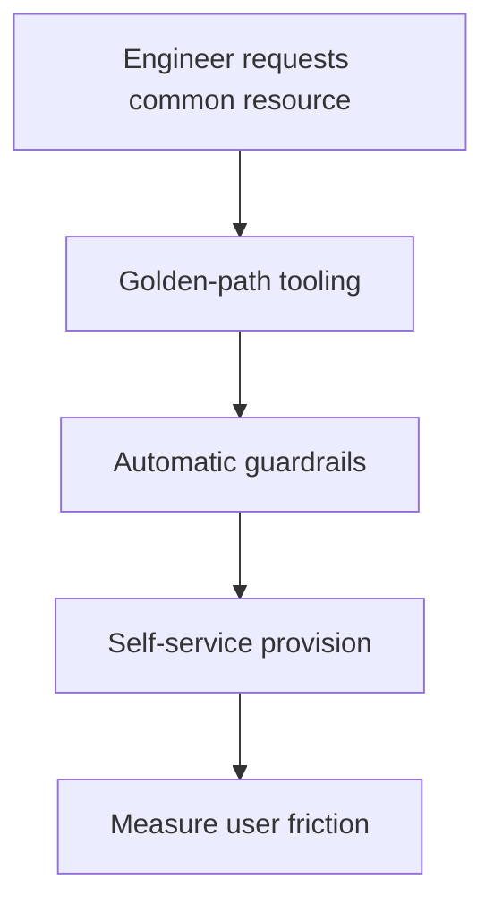

Every chapter in this track so far covered infrastructure from the outside —
how it works. Platform engineering is the discipline of treating that
infrastructure as a PRODUCT, with OTHER ENGINEERS as its users — and, like
any product, its quality is measured by whether those users can get their
actual work done, not by how sophisticated the underlying technology is.

> [!WHY] A new engineer waits on several tickets before a first
> deployment, while every team maintains a different setup. The platform’s
> sophistication matters little if common tasks repeatedly stop its actual
> users from shipping.

> [!GOALS]
>
> - Explain the golden-path contract
> - Compute repeated iteration waiting cost
> - Design self-service with enforced guardrails

## The golden path: one well-supported way to do the common thing

```text
  without a golden path: every team invents its OWN deployment
  setup, its own CI pipeline, its own way of provisioning a
  database — each one slightly different, each one a genuine
  maintenance burden, and each new engineer joining a team
  learns a DIFFERENT set of conventions than the engineer on
  the team next door.

  a GOLDEN PATH: ONE well-documented, well-supported, DEFAULT
  way to do the common thing (deploy a new service, provision a
  database, set up monitoring) — opinionated on PURPOSE.
```

```text
  → this is the "reviewable environments" idea from Infrastructure as Code,
    generalized past just infrastructure definitions to the ENTIRE workflow
    of building and shipping a service — a golden path doesn't PREVENT
    deviating from it for a genuinely unusual need, but it means the COMMON
    case (which is most cases) has a fast, well-supported, already-solved
    answer, rather than every team re-solving the same problem independently
    and inconsistently.
```

## Internal tooling as a product, with real users

```text
  → the discipline: an internal platform team should think
    about their INTERNAL USERS (other engineers) with the same
    seriousness a product team thinks about EXTERNAL customers
    — onboarding friction, documentation quality, and whether a
    common task is EASY or a multi-hour struggle are all real
    product-quality questions, not "just internal tooling, it
    doesn't matter as much."
```

```text
  → the concrete, measurable form this takes: how long does it
    take a NEW engineer to ship their FIRST change to
    production? this single number is a genuinely useful proxy
    for platform quality — a slow, confusing, undocumented path
    to a first deploy is real, ongoing FRICTION multiplied
    across every new hire, forever, not a one-time cost.
```

## Build times: a tax paid on every single iteration

```text
  a build/test cycle that takes 30 seconds vs. 10 minutes isn't
  a minor inconvenience — it's the difference between an
  engineer STAYING in flow (iterate, see the result, iterate
  again, all within their current train of thought) and
  CONTEXT-SWITCHING to something else while waiting (checking
  Slack, starting a different task) and having to mentally
  RELOAD the original problem when the build finally finishes.

  → this cost is paid MANY times per day, by EVERY engineer —
    a slow build isn't a one-time annoyance, it's a small
    tax multiplied by every iteration of every engineer's every
    working day, which compounds into a genuinely large amount
    of lost productive time across a team over a year.
```

## Self-service vs. ticket-based provisioning

```text
  TICKET-BASED      "file a request, a platform team member
                    manually provisions it" — the platform
                    team becomes a BOTTLENECK, and every
                    requesting team waits on THEIR availability

  SELF-SERVICE        an engineer provisions what they need
                    THEMSELVES, through tooling (a golden-path
                    template, an internal CLI/portal) that
                    encodes the platform team's best practices
                    WITHOUT needing them to do it by hand, every
                    time, for every request
```

```text
  → self-service doesn't mean "no guardrails" — the tooling
    itself ENFORCES the guardrails (default resource limits, a
    required tagging convention, mandatory security scanning)
    automatically, which is actually MORE consistent than a
    human manually reviewing every ticket, since automated
    enforcement doesn't have an off day or accidentally skip a
    step under time pressure.
```



## Measuring platform effectiveness

```text
  ✓  time to first production deploy for a new engineer
  ✓  build/deploy pipeline DURATION (and its VARIANCE — a
     pipeline that's usually fast but occasionally takes 3x as
     long is its own distinct problem from one that's
     consistently slow)
  ✓  how often engineers work AROUND the platform (a bypass,
     a manual workaround) rather than through it — this is a
     direct, honest signal that the golden path isn't actually
     serving a real need, however well-intentioned it was when
     built

  → these are real, MEASURABLE signals of whether the platform
    is actually SERVING its users — the same "measure, don't
    guess" discipline the Performance Engineering chapter
    applies to code, applied here to the team's own
    infrastructure experience instead.
```

> [!PITFALL] A portal without encoded limits and conventions changes the
> interface to provisioning, not the reliability of its guardrails.

> [!INTERVIEW] Treat developers as users: measure their first deploy,
> iteration delay and workarounds before judging a platform by its
> technology stack.

> [!CHECK] What onboarding metric is a useful platform signal?
>
> Time for a new engineer to make a first production deployment.

> [!CHECK] Why measure pipeline variance as well as typical duration?
>
> Occasional large delays create a different disruptive experience from a
> consistently predictable cycle.

> [!CHECK] What does frequent bypass of platform tooling suggest?
>
> The supported path may not serve a real user need; investigate the
> workaround rather than assuming the platform is effective.

## What to take away

1. A golden path is deliberately opinionated — one well-supported default
   way to do the common thing — which frees most teams from re-solving the
   same infrastructure problem independently and inconsistently.
2. Internal tooling deserves the same product-quality seriousness as
   external customer-facing tools — time-to-first-production-deploy for a
   new engineer is a genuinely useful, measurable proxy for platform
   quality.
3. A slow build/test cycle isn't a minor inconvenience — it breaks flow and
   forces a context-switch-and-reload cost, paid many times a day, by every
   engineer, compounding across a team's whole year.
4. Self-service provisioning with automated guardrails is actually more
   consistent than ticket-based manual review, since automation doesn't
   skip a step under time pressure the way a rushed human can.
5. How often engineers bypass the platform to work around it is a direct,
   honest signal of whether a golden path is actually serving a real need —
   measure platform effectiveness the same way performance work measures
   code, rather than assuming it.

## Exercises

> [!EXERCISE recall] What makes a golden path opinionated without
> requiring that every unusual workload fit it?
>
> **Solution:** It gives the common case one documented, supported
> default, avoiding independent reinvention. Genuinely unusual needs can
> deviate deliberately; the value is fast reliable support for ordinary
> work rather than prohibition of every alternative.

> [!EXERCISE apply] Twelve engineers each run eighteen build/test cycles
> daily. A shared improvement reduces each cycle from eight minutes to
> one. Compute raw waiting time avoided and explain why that informs
> prioritisation without claiming all of it becomes productive coding
> time.
>
> **Solution:** There are 12 × 18 = 216 cycles. Each saves 8 − 1 = 7
> minutes, for 216 × 7 = 1512 minutes, or 25.2 engineer-hours of raw
> waiting per day. This makes the repeated tax visible when prioritising a
> shared pipeline improvement. Actual productivity also depends on context
> switching and overlap, so the arithmetic is not a promise of 25.2 extra
> coding hours.

> [!EXERCISE stretch] A platform proposal replaces provisioning tickets
> with a portal but removes limits and required tags for convenience.
> Recommend a genuine self-service design.
>
> **Solution:** Encode resource limits, tagging and security checks in the
> supported tooling so users can provision the common case without manual
> platform intervention. A weaker answer removes those guardrails and
> calls the absence of tickets success: the chapter’s self-service model
> moves consistent enforcement into automation rather than discarding it.
