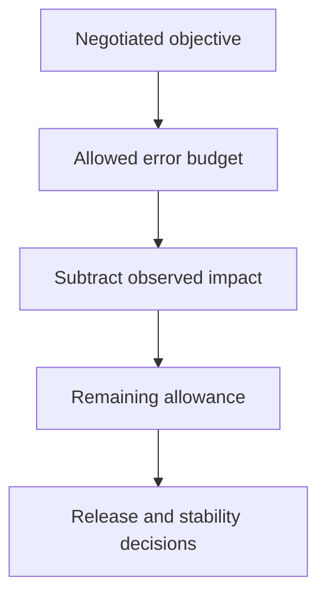

"Make the system more reliable" is not an actionable goal — reliable
COMPARED TO WHAT, and reliable AT WHAT COST? SLIs, SLOs, and error budgets
exist to turn that vague aspiration into a specific, measured, negotiated
number that both engineering and the business can actually make decisions
against.

> [!WHY] A service has spent nearly all its reliability allowance, but a
> rollout decision is still argued only as move fast versus be careful. An
> explicit remaining budget makes the trade measurable rather than a
> contest of instincts.

> [!GOALS]
>
> - Explain indicator, objective and agreement
> - Compute an error budget and remaining allowance
> - Choose alerts from user impact

## SLI, SLO, SLA: three related, genuinely different things

```text
  SLI (Indicator)   a MEASURED metric — "99.95% of requests
                    in the last 30 days returned in under
                    200ms" — a FACT about actual behavior

  SLO (Objective)     a TARGET for that metric — "99.9% of
                    requests should return in under 200ms" —
                    an internal GOAL the team is accountable to

  SLA (Agreement)      a CONTRACTUAL promise to a CUSTOMER,
                    usually with a financial penalty for
                    missing it — typically set LOOSER than the
                    internal SLO, deliberately, so there's
                    margin before a missed internal target
                    becomes an actual contractual/financial
                    problem
```

```text
  → confusing these matters in practice: treating an SLA (the
    customer-facing contractual floor) as the team's actual
    target means you're already in contractual violation
    territory by the time anyone notices a problem — the SLO
    exists specifically to catch degradation BEFORE it reaches
    that point.
```

## The error budget: reliability as a spendable resource

```text
  SLO: 99.9% uptime per month
  → ALLOWED downtime: 0.1% of a month ≈ 43 minutes

  → this 43 minutes is the ERROR BUDGET — reliability EXPRESSED
    as something that can be SPENT, not an abstract aspiration
    to "be reliable." every minute of downtime (a bug, a
    deploy that breaks something, a dependency's own outage)
    SPENDS budget from this same pool.
```

```text
  → the genuinely powerful reframe this enables: BUDGET
    REMAINING becomes a real, legitimate input to a decision
    that used to be argued qualitatively and inconclusively
    ("are we being too cautious/reckless with releases?") —
    budget largely UNSPENT this month → the team can reasonably
    ship a riskier, more ambitious change; budget nearly
    EXHAUSTED → the team should slow down, prioritize
    stability work, and defer risky changes until the budget
    resets — a data-driven answer to a question that otherwise
    stays a permanent, unresolved argument between "move fast"
    and "be careful."
```



## Alerting on symptoms, not causes

```text
  ✗  alert on: "CPU usage > 80%" — is this even a PROBLEM? maybe it's fine,
     maybe the system is about to fall over — the metric alone doesn't say

  ✓  alert on: "error rate > 1%" or "p99 latency > 500ms" — this is a
     USER-FACING symptom — something is ACTUALLY wrong for a real user
     right now
```

```text
  → this is the Observability chapter's "answer the real
    question" discipline, applied specifically to alerting: a
    CAUSE-based alert (high CPU, high memory, a specific
    internal metric) can fire constantly for conditions that
    AREN'T actually problems (a system genuinely handling load
    fine at 85% CPU), producing ALERT FATIGUE — engineers
    learning to ignore or silence alerts because most of them
    turn out not to matter, which is exactly how the ONE real
    alert gets missed among the noise. a SYMPTOM-based alert
    ("users are actually experiencing errors right now") is
    what should page someone; the CAUSE is what you investigate
    AFTER being paged, not what triggers the page itself.
```

## Toil: work worth measuring, specifically so it can be reduced

```text
  TOIL: manual, repetitive, operational work that scales
  LINEARLY with system size/traffic and provides NO lasting
  engineering value once done (restarting a stuck service by
  hand, manually running the same routine cleanup script every
  week).

  → toil is explicitly NOT "any operational work" — it's
    specifically work that's repetitive AND doesn't reduce
    FUTURE toil by being done — writing an AUTOMATION script
    that eliminates a recurring manual task IS valuable
    engineering work; manually doing that SAME task by hand,
    every single week, forever, is toil.
```

```text
  → MEASURING toil (tracking what fraction of a team's time
    goes to it) is what makes REDUCING it an actual, visible,
    prioritizable engineering goal — rather than invisible
    background load that consumes real capacity while never
    explicitly competing for priority against a team's other,
    more visible work.
```

## Reliability as an explicit, negotiated trade-off

```text
  100% reliability is NOT the goal — it's neither achievable
  in any real system, nor economically sensible even if it
  somehow were: the LAST fraction of a percent of reliability
  costs disproportionately MORE than the fractions before it
  (this is directly the Capacity Planning and Cost chapter's
  diminishing-returns shape, applied to reliability
  specifically), for genuinely diminishing real-world benefit.
```

```text
  → the error budget makes this trade EXPLICIT and NEGOTIATED,
    rather than an unstated assumption everyone interprets
    differently: "99.9%, not 99.99%" is a real, deliberate
    decision about how much reliability investment is actually
    worth it for THIS specific system, made once and revisited
    periodically — not a permanent, unexamined default nobody
    consciously chose.
```

> [!PITFALL] An internal resource threshold alone does not establish user
> harm; repeated noisy pages can hide the real incident.

> [!INTERVIEW] State the measurement window, objective and remaining
> budget, then separate paging symptoms from the causes you will
> investigate.

> [!CHECK] Do dependency outages consume a service’s uptime budget?
>
> Yes. User-visible downtime consumes the same allowance regardless of
> whether its cause was an internal deploy or a dependency.

> [!CHECK] What separates toil from lasting engineering work?
>
> Toil repeats manually without reducing future effort; building
> automation that removes that repetition creates lasting value.

> [!CHECK] Why is absolute reliability not a sensible universal investment
> target?
>
> The final fractions of reliability cost disproportionately more, so a
> negotiated objective makes the benefit-versus-cost decision explicit.

## What to take away

1. An SLI is a measured fact, an SLO is an internal target, and an SLA is a
   looser contractual promise to a customer — confusing the SLO with the
   SLA means you're already in contractual-violation territory by the time
   anyone notices degradation.
2. An error budget turns reliability into a spendable resource — budget
   remaining becomes a real, data-driven input to the otherwise permanently
   unresolved "move fast vs be careful" argument.
3. Alert on user-facing symptoms (error rate, latency), not internal causes
   (CPU, memory) — cause-based alerting produces alert fatigue that
   eventually buries the one alert that actually matters.
4. Toil is specifically repetitive work that provides no lasting value once
   done — measuring it is what makes reducing it an explicit, prioritizable
   engineering goal instead of invisible background load.
5. 100% reliability isn't the goal — the last fraction of a percent costs
   disproportionately more for diminishing benefit, and an error budget
   makes that trade-off explicit and negotiated rather than an unexamined
   default.

## Exercises

> [!EXERCISE recall] How do SLI, SLO and SLA differ in what each statement
> represents?
>
> **Solution:** An SLI measures actual behaviour, an SLO sets the team’s
> internal objective for that indicator, and an SLA makes a
> customer-facing contractual promise, often looser than the internal
> target to preserve margin.

> [!EXERCISE apply] For a fixed 30-day window, the uptime SLO is 99.95%.
> Incidents used eight minutes and 6.5 minutes. Compute allowed downtime
> and remaining budget; decide whether another ten-minute outage would
> fit.
>
> **Solution:** The window has 30 × 24 × 60 = 43200 minutes. Allowed
> downtime is 0.05% × 43200 = 0.0005 × 43200 = 21.6 minutes. Spent time is
> 8 + 6.5 = 14.5, leaving 21.6 − 14.5 = 7.1 minutes. Another ten minutes
> would exceed that by 2.9 minutes, so it does not fit the stated
> remaining allowance.

> [!EXERCISE stretch] An on-call rotation is paged for high CPU while
> requests remain healthy and begins ignoring alarms. Recommend an
> alerting policy.
>
> **Solution:** Page on meaningful user-facing error or latency symptoms
> and use internal CPU or memory evidence to investigate causes after
> detection. A weaker answer lowers the CPU threshold so it pages even
> more often: it amplifies noise without establishing user impact.
> Symptom-based signals preserve attention for failures the response must
> actually mitigate.
