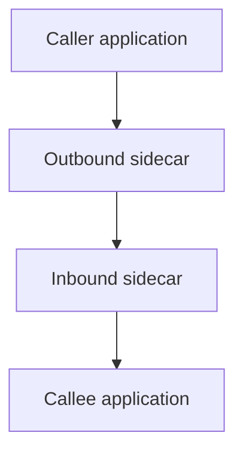

A microservices architecture multiplies a specific class of problem: every
service needs retries, timeouts, encryption, and observability on every call
it makes to every other service. Implementing all of that inside every
service's own code, in every language a team uses, doesn't scale — a
gateway and a mesh exist to move it somewhere shared instead.

> [!WHY] A service mesh standardises encryption and retries but adds proxy
> work to every internal hop. A small system can pay both latency and
> operating cost before its duplicated service concerns are large enough
> to justify the new layer.

> [!GOALS]
>
> - Explain mutual service authentication
> - Compute proxy overhead on a call path
> - Design a reliable gateway boundary

## API gateways: one front door

```text
  client → API GATEWAY → [service A, service B, service C, ...]

  → the gateway sits at the EDGE, in front of every internal
    service, and centralizes concerns that would otherwise be
    duplicated in every service: authentication, rate limiting
    (the Rate Limiting and Resilience chapter's machinery, at
    the CLUSTER'S front door rather than per-service), request
    routing, and often API versioning — a client talks to ONE
    endpoint, and the gateway routes internally to whichever
    service actually handles the request.
```

```text
  → this is a REAL single point of failure/bottleneck if built
    carelessly — every request passes through it, so the
    gateway itself needs the same reliability engineering
    (redundancy, no single instance) as anything else critical,
    and its own latency overhead is added to EVERY request in
    the system, not just some of them.
```

## The sidecar pattern: infrastructure as a co-located proxy

```text
  the Kubernetes and Orchestration chapter's pod model already
  covers WHY this works: a SIDECAR is a second container in the
  SAME pod as your application, INTERCEPTING all its network
  traffic — your application code talks to localhost, and the
  sidecar handles the ACTUAL network call, transparently adding
  retries, encryption, and observability WITHOUT your
  application code knowing or caring.

  → this is exactly why a service mesh doesn't require
    rewriting application code in every language a team uses —
    the sidecar is LANGUAGE-AGNOSTIC infrastructure, sitting
    OUTSIDE the application entirely; a Python service and a Go
    service get the identical mesh behavior for free, with zero
    mesh-specific code in either one.
```



## mTLS: mutual authentication between services

```text
  ordinary TLS: the CLIENT verifies the SERVER's identity
                (the Practical Networking chapter's certificate
                chain) — the server doesn't verify who's
                calling it

  mTLS (mutual TLS): BOTH sides present and verify a
                certificate — the server ALSO verifies the
                CLIENT's identity, not just encrypting the
                connection
```

```text
  → a service mesh commonly enforces mTLS between EVERY
    service automatically (via the sidecars, transparently) —
    which means every internal service-to-service call is BOTH
    encrypted AND mutually authenticated, without a single line
    of application code implementing either — this is
    genuinely different from "the network is internal, so it
    doesn't need encryption," a real and dangerous assumption a
    mesh removes the need to make (an attacker who's already
    breached the internal network can't simply eavesdrop or
    impersonate a service, because every connection requires a
    valid certificate on BOTH ends).
```

## Traffic management: shifting traffic without touching application code

```text
  a service mesh's sidecars ALREADY intercept every request —
  which means TRAFFIC SHIFTING (the CI/CD chapter's canary
  releases, at the SERVICE-MESH layer) becomes a MESH
  CONFIGURATION change, not an application code change: "route
  5% of traffic to service-v2" is a rule the sidecars enforce,
  with the application itself completely unaware any traffic
  splitting is happening.
```

```text
  → this is the SAME cross-cutting-concern-out-of-application-code idea
    running through the whole chapter — canary rollout logic, retry logic,
    mTLS, and observability all move OUT of every individual service's code
    and INTO the shared infrastructure layer, once, rather than being
    reimplemented (and potentially reimplemented inconsistently) in
    every service.
```

## The real cost: complexity and latency, paid on every call

```text
  a service mesh is NOT free — every request now passes through
  AT LEAST two sidecars (the caller's outbound proxy, the
  callee's inbound proxy) instead of going DIRECTLY between
  services, adding real, measurable latency PER HOP — and the
  mesh's control plane itself is another distributed system
  that needs to be operated, monitored, and can itself fail.
```

```text
  → this is precisely why a service mesh is usually adopted at a SPECIFIC
    scale of complexity (many services, many teams, genuinely needing the
    consistency a shared layer provides) rather than by default — for a
    handful of services, the OPERATIONAL overhead of running a mesh can
    exceed the benefit it provides, the same "don't add microservices-style
    boundaries without a real reason" judgment the Services and Modular
    Monoliths chapter applies one level up.
```

> [!PITFALL] Consistent mesh policy does not make the gateway redundant or
> remove proxy latency from the call path.

> [!INTERVIEW] Identify which concern belongs at the edge or between
> services, then account for both per-hop latency and control-plane
> operations.

> [!CHECK] Why can the sidecar model work across application languages?
>
> The co-located proxy handles network concerns outside the
> language-specific application implementation.

> [!CHECK] How can a mesh perform a canary shift?
>
> Change traffic policy configuration enforced by the proxies rather than
> adding rollout branches to every service.

> [!CHECK] What operational system accompanies the proxy data path?
>
> The mesh control plane must itself be operated, monitored and handled as
> another system that can fail.

## What to take away

1. An API gateway centralizes edge concerns (auth, rate limiting, routing)
   that would otherwise be duplicated in every service, but it's also a
   real single point of failure and latency addition that needs its own
   reliability engineering.
2. A sidecar intercepts a pod's network traffic transparently, which is
   exactly why a service mesh works across every language a team uses with
   zero mesh-specific application code.
3. mTLS has both sides verify each other's identity, not just encrypting
   the connection — a mesh enforcing it removes the dangerous "the internal
   network doesn't need encryption" assumption.
4. Traffic shifting (canary rollouts) becomes a mesh configuration change
   rather than application code, because the sidecars already intercept
   every request — the same cross-cutting-concern-out-of-code idea that
   also applies to retries and observability.
5. A service mesh adds real per-hop latency and its own operational
   complexity — it's usually adopted at a specific scale of genuine need,
   not by default, the same judgment that governs adding any service
   boundary.

## Exercises

> [!EXERCISE recall] How does mTLS differ from ordinary
> server-authenticated TLS?
>
> **Solution:** Both endpoints present and verify certificates in mTLS,
> establishing the caller’s identity as well as the server’s. Encryption
> alone is not the same as mutual identity verification.

> [!EXERCISE apply] A sequential request path makes three internal calls.
> Each adds an outbound and inbound sidecar costing 0.6 ms each; the
> unmeshed path is 18 ms and the budget is 20 ms. Compute the meshed path
> and evaluate adoption solely for code neatness.
>
> **Solution:** There are 3 × 2 = 6 proxy passages, adding 6 × 0.6 = 3.6
> ms. Total is 18 + 3.6 = 21.6 ms, exceeding the budget by 1.6 ms under
> the assumptions. Do not justify adoption only as cleaner code: assess
> whether shared policy consistency at the actual service/team scale
> warrants the latency and operating cost, and address the budget
> explicitly.

> [!EXERCISE stretch] All external requests pass through one gateway
> instance, and a team assumes adding a mesh removes the availability
> risk. Recommend an edge design.
>
> **Solution:** Provide gateway redundancy and monitor its own health and
> latency because it remains on every external request path. A weaker
> answer keeps the single gateway instance and relies on internal
> sidecars: they do not create another working front door when that
> instance fails. Shared cross-cutting policy and gateway availability are
> separate requirements.
